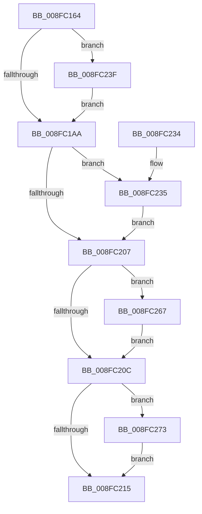

# PnpCallAddDevice

- RVA: `0x008FC164`–`0x008FC28B` (길이 `295` bytes)
- VA: `0x00000001408FC164`
- 실행 섹션: `PAGE`
- PDB 이름 있음: `예`; PDB Function 태그: `아니요`
- unwind 정보 RVA: `0x00087F4C`
- 디코드: `78`개 명령, `295/295` bytes 표시
- 미해석 바이트: `0` (있으면 어셈블리에 `.byte`로 보존)

> 이 문서는 커널 이미지의 기계어와 PDB 기호를 분석해 생성했습니다. 4번과 5번은 함수 원형과 자료형을 바이너리 사용 방식에서 추정한 C 해석이며 원본 소스 복구 결과는 아닙니다.

## 1. Dependencies

- 직접 호출 지점: **8**; 고유 호출 대상: **8**
- 직접 호출자로 확인된 함수: **1**
- RIP 상대 이미지 참조: **4**

### Outgoing calls
- `0x008FC1B3` → [PnpSetDeviceAffinityThread](../../text/27/PnpSetDeviceAffinityThread_function_00271EA4.md) (function, `0x00271EA4`)
- `0x008FC1E5` → [PnpEnableWatchdog](PnpEnableWatchdog_function_008FB5C8.md) (function, `0x008FB5C8`)
- `0x008FC1FB` → [PpvUtilCallAddDevice](../../text/4B/PpvUtilCallAddDevice_function_004B3B40.md) (function, `0x004B3B40`)
- `0x008FC21F` → [_security_check_cookie](../../text/6A/_security_check_cookie_function_006AC640.md) (function, `0x006AC640`)
- `0x008FC238` → [PnpDisableWatchdog](../95/PnpDisableWatchdog_function_00955B00.md) (function, `0x00955B00`)
- `0x008FC25D` → [McTemplateK0qhzr1z_EtwWriteTransfer](../../text/5A/McTemplateK0qhzr1z_EtwWriteTransfer_function_005A6CDC.md) (function, `0x005A6CDC`)
- `0x008FC26C` → [KeRevertToUserGroupAffinityThread](../../text/39/KeRevertToUserGroupAffinityThread_function_00398EC0.md) (function, `0x00398EC0`)
- `0x008FC284` → [McTemplateK0q_EtwWriteTransfer](../../text/59/McTemplateK0q_EtwWriteTransfer_function_00596B68.md) (function, `0x00596B68`)

### Direct callers
- [PipCallDriverAddDevice](../A2/PipCallDriverAddDevice_function_00A272E0.md) at `0x00A27705`

### Static image references
- `0x008FC174` → RVA `0x00E0A740` (`.data`; read)
- `0x008FC18C` → RVA `0x00EF012B` (`.data`; read)
- `0x008FC276` → RVA `0x000270A0` (`.rdata`; read)
- `0x008FC27D` → RVA `0x00E06DA0` (`.data`; read)

## 2. Other-region calls and transfers

- 다른 실행 섹션으로 향하는 call: **6**
  - `0x008FC1B3` → [PnpSetDeviceAffinityThread](../../text/27/PnpSetDeviceAffinityThread_function_00271EA4.md) (`PAGE` → `.text`)
  - `0x008FC1FB` → [PpvUtilCallAddDevice](../../text/4B/PpvUtilCallAddDevice_function_004B3B40.md) (`PAGE` → `.text`)
  - `0x008FC21F` → [_security_check_cookie](../../text/6A/_security_check_cookie_function_006AC640.md) (`PAGE` → `.text`)
  - `0x008FC25D` → [McTemplateK0qhzr1z_EtwWriteTransfer](../../text/5A/McTemplateK0qhzr1z_EtwWriteTransfer_function_005A6CDC.md) (`PAGE` → `.text`)
  - `0x008FC26C` → [KeRevertToUserGroupAffinityThread](../../text/39/KeRevertToUserGroupAffinityThread_function_00398EC0.md) (`PAGE` → `.text`)
  - `0x008FC284` → [McTemplateK0q_EtwWriteTransfer](../../text/59/McTemplateK0q_EtwWriteTransfer_function_00596B68.md) (`PAGE` → `.text`)
- 별도 외부 분기/꼬리 이동을 확인하지 못했습니다.

## 3. Assembly (complete function range)

```asm
008FC164  40 53                           push rbx
008FC166  55                              push rbp
008FC167  56                              push rsi
008FC168  57                              push rdi
008FC169  41 56                           push r14
008FC16B  41 57                           push r15
008FC16D  48 81 EC 88 00 00 00            sub rsp, 0x88
008FC174  48 8B 05 C5 E5 50 00            mov rax, qword ptr [rip + 0x50e5c5]
008FC17B  48 33 C4                        xor rax, rsp
008FC17E  48 89 44 24 70                  mov qword ptr [rsp + 0x70], rax
008FC183  48 83 64 24 40 00               and qword ptr [rsp + 0x40], 0
008FC189  0F 57 C0                        xorps xmm0, xmm0
008FC18C  F6 05 98 3F 5F 00 10            test byte ptr [rip + 0x5f3f98], 0x10
008FC193  41 8B F1                        mov esi, r9d
008FC196  4D 8B F8                        mov r15, r8
008FC199  48 8B DA                        mov rbx, rdx
008FC19C  48 8B F9                        mov rdi, rcx
008FC19F  0F 11 44 24 60                  movups xmmword ptr [rsp + 0x60], xmm0
008FC1A4  0F 85 95 00 00 00               jne 0x1408fc23f
008FC1AA  48 8B 4F 20                     mov rcx, qword ptr [rdi + 0x20]
008FC1AE  48 8D 54 24 60                  lea rdx, [rsp + 0x60]
008FC1B3  E8 EC 5C 97 FF                  call 0x140271ea4
008FC1B8  48 89 7C 24 48                  mov qword ptr [rsp + 0x48], rdi
008FC1BD  48 8D 54 24 40                  lea rdx, [rsp + 0x40]
008FC1C2  48 89 5C 24 50                  mov qword ptr [rsp + 0x50], rbx
008FC1C7  44 8B F0                        mov r14d, eax
008FC1CA  65 48 8B 0C 25 88 01 00 00      mov rcx, qword ptr gs:[0x188]
008FC1D3  4C 8B 43 30                     mov r8, qword ptr [rbx + 0x30]
008FC1D7  48 89 4C 24 58                  mov qword ptr [rsp + 0x58], rcx
008FC1DC  49 83 C0 18                     add r8, 0x18
008FC1E0  B9 04 00 00 00                  mov ecx, 4
008FC1E5  E8 DE F3 FF FF                  call 0x1408fb5c8
008FC1EA  48 8B 4F 20                     mov rcx, qword ptr [rdi + 0x20]
008FC1EE  44 8D 4E 01                     lea r9d, [rsi + 1]
008FC1F2  4D 8B C7                        mov r8, r15
008FC1F5  48 8B D3                        mov rdx, rbx
008FC1F8  48 8B E8                        mov rbp, rax
008FC1FB  E8 40 79 BB FF                  call 0x1404b3b40
008FC200  8B D8                           mov ebx, eax
008FC202  48 85 ED                        test rbp, rbp
008FC205  75 2E                           jne 0x1408fc235
008FC207  45 85 F6                        test r14d, r14d
008FC20A  75 5B                           jne 0x1408fc267
008FC20C  F6 05 18 3F 5F 00 10            test byte ptr [rip + 0x5f3f18], 0x10
008FC213  75 5E                           jne 0x1408fc273
008FC215  8B C3                           mov eax, ebx
008FC217  48 8B 4C 24 70                  mov rcx, qword ptr [rsp + 0x70]
008FC21C  48 33 CC                        xor rcx, rsp
008FC21F  E8 1C 04 DB FF                  call 0x1406ac640
008FC224  48 81 C4 88 00 00 00            add rsp, 0x88
008FC22B  41 5F                           pop r15
008FC22D  41 5E                           pop r14
008FC22F  5F                              pop rdi
008FC230  5E                              pop rsi
008FC231  5D                              pop rbp
008FC232  5B                              pop rbx
008FC233  C3                              ret
008FC234  CC                              int3
008FC235  48 8B CD                        mov rcx, rbp
008FC238  E8 C3 98 05 00                  call 0x140955b00
008FC23D  EB C8                           jmp 0x1408fc207
008FC23F  48 8B 47 30                     mov rax, qword ptr [rdi + 0x30]
008FC243  0F B7 4A 38                     movzx ecx, word ptr [rdx + 0x38]
008FC247  48 89 44 24 30                  mov qword ptr [rsp + 0x30], rax
008FC24C  48 8B 42 40                     mov rax, qword ptr [rdx + 0x40]
008FC250  66 D1 E9                        shr cx, 1
008FC253  48 89 44 24 28                  mov qword ptr [rsp + 0x28], rax
008FC258  66 89 4C 24 20                  mov word ptr [rsp + 0x20], cx
008FC25D  E8 7A AA CA FF                  call 0x1405a6cdc
008FC262  E9 43 FF FF FF                  jmp 0x1408fc1aa
008FC267  48 8D 4C 24 60                  lea rcx, [rsp + 0x60]
008FC26C  E8 4F CC A9 FF                  call 0x140398ec0
008FC271  EB 99                           jmp 0x1408fc20c
008FC273  44 8B CB                        mov r9d, ebx
008FC276  48 8D 15 23 AE 72 FF            lea rdx, [rip - 0x8d51dd]
008FC27D  48 8D 0D 1C AB 50 00            lea rcx, [rip + 0x50ab1c]
008FC284  E8 DF A8 C9 FF                  call 0x140596b68
008FC289  EB 8A                           jmp 0x1408fc215
```

## 4. C-style interpretation (structured pseudocode)

```c
__int64 __fastcall PnpCallAddDevice(__int64 a1, __int64 a2, __int64 a3, int a4)
{
    __int64 result;
    __int64 v_rsp;
    unsigned __int64 v_stack_m48;
    unsigned __int64 v_stack_m58;
    unsigned __int64 v_stack_m60;
    unsigned __int64 v_stack_m68;
    unsigned __int64 v_stack_m70;
    unsigned __int64 v_stack_m78;
    unsigned __int16 v_stack_p20;
    unsigned __int64 v_stack_p28;
    unsigned __int64 v_stack_p30;
    unsigned __int64 v_stack_p60;

    v_rsp = (v_rsp) - (136);
    result = (*(unsigned __int64 *)(v_rip + 5301701)) ^ (v_rsp);
    v_stack_m48 = result;
    v_stack_m58 = v_xmm0;
    if (((*(unsigned __int8 *)(v_rip + 6242200)) & (16)) != 0) goto loc_008FC23F;
loc_008FC1AA:
    result = PnpSetDeviceAffinityThread(*(unsigned __int64 *)(a1 + 32), v_stack_m58, a3, a4);
    v_stack_m70 = a1;
    v_stack_m68 = a2;
    v_stack_m60 = *(unsigned __int64 *)(gs_base + (0 + 392));
    a3 = (*(unsigned __int64 *)(a2 + 48)) + (24);
    result = PnpEnableWatchdog(4, v_stack_m78, a3, a4);
    result = PpvUtilCallAddDevice(*(unsigned __int64 *)(a1 + 32), a2, a3, (unsigned int)(a4) + 1);
    if (result != 0) goto loc_008FC235;
loc_008FC207:
    if ((unsigned int)((unsigned int)((unsigned int)(result))) != 0) goto loc_008FC267;
loc_008FC20C:
    if (((*(unsigned __int8 *)(v_rip + 6242072)) & (16)) != 0) goto loc_008FC273;
loc_008FC215:
    a1 = (v_stack_m48) ^ (v_rsp);
    result = _security_check_cookie(a1, a2, a3, (unsigned int)(a4) + 1);
    v_rsp = (v_rsp) + (136);
    return result;
loc_008FC235:
    result = PnpDisableWatchdog(result, a2, a3, (unsigned int)(a4) + 1);
    goto loc_008FC207;
loc_008FC23F:
    v_stack_p30 = *(unsigned __int64 *)(a1 + 48);
    a1 = (unsigned __int16)((*(unsigned __int16 *)(a2 + 56)) >> (1));
    v_stack_p28 = *(unsigned __int64 *)(a2 + 64);
    v_stack_p20 = (unsigned __int16)(a1);
    result = McTemplateK0qhzr1z_EtwWriteTransfer(a1, a2, a3, (unsigned int)(a4) + 1);
    goto loc_008FC1AA;
loc_008FC267:
    result = KeRevertToUserGroupAffinityThread(v_stack_p60, a2, a3, (unsigned int)(a4) + 1);
    goto loc_008FC20C;
loc_008FC273:
    result = McTemplateK0q_EtwWriteTransfer(v_rip + 5286684, v_rip - 9261533, a3, (unsigned int)((unsigned int)((unsigned int)((unsigned int)(result)))));
    goto loc_008FC215;
}
```

## 5. (Beta) C Style

```c
int64_t PnpCallAddDevice(void *Arg1, void *Arg2, int64_t Arg3, void *Arg4)
{
    uint8_t *arg1 = (uint8_t *)Arg1;
    uint8_t *arg2 = (uint8_t *)Arg2;
    uint8_t *arg4 = (uint8_t *)Arg4;

    int64_t result;
    int64_t local_rsp;
    uint64_t v_stack_m48;
    uint64_t v_stack_m58;
    uint64_t v_stack_m60;
    uint64_t v_stack_m68;
    uint64_t v_stack_m70;
    uint64_t v_stack_m78;
    uint16_t v_stack_p20;
    uint64_t v_stack_p28;
    uint64_t v_stack_p30;
    uint64_t v_stack_p60;

    local_rsp = (local_rsp) - (136);
    result = (*(uint64_t *)(v_rip + 0x50E5C5)) ^ (local_rsp);
    v_stack_m48 = result;
    v_stack_m58 = v_xmm0;
    if (((*(uint8_t *)(v_rip + 0x5F3F98)) & (16)) != 0) goto loc_008FC23F;
loc_008FC1AA:
    result = PnpSetDeviceAffinityThread(*(uint64_t *)(arg1 + 0x20), v_stack_m58, Arg3, Arg4);
    v_stack_m70 = Arg1;
    v_stack_m68 = Arg2;
    v_stack_m60 = *(uint64_t *)(gs_base + (0 + 0x188));
    Arg3 = (*(uint64_t *)(arg2 + 0x30)) + (24);
    result = PnpEnableWatchdog(4, v_stack_m78, Arg3, Arg4);
    result = PpvUtilCallAddDevice(*(uint64_t *)(arg1 + 0x20), Arg2, Arg3, (uint32_t)(Arg4) + 1);
    if (result != 0) goto loc_008FC235;
loc_008FC207:
    if ((uint32_t)((uint32_t)((uint32_t)(result))) != 0) goto loc_008FC267;
loc_008FC20C:
    if (((*(uint8_t *)(v_rip + 0x5F3F18)) & (16)) != 0) goto loc_008FC273;
loc_008FC215:
    Arg1 = (v_stack_m48) ^ (local_rsp);
    result = _security_check_cookie(Arg1, Arg2, Arg3, (uint32_t)(Arg4) + 1);
    local_rsp = (local_rsp) + (136);
    return result;
loc_008FC235:
    result = PnpDisableWatchdog(result, Arg2, Arg3, (uint32_t)(Arg4) + 1);
    goto loc_008FC207;
loc_008FC23F:
    v_stack_p30 = *(uint64_t *)(arg1 + 0x30);
    Arg1 = (uint16_t)((*(uint16_t *)(arg2 + 0x38)) >> (1));
    v_stack_p28 = *(uint64_t *)(arg2 + 0x40);
    v_stack_p20 = (uint16_t)(Arg1);
    result = McTemplateK0qhzr1z_EtwWriteTransfer(Arg1, Arg2, Arg3, (uint32_t)(Arg4) + 1);
    goto loc_008FC1AA;
loc_008FC267:
    result = KeRevertToUserGroupAffinityThread(v_stack_p60, Arg2, Arg3, (uint32_t)(Arg4) + 1);
    goto loc_008FC20C;
loc_008FC273:
    result = McTemplateK0q_EtwWriteTransfer(v_rip + 5286684, v_rip - 9261533, Arg3, (uint32_t)((uint32_t)((uint32_t)((uint32_t)(result)))));
    goto loc_008FC215;
}
```

### 관측된 메모리 오프셋

구조체 형식이 확인되지 않은 접근은 인자 기준의 오프셋으로만 기록했습니다.

| 기준 인자 | 오프셋 표현 | 폭 (bit) | 접근 |
|---|---:|---:|---|
| `Arg1` | `+ 0x20` | `64` | `R` |
| `Arg1` | `+ 0x30` | `64` | `R` |
| `Arg2` | `+ 0x30` | `64` | `R` |
| `Arg2` | `+ 0x38` | `16` | `R` |
| `Arg2` | `+ 0x40` | `64` | `R` |
| `Arg4` | `+ 0x1` | `32` | `R` |

## 6. Execution-region graph

[열기: 2D/3D 그래프와 함수 탐색 컨트롤 패널](../../../control-panel.html?section=page&rva=0x008FC164&view=graph)

- 2D 그래프는 위에서 아래로 흐르고, 3D 그래프는 빈 공간을 드래그해 회전합니다. Shift+드래그는 이동, 휠은 확대·축소, 함수 노드 선택은 대상 보고서 이동입니다.

### Static fallback


