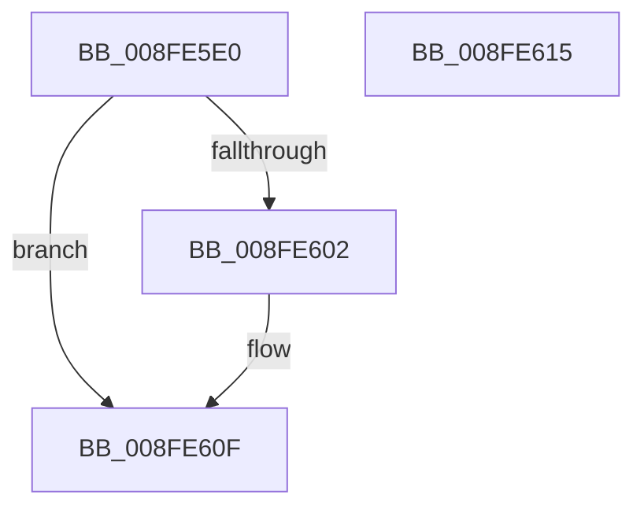

# PnpCtxRegDeleteValue

- RVA: `0x008FE5E0`–`0x008FE616` (길이 `54` bytes)
- VA: `0x00000001408FE5E0`
- 실행 섹션: `PAGE`
- PDB 이름 있음: `예`; PDB Function 태그: `아니요`
- unwind 정보 RVA: `0x00064C80`
- 디코드: `17`개 명령, `54/54` bytes 표시
- 미해석 바이트: `0` (있으면 어셈블리에 `.byte`로 보존)

> 이 문서는 커널 이미지의 기계어와 PDB 기호를 분석해 생성했습니다. 4번과 5번은 함수 원형과 자료형을 바이너리 사용 방식에서 추정한 C 해석이며 원본 소스 복구 결과는 아닙니다.

## 1. Dependencies

- 직접 호출 지점: **2**; 고유 호출 대상: **2**
- 직접 호출자로 확인된 함수: **23**
- RIP 상대 이미지 참조: **0**

### Outgoing calls
- `0x008FE5F9` → [RtlInitUnicodeStringEx](../../text/46/RtlInitUnicodeStringEx_function_00463960.md) (function, `0x00463960`)
- `0x008FE60A` → [ZwDeleteValueKey](../../text/6A/ZwDeleteValueKey_function_006AECB0.md) (function, `0x006AECB0`)

### Direct callers
- [PipUpdateDeviceProducts](../../text/5A/PipUpdateDeviceProducts_function_005A46C0.md) at `0x005A4AAF`
- [PipHardwareConfigClearStartOverrideCallback](../72/PipHardwareConfigClearStartOverrideCallback_function_007233D0.md) at `0x0072346B`
- [CmSetInstallerClassRegPropWorker](../82/CmSetInstallerClassRegPropWorker_function_0082ABF4.md) at `0x0082ADCD`
- [CmRemoveDeviceFromContainerWorker](../82/CmRemoveDeviceFromContainerWorker_function_0082C080.md) at `0x0082C172`
- [CmRemovePanelDeviceWorker](../82/CmRemovePanelDeviceWorker_function_0082F470.md) at `0x0082F52B`
- [CmDeleteDeviceMappedPropertyFromDriverKeyRegValue](../82/CmDeleteDeviceMappedPropertyFromDriverKeyRegValue_function_0082F944.md) at `0x0082F9F2`
- [CmDeleteDeviceMappedPropertyFromDriverKeyRegValue](../82/CmDeleteDeviceMappedPropertyFromDriverKeyRegValue_function_0082F944.md) at `0x0082FA3B`
- [CmDeleteDeviceMappedPropertyFromInstanceKeyRegValue](../82/CmDeleteDeviceMappedPropertyFromInstanceKeyRegValue_function_0082FA68.md) at `0x0082FB23`
- [CmDeleteInstallerClassMappedPropertyFromRegValue](../82/CmDeleteInstallerClassMappedPropertyFromRegValue_function_0082FB70.md) at `0x0082FC9C`
- [CmDeleteInstallerClassMappedPropertyFromRegValue](../82/CmDeleteInstallerClassMappedPropertyFromRegValue_function_0082FB70.md) at `0x0082FCC1`
- [CmDeleteInterfaceClassMappedPropertyFromRegValue](../82/CmDeleteInterfaceClassMappedPropertyFromRegValue_function_0082FD08.md) at `0x0082FE2C`
- [CmSetInstallerClassMappedProperty](../83/CmSetInstallerClassMappedProperty_function_008310E8.md) at `0x008312F1`
- [DrvDbDeleteObjectSubKey](../83/DrvDbDeleteObjectSubKey_function_00832EEC.md) at `0x00833279`
- [DrvDbSetRegValueMappedProperty](../83/DrvDbSetRegValueMappedProperty_function_00834DC8.md) at `0x00834E42`
- [_CmSetDeviceRegPropWorker](_CmSetDeviceRegPropWorker_function_008FD804.md) at `0x008FD91C`
- [PnpDeletePropertyWorker](PnpDeletePropertyWorker_function_008FE754.md) at `0x008FE89E`
- [PiDevCfgClearDeviceMigrationNode](../96/PiDevCfgClearDeviceMigrationNode_function_00965780.md) at `0x0096598B`
- [PiDevCfgClearDeviceMigrationNode](../96/PiDevCfgClearDeviceMigrationNode_function_00965780.md) at `0x00965A76`
- [PiDevCfgResetDeviceDriverSettings](../96/PiDevCfgResetDeviceDriverSettings_function_00966168.md) at `0x009663AC`
- [CmGetInstallerClassMappedPropertyFromCoInstallers](../9D/CmGetInstallerClassMappedPropertyFromCoInstallers_function_009D44BC.md) at `0x009D45A4`
- [DrvDbSetDeviceIdDriverInfMatches](../A6/DrvDbSetDeviceIdDriverInfMatches_function_00A6251C.md) at `0x00A6279E`
- [CmDeleteDeviceInterfaceMappedPropertyFromRegValue](../A7/CmDeleteDeviceInterfaceMappedPropertyFromRegValue_function_00A72DA8.md) at `0x00A72EF1`
- [PiCMCreateDevice](../AC/PiCMCreateDevice_function_00ACB824.md) at `0x00ACBD4E`
- [sub_00B2819A](../B2/Unknown_function_00B2819A.md) at `0x00B282A9`
- [sub_00B28770](../B2/Unknown_function_00B28770.md) at `0x00B287BE`
- [sub_00B3E2D0](../B3/Unknown_function_00B3E2D0.md) at `0x00B3E341`

### Static image references
- 디코드된 RIP-relative 메모리 참조가 없습니다.

## 2. Other-region calls and transfers

- 다른 실행 섹션으로 향하는 call: **2**
  - `0x008FE5F9` → [RtlInitUnicodeStringEx](../../text/46/RtlInitUnicodeStringEx_function_00463960.md) (`PAGE` → `.text`)
  - `0x008FE60A` → [ZwDeleteValueKey](../../text/6A/ZwDeleteValueKey_function_006AECB0.md) (`PAGE` → `.text`)
- 별도 외부 분기/꼬리 이동을 확인하지 못했습니다.

## 3. Assembly (complete function range)

```asm
008FE5E0  40 53                           push rbx
008FE5E2  48 83 EC 30                     sub rsp, 0x30
008FE5E6  48 8B DA                        mov rbx, rdx
008FE5E9  48 8D 4C 24 20                  lea rcx, [rsp + 0x20]
008FE5EE  0F 57 C0                        xorps xmm0, xmm0
008FE5F1  49 8B D0                        mov rdx, r8
008FE5F4  0F 11 44 24 20                  movups xmmword ptr [rsp + 0x20], xmm0
008FE5F9  E8 62 53 B6 FF                  call 0x140463960
008FE5FE  85 C0                           test eax, eax
008FE600  78 0D                           js 0x1408fe60f
008FE602  48 8D 54 24 20                  lea rdx, [rsp + 0x20]
008FE607  48 8B CB                        mov rcx, rbx
008FE60A  E8 A1 06 DB FF                  call 0x1406aecb0
008FE60F  48 83 C4 30                     add rsp, 0x30
008FE613  5B                              pop rbx
008FE614  C3                              ret
008FE615  CC                              int3
```

## 4. C-style interpretation (structured pseudocode)

```c
__int64 __fastcall PnpCtxRegDeleteValue(__int64 a1, __int64 a2, __int64 a3)
{
    __int64 result;
    __int64 v_rsp;
    unsigned __int64 v_stack_m18;

    v_rsp = (v_rsp) - (48);
    v_stack_m18 = v_xmm0;
    result = RtlInitUnicodeStringEx(v_stack_m18, a3, a3, a4);
    if (!(sign_flag)) {
        a2 = v_stack_m18;
        a1 = a2;
        result = ZwDeleteValueKey(a1, a2, a3, a4);
    }
    v_rsp = (v_rsp) + (48);
    return result;
}
```

## 5. (Beta) C Style

```c
int64_t PnpCtxRegDeleteValue(int64_t Arg1, int64_t Arg2, int64_t Arg3)
{
    int64_t result;
    int64_t local_rsp;
    uint64_t v_stack_m18;

    local_rsp = (local_rsp) - (48);
    v_stack_m18 = v_xmm0;
    result = RtlInitUnicodeStringEx(v_stack_m18, Arg3, Arg3, a4);
    if (!(sign_flag)) {
        Arg2 = v_stack_m18;
        Arg1 = Arg2;
        result = ZwDeleteValueKey(Arg1, Arg2, Arg3, a4);
    }
    local_rsp = (local_rsp) + (48);
    return result;
}
```

## 6. Execution-region graph

[열기: 2D/3D 그래프와 함수 탐색 컨트롤 패널](../../../control-panel.html?section=page&rva=0x008FE5E0&view=graph)

- 2D 그래프는 위에서 아래로 흐르고, 3D 그래프는 빈 공간을 드래그해 회전합니다. Shift+드래그는 이동, 휠은 확대·축소, 함수 노드 선택은 대상 보고서 이동입니다.

### Static fallback


