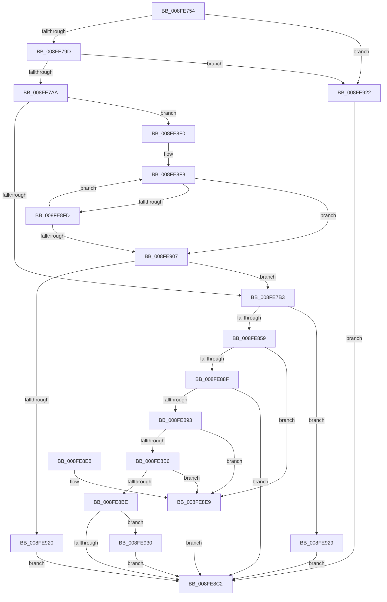

# PnpDeletePropertyWorker

- RVA: `0x008FE754`–`0x008FE934` (길이 `480` bytes)
- VA: `0x00000001408FE754`
- 실행 섹션: `PAGE`
- PDB 이름 있음: `예`; PDB Function 태그: `아니요`
- unwind 정보 RVA: `0x0008826C`
- 디코드: `122`개 명령, `480/480` bytes 표시
- 미해석 바이트: `0` (있으면 어셈블리에 `.byte`로 보존)

> 이 문서는 커널 이미지의 기계어와 PDB 기호를 분석해 생성했습니다. 4번과 5번은 함수 원형과 자료형을 바이너리 사용 방식에서 추정한 C 해석이며 원본 소스 복구 결과는 아닙니다.

## 1. Dependencies

- 직접 호출 지점: **5**; 고유 호출 대상: **5**
- 직접 호출자로 확인된 함수: **2**
- RIP 상대 이미지 참조: **2**

### Outgoing calls
- `0x008FE84C` → [RtlStringCchPrintfExW](../../text/42/RtlStringCchPrintfExW_function_0042B390.md) (function, `0x0042B390`)
- `0x008FE87F` → [_PnpOpenPropertiesKey](../99/_PnpOpenPropertiesKey_function_009938A0.md) (function, `0x009938A0`)
- `0x008FE89E` → [PnpCtxRegDeleteValue](PnpCtxRegDeleteValue_function_008FE5E0.md) (function, `0x008FE5E0`)
- `0x008FE8AD` → [ZwClose](../../text/6A/ZwClose_function_006AD2B0.md) (function, `0x006AD2B0`)
- `0x008FE8CF` → [_security_check_cookie](../../text/6A/_security_check_cookie_function_006AC640.md) (function, `0x006AC640`)

### Direct callers
- [DrvDbDeleteObjectSubKey](../83/DrvDbDeleteObjectSubKey_function_00832EEC.md) at `0x0083302B`
- [PnpSetGenericStoreProperty](../99/PnpSetGenericStoreProperty_function_00991BC0.md) at `0x00991BF8`

### Static image references
- `0x008FE768` → RVA `0x00E0A740` (`.data`; read)
- `0x008FE838` → RVA `0x00B0D8D0` (` ?? ::NNGAKEGL::`string'`; read)

## 2. Other-region calls and transfers

- 다른 실행 섹션으로 향하는 call: **3**
  - `0x008FE84C` → [RtlStringCchPrintfExW](../../text/42/RtlStringCchPrintfExW_function_0042B390.md) (`PAGE` → `.text`)
  - `0x008FE8AD` → [ZwClose](../../text/6A/ZwClose_function_006AD2B0.md) (`PAGE` → `.text`)
  - `0x008FE8CF` → [_security_check_cookie](../../text/6A/_security_check_cookie_function_006AC640.md) (`PAGE` → `.text`)
- 별도 외부 분기/꼬리 이동을 확인하지 못했습니다.

## 3. Assembly (complete function range)

```asm
008FE754  40 53                           push rbx
008FE756  55                              push rbp
008FE757  56                              push rsi
008FE758  57                              push rdi
008FE759  41 54                           push r12
008FE75B  41 55                           push r13
008FE75D  41 56                           push r14
008FE75F  41 57                           push r15
008FE761  48 81 EC 18 01 00 00            sub rsp, 0x118
008FE768  48 8B 05 D1 BF 50 00            mov rax, qword ptr [rip + 0x50bfd1]
008FE76F  48 33 C4                        xor rax, rsp
008FE772  48 89 84 24 00 01 00 00         mov qword ptr [rsp + 0x100], rax
008FE77A  4C 8B EA                        mov r13, rdx
008FE77D  4D 8B F9                        mov r15, r9
008FE780  33 D2                           xor edx, edx
008FE782  4D 8B F0                        mov r14, r8
008FE785  4C 8B E1                        mov r12, rcx
008FE788  48 89 94 24 90 00 00 00         mov qword ptr [rsp + 0x90], rdx
008FE790  39 94 24 80 01 00 00            cmp dword ptr [rsp + 0x180], edx
008FE797  0F 85 85 01 00 00               jne 0x1408fe922
008FE79D  39 94 24 90 01 00 00            cmp dword ptr [rsp + 0x190], edx
008FE7A4  0F 85 78 01 00 00               jne 0x1408fe922
008FE7AA  4D 85 C0                        test r8, r8
008FE7AD  0F 85 3D 01 00 00               jne 0x1408fe8f0
008FE7B3  41 0F B6 49 0F                  movzx ecx, byte ptr [r9 + 0xf]
008FE7B8  41 0F B6 51 0E                  movzx edx, byte ptr [r9 + 0xe]
008FE7BD  45 0F B6 41 0D                  movzx r8d, byte ptr [r9 + 0xd]
008FE7C2  41 8B 47 10                     mov eax, dword ptr [r15 + 0x10]
008FE7C6  45 0F B6 49 0C                  movzx r9d, byte ptr [r9 + 0xc]
008FE7CB  45 0F B6 57 0B                  movzx r10d, byte ptr [r15 + 0xb]
008FE7D0  45 0F B6 5F 0A                  movzx r11d, byte ptr [r15 + 0xa]
008FE7D5  41 0F B6 5F 09                  movzx ebx, byte ptr [r15 + 9]
008FE7DA  41 0F B6 7F 08                  movzx edi, byte ptr [r15 + 8]
008FE7DF  41 0F B7 77 06                  movzx esi, word ptr [r15 + 6]
008FE7E4  41 0F B7 6F 04                  movzx ebp, word ptr [r15 + 4]
008FE7E9  89 84 24 88 00 00 00            mov dword ptr [rsp + 0x88], eax
008FE7F0  41 8B 07                        mov eax, dword ptr [r15]
008FE7F3  89 8C 24 80 00 00 00            mov dword ptr [rsp + 0x80], ecx
008FE7FA  48 8D 8C 24 A0 00 00 00         lea rcx, [rsp + 0xa0]
008FE802  89 54 24 78                     mov dword ptr [rsp + 0x78], edx
008FE806  44 89 44 24 70                  mov dword ptr [rsp + 0x70], r8d
008FE80B  45 33 C0                        xor r8d, r8d
008FE80E  44 89 4C 24 68                  mov dword ptr [rsp + 0x68], r9d
008FE813  45 33 C9                        xor r9d, r9d
008FE816  44 89 54 24 60                  mov dword ptr [rsp + 0x60], r10d
008FE81B  44 89 5C 24 58                  mov dword ptr [rsp + 0x58], r11d
008FE820  89 5C 24 50                     mov dword ptr [rsp + 0x50], ebx
008FE824  89 7C 24 48                     mov dword ptr [rsp + 0x48], edi
008FE828  41 8D 51 30                     lea edx, [r9 + 0x30]
008FE82C  89 74 24 40                     mov dword ptr [rsp + 0x40], esi
008FE830  89 6C 24 38                     mov dword ptr [rsp + 0x38], ebp
008FE834  89 44 24 30                     mov dword ptr [rsp + 0x30], eax
008FE838  48 8D 05 91 F0 20 00            lea rax, [rip + 0x20f091]
008FE83F  48 89 44 24 28                  mov qword ptr [rsp + 0x28], rax
008FE844  C7 44 24 20 00 08 00 00         mov dword ptr [rsp + 0x20], 0x800
008FE84C  E8 3F CB B2 FF                  call 0x14042b390
008FE851  85 C0                           test eax, eax
008FE853  0F 88 D0 00 00 00               js 0x1408fe929
008FE859  48 8D 84 24 90 00 00 00         lea rax, [rsp + 0x90]
008FE861  41 B9 06 00 00 00               mov r9d, 6
008FE867  48 89 44 24 30                  mov qword ptr [rsp + 0x30], rax
008FE86C  4C 8D 84 24 A0 00 00 00         lea r8, [rsp + 0xa0]
008FE874  49 8B D5                        mov rdx, r13
008FE877  C6 44 24 20 00                  mov byte ptr [rsp + 0x20], 0
008FE87C  49 8B CC                        mov rcx, r12
008FE87F  E8 1C 50 09 00                  call 0x1409938a0
008FE884  BE 34 00 00 C0                  mov esi, 0xc0000034
008FE889  8B D8                           mov ebx, eax
008FE88B  3B C6                           cmp eax, esi
008FE88D  74 5A                           je 0x1408fe8e9
008FE88F  85 C0                           test eax, eax
008FE891  78 2F                           js 0x1408fe8c2
008FE893  48 8B 94 24 90 00 00 00         mov rdx, qword ptr [rsp + 0x90]
008FE89B  4D 8B C6                        mov r8, r14
008FE89E  E8 3D FD FF FF                  call 0x1408fe5e0
008FE8A3  48 8B 8C 24 90 00 00 00         mov rcx, qword ptr [rsp + 0x90]
008FE8AB  8B F8                           mov edi, eax
008FE8AD  E8 FE E9 DA FF                  call 0x1406ad2b0
008FE8B2  3B FE                           cmp edi, esi
008FE8B4  74 33                           je 0x1408fe8e9
008FE8B6  81 FF 7C 01 00 C0               cmp edi, 0xc000017c
008FE8BC  74 2B                           je 0x1408fe8e9
008FE8BE  85 FF                           test edi, edi
008FE8C0  78 6E                           js 0x1408fe930
008FE8C2  8B C3                           mov eax, ebx
008FE8C4  48 8B 8C 24 00 01 00 00         mov rcx, qword ptr [rsp + 0x100]
008FE8CC  48 33 CC                        xor rcx, rsp
008FE8CF  E8 6C DD DA FF                  call 0x1406ac640
008FE8D4  48 81 C4 18 01 00 00            add rsp, 0x118
008FE8DB  41 5F                           pop r15
008FE8DD  41 5E                           pop r14
008FE8DF  41 5D                           pop r13
008FE8E1  41 5C                           pop r12
008FE8E3  5F                              pop rdi
008FE8E4  5E                              pop rsi
008FE8E5  5D                              pop rbp
008FE8E6  5B                              pop rbx
008FE8E7  C3                              ret
008FE8E8  CC                              int3
008FE8E9  BB 25 02 00 C0                  mov ebx, 0xc0000225
008FE8EE  EB D2                           jmp 0x1408fe8c2
008FE8F0  B9 55 00 00 00                  mov ecx, 0x55
008FE8F5  49 8B C6                        mov rax, r14
008FE8F8  66 39 10                        cmp word ptr [rax], dx
008FE8FB  74 0A                           je 0x1408fe907
008FE8FD  48 83 C0 02                     add rax, 2
008FE901  48 83 E9 01                     sub rcx, 1
008FE905  75 F1                           jne 0x1408fe8f8
008FE907  48 8B C1                        mov rax, rcx
008FE90A  48 F7 D8                        neg rax
008FE90D  1B DB                           sbb ebx, ebx
008FE90F  F7 D3                           not ebx
008FE911  81 E3 0D 00 00 C0               and ebx, 0xc000000d
008FE917  48 85 C9                        test rcx, rcx
008FE91A  0F 85 93 FE FF FF               jne 0x1408fe7b3
008FE920  EB A0                           jmp 0x1408fe8c2
008FE922  BB 0D 00 00 C0                  mov ebx, 0xc000000d
008FE927  EB 99                           jmp 0x1408fe8c2
008FE929  BB E5 00 00 C0                  mov ebx, 0xc00000e5
008FE92E  EB 92                           jmp 0x1408fe8c2
008FE930  8B DF                           mov ebx, edi
008FE932  EB 8E                           jmp 0x1408fe8c2
```

## 4. C-style interpretation (structured pseudocode)

```c
__int64 __fastcall PnpDeletePropertyWorker(__int64 a1, __int64 a2, __int64 a3, __int64 a4, unsigned int a5, __int64 a6, unsigned int a7)
{
    __int64 result;
    __int64 v_rbx;
    __int64 v_rsp;
    unsigned int v_stack_m100;
    unsigned int v_stack_m108;
    unsigned int v_stack_m110;
    unsigned int v_stack_m118;
    unsigned int v_stack_m120;
    unsigned int v_stack_m128;
    unsigned __int64 v_stack_m130;
    unsigned int v_stack_m138;
    unsigned __int64 v_stack_m58;
    unsigned __int64 v_stack_mB8;
    unsigned __int64 v_stack_mC8;
    unsigned int v_stack_mD0;
    unsigned int v_stack_mD8;
    unsigned int v_stack_mE0;
    unsigned int v_stack_mE8;
    unsigned int v_stack_mF0;
    unsigned int v_stack_mF8;

    v_rsp = (v_rsp) - (280);
    result = (*(unsigned __int64 *)(v_rip + 5291985)) ^ (v_rsp);
    v_stack_m58 = result;
    a2 = 0;
    v_stack_mC8 = 0;
    if (a5 != 0) goto loc_008FE922;
    if (a7 != 0) goto loc_008FE922;
    if (a3 != 0) goto loc_008FE8F0;
loc_008FE7B3:
    v_stack_mD0 = (unsigned int)((unsigned int)(*(unsigned int *)(a4 + 16)));
    v_stack_mD8 = (unsigned int)(*(unsigned __int8 *)(a4 + 15));
    v_stack_mE0 = (unsigned int)(*(unsigned __int8 *)(a4 + 14));
    v_stack_mE8 = (unsigned int)(*(unsigned __int8 *)(a4 + 13));
    a3 = 0;
    v_stack_mF0 = (unsigned int)(*(unsigned __int8 *)(a4 + 12));
    a4 = 0;
    v_stack_mF8 = (unsigned int)(*(unsigned __int8 *)(a4 + 11));
    v_stack_m100 = (unsigned int)(*(unsigned __int8 *)(a4 + 10));
    v_stack_m108 = (unsigned int)(*(unsigned __int8 *)(a4 + 9));
    v_stack_m110 = (unsigned int)(*(unsigned __int8 *)(a4 + 8));
    v_stack_m118 = (unsigned int)(*(unsigned __int16 *)(a4 + 6));
    v_stack_m120 = (unsigned int)(*(unsigned __int16 *)(a4 + 4));
    v_stack_m128 = (unsigned int)((unsigned int)(*(unsigned int *)(a4)));
    v_stack_m130 = v_rip + 2158737;
    v_stack_m138 = 0x800ULL;
    result = RtlStringCchPrintfExW(v_stack_mB8, a4 + 48, a3, a4);
    if (sign_flag) goto loc_008FE929;
    v_stack_m128 = v_stack_mC8;
    v_stack_m138 = 0;
    result = _PnpOpenPropertiesKey(a1, 0, v_stack_mB8, 6);
    if (((unsigned int)(result)) == ((unsigned int)((unsigned int)(0xC0000034ULL)))) goto loc_008FE8E9;
    if (sign_flag) goto loc_008FE8C2;
    result = PnpCtxRegDeleteValue(a1, v_stack_mC8, 0, 6);
    result = ZwClose(v_stack_mC8, v_stack_mC8, 0, 6);
    if (((unsigned int)((unsigned int)((unsigned int)(result)))) == ((unsigned int)((unsigned int)(0xC0000034ULL)))) goto loc_008FE8E9;
    if (((unsigned int)((unsigned int)((unsigned int)(result)))) == 0xC000017CULL) goto loc_008FE8E9;
    if (sign_flag) goto loc_008FE930;
loc_008FE8C2:
    a1 = (v_stack_m58) ^ (v_rsp);
    result = _security_check_cookie(a1, v_stack_mC8, 0, 6);
    v_rsp = (v_rsp) + (280);
    return result;
loc_008FE8E9:
    goto loc_008FE8C2;
loc_008FE8F0:
loc_008FE8F8:
    if ((*(unsigned __int16 *)(0)) == ((unsigned __int16)(v_stack_mC8))) goto loc_008FE907;
    result = (0) + (2);
    a1 = (85) - (1);
    if (condition_is_not_equal) goto loc_008FE8F8;
loc_008FE907:
    result = -(a1);
    v_rbx = (unsigned int)(~((unsigned int)(0xC0000225ULL)));
    v_rbx = (unsigned int)((v_rbx) & (0xC000000DULL));
    if (a1 != 0) goto loc_008FE7B3;
    goto loc_008FE8C2;
loc_008FE922:
    goto loc_008FE8C2;
loc_008FE929:
    goto loc_008FE8C2;
loc_008FE930:
    goto loc_008FE8C2;
}
```

## 5. (Beta) C Style

```c
int64_t PnpDeletePropertyWorker(int64_t Arg1, int64_t Arg2, void *Arg3, void *Arg4, uint32_t Arg5, uint64_t Arg6, uint32_t Arg7)
{
    uint8_t *arg3 = (uint8_t *)Arg3;
    uint8_t *arg4 = (uint8_t *)Arg4;

    int64_t result;
    int64_t local_rbx;
    int64_t local_rsp;
    uint32_t v_stack_m100;
    uint32_t v_stack_m108;
    uint32_t v_stack_m110;
    uint32_t v_stack_m118;
    uint32_t v_stack_m120;
    uint32_t v_stack_m128;
    uint64_t v_stack_m130;
    uint32_t v_stack_m138;
    uint64_t v_stack_m58;
    uint64_t v_stack_mB8;
    uint64_t v_stack_mC8;
    uint32_t v_stack_mD0;
    uint32_t v_stack_mD8;
    uint32_t v_stack_mE0;
    uint32_t v_stack_mE8;
    uint32_t v_stack_mF0;
    uint32_t v_stack_mF8;

    local_rsp = (local_rsp) - (280);
    result = (*(uint64_t *)(v_rip + 0x50BFD1)) ^ (local_rsp);
    v_stack_m58 = result;
    Arg2 = 0;
    v_stack_mC8 = 0;
    if (Arg5 != 0) goto loc_008FE922;
    if (Arg7 != 0) goto loc_008FE922;
    if (Arg3 != NULL) goto loc_008FE8F0;
loc_008FE7B3:
    v_stack_mD0 = (uint32_t)((uint32_t)(*(uint32_t *)(arg4 + 0x10)));
    v_stack_mD8 = (uint32_t)(*(uint8_t *)(arg4 + 0xF));
    v_stack_mE0 = (uint32_t)(*(uint8_t *)(arg4 + 0xE));
    v_stack_mE8 = (uint32_t)(*(uint8_t *)(arg4 + 0xD));
    Arg3 = 0;
    v_stack_mF0 = (uint32_t)(*(uint8_t *)(arg4 + 0xC));
    Arg4 = 0;
    v_stack_mF8 = (uint32_t)(*(uint8_t *)(arg4 + 0xB));
    v_stack_m100 = (uint32_t)(*(uint8_t *)(arg4 + 0xA));
    v_stack_m108 = (uint32_t)(*(uint8_t *)(arg4 + 0x9));
    v_stack_m110 = (uint32_t)(*(uint8_t *)(arg4 + 0x8));
    v_stack_m118 = (uint32_t)(*(uint16_t *)(arg4 + 0x6));
    v_stack_m120 = (uint32_t)(*(uint16_t *)(arg4 + 0x4));
    v_stack_m128 = (uint32_t)((uint32_t)(*(uint32_t *)(arg4)));
    v_stack_m130 = v_rip + 2158737;
    v_stack_m138 = 0x800ULL;
    result = RtlStringCchPrintfExW(v_stack_mB8, Arg4 + 48, Arg3, Arg4);
    if (sign_flag) goto loc_008FE929;
    v_stack_m128 = v_stack_mC8;
    v_stack_m138 = 0;
    result = _PnpOpenPropertiesKey(Arg1, 0, v_stack_mB8, 6);
    if (((uint32_t)(result)) == ((uint32_t)((uint32_t)(0xC0000034ULL)))) goto loc_008FE8E9;
    if (sign_flag) goto loc_008FE8C2;
    result = PnpCtxRegDeleteValue(Arg1, v_stack_mC8, 0, 6);
    result = ZwClose(v_stack_mC8, v_stack_mC8, 0, 6);
    if (((uint32_t)((uint32_t)((uint32_t)(result)))) == ((uint32_t)((uint32_t)(0xC0000034ULL)))) goto loc_008FE8E9;
    if (((uint32_t)((uint32_t)((uint32_t)(result)))) == 0xC000017CULL) goto loc_008FE8E9;
    if (sign_flag) goto loc_008FE930;
loc_008FE8C2:
    Arg1 = (v_stack_m58) ^ (local_rsp);
    result = _security_check_cookie(Arg1, v_stack_mC8, 0, 6);
    local_rsp = (local_rsp) + (280);
    return result;
loc_008FE8E9:
    goto loc_008FE8C2;
loc_008FE8F0:
loc_008FE8F8:
    if ((*(uint16_t *)(0)) == ((uint16_t)(v_stack_mC8))) goto loc_008FE907;
    result = (0) + (2);
    Arg1 = (85) - (1);
    if (condition_is_not_equal) goto loc_008FE8F8;
loc_008FE907:
    result = -(Arg1);
    local_rbx = (uint32_t)(~((uint32_t)(0xC0000225ULL)));
    local_rbx = (uint32_t)((local_rbx) & (0xC000000DULL));
    if (Arg1 != 0) goto loc_008FE7B3;
    goto loc_008FE8C2;
loc_008FE922:
    goto loc_008FE8C2;
loc_008FE929:
    goto loc_008FE8C2;
loc_008FE930:
    goto loc_008FE8C2;
}
```

### 관측된 메모리 오프셋

구조체 형식이 확인되지 않은 접근은 인자 기준의 오프셋으로만 기록했습니다.

| 기준 인자 | 오프셋 표현 | 폭 (bit) | 접근 |
|---|---:|---:|---|
| `Arg3` | `+ 0x0` | `16` | `R` |
| `Arg4` | `+ 0x0` | `32` | `R` |
| `Arg4` | `+ 0x4` | `16` | `R` |
| `Arg4` | `+ 0x6` | `16` | `R` |
| `Arg4` | `+ 0x8` | `8` | `R` |
| `Arg4` | `+ 0x9` | `8` | `R` |
| `Arg4` | `+ 0xA` | `8` | `R` |
| `Arg4` | `+ 0xB` | `8` | `R` |
| `Arg4` | `+ 0xC` | `8` | `R` |
| `Arg4` | `+ 0xD` | `8` | `R` |
| `Arg4` | `+ 0xE` | `8` | `R` |
| `Arg4` | `+ 0xF` | `8` | `R` |
| `Arg4` | `+ 0x10` | `32` | `R` |

## 6. Execution-region graph

[열기: 2D/3D 그래프와 함수 탐색 컨트롤 패널](../../../control-panel.html?section=page&rva=0x008FE754&view=graph)

- 2D 그래프는 위에서 아래로 흐르고, 3D 그래프는 빈 공간을 드래그해 회전합니다. Shift+드래그는 이동, 휠은 확대·축소, 함수 노드 선택은 대상 보고서 이동입니다.

### Static fallback


