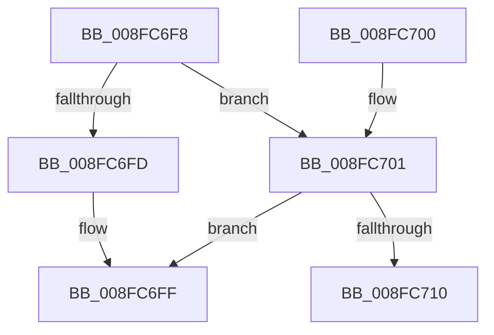

# PnpDetermineResourceListSize

- RVA: `0x008FC6F8`–`0x008FC718` (길이 `32` bytes)
- VA: `0x00000001408FC6F8`
- 실행 섹션: `PAGE`
- PDB 이름 있음: `예`; PDB Function 태그: `예`
- unwind 정보 RVA: `0x000DB714`
- 디코드: `12`개 명령, `32/32` bytes 표시
- 미해석 바이트: `0` (있으면 어셈블리에 `.byte`로 보존)

> 이 문서는 커널 이미지의 기계어와 PDB 기호를 분석해 생성했습니다. 4번과 5번은 함수 원형과 자료형을 바이너리 사용 방식에서 추정한 C 해석이며 원본 소스 복구 결과는 아닙니다.

## 1. Dependencies

- 직접 호출 지점: **0**; 고유 호출 대상: **0**
- 직접 호출자로 확인된 함수: **12**
- RIP 상대 이미지 참조: **0**

### Outgoing calls
- 직접 디코드된 call 명령이 없습니다.

### Direct callers
- [IoReportDetectedDevice](../72/IoReportDetectedDevice_function_00725CD0.md) at `0x00726589`
- [IoReportDetectedDevice](../72/IoReportDetectedDevice_function_00725CD0.md) at `0x0072662B`
- [IoReportDetectedDevice](../72/IoReportDetectedDevice_function_00725CD0.md) at `0x00726675`
- [IopChangeInterfaceType](../72/IopChangeInterfaceType_function_0072A4C0.md) at `0x0072A54C`
- [IopCombineLegacyResources](../72/IopCombineLegacyResources_function_0072E3D0.md) at `0x0072E408`
- [IopCombineLegacyResources](../72/IopCombineLegacyResources_function_0072E3D0.md) at `0x0072E44E`
- [IopCombineCmResourceList](../72/IopCombineCmResourceList_function_0072E984.md) at `0x0072E9B9`
- [IopCombineCmResourceList](../72/IopCombineCmResourceList_function_0072E984.md) at `0x0072E9C3`
- [PnpCopyResourceList](../73/PnpCopyResourceList_function_0073D844.md) at `0x0073D856`
- [PnpBuildCmResourceLists](../73/PnpBuildCmResourceLists_function_0073E684.md) at `0x0073E821`
- [PnpRestoreResourcesInternal](../73/PnpRestoreResourcesInternal_function_0073EB10.md) at `0x0073EC1D`
- [IoGetDeviceProperty](IoGetDeviceProperty_function_008FA720.md) at `0x008FAB9A`
- [IopQueryDeviceResources](IopQueryDeviceResources_function_008FC344.md) at `0x008FC479`
- [IopLegacyResourceAllocation](../A0/IopLegacyResourceAllocation_function_00A07224.md) at `0x00A07352`
- [IopLegacyResourceAllocation](../A0/IopLegacyResourceAllocation_function_00A07224.md) at `0x00A0744A`
- [sub_00B1F43A](../B1/Unknown_function_00B1F43A.md) at `0x00B1F47C`
- [sub_00B1F43A](../B1/Unknown_function_00B1F43A.md) at `0x00B1F486`
- [IopReportBootResources](../../init/C3/IopReportBootResources_function_00C342D0.md) at `0x00C342EF`

### Static image references
- 디코드된 RIP-relative 메모리 참조가 없습니다.

## 2. Other-region calls and transfers

- 다른 실행 섹션으로 향하는 call: **0**
- call이 아닌 외부 분기/꼬리 이동: **1**
  - `0x008FC713` → `0x00B1FC3C` (`tail-transfer`)

## 3. Assembly (complete function range)

```asm
008FC6F8  48 85 C9                        test rcx, rcx
008FC6FB  75 04                           jne 0x1408fc701
008FC6FD  33 C0                           xor eax, eax
008FC6FF  C3                              ret
008FC700  CC                              int3
008FC701  8B 11                           mov edx, dword ptr [rcx]
008FC703  4C 8D 41 04                     lea r8, [rcx + 4]
008FC707  B8 04 00 00 00                  mov eax, 4
008FC70C  85 D2                           test edx, edx
008FC70E  74 EF                           je 0x1408fc6ff
008FC710  44 8B D2                        mov r10d, edx
008FC713  E9 24 35 22 00                  jmp 0x140b1fc3c
```

## 4. C-style interpretation (structured pseudocode)

```c
__int64 __fastcall PnpDetermineResourceListSize(__int64 a1)
{
    __int64 result;

    if (a1 != 0) goto loc_008FC701;
    result = 0;
loc_008FC6FF:
    return result;
loc_008FC701:
    if ((unsigned int)((unsigned int)(*(unsigned int *)(a1))) == 0) goto loc_008FC6FF;
}
```

## 5. (Beta) C Style

```c
int64_t PnpDetermineResourceListSize(int64_t Arg1)
{
    int64_t result;

    if (Arg1 != 0) goto loc_008FC701;
    result = 0;
loc_008FC6FF:
    return result;
loc_008FC701:
    if ((uint32_t)((uint32_t)(*(uint32_t *)(Arg1))) == 0) goto loc_008FC6FF;
}
```

## 6. Execution-region graph

[열기: 2D/3D 그래프와 함수 탐색 컨트롤 패널](../../../control-panel.html?section=page&rva=0x008FC6F8&view=graph)

- 2D 그래프는 위에서 아래로 흐르고, 3D 그래프는 빈 공간을 드래그해 회전합니다. Shift+드래그는 이동, 휠은 확대·축소, 함수 노드 선택은 대상 보고서 이동입니다.

### Static fallback


