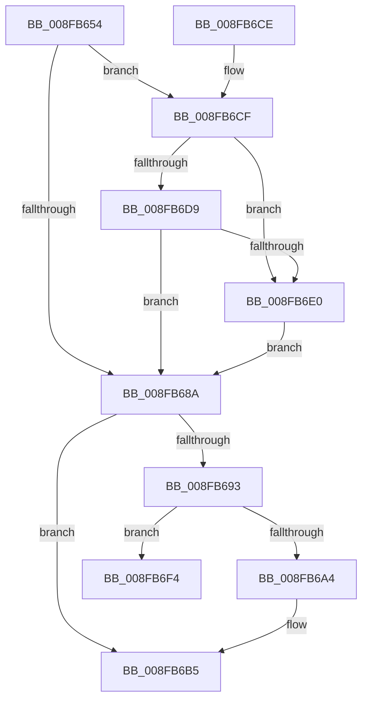

# PnpDeviceCompletionProcessCompletedRequest

- RVA: `0x008FB654`–`0x008FB70D` (길이 `185` bytes)
- VA: `0x00000001408FB654`
- 실행 섹션: `PAGE`
- PDB 이름 있음: `예`; PDB Function 태그: `아니요`
- unwind 정보 RVA: `0x00087E24`
- 디코드: `47`개 명령, `185/185` bytes 표시
- 미해석 바이트: `0` (있으면 어셈블리에 `.byte`로 보존)

> 이 문서는 커널 이미지의 기계어와 PDB 기호를 분석해 생성했습니다. 4번과 5번은 함수 원형과 자료형을 바이너리 사용 방식에서 추정한 C 해석이며 원본 소스 복구 결과는 아닙니다.

## 1. Dependencies

- 직접 호출 지점: **6**; 고유 호출 대상: **6**
- 직접 호출자로 확인된 함수: **4**
- RIP 상대 이미지 참조: **0**

### Outgoing calls
- `0x008FB67F` → [PipSetDevNodeState](../../text/47/PipSetDevNodeState_function_00470708.md) (function, `0x00470708`)
- `0x008FB6A8` → [PoFxIdleDevice](../../text/48/PoFxIdleDevice_function_00483EE8.md) (function, `0x00483EE8`)
- `0x008FB6B8` → [PnpDeviceCompletionRequestDestroy](../../text/26/PnpDeviceCompletionRequestDestroy_function_0026E7E4.md) (function, `0x0026E7E4`)
- `0x008FB6E4` → [PipUpdatePostStartCharacteristics](../../text/4A/PipUpdatePostStartCharacteristics_function_004AB4E8.md) (function, `0x004AB4E8`)
- `0x008FB6ED` → [PiSwProcessParentStartIrp](../A9/PiSwProcessParentStartIrp_function_00A97FC0.md) (function, `0x00A97FC0`)
- `0x008FB707` → [KeBugCheckEx](../../text/4F/KeBugCheckEx_function_004FD660.md) (function, `0x004FD660`)

### Direct callers
- [PipProcessDevNodeTree](PipProcessDevNodeTree_function_008F9068.md) at `0x008F95D4`
- [PipProcessDevNodeTree](PipProcessDevNodeTree_function_008F9068.md) at `0x008F975C`
- [PipProcessDevNodeTree](PipProcessDevNodeTree_function_008F9068.md) at `0x008F9798`
- [PipEnumerateDevice](PipEnumerateDevice_function_008F99E4.md) at `0x008F9AC9`
- [PnpDeviceCompletionProcessCompletedRequests](PnpDeviceCompletionProcessCompletedRequests_function_008FC0D0.md) at `0x008FC134`
- [PnpStartDeviceNode](PnpStartDeviceNode_function_008FE38C.md) at `0x008FE56E`

### Static image references
- 디코드된 RIP-relative 메모리 참조가 없습니다.

## 2. Other-region calls and transfers

- 다른 실행 섹션으로 향하는 call: **5**
  - `0x008FB67F` → [PipSetDevNodeState](../../text/47/PipSetDevNodeState_function_00470708.md) (`PAGE` → `.text`)
  - `0x008FB6A8` → [PoFxIdleDevice](../../text/48/PoFxIdleDevice_function_00483EE8.md) (`PAGE` → `.text`)
  - `0x008FB6B8` → [PnpDeviceCompletionRequestDestroy](../../text/26/PnpDeviceCompletionRequestDestroy_function_0026E7E4.md) (`PAGE` → `.text`)
  - `0x008FB6E4` → [PipUpdatePostStartCharacteristics](../../text/4A/PipUpdatePostStartCharacteristics_function_004AB4E8.md) (`PAGE` → `.text`)
  - `0x008FB707` → [KeBugCheckEx](../../text/4F/KeBugCheckEx_function_004FD660.md) (`PAGE` → `.text`)
- 별도 외부 분기/꼬리 이동을 확인하지 못했습니다.

## 3. Assembly (complete function range)

```asm
008FB654  48 89 5C 24 08                  mov qword ptr [rsp + 8], rbx
008FB659  57                              push rdi
008FB65A  48 83 EC 30                     sub rsp, 0x30
008FB65E  48 8B 41 30                     mov rax, qword ptr [rcx + 0x30]
008FB662  48 8B F9                        mov rdi, rcx
008FB665  48 8B 59 10                     mov rbx, qword ptr [rcx + 0x10]
008FB669  48 89 83 10 02 00 00            mov qword ptr [rbx + 0x210], rax
008FB670  8B 41 28                        mov eax, dword ptr [rcx + 0x28]
008FB673  89 83 88 01 00 00               mov dword ptr [rbx + 0x188], eax
008FB679  8B 51 20                        mov edx, dword ptr [rcx + 0x20]
008FB67C  48 8B CB                        mov rcx, rbx
008FB67F  E8 84 50 B7 FF                  call 0x140470708
008FB684  83 7F 28 00                     cmp dword ptr [rdi + 0x28], 0
008FB688  7D 45                           jge 0x1408fb6cf
008FB68A  81 7F 20 0F 03 00 00            cmp dword ptr [rdi + 0x20], 0x30f
008FB691  75 22                           jne 0x1408fb6b5
008FB693  8B 83 C0 02 00 00               mov eax, dword ptr [rbx + 0x2c0]
008FB699  41 B9 80 00 00 00               mov r9d, 0x80
008FB69F  41 84 C1                        test r9b, al
008FB6A2  74 50                           je 0x1408fb6f4
008FB6A4  48 8B 4B 20                     mov rcx, qword ptr [rbx + 0x20]
008FB6A8  E8 3B 88 B8 FF                  call 0x140483ee8
008FB6AD  0F BA B3 C0 02 00 00 07         btr dword ptr [rbx + 0x2c0], 7
008FB6B5  48 8B CF                        mov rcx, rdi
008FB6B8  E8 27 31 97 FF                  call 0x14026e7e4
008FB6BD  8B 83 88 01 00 00               mov eax, dword ptr [rbx + 0x188]
008FB6C3  48 8B 5C 24 40                  mov rbx, qword ptr [rsp + 0x40]
008FB6C8  48 83 C4 30                     add rsp, 0x30
008FB6CC  5F                              pop rdi
008FB6CD  C3                              ret
008FB6CE  CC                              int3
008FB6CF  8B 47 20                        mov eax, dword ptr [rdi + 0x20]
008FB6D2  3D 08 03 00 00                  cmp eax, 0x308
008FB6D7  74 07                           je 0x1408fb6e0
008FB6D9  3D 0D 03 00 00                  cmp eax, 0x30d
008FB6DE  75 AA                           jne 0x1408fb68a
008FB6E0  48 8B 4B 20                     mov rcx, qword ptr [rbx + 0x20]
008FB6E4  E8 FF FD BA FF                  call 0x1404ab4e8
008FB6E9  48 8B 4B 20                     mov rcx, qword ptr [rbx + 0x20]
008FB6ED  E8 CE C8 19 00                  call 0x140a97fc0
008FB6F2  EB 96                           jmp 0x1408fb68a
008FB6F4  48 83 64 24 20 00               and qword ptr [rsp + 0x20], 0
008FB6FA  4C 8B C3                        mov r8, rbx
008FB6FD  BA 0D 00 00 00                  mov edx, 0xd
008FB702  B9 CA 00 00 00                  mov ecx, 0xca
008FB707  E8 54 1F C0 FF                  call 0x1404fd660
008FB70C  CC                              int3
```

## 4. C-style interpretation (structured pseudocode)

```c
__int64 __fastcall PnpDeviceCompletionProcessCompletedRequest(__int64 a1)
{
    __int64 result;
    __int64 v_rsp;
    unsigned __int64 v_stack_p20;
    unsigned __int64 v_stack_p8;

    v_stack_p8 = v_rbx;
    v_rsp = (v_rsp) - (48);
    *(unsigned __int64 *)(*(unsigned __int64 *)(a1 + 16) + 528) = *(unsigned __int64 *)(a1 + 48);
    *(unsigned int *)(*(unsigned __int64 *)(a1 + 16) + 392) = (unsigned int)((unsigned int)(*(unsigned int *)(a1 + 40)));
    result = PipSetDevNodeState(*(unsigned __int64 *)(a1 + 16), (unsigned int)(*(unsigned int *)(a1 + 32)), a3, a4);
    if ((*(unsigned int *)(a1 + 40)) >= 0) goto loc_008FB6CF;
loc_008FB68A:
    if ((*(unsigned int *)(a1 + 32)) != 783) goto loc_008FB6B5;
    if (((128) & ((unsigned __int8)((unsigned int)(*(unsigned int *)(*(unsigned __int64 *)(a1 + 16) + 704))))) == 0) goto loc_008FB6F4;
    result = PoFxIdleDevice(*(unsigned __int64 *)(*(unsigned __int64 *)(a1 + 16) + 32), (unsigned int)(*(unsigned int *)(a1 + 32)), a3, 128);
loc_008FB6B5:
    result = PnpDeviceCompletionRequestDestroy(a1, (unsigned int)(*(unsigned int *)(a1 + 32)), a3, 128);
    v_rsp = (v_rsp) + (48);
    return (unsigned int)(*(unsigned int *)(*(unsigned __int64 *)(a1 + 16) + 392));
loc_008FB6CF:
    if (((unsigned int)((unsigned int)(*(unsigned int *)(a1 + 32)))) == 776) goto loc_008FB6E0;
    if (((unsigned int)((unsigned int)(*(unsigned int *)(a1 + 32)))) != 781) goto loc_008FB68A;
loc_008FB6E0:
    result = PipUpdatePostStartCharacteristics(*(unsigned __int64 *)(v_stack_p8 + 32), (unsigned int)(*(unsigned int *)(a1 + 32)), a3, 128);
    result = PiSwProcessParentStartIrp(*(unsigned __int64 *)(v_stack_p8 + 32), (unsigned int)(*(unsigned int *)(a1 + 32)), a3, 128);
    goto loc_008FB68A;
loc_008FB6F4:
    result = KeBugCheckEx(202, 13, v_stack_p8, 128);
    return result;
}
```

## 5. (Beta) C Style

```c
int64_t PnpDeviceCompletionProcessCompletedRequest(void *Arg1)
{
    uint8_t *arg1 = (uint8_t *)Arg1;

    int64_t result;
    int64_t local_rsp;
    uint64_t v_stack_p20;
    uint64_t v_stack_p8;

    v_stack_p8 = local_rbx;
    local_rsp = (local_rsp) - (48);
    *(uint64_t *)(*(uint64_t *)(arg1 + 0x10) + 0x210) = *(uint64_t *)(arg1 + 0x30);
    *(uint32_t *)(*(uint64_t *)(arg1 + 0x10) + 0x188) = (uint32_t)((uint32_t)(*(uint32_t *)(arg1 + 0x28)));
    result = PipSetDevNodeState(*(uint64_t *)(arg1 + 0x10), (uint32_t)(*(uint32_t *)(arg1 + 0x20)), a3, a4);
    if ((*(uint32_t *)(arg1 + 0x28)) >= 0) goto loc_008FB6CF;
loc_008FB68A:
    if ((*(uint32_t *)(arg1 + 0x20)) != 783) goto loc_008FB6B5;
    if (((128) & ((uint8_t)((uint32_t)(*(uint32_t *)(*(uint64_t *)(arg1 + 0x10) + 0x2C0))))) == 0) goto loc_008FB6F4;
    result = PoFxIdleDevice(*(uint64_t *)(*(uint64_t *)(arg1 + 0x10) + 0x20), (uint32_t)(*(uint32_t *)(arg1 + 0x20)), a3, 128);
loc_008FB6B5:
    result = PnpDeviceCompletionRequestDestroy(Arg1, (uint32_t)(*(uint32_t *)(arg1 + 0x20)), a3, 128);
    local_rsp = (local_rsp) + (48);
    return (uint32_t)(*(uint32_t *)(*(uint64_t *)(arg1 + 0x10) + 0x188));
loc_008FB6CF:
    if (((uint32_t)((uint32_t)(*(uint32_t *)(arg1 + 0x20)))) == 776) goto loc_008FB6E0;
    if (((uint32_t)((uint32_t)(*(uint32_t *)(arg1 + 0x20)))) != 781) goto loc_008FB68A;
loc_008FB6E0:
    result = PipUpdatePostStartCharacteristics(*(uint64_t *)(v_stack_p8 + 0x20), (uint32_t)(*(uint32_t *)(arg1 + 0x20)), a3, 128);
    result = PiSwProcessParentStartIrp(*(uint64_t *)(v_stack_p8 + 0x20), (uint32_t)(*(uint32_t *)(arg1 + 0x20)), a3, 128);
    goto loc_008FB68A;
loc_008FB6F4:
    result = KeBugCheckEx(202, 13, v_stack_p8, 128);
    return result;
}
```

### 관측된 메모리 오프셋

구조체 형식이 확인되지 않은 접근은 인자 기준의 오프셋으로만 기록했습니다.

| 기준 인자 | 오프셋 표현 | 폭 (bit) | 접근 |
|---|---:|---:|---|
| `Arg1` | `+ 0x10` | `64` | `R` |
| `Arg1` | `+ 0x20` | `32` | `R` |
| `Arg1` | `+ 0x28` | `32` | `R` |
| `Arg1` | `+ 0x30` | `64` | `R` |

## 6. Execution-region graph

[열기: 2D/3D 그래프와 함수 탐색 컨트롤 패널](../../../control-panel.html?section=page&rva=0x008FB654&view=graph)

- 2D 그래프는 위에서 아래로 흐르고, 3D 그래프는 빈 공간을 드래그해 회전합니다. Shift+드래그는 이동, 휠은 확대·축소, 함수 노드 선택은 대상 보고서 이동입니다.

### Static fallback


