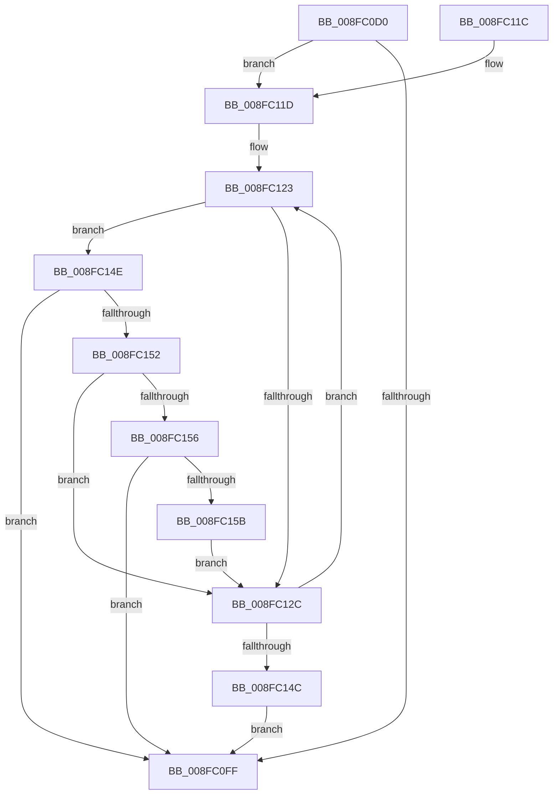

# PnpDeviceCompletionProcessCompletedRequests

- RVA: `0x008FC0D0`–`0x008FC15D` (길이 `141` bytes)
- VA: `0x00000001408FC0D0`
- 실행 섹션: `PAGE`
- PDB 이름 있음: `예`; PDB Function 태그: `아니요`
- unwind 정보 RVA: `0x00087F30`
- 디코드: `44`개 명령, `141/141` bytes 표시
- 미해석 바이트: `0` (있으면 어셈블리에 `.byte`로 보존)

> 이 문서는 커널 이미지의 기계어와 PDB 기호를 분석해 생성했습니다. 4번과 5번은 함수 원형과 자료형을 바이너리 사용 방식에서 추정한 C 해석이며 원본 소스 복구 결과는 아닙니다.

## 1. Dependencies

- 직접 호출 지점: **4**; 고유 호출 대상: **3**
- 직접 호출자로 확인된 함수: **1**
- RIP 상대 이미지 참조: **1**

### Outgoing calls
- `0x008FC0F6` → [PnpDeviceCompletionQueueIsEmpty](../../text/48/PnpDeviceCompletionQueueIsEmpty_function_0048A070.md) (function, `0x0048A070`)
- `0x008FC12C` → [PnpDeviceCompletionQueueGetCompletedRequest](../../text/4B/PnpDeviceCompletionQueueGetCompletedRequest_function_004BE224.md) (function, `0x004BE224`)
- `0x008FC134` → [PnpDeviceCompletionProcessCompletedRequest](PnpDeviceCompletionProcessCompletedRequest_function_008FB654.md) (function, `0x008FB654`)
- `0x008FC143` → [PnpDeviceCompletionQueueIsEmpty](../../text/48/PnpDeviceCompletionQueueIsEmpty_function_0048A070.md) (function, `0x0048A070`)

### Direct callers
- [PipProcessDevNodeTree](PipProcessDevNodeTree_function_008F9068.md) at `0x008F98E6`

### Static image references
- `0x008FC123` → RVA `0x00F8C32C` (`.data`; read)

## 2. Other-region calls and transfers

- 다른 실행 섹션으로 향하는 call: **3**
  - `0x008FC0F6` → [PnpDeviceCompletionQueueIsEmpty](../../text/48/PnpDeviceCompletionQueueIsEmpty_function_0048A070.md) (`PAGE` → `.text`)
  - `0x008FC12C` → [PnpDeviceCompletionQueueGetCompletedRequest](../../text/4B/PnpDeviceCompletionQueueGetCompletedRequest_function_004BE224.md) (`PAGE` → `.text`)
  - `0x008FC143` → [PnpDeviceCompletionQueueIsEmpty](../../text/48/PnpDeviceCompletionQueueIsEmpty_function_0048A070.md) (`PAGE` → `.text`)
- 별도 외부 분기/꼬리 이동을 확인하지 못했습니다.

## 3. Assembly (complete function range)

```asm
008FC0D0  48 8B C4                        mov rax, rsp
008FC0D3  48 89 58 08                     mov qword ptr [rax + 8], rbx
008FC0D7  48 89 68 10                     mov qword ptr [rax + 0x10], rbp
008FC0DB  48 89 70 18                     mov qword ptr [rax + 0x18], rsi
008FC0DF  48 89 78 20                     mov qword ptr [rax + 0x20], rdi
008FC0E3  41 57                           push r15
008FC0E5  48 83 EC 20                     sub rsp, 0x20
008FC0E9  49 8B F8                        mov rdi, r8
008FC0EC  41 C6 00 00                     mov byte ptr [r8], 0
008FC0F0  8B F2                           mov esi, edx
008FC0F2  8B E9                           mov ebp, ecx
008FC0F4  33 DB                           xor ebx, ebx
008FC0F6  E8 75 DF B8 FF                  call 0x14048a070
008FC0FB  85 C0                           test eax, eax
008FC0FD  74 1E                           je 0x1408fc11d
008FC0FF  48 8B 6C 24 38                  mov rbp, qword ptr [rsp + 0x38]
008FC104  8B C3                           mov eax, ebx
008FC106  48 8B 5C 24 30                  mov rbx, qword ptr [rsp + 0x30]
008FC10B  48 8B 74 24 40                  mov rsi, qword ptr [rsp + 0x40]
008FC110  48 8B 7C 24 48                  mov rdi, qword ptr [rsp + 0x48]
008FC115  48 83 C4 20                     add rsp, 0x20
008FC119  41 5F                           pop r15
008FC11B  C3                              ret
008FC11C  CC                              int3
008FC11D  41 BF CE 02 00 C0               mov r15d, 0xc00002ce
008FC123  83 3D 02 02 69 00 00            cmp dword ptr [rip + 0x690202], 0
008FC12A  74 22                           je 0x1408fc14e
008FC12C  E8 F3 20 BC FF                  call 0x1404be224
008FC131  48 8B C8                        mov rcx, rax
008FC134  E8 1B F5 FF FF                  call 0x1408fb654
008FC139  41 3B C7                        cmp eax, r15d
008FC13C  C6 07 01                        mov byte ptr [rdi], 1
008FC13F  41 0F 44 DF                     cmove ebx, r15d
008FC143  E8 28 DF B8 FF                  call 0x14048a070
008FC148  85 C0                           test eax, eax
008FC14A  74 D7                           je 0x1408fc123
008FC14C  EB B1                           jmp 0x1408fc0ff
008FC14E  85 F6                           test esi, esi
008FC150  74 AD                           je 0x1408fc0ff
008FC152  85 ED                           test ebp, ebp
008FC154  75 D6                           jne 0x1408fc12c
008FC156  40 38 2F                        cmp byte ptr [rdi], bpl
008FC159  75 A4                           jne 0x1408fc0ff
008FC15B  EB CF                           jmp 0x1408fc12c
```

## 4. C-style interpretation (structured pseudocode)

```c
__int64 __fastcall PnpDeviceCompletionProcessCompletedRequests(int a1, int a2, __int64 a3)
{
    __int64 result;
    __int64 v_rbx;
    __int64 v_rsp;
    unsigned __int64 v_stack_p10;
    unsigned __int64 v_stack_p18;
    unsigned __int64 v_stack_p20;
    unsigned __int64 v_stack_p8;

    *(unsigned __int64 *)(v_rsp + 8) = v_rbx;
    *(unsigned __int64 *)(v_rsp + 16) = v_rbp;
    *(unsigned __int64 *)(v_rsp + 24) = v_rsi;
    *(unsigned __int64 *)(v_rsp + 32) = v_rdi;
    v_rsp = (v_rsp) - (32);
    *(unsigned __int8 *)(a3) = 0;
    v_rbx = 0;
    result = PnpDeviceCompletionQueueIsEmpty(a1, a2, a3, a4);
    if ((unsigned int)(result) == 0) goto loc_008FC11D;
loc_008FC0FF:
    v_rsp = (v_rsp) + (32);
    return 0;
loc_008FC11D:
loc_008FC123:
    if ((*(unsigned int *)(v_rip + 6881794)) == 0) goto loc_008FC14E;
loc_008FC12C:
    result = PnpDeviceCompletionQueueGetCompletedRequest(a1, a2, a3, a4);
    result = PnpDeviceCompletionProcessCompletedRequest(result, a2, a3, a4);
    *(unsigned __int8 *)(v_stack_p20) = 1;
    v_rbx = v_stack_p8;
    if (((unsigned int)(result)) == ((unsigned int)((unsigned int)(0xC00002CEULL)))) { v_rbx = (unsigned int)((unsigned int)(0xC00002CEULL)); }
    result = PnpDeviceCompletionQueueIsEmpty(result, a2, a3, a4);
    if ((unsigned int)(result) == 0) goto loc_008FC123;
    goto loc_008FC0FF;
loc_008FC14E:
    if ((unsigned int)(v_stack_p18) == 0) goto loc_008FC0FF;
    if ((unsigned int)(v_stack_p10) != 0) goto loc_008FC12C;
    if ((*(unsigned __int8 *)(v_stack_p20)) != ((unsigned __int8)(v_stack_p10))) goto loc_008FC0FF;
    goto loc_008FC12C;
}
```

## 5. (Beta) C Style

```c
int64_t PnpDeviceCompletionProcessCompletedRequests(int32_t Arg1, int32_t Arg2, void *Arg3)
{
    uint8_t *arg3 = (uint8_t *)Arg3;

    int64_t result;
    int64_t local_rbx;
    int64_t local_rsp;
    uint64_t v_stack_p10;
    uint64_t v_stack_p18;
    uint64_t v_stack_p20;
    uint64_t v_stack_p8;

    *(uint64_t *)(local_rsp + 0x8) = local_rbx;
    *(uint64_t *)(local_rsp + 0x10) = local_rbp;
    *(uint64_t *)(local_rsp + 0x18) = local_rsi;
    *(uint64_t *)(local_rsp + 0x20) = local_rdi;
    local_rsp = (local_rsp) - (32);
    *(uint8_t *)(arg3) = 0;
    local_rbx = 0;
    result = PnpDeviceCompletionQueueIsEmpty(Arg1, Arg2, Arg3, a4);
    if ((uint32_t)(result) == 0) goto loc_008FC11D;
loc_008FC0FF:
    local_rsp = (local_rsp) + (32);
    return 0;
loc_008FC11D:
loc_008FC123:
    if ((*(uint32_t *)(v_rip + 0x690202)) == 0) goto loc_008FC14E;
loc_008FC12C:
    result = PnpDeviceCompletionQueueGetCompletedRequest(Arg1, Arg2, Arg3, a4);
    result = PnpDeviceCompletionProcessCompletedRequest(result, Arg2, Arg3, a4);
    *(uint8_t *)(v_stack_p20) = 1;
    local_rbx = v_stack_p8;
    if (((uint32_t)(result)) == ((uint32_t)((uint32_t)(0xC00002CEULL)))) { local_rbx = (uint32_t)((uint32_t)(0xC00002CEULL)); }
    result = PnpDeviceCompletionQueueIsEmpty(result, Arg2, Arg3, a4);
    if ((uint32_t)(result) == 0) goto loc_008FC123;
    goto loc_008FC0FF;
loc_008FC14E:
    if ((uint32_t)(v_stack_p18) == 0) goto loc_008FC0FF;
    if ((uint32_t)(v_stack_p10) != 0) goto loc_008FC12C;
    if ((*(uint8_t *)(v_stack_p20)) != ((uint8_t)(v_stack_p10))) goto loc_008FC0FF;
    goto loc_008FC12C;
}
```

### 관측된 메모리 오프셋

구조체 형식이 확인되지 않은 접근은 인자 기준의 오프셋으로만 기록했습니다.

| 기준 인자 | 오프셋 표현 | 폭 (bit) | 접근 |
|---|---:|---:|---|
| `Arg3` | `+ 0x0` | `8` | `R` |
| `Arg3` | `+ 0x0` | `8` | `W` |

## 6. Execution-region graph

[열기: 2D/3D 그래프와 함수 탐색 컨트롤 패널](../../../control-panel.html?section=page&rva=0x008FC0D0&view=graph)

- 2D 그래프는 위에서 아래로 흐르고, 3D 그래프는 빈 공간을 드래그해 회전합니다. Shift+드래그는 이동, 휠은 확대·축소, 함수 노드 선택은 대상 보고서 이동입니다.

### Static fallback


