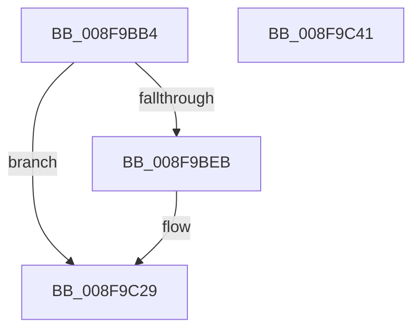

# PnpDeviceCompletionRequestCreate

- RVA: `0x008F9BB4`–`0x008F9C42` (길이 `142` bytes)
- VA: `0x00000001408F9BB4`
- 실행 섹션: `PAGE`
- PDB 이름 있음: `예`; PDB Function 태그: `아니요`
- unwind 정보 RVA: `0x0005C954`
- 디코드: `37`개 명령, `142/142` bytes 표시
- 미해석 바이트: `0` (있으면 어셈블리에 `.byte`로 보존)

> 이 문서는 커널 이미지의 기계어와 PDB 기호를 분석해 생성했습니다. 4번과 5번은 함수 원형과 자료형을 바이너리 사용 방식에서 추정한 C 해석이며 원본 소스 복구 결과는 아닙니다.

## 1. Dependencies

- 직접 호출 지점: **2**; 고유 호출 대상: **2**
- 직접 호출자로 확인된 함수: **3**
- RIP 상대 이미지 참조: **0**

### Outgoing calls
- `0x008F9BDE` → [ExAllocatePool2](../../poolcode/B8/ExAllocatePool2_function_00B820F0.md) (function, `0x00B820F0`)
- `0x008F9C20` → [PnpEnableWatchdog](PnpEnableWatchdog_function_008FB5C8.md) (function, `0x008FB5C8`)

### Direct callers
- [PipEnumerateDevice](PipEnumerateDevice_function_008F99E4.md) at `0x008F9A36`
- [PnpStartDeviceNode](PnpStartDeviceNode_function_008FE38C.md) at `0x008FE4F2`
- [sub_00B38858](../B3/Unknown_function_00B38858.md) at `0x00B3889E`

### Static image references
- 디코드된 RIP-relative 메모리 참조가 없습니다.

## 2. Other-region calls and transfers

- 다른 실행 섹션으로 향하는 call: **1**
  - `0x008F9BDE` → [ExAllocatePool2](../../poolcode/B8/ExAllocatePool2_function_00B820F0.md) (`PAGE` → `POOLCODE`)
- 별도 외부 분기/꼬리 이동을 확인하지 못했습니다.

## 3. Assembly (complete function range)

```asm
008F9BB4  48 89 5C 24 08                  mov qword ptr [rsp + 8], rbx
008F9BB9  48 89 6C 24 10                  mov qword ptr [rsp + 0x10], rbp
008F9BBE  48 89 74 24 18                  mov qword ptr [rsp + 0x18], rsi
008F9BC3  57                              push rdi
008F9BC4  48 83 EC 20                     sub rsp, 0x20
008F9BC8  8B EA                           mov ebp, edx
008F9BCA  49 8B F0                        mov rsi, r8
008F9BCD  BA 48 00 00 00                  mov edx, 0x48
008F9BD2  48 8B F9                        mov rdi, rcx
008F9BD5  41 B8 50 6E 70 31               mov r8d, 0x31706e50
008F9BDB  8D 4A F8                        lea ecx, [rdx - 8]
008F9BDE  E8 0D 85 28 00                  call 0x140b820f0
008F9BE3  48 8B D8                        mov rbx, rax
008F9BE6  48 85 C0                        test rax, rax
008F9BE9  74 3E                           je 0x1408f9c29
008F9BEB  48 89 40 08                     mov qword ptr [rax + 8], rax
008F9BEF  4C 8D 47 38                     lea r8, [rdi + 0x38]
008F9BF3  48 89 00                        mov qword ptr [rax], rax
008F9BF6  48 8B D0                        mov rdx, rax
008F9BF9  83 60 24 00                     and dword ptr [rax + 0x24], 0
008F9BFD  B9 02 00 00 00                  mov ecx, 2
008F9C02  48 83 60 30 00                  and qword ptr [rax + 0x30], 0
008F9C07  C7 40 38 01 00 00 00            mov dword ptr [rax + 0x38], 1
008F9C0E  48 89 70 18                     mov qword ptr [rax + 0x18], rsi
008F9C12  48 89 78 10                     mov qword ptr [rax + 0x10], rdi
008F9C16  89 68 20                        mov dword ptr [rax + 0x20], ebp
008F9C19  C7 40 28 E5 00 00 C0            mov dword ptr [rax + 0x28], 0xc00000e5
008F9C20  E8 A3 19 00 00                  call 0x1408fb5c8
008F9C25  48 89 43 40                     mov qword ptr [rbx + 0x40], rax
008F9C29  48 8B 6C 24 38                  mov rbp, qword ptr [rsp + 0x38]
008F9C2E  48 8B C3                        mov rax, rbx
008F9C31  48 8B 5C 24 30                  mov rbx, qword ptr [rsp + 0x30]
008F9C36  48 8B 74 24 40                  mov rsi, qword ptr [rsp + 0x40]
008F9C3B  48 83 C4 20                     add rsp, 0x20
008F9C3F  5F                              pop rdi
008F9C40  C3                              ret
008F9C41  CC                              int3
```

## 4. C-style interpretation (structured pseudocode)

```c
__int64 __fastcall PnpDeviceCompletionRequestCreate(__int64 a1, int a2, __int64 a3)
{
    __int64 result;
    __int64 v_rsp;
    unsigned __int64 v_stack_p10;
    unsigned __int64 v_stack_p18;
    unsigned __int64 v_stack_p8;

    v_stack_p8 = v_rbx;
    v_stack_p10 = v_rbp;
    v_stack_p18 = v_rsi;
    v_rsp = (v_rsp) - (32);
    result = ExAllocatePool2(72 - 8, 72, (unsigned int)(0x31706E50ULL), a4);
    if (result != 0) {
        *(unsigned __int64 *)(result + 8) = result;
        a3 = a1 + 56;
        *(unsigned __int64 *)(result) = result;
        a2 = result;
        a1 = 2;
        *(unsigned int *)(result + 56) = 1;
        *(unsigned __int64 *)(result + 24) = a3;
        *(unsigned __int64 *)(result + 16) = a1;
        *(unsigned int *)(result + 32) = (unsigned int)((unsigned int)(a2));
        *(unsigned int *)(result + 40) = 0xC00000E5ULL;
        result = PnpEnableWatchdog(a1, a2, a3, a4);
        *(unsigned __int64 *)(result + 64) = result;
    }
    v_rsp = (v_rsp) + (32);
    return result;
}
```

## 5. (Beta) C Style

```c
int64_t PnpDeviceCompletionRequestCreate(void *Arg1, int32_t Arg2, int64_t Arg3)
{
    uint8_t *arg1 = (uint8_t *)Arg1;

    int64_t result;
    int64_t local_rsp;
    uint64_t v_stack_p10;
    uint64_t v_stack_p18;
    uint64_t v_stack_p8;

    v_stack_p8 = local_rbx;
    v_stack_p10 = local_rbp;
    v_stack_p18 = local_rsi;
    local_rsp = (local_rsp) - (32);
    result = ExAllocatePool2(72 - 8, 72, (uint32_t)(0x31706E50ULL), a4);
    if (result != 0) {
        *(uint64_t *)(result + 0x8) = result;
        Arg3 = Arg1 + 56;
        *(uint64_t *)(result) = result;
        Arg2 = result;
        Arg1 = 2;
        *(uint32_t *)(result + 0x38) = 1;
        *(uint64_t *)(result + 0x18) = Arg3;
        *(void **)(result + 0x10) = Arg1;
        *(uint32_t *)(result + 0x20) = (uint32_t)((uint32_t)(Arg2));
        *(uint32_t *)(result + 0x28) = 0xC00000E5ULL;
        result = PnpEnableWatchdog(Arg1, Arg2, Arg3, a4);
        *(uint64_t *)(result + 0x40) = result;
    }
    local_rsp = (local_rsp) + (32);
    return result;
}
```

### 관측된 메모리 오프셋

구조체 형식이 확인되지 않은 접근은 인자 기준의 오프셋으로만 기록했습니다.

| 기준 인자 | 오프셋 표현 | 폭 (bit) | 접근 |
|---|---:|---:|---|
| `Arg1` | `+ 0x38` | `64` | `R` |

## 6. Execution-region graph

[열기: 2D/3D 그래프와 함수 탐색 컨트롤 패널](../../../control-panel.html?section=page&rva=0x008F9BB4&view=graph)

- 2D 그래프는 위에서 아래로 흐르고, 3D 그래프는 빈 공간을 드래그해 회전합니다. Shift+드래그는 이동, 휠은 확대·축소, 함수 노드 선택은 대상 보고서 이동입니다.

### Static fallback


