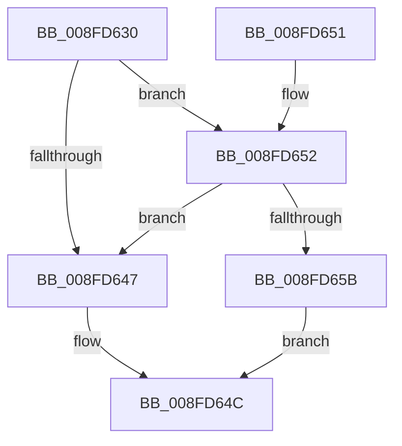

# PnpDeviceObjectToDeviceInstance

- RVA: `0x008FD630`–`0x008FD685` (길이 `85` bytes)
- VA: `0x00000001408FD630`
- 실행 섹션: `PAGE`
- PDB 이름 있음: `예`; PDB Function 태그: `아니요`
- unwind 정보 RVA: `0x00088114`
- 디코드: `22`개 명령, `85/85` bytes 표시
- 미해석 바이트: `0` (있으면 어셈블리에 `.byte`로 보존)

> 이 문서는 커널 이미지의 기계어와 PDB 기호를 분석해 생성했습니다. 4번과 5번은 함수 원형과 자료형을 바이너리 사용 방식에서 추정한 C 해석이며 원본 소스 복구 결과는 아닙니다.

## 1. Dependencies

- 직접 호출 지점: **1**; 고유 호출 대상: **1**
- 직접 호출자로 확인된 함수: **8**
- RIP 상대 이미지 참조: **1**

### Outgoing calls
- `0x008FD67E` → [_CmOpenDeviceRegKey](../8E/_CmOpenDeviceRegKey_function_008EE540.md) (function, `0x008EE540`)

### Direct callers
- [IoReportDetectedDevice](../72/IoReportDetectedDevice_function_00725CD0.md) at `0x00726509`
- [PiGetDeviceRegistryProperty](../72/PiGetDeviceRegistryProperty_function_007280A8.md) at `0x00728148`
- [PipDmgSetIommuDomainPolicyAndNotifyHal](../73/PipDmgSetIommuDomainPolicyAndNotifyHal_function_0073C718.md) at `0x0073C75F`
- [PiUpdateDevicePanel](PiUpdateDevicePanel_function_008FBD4C.md) at `0x008FBDE3`
- [PiCreateDriverSwDevices](PiCreateDriverSwDevices_function_008FCFA8.md) at `0x008FCFDC`
- [PnpSaveDeviceCapabilities](PnpSaveDeviceCapabilities_function_008FD478.md) at `0x008FD4B9`
- [PiQueryRemovableDeviceOverride](../A2/PiQueryRemovableDeviceOverride_function_00A2A474.md) at `0x00A2A602`
- [sub_00B1F622](../B1/Unknown_function_00B1F622.md) at `0x00B1F646`

### Static image references
- `0x008FD661` → RVA `0x00E66398` (`.data`; read)

## 2. Other-region calls and transfers

- 다른 실행 섹션으로 향하는 call: **0**
- 별도 외부 분기/꼬리 이동을 확인하지 못했습니다.

## 3. Assembly (complete function range)

```asm
008FD630  48 83 EC 48                     sub rsp, 0x48
008FD634  48 8B 81 38 01 00 00            mov rax, qword ptr [rcx + 0x138]
008FD63B  4C 8B CA                        mov r9, rdx
008FD63E  48 8B 50 28                     mov rdx, qword ptr [rax + 0x28]
008FD642  48 85 D2                        test rdx, rdx
008FD645  75 0B                           jne 0x1408fd652
008FD647  B8 10 00 00 C0                  mov eax, 0xc0000010
008FD64C  48 83 C4 48                     add rsp, 0x48
008FD650  C3                              ret
008FD651  CC                              int3
008FD652  48 8B 52 30                     mov rdx, qword ptr [rdx + 0x30]
008FD656  48 85 D2                        test rdx, rdx
008FD659  74 EC                           je 0x1408fd647
008FD65B  48 83 64 24 38 00               and qword ptr [rsp + 0x38], 0
008FD661  48 8B 0D 30 8D 56 00            mov rcx, qword ptr [rip + 0x568d30]
008FD668  4C 89 4C 24 30                  mov qword ptr [rsp + 0x30], r9
008FD66D  45 33 C9                        xor r9d, r9d
008FD670  C6 44 24 28 00                  mov byte ptr [rsp + 0x28], 0
008FD675  44 89 44 24 20                  mov dword ptr [rsp + 0x20], r8d
008FD67A  45 8D 41 10                     lea r8d, [r9 + 0x10]
008FD67E  E8 BD 0E FF FF                  call 0x1408ee540
008FD683  EB C7                           jmp 0x1408fd64c
```

## 4. C-style interpretation (structured pseudocode)

```c
__int64 __fastcall PnpDeviceObjectToDeviceInstance(__int64 a1, __int64 a2, int a3)
{
    __int64 result;
    __int64 v_rsp;
    unsigned int v_stack_p20;
    unsigned __int8 v_stack_p28;
    unsigned __int64 v_stack_p30;
    unsigned __int64 v_stack_p38;

    v_rsp = (v_rsp) - (72);
    if (*(unsigned __int64 *)(*(unsigned __int64 *)(a1 + 312) + 40) != 0) goto loc_008FD652;
loc_008FD647:
loc_008FD64C:
    v_rsp = (v_rsp) + (72);
    return (unsigned int)(0xC0000010ULL);
loc_008FD652:
    if (*(unsigned __int64 *)(*(unsigned __int64 *)(*(unsigned __int64 *)(a1 + 312) + 40) + 48) == 0) goto loc_008FD647;
    v_stack_p30 = a2;
    a4 = 0;
    v_stack_p28 = 0;
    v_stack_p20 = a3;
    result = _CmOpenDeviceRegKey(*(unsigned __int64 *)(v_rip + 5672240), *(unsigned __int64 *)(*(unsigned __int64 *)(*(unsigned __int64 *)(a1 + 312) + 40) + 48), a4 + 16, a4);
    goto loc_008FD64C;
}
```

## 5. (Beta) C Style

```c
int64_t PnpDeviceObjectToDeviceInstance(void *Arg1, int64_t Arg2, int32_t Arg3)
{
    uint8_t *arg1 = (uint8_t *)Arg1;

    int64_t result;
    int64_t local_rsp;
    uint32_t v_stack_p20;
    uint8_t v_stack_p28;
    uint64_t v_stack_p30;
    uint64_t v_stack_p38;

    local_rsp = (local_rsp) - (72);
    if (*(uint64_t *)(*(uint64_t *)(arg1 + 0x138) + 0x28) != 0) goto loc_008FD652;
loc_008FD647:
loc_008FD64C:
    local_rsp = (local_rsp) + (72);
    return (uint32_t)(0xC0000010ULL);
loc_008FD652:
    if (*(uint64_t *)(*(uint64_t *)(*(uint64_t *)(arg1 + 0x138) + 0x28) + 0x30) == 0) goto loc_008FD647;
    v_stack_p30 = Arg2;
    a4 = 0;
    v_stack_p28 = 0;
    v_stack_p20 = Arg3;
    result = _CmOpenDeviceRegKey(*(uint64_t *)(v_rip + 0x568D30), *(uint64_t *)(*(uint64_t *)(*(uint64_t *)(arg1 + 0x138) + 0x28) + 0x30), a4 + 16, a4);
    goto loc_008FD64C;
}
```

### 관측된 메모리 오프셋

구조체 형식이 확인되지 않은 접근은 인자 기준의 오프셋으로만 기록했습니다.

| 기준 인자 | 오프셋 표현 | 폭 (bit) | 접근 |
|---|---:|---:|---|
| `Arg1` | `+ 0x138` | `64` | `R` |

## 6. Execution-region graph

[열기: 2D/3D 그래프와 함수 탐색 컨트롤 패널](../../../control-panel.html?section=page&rva=0x008FD630&view=graph)

- 2D 그래프는 위에서 아래로 흐르고, 3D 그래프는 빈 공간을 드래그해 회전합니다. Shift+드래그는 이동, 휠은 확대·축소, 함수 노드 선택은 대상 보고서 이동입니다.

### Static fallback


