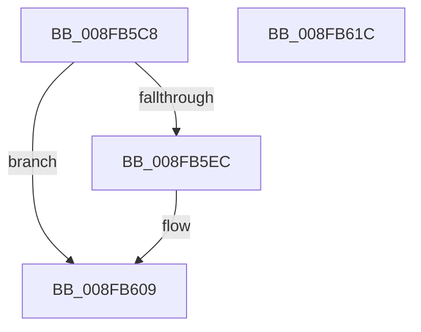

# PnpEnableWatchdog

- RVA: `0x008FB5C8`–`0x008FB61D` (길이 `85` bytes)
- VA: `0x00000001408FB5C8`
- 실행 섹션: `PAGE`
- PDB 이름 있음: `예`; PDB Function 태그: `아니요`
- unwind 정보 RVA: `0x00060BC4`
- 디코드: `24`개 명령, `85/85` bytes 표시
- 미해석 바이트: `0` (있으면 어셈블리에 `.byte`로 보존)

> 이 문서는 커널 이미지의 기계어와 PDB 기호를 분석해 생성했습니다. 4번과 5번은 함수 원형과 자료형을 바이너리 사용 방식에서 추정한 C 해석이며 원본 소스 복구 결과는 아닙니다.

## 1. Dependencies

- 직접 호출 지점: **2**; 고유 호출 대상: **2**
- 직접 호출자로 확인된 함수: **5**
- RIP 상대 이미지 참조: **0**

### Outgoing calls
- `0x008FB5DF` → [PnpAllocateWatchdog](../../text/3F/PnpAllocateWatchdog_function_003FEE5C.md) (function, `0x003FEE5C`)
- `0x008FB604` → [PnpWatchdogTimerStart](PnpWatchdogTimerStart_function_008FB624.md) (function, `0x008FB624`)

### Direct callers
- [PnpDeviceCompletionRequestCreate](PnpDeviceCompletionRequestCreate_function_008F9BB4.md) at `0x008F9C20`
- [PnpAllocateAndEnableEventWatchdog](PnpAllocateAndEnableEventWatchdog_function_008FB3F8.md) at `0x008FB53A`
- [PnpCallAddDevice](PnpCallAddDevice_function_008FC164.md) at `0x008FC1E5`
- [PnpCallDriverEntry](../99/PnpCallDriverEntry_function_00996AF4.md) at `0x00996B31`
- [PnpDelayedRemoveWorker](../A0/PnpDelayedRemoveWorker_function_00A08AE0.md) at `0x00A08C42`

### Static image references
- 디코드된 RIP-relative 메모리 참조가 없습니다.

## 2. Other-region calls and transfers

- 다른 실행 섹션으로 향하는 call: **1**
  - `0x008FB5DF` → [PnpAllocateWatchdog](../../text/3F/PnpAllocateWatchdog_function_003FEE5C.md) (`PAGE` → `.text`)
- 별도 외부 분기/꼬리 이동을 확인하지 못했습니다.

## 3. Assembly (complete function range)

```asm
008FB5C8  48 89 5C 24 08                  mov qword ptr [rsp + 8], rbx
008FB5CD  48 89 74 24 10                  mov qword ptr [rsp + 0x10], rsi
008FB5D2  57                              push rdi
008FB5D3  48 83 EC 20                     sub rsp, 0x20
008FB5D7  8B F1                           mov esi, ecx
008FB5D9  48 8B FA                        mov rdi, rdx
008FB5DC  49 8B C8                        mov rcx, r8
008FB5DF  E8 78 38 B0 FF                  call 0x1403fee5c
008FB5E4  48 8B D8                        mov rbx, rax
008FB5E7  48 85 C0                        test rax, rax
008FB5EA  74 1D                           je 0x1408fb609
008FB5EC  48 89 78 18                     mov qword ptr [rax + 0x18], rdi
008FB5F0  89 70 10                        mov dword ptr [rax + 0x10], esi
008FB5F3  48 A1 08 00 00 00 80 F7 FF FF   movabs rax, qword ptr [0xfffff78000000008]
008FB5FD  48 8B 4B 08                     mov rcx, qword ptr [rbx + 8]
008FB601  48 89 03                        mov qword ptr [rbx], rax
008FB604  E8 1B 00 00 00                  call 0x1408fb624
008FB609  48 8B 74 24 38                  mov rsi, qword ptr [rsp + 0x38]
008FB60E  48 8B C3                        mov rax, rbx
008FB611  48 8B 5C 24 30                  mov rbx, qword ptr [rsp + 0x30]
008FB616  48 83 C4 20                     add rsp, 0x20
008FB61A  5F                              pop rdi
008FB61B  C3                              ret
008FB61C  CC                              int3
```

## 4. C-style interpretation (structured pseudocode)

```c
__int64 __fastcall PnpEnableWatchdog(int a1, __int64 a2, __int64 a3)
{
    __int64 result;
    __int64 v_rsp;
    unsigned __int64 v_stack_p10;
    unsigned __int64 v_stack_p8;

    v_stack_p8 = v_rbx;
    v_stack_p10 = v_rsi;
    v_rsp = (v_rsp) - (32);
    result = PnpAllocateWatchdog(a3, a2, a3, a4);
    if (result != 0) {
        *(unsigned __int64 *)(result + 24) = a2;
        *(unsigned int *)(result + 16) = (unsigned int)((unsigned int)(a1));
        a1 = *(unsigned __int64 *)(result + 8);
        *(unsigned __int64 *)(result) = result;
        result = PnpWatchdogTimerStart(a1, a2, a3, a4);
    }
    v_rsp = (v_rsp) + (32);
    return result;
}
```

## 5. (Beta) C Style

```c
int64_t PnpEnableWatchdog(int32_t Arg1, int64_t Arg2, int64_t Arg3)
{
    int64_t result;
    int64_t local_rsp;
    uint64_t v_stack_p10;
    uint64_t v_stack_p8;

    v_stack_p8 = local_rbx;
    v_stack_p10 = local_rsi;
    local_rsp = (local_rsp) - (32);
    result = PnpAllocateWatchdog(Arg3, Arg2, Arg3, a4);
    if (result != 0) {
        *(uint64_t *)(result + 0x18) = Arg2;
        *(uint32_t *)(result + 0x10) = (uint32_t)((uint32_t)(Arg1));
        Arg1 = *(uint64_t *)(result + 0x8);
        *(uint64_t *)(result) = result;
        result = PnpWatchdogTimerStart(Arg1, Arg2, Arg3, a4);
    }
    local_rsp = (local_rsp) + (32);
    return result;
}
```

## 6. Execution-region graph

[열기: 2D/3D 그래프와 함수 탐색 컨트롤 패널](../../../control-panel.html?section=page&rva=0x008FB5C8&view=graph)

- 2D 그래프는 위에서 아래로 흐르고, 3D 그래프는 빈 공간을 드래그해 회전합니다. Shift+드래그는 이동, 휠은 확대·축소, 함수 노드 선택은 대상 보고서 이동입니다.

### Static fallback


