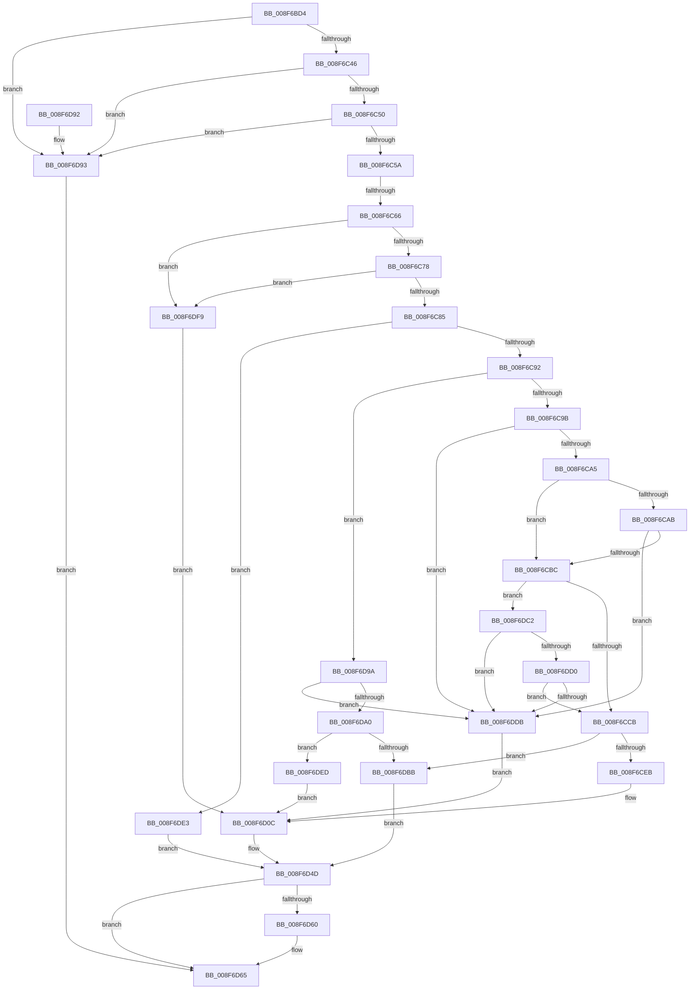

# PnpGetDeviceInterfacePropertyData

- RVA: `0x008F6BD4`–`0x008F6E01` (길이 `557` bytes)
- VA: `0x00000001408F6BD4`
- 실행 섹션: `PAGE`
- PDB 이름 있음: `예`; PDB Function 태그: `예`
- unwind 정보 RVA: `0x000879B8`
- 디코드: `138`개 명령, `557/557` bytes 표시
- 미해석 바이트: `0` (있으면 어셈블리에 `.byte`로 보존)

> 이 문서는 커널 이미지의 기계어와 PDB 기호를 분석해 생성했습니다. 4번과 5번은 함수 원형과 자료형을 바이너리 사용 방식에서 추정한 C 해석이며 원본 소스 복구 결과는 아닙니다.

## 1. Dependencies

- 직접 호출 지점: **7**; 고유 호출 대상: **6**
- 직접 호출자로 확인된 함수: **1**
- RIP 상대 이미지 참조: **2**

### Outgoing calls
- `0x008F6C2D` → [memset](../../text/6C/memset_function_006C6C40.md) (function, `0x006C6C40`)
- `0x008F6CDA` → [ExAllocatePool2](../../poolcode/B8/ExAllocatePool2_function_00B820F0.md) (function, `0x00B820F0`)
- `0x008F6CF6` → [memcpy](../../text/6C/memcpy_function_006C6840.md) (function, `0x006C6840`)
- `0x008F6D46` → [PnpGetObjectProperty](../8E/PnpGetObjectProperty_function_008E2180.md) (function, `0x008E2180`)
- `0x008F6D53` → [PnpUnicodeStringToWstrFree](PnpUnicodeStringToWstrFree_function_008F59F0.md) (function, `0x008F59F0`)
- `0x008F6D72` → [_security_check_cookie](../../text/6A/_security_check_cookie_function_006AC640.md) (function, `0x006AC640`)
- `0x008F6DAE` → [ExAllocatePool2](../../poolcode/B8/ExAllocatePool2_function_00B820F0.md) (function, `0x00B820F0`)

### Direct callers
- [IoGetDeviceInterfacePropertyData](IoGetDeviceInterfacePropertyData_function_008F6B90.md) at `0x008F6BC0`

### Static image references
- `0x008F6BEB` → RVA `0x00E0A740` (`.data`; read)
- `0x008F6D16` → RVA `0x00E66398` (`.data`; read)

## 2. Other-region calls and transfers

- 다른 실행 섹션으로 향하는 call: **5**
  - `0x008F6C2D` → [memset](../../text/6C/memset_function_006C6C40.md) (`PAGE` → `.text`)
  - `0x008F6CDA` → [ExAllocatePool2](../../poolcode/B8/ExAllocatePool2_function_00B820F0.md) (`PAGE` → `POOLCODE`)
  - `0x008F6CF6` → [memcpy](../../text/6C/memcpy_function_006C6840.md) (`PAGE` → `.text`)
  - `0x008F6D72` → [_security_check_cookie](../../text/6A/_security_check_cookie_function_006AC640.md) (`PAGE` → `.text`)
  - `0x008F6DAE` → [ExAllocatePool2](../../poolcode/B8/ExAllocatePool2_function_00B820F0.md) (`PAGE` → `POOLCODE`)
- call이 아닌 외부 분기/꼬리 이동: **1**
  - `0x008F6C60` → [sub_00B1EF9C](../B1/Unknown_function_00B1EF9C.md) (`tail-transfer`)

## 3. Assembly (complete function range)

```asm
008F6BD4  48 89 5C 24 20                  mov qword ptr [rsp + 0x20], rbx
008F6BD9  55                              push rbp
008F6BDA  56                              push rsi
008F6BDB  57                              push rdi
008F6BDC  41 54                           push r12
008F6BDE  41 55                           push r13
008F6BE0  41 56                           push r14
008F6BE2  41 57                           push r15
008F6BE4  48 81 EC 30 01 00 00            sub rsp, 0x130
008F6BEB  48 8B 05 4E 3B 51 00            mov rax, qword ptr [rip + 0x513b4e]
008F6BF2  48 33 C4                        xor rax, rsp
008F6BF5  48 89 84 24 20 01 00 00         mov qword ptr [rsp + 0x120], rax
008F6BFD  4C 8B BC 24 98 01 00 00         mov r15, qword ptr [rsp + 0x198]
008F6C05  41 8B D8                        mov ebx, r8d
008F6C08  4C 8B A4 24 A0 01 00 00         mov r12, qword ptr [rsp + 0x1a0]
008F6C10  4C 8B F2                        mov r14, rdx
008F6C13  4C 8B AC 24 A8 01 00 00         mov r13, qword ptr [rsp + 0x1a8]
008F6C1B  48 8B F9                        mov rdi, rcx
008F6C1E  BD AA 00 00 00                  mov ebp, 0xaa
008F6C23  48 8D 4C 24 70                  lea rcx, [rsp + 0x70]
008F6C28  44 8B C5                        mov r8d, ebp
008F6C2B  33 D2                           xor edx, edx
008F6C2D  E8 0E 00 DD FF                  call 0x1406c6c40
008F6C32  45 33 C9                        xor r9d, r9d
008F6C35  4C 89 4C 24 60                  mov qword ptr [rsp + 0x60], r9
008F6C3A  41 8B F1                        mov esi, r9d
008F6C3D  48 85 FF                        test rdi, rdi
008F6C40  0F 84 4D 01 00 00               je 0x1408f6d93
008F6C46  4C 39 4F 08                     cmp qword ptr [rdi + 8], r9
008F6C4A  0F 84 43 01 00 00               je 0x1408f6d93
008F6C50  66 44 39 0F                     cmp word ptr [rdi], r9w
008F6C54  0F 84 39 01 00 00               je 0x1408f6d93
008F6C5A  45 8D 51 02                     lea r10d, [r9 + 2]
008F6C5E  85 DB                           test ebx, ebx
008F6C60  0F 85 36 83 22 00               jne 0x140b1ef9c
008F6C66  41 8B E9                        mov ebp, r9d
008F6C69  44 0F B7 47 02                  movzx r8d, word ptr [rdi + 2]
008F6C6E  66 45 3B C2                     cmp r8w, r10w
008F6C72  0F 82 81 01 00 00               jb 0x1408f6df9
008F6C78  48 8B 4F 08                     mov rcx, qword ptr [rdi + 8]
008F6C7C  48 85 C9                        test rcx, rcx
008F6C7F  0F 84 74 01 00 00               je 0x1408f6df9
008F6C85  0F B7 17                        movzx edx, word ptr [rdi]
008F6C88  66 41 3B D0                     cmp dx, r8w
008F6C8C  0F 87 51 01 00 00               ja 0x1408f6de3
008F6C92  66 85 D2                        test dx, dx
008F6C95  0F 84 FF 00 00 00               je 0x1408f6d9a
008F6C9B  66 44 39 09                     cmp word ptr [rcx], r9w
008F6C9F  0F 84 36 01 00 00               je 0x1408f6ddb
008F6CA5  66 41 3B D0                     cmp dx, r8w
008F6CA9  75 11                           jne 0x1408f6cbc
008F6CAB  8B C2                           mov eax, edx
008F6CAD  48 D1 E8                        shr rax, 1
008F6CB0  66 44 39 4C 41 FE               cmp word ptr [rcx + rax*2 - 2], r9w
008F6CB6  0F 84 1F 01 00 00               je 0x1408f6ddb
008F6CBC  49 8B C0                        mov rax, r8
008F6CBF  49 2B C2                        sub rax, r10
008F6CC2  48 3B D0                        cmp rdx, rax
008F6CC5  0F 86 F7 00 00 00               jbe 0x1408f6dc2
008F6CCB  48 83 C2 02                     add rdx, 2
008F6CCF  B9 00 01 00 00                  mov ecx, 0x100
008F6CD4  41 B8 50 70 73 75               mov r8d, 0x75737050
008F6CDA  E8 11 B4 28 00                  call 0x140b820f0
008F6CDF  48 8B D8                        mov rbx, rax
008F6CE2  48 85 C0                        test rax, rax
008F6CE5  0F 84 D0 00 00 00               je 0x1408f6dbb
008F6CEB  44 0F B7 07                     movzx r8d, word ptr [rdi]
008F6CEF  48 8B C8                        mov rcx, rax
008F6CF2  48 8B 57 08                     mov rdx, qword ptr [rdi + 8]
008F6CF6  E8 45 FB DC FF                  call 0x1406c6840
008F6CFB  0F B7 07                        movzx eax, word ptr [rdi]
008F6CFE  48 8B F3                        mov rsi, rbx
008F6D01  48 D1 E8                        shr rax, 1
008F6D04  45 33 C9                        xor r9d, r9d
008F6D07  66 44 89 0C 43                  mov word ptr [rbx + rax*2], r9w
008F6D0C  8B 84 24 90 01 00 00            mov eax, dword ptr [rsp + 0x190]
008F6D13  48 8B D6                        mov rdx, rsi
008F6D16  48 8B 0D 7B F6 56 00            mov rcx, qword ptr [rip + 0x56f67b]
008F6D1D  44 89 4C 24 50                  mov dword ptr [rsp + 0x50], r9d
008F6D22  45 33 C9                        xor r9d, r9d
008F6D25  4C 89 64 24 48                  mov qword ptr [rsp + 0x48], r12
008F6D2A  89 44 24 40                     mov dword ptr [rsp + 0x40], eax
008F6D2E  4C 89 7C 24 38                  mov qword ptr [rsp + 0x38], r15
008F6D33  4C 89 6C 24 30                  mov qword ptr [rsp + 0x30], r13
008F6D38  45 8D 41 03                     lea r8d, [r9 + 3]
008F6D3C  4C 89 74 24 28                  mov qword ptr [rsp + 0x28], r14
008F6D41  48 89 6C 24 20                  mov qword ptr [rsp + 0x20], rbp
008F6D46  E8 35 B4 FE FF                  call 0x1408e2180
008F6D4B  8B D8                           mov ebx, eax
008F6D4D  48 8B D7                        mov rdx, rdi
008F6D50  48 8B CE                        mov rcx, rsi
008F6D53  E8 98 EC FF FF                  call 0x1408f59f0
008F6D58  81 FB 25 02 00 C0               cmp ebx, 0xc0000225
008F6D5E  75 05                           jne 0x1408f6d65
008F6D60  BB 34 00 00 C0                  mov ebx, 0xc0000034
008F6D65  8B C3                           mov eax, ebx
008F6D67  48 8B 8C 24 20 01 00 00         mov rcx, qword ptr [rsp + 0x120]
008F6D6F  48 33 CC                        xor rcx, rsp
008F6D72  E8 C9 58 DB FF                  call 0x1406ac640
008F6D77  48 8B 9C 24 88 01 00 00         mov rbx, qword ptr [rsp + 0x188]
008F6D7F  48 81 C4 30 01 00 00            add rsp, 0x130
008F6D86  41 5F                           pop r15
008F6D88  41 5E                           pop r14
008F6D8A  41 5D                           pop r13
008F6D8C  41 5C                           pop r12
008F6D8E  5F                              pop rdi
008F6D8F  5E                              pop rsi
008F6D90  5D                              pop rbp
008F6D91  C3                              ret
008F6D92  CC                              int3
008F6D93  BB 0D 00 00 C0                  mov ebx, 0xc000000d
008F6D98  EB CB                           jmp 0x1408f6d65
008F6D9A  66 44 39 09                     cmp word ptr [rcx], r9w
008F6D9E  74 3B                           je 0x1408f6ddb
008F6DA0  41 B8 50 70 73 75               mov r8d, 0x75737050
008F6DA6  49 8B D2                        mov rdx, r10
008F6DA9  B9 00 01 00 00                  mov ecx, 0x100
008F6DAE  E8 3D B3 28 00                  call 0x140b820f0
008F6DB3  45 33 C9                        xor r9d, r9d
008F6DB6  48 85 C0                        test rax, rax
008F6DB9  75 32                           jne 0x1408f6ded
008F6DBB  BB 9A 00 00 C0                  mov ebx, 0xc000009a
008F6DC0  EB 8B                           jmp 0x1408f6d4d
008F6DC2  48 8B C2                        mov rax, rdx
008F6DC5  48 D1 E8                        shr rax, 1
008F6DC8  66 44 39 4C 41 FE               cmp word ptr [rcx + rax*2 - 2], r9w
008F6DCE  74 0B                           je 0x1408f6ddb
008F6DD0  66 44 39 0C 41                  cmp word ptr [rcx + rax*2], r9w
008F6DD5  0F 85 F0 FE FF FF               jne 0x1408f6ccb
008F6DDB  48 8B F1                        mov rsi, rcx
008F6DDE  E9 29 FF FF FF                  jmp 0x1408f6d0c
008F6DE3  BB 0D 00 00 C0                  mov ebx, 0xc000000d
008F6DE8  E9 60 FF FF FF                  jmp 0x1408f6d4d
008F6DED  66 44 89 08                     mov word ptr [rax], r9w
008F6DF1  48 8B F0                        mov rsi, rax
008F6DF4  E9 13 FF FF FF                  jmp 0x1408f6d0c
008F6DF9  49 8B F1                        mov rsi, r9
008F6DFC  E9 0B FF FF FF                  jmp 0x1408f6d0c
```

## 4. C-style interpretation (structured pseudocode)

```c
__int64 __fastcall PnpGetDeviceInterfacePropertyData(__int64 a1, __int64 a2, int a3, int a4, unsigned int a5, __int64 a6, __int64 a7, __int64 a8)
{
    __int64 result;
    __int64 v_rbx;
    __int64 v_rsp;
    unsigned __int64 v_stack_m108;
    unsigned int v_stack_m118;
    unsigned __int64 v_stack_m120;
    unsigned int v_stack_m128;
    unsigned __int64 v_stack_m130;
    unsigned __int64 v_stack_m138;
    unsigned __int64 v_stack_m140;
    unsigned __int64 v_stack_m148;
    unsigned __int64 v_stack_m48;
    unsigned __int64 v_stack_mF8;
    unsigned __int64 v_stack_p20;

    v_stack_p20 = v_rbx;
    v_rsp = (v_rsp) - (304);
    result = (*(unsigned __int64 *)(v_rip + 5323598)) ^ (v_rsp);
    v_stack_m48 = result;
    a2 = 0;
    result = memset(v_stack_mF8, a2, 170, a4);
    a4 = 0;
    v_stack_m108 = 0;
    if (a1 == 0) goto loc_008F6D93;
    if ((*(unsigned __int64 *)(a1 + 8)) == 0) goto loc_008F6D93;
    if ((*(unsigned __int16 *)(a1)) == 0) goto loc_008F6D93;
    if (((unsigned __int16)(*(unsigned __int16 *)(a1 + 2))) < ((unsigned __int16)(a4 + 2))) goto loc_008F6DF9;
    if (*(unsigned __int64 *)(a1 + 8) == 0) goto loc_008F6DF9;
    if (((unsigned __int16)(*(unsigned __int16 *)(a1))) > ((unsigned __int16)(*(unsigned __int16 *)(a1 + 2)))) goto loc_008F6DE3;
    if ((unsigned __int16)(*(unsigned __int16 *)(a1)) == 0) goto loc_008F6D9A;
    if ((*(unsigned __int16 *)(*(unsigned __int64 *)(a1 + 8))) == 0) goto loc_008F6DDB;
    if (((unsigned __int16)(*(unsigned __int16 *)(a1))) != ((unsigned __int16)(*(unsigned __int16 *)(a1 + 2)))) goto loc_008F6CBC;
    result = ((unsigned int)((unsigned int)(*(unsigned __int16 *)(a1)))) >> (1);
    if ((*(unsigned __int16 *)(*(unsigned __int64 *)(a1 + 8) + result * 2 - 2)) == 0) goto loc_008F6DDB;
loc_008F6CBC:
    result = (*(unsigned __int16 *)(a1 + 2)) - (a4 + 2);
    if ((*(unsigned __int16 *)(a1)) <= result) goto loc_008F6DC2;
loc_008F6CCB:
    a2 = (*(unsigned __int16 *)(a1)) + (2);
    result = ExAllocatePool2(256, a2, (unsigned int)(0x75737050ULL), a4);
    if (result == 0) goto loc_008F6DBB;
    result = memcpy(result, *(unsigned __int64 *)(a1 + 8), *(unsigned __int16 *)(a1), a4);
    result = (*(unsigned __int16 *)(a1)) >> (1);
    a4 = 0;
    *(unsigned __int16 *)(result + result * 2) = 0;
loc_008F6D0C:
    v_stack_m118 = 0;
    a4 = 0;
    v_stack_m120 = a7;
    v_stack_m128 = (unsigned int)((unsigned int)(a5));
    v_stack_m130 = a6;
    v_stack_m138 = a8;
    v_stack_m140 = a2;
    v_stack_m148 = 0;
    result = PnpGetObjectProperty(*(unsigned __int64 *)(v_rip + 5699195), result, a4 + 3, a4);
loc_008F6D4D:
    result = PnpUnicodeStringToWstrFree(result, a1, a4 + 3, a4);
    v_rbx = (unsigned int)((unsigned int)(result));
    if (((unsigned int)((unsigned int)((unsigned int)(result)))) == 0xC0000225ULL) {
        v_rbx = 0xC0000034ULL;
    }
    a1 = (v_stack_m48) ^ (v_rsp);
    result = _security_check_cookie(a1, a1, a4 + 3, a4);
    v_rsp = (v_rsp) + (304);
    return result;
loc_008F6D93:
    goto loc_008F6D65;
loc_008F6D9A:
    if ((*(unsigned __int16 *)(a1)) == 0) goto loc_008F6DDB;
    result = ExAllocatePool2(256, a4 + 2, (unsigned int)(0x75737050ULL), a4);
    a4 = 0;
    if (result != 0) goto loc_008F6DED;
loc_008F6DBB:
    goto loc_008F6D4D;
loc_008F6DC2:
    result = (a4 + 2) >> (1);
    if ((*(unsigned __int16 *)(256 + result * 2 - 2)) == 0) goto loc_008F6DDB;
    if ((*(unsigned __int16 *)(256 + result * 2)) != 0) goto loc_008F6CCB;
loc_008F6DDB:
    goto loc_008F6D0C;
loc_008F6DE3:
    goto loc_008F6D4D;
loc_008F6DED:
    *(unsigned __int16 *)(result) = 0;
    goto loc_008F6D0C;
loc_008F6DF9:
    goto loc_008F6D0C;
}
```

## 5. (Beta) C Style

```c
int64_t PnpGetDeviceInterfacePropertyData(int64_t Arg1, int64_t Arg2, int32_t Arg3, int32_t Arg4, uint32_t Arg5, int64_t Arg6, int64_t Arg7, int64_t Arg8)
{
    int64_t result;
    int64_t local_rbx;
    int64_t local_rsp;
    uint64_t v_stack_m108;
    uint32_t v_stack_m118;
    uint64_t v_stack_m120;
    uint32_t v_stack_m128;
    uint64_t v_stack_m130;
    uint64_t v_stack_m138;
    uint64_t v_stack_m140;
    uint64_t v_stack_m148;
    uint64_t v_stack_m48;
    uint64_t v_stack_mF8;
    uint64_t v_stack_p20;

    v_stack_p20 = local_rbx;
    local_rsp = (local_rsp) - (304);
    result = (*(uint64_t *)(v_rip + 0x513B4E)) ^ (local_rsp);
    v_stack_m48 = result;
    Arg2 = 0;
    result = memset(v_stack_mF8, Arg2, 170, Arg4);
    Arg4 = 0;
    v_stack_m108 = 0;
    if (Arg1 == 0) goto loc_008F6D93;
    if ((*(uint64_t *)(Arg1 + 0x8)) == 0) goto loc_008F6D93;
    if ((*(uint16_t *)(Arg1)) == 0) goto loc_008F6D93;
    if (((uint16_t)(*(uint16_t *)(Arg1 + 0x2))) < ((uint16_t)(Arg4 + 2))) goto loc_008F6DF9;
    if (*(uint64_t *)(Arg1 + 0x8) == 0) goto loc_008F6DF9;
    if (((uint16_t)(*(uint16_t *)(Arg1))) > ((uint16_t)(*(uint16_t *)(Arg1 + 0x2)))) goto loc_008F6DE3;
    if ((uint16_t)(*(uint16_t *)(Arg1)) == 0) goto loc_008F6D9A;
    if ((*(uint16_t *)(*(uint64_t *)(Arg1 + 0x8))) == 0) goto loc_008F6DDB;
    if (((uint16_t)(*(uint16_t *)(Arg1))) != ((uint16_t)(*(uint16_t *)(Arg1 + 0x2)))) goto loc_008F6CBC;
    result = ((uint32_t)((uint32_t)(*(uint16_t *)(Arg1)))) >> (1);
    if ((*(uint16_t *)(*(uint64_t *)(Arg1 + 0x8) + result * 2 - 0x2)) == 0) goto loc_008F6DDB;
loc_008F6CBC:
    result = (*(uint16_t *)(Arg1 + 0x2)) - (Arg4 + 2);
    if ((*(uint16_t *)(Arg1)) <= result) goto loc_008F6DC2;
loc_008F6CCB:
    Arg2 = (*(uint16_t *)(Arg1)) + (2);
    result = ExAllocatePool2(256, Arg2, (uint32_t)(0x75737050ULL), Arg4);
    if (result == 0) goto loc_008F6DBB;
    result = memcpy(result, *(uint64_t *)(Arg1 + 0x8), *(uint16_t *)(Arg1), Arg4);
    result = (*(uint16_t *)(Arg1)) >> (1);
    Arg4 = 0;
    *(uint16_t *)(result + result * 2) = 0;
loc_008F6D0C:
    v_stack_m118 = 0;
    Arg4 = 0;
    v_stack_m120 = Arg7;
    v_stack_m128 = (uint32_t)((uint32_t)(Arg5));
    v_stack_m130 = Arg6;
    v_stack_m138 = Arg8;
    v_stack_m140 = Arg2;
    v_stack_m148 = 0;
    result = PnpGetObjectProperty(*(uint64_t *)(v_rip + 0x56F67B), result, Arg4 + 3, Arg4);
loc_008F6D4D:
    result = PnpUnicodeStringToWstrFree(result, Arg1, Arg4 + 3, Arg4);
    local_rbx = (uint32_t)((uint32_t)(result));
    if (((uint32_t)((uint32_t)((uint32_t)(result)))) == 0xC0000225ULL) {
        local_rbx = 0xC0000034ULL;
    }
    Arg1 = (v_stack_m48) ^ (local_rsp);
    result = _security_check_cookie(Arg1, Arg1, Arg4 + 3, Arg4);
    local_rsp = (local_rsp) + (304);
    return result;
loc_008F6D93:
    goto loc_008F6D65;
loc_008F6D9A:
    if ((*(uint16_t *)(Arg1)) == 0) goto loc_008F6DDB;
    result = ExAllocatePool2(256, Arg4 + 2, (uint32_t)(0x75737050ULL), Arg4);
    Arg4 = 0;
    if (result != 0) goto loc_008F6DED;
loc_008F6DBB:
    goto loc_008F6D4D;
loc_008F6DC2:
    result = (Arg4 + 2) >> (1);
    if ((*(uint16_t *)(256 + result * 2 - 0x2)) == 0) goto loc_008F6DDB;
    if ((*(uint16_t *)(256 + result * 2)) != 0) goto loc_008F6CCB;
loc_008F6DDB:
    goto loc_008F6D0C;
loc_008F6DE3:
    goto loc_008F6D4D;
loc_008F6DED:
    *(uint16_t *)(result) = 0;
    goto loc_008F6D0C;
loc_008F6DF9:
    goto loc_008F6D0C;
}
```

## 6. Execution-region graph

[열기: 2D/3D 그래프와 함수 탐색 컨트롤 패널](../../../control-panel.html?section=page&rva=0x008F6BD4&view=graph)

- 2D 그래프는 위에서 아래로 흐르고, 3D 그래프는 빈 공간을 드래그해 회전합니다. Shift+드래그는 이동, 휠은 확대·축소, 함수 노드 선택은 대상 보고서 이동입니다.

### Static fallback


