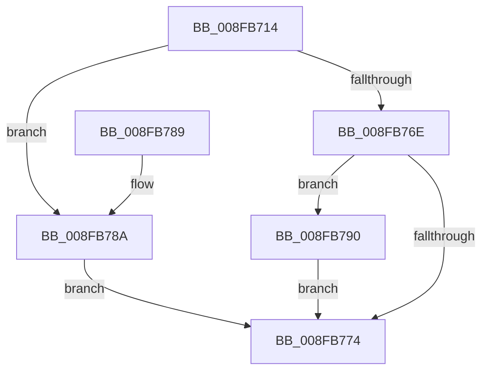

# PnpIrpQueryID

- RVA: `0x008FB714`–`0x008FB794` (길이 `128` bytes)
- VA: `0x00000001408FB714`
- 실행 섹션: `PAGE`
- PDB 이름 있음: `예`; PDB Function 태그: `아니요`
- unwind 정보 RVA: `0x00087E34`
- 디코드: `36`개 명령, `128/128` bytes 표시
- 미해석 바이트: `0` (있으면 어셈블리에 `.byte`로 보존)

> 이 문서는 커널 이미지의 기계어와 PDB 기호를 분석해 생성했습니다. 4번과 5번은 함수 원형과 자료형을 바이너리 사용 방식에서 추정한 C 해석이며 원본 소스 복구 결과는 아닙니다.

## 1. Dependencies

- 직접 호출 지점: **2**; 고유 호출 대상: **2**
- 직접 호출자로 확인된 함수: **5**
- RIP 상대 이미지 참조: **0**

### Outgoing calls
- `0x008FB73D` → [memset](../../text/6C/memset_function_006C6C40.md) (function, `0x006C6C40`)
- `0x008FB765` → [IopSynchronousCall](IopSynchronousCall_function_008FB018.md) (function, `0x008FB018`)

### Direct callers
- [PpProfileCommitTransitioningDock](../73/PpProfileCommitTransitioningDock_function_00737A4C.md) at `0x00737AE3`
- [PpProfileIncludeInHardwareProfileTransition](../73/PpProfileIncludeInHardwareProfileTransition_function_00737B9C.md) at `0x00737C1E`
- [PnpQueryID](PnpQueryID_function_008FB984.md) at `0x008FB9AF`
- [PiProcessNewDeviceNode](../A2/PiProcessNewDeviceNode_function_00A28F20.md) at `0x00A2910E`
- [PiProcessNewDeviceNode](../A2/PiProcessNewDeviceNode_function_00A28F20.md) at `0x00A29B6A`
- [PiProcessNewDeviceNode](../A2/PiProcessNewDeviceNode_function_00A28F20.md) at `0x00A29C15`
- [PiProcessNewDeviceNode](../A2/PiProcessNewDeviceNode_function_00A28F20.md) at `0x00A29CC9`
- [PnpQueryDeviceID](../A2/PnpQueryDeviceID_function_00A2B21C.md) at `0x00A2B257`

### Static image references
- 디코드된 RIP-relative 메모리 참조가 없습니다.

## 2. Other-region calls and transfers

- 다른 실행 섹션으로 향하는 call: **1**
  - `0x008FB73D` → [memset](../../text/6C/memset_function_006C6C40.md) (`PAGE` → `.text`)
- 별도 외부 분기/꼬리 이동을 확인하지 못했습니다.

## 3. Assembly (complete function range)

```asm
008FB714  48 89 5C 24 08                  mov qword ptr [rsp + 8], rbx
008FB719  48 89 74 24 10                  mov qword ptr [rsp + 0x10], rsi
008FB71E  57                              push rdi
008FB71F  48 81 EC 80 00 00 00            sub rsp, 0x80
008FB726  49 83 20 00                     and qword ptr [r8], 0
008FB72A  8B DA                           mov ebx, edx
008FB72C  33 D2                           xor edx, edx
008FB72E  49 8B F0                        mov rsi, r8
008FB731  48 8B F9                        mov rdi, rcx
008FB734  48 8D 4C 24 30                  lea rcx, [rsp + 0x30]
008FB739  44 8D 42 48                     lea r8d, [rdx + 0x48]
008FB73D  E8 FE B4 DC FF                  call 0x1406c6c40
008FB742  89 5C 24 38                     mov dword ptr [rsp + 0x38], ebx
008FB746  48 8D 54 24 30                  lea rdx, [rsp + 0x30]
008FB74B  BB BB 00 00 C0                  mov ebx, 0xc00000bb
008FB750  66 C7 44 24 30 1B 13            mov word ptr [rsp + 0x30], 0x131b
008FB757  44 8B C3                        mov r8d, ebx
008FB75A  48 89 74 24 20                  mov qword ptr [rsp + 0x20], rsi
008FB75F  45 33 C9                        xor r9d, r9d
008FB762  48 8B CF                        mov rcx, rdi
008FB765  E8 AE F8 FF FF                  call 0x1408fb018
008FB76A  85 C0                           test eax, eax
008FB76C  78 1C                           js 0x1408fb78a
008FB76E  48 83 3E 00                     cmp qword ptr [rsi], 0
008FB772  74 1C                           je 0x1408fb790
008FB774  4C 8D 9C 24 80 00 00 00         lea r11, [rsp + 0x80]
008FB77C  49 8B 5B 10                     mov rbx, qword ptr [r11 + 0x10]
008FB780  49 8B 73 18                     mov rsi, qword ptr [r11 + 0x18]
008FB784  49 8B E3                        mov rsp, r11
008FB787  5F                              pop rdi
008FB788  C3                              ret
008FB789  CC                              int3
008FB78A  48 83 26 00                     and qword ptr [rsi], 0
008FB78E  EB E4                           jmp 0x1408fb774
008FB790  8B C3                           mov eax, ebx
008FB792  EB E0                           jmp 0x1408fb774
```

## 4. C-style interpretation (structured pseudocode)

```c
__int64 __fastcall PnpIrpQueryID(__int64 a1, int a2, __int64 a3, int a4)
{
    __int64 result;
    __int64 v_rsp;
    unsigned int v_stack_m50;
    unsigned __int64 v_stack_m58;
    unsigned __int64 v_stack_m68;
    unsigned __int64 v_stack_m8;
    unsigned __int64 v_stack_p10;
    unsigned __int64 v_stack_p8;

    v_stack_p8 = v_rbx;
    v_stack_p10 = v_rsi;
    v_rsp = (v_rsp) - (128);
    a2 = 0;
    result = memset(v_stack_m58, a2, a2 + 72, a4);
    v_stack_m50 = (unsigned int)((unsigned int)(a2));
    v_stack_m58 = 0x131BULL;
    v_stack_m68 = a3;
    a4 = 0;
    result = IopSynchronousCall(a1, v_stack_m58, (unsigned int)((unsigned int)((unsigned int)(0xC00000BBULL))), a4);
    if (sign_flag) goto loc_008FB78A;
    if ((*(unsigned __int64 *)(a3)) == 0) goto loc_008FB790;
loc_008FB774:
    return result;
loc_008FB78A:
    goto loc_008FB774;
loc_008FB790:
    goto loc_008FB774;
}
```

## 5. (Beta) C Style

```c
int64_t PnpIrpQueryID(int64_t Arg1, int32_t Arg2, void *Arg3, int32_t Arg4)
{
    uint8_t *arg3 = (uint8_t *)Arg3;

    int64_t result;
    int64_t local_rsp;
    uint32_t v_stack_m50;
    uint64_t v_stack_m58;
    uint64_t v_stack_m68;
    uint64_t v_stack_m8;
    uint64_t v_stack_p10;
    uint64_t v_stack_p8;

    v_stack_p8 = local_rbx;
    v_stack_p10 = local_rsi;
    local_rsp = (local_rsp) - (128);
    Arg2 = 0;
    result = memset(v_stack_m58, Arg2, Arg2 + 72, Arg4);
    v_stack_m50 = (uint32_t)((uint32_t)(Arg2));
    v_stack_m58 = 0x131BULL;
    v_stack_m68 = Arg3;
    Arg4 = 0;
    result = IopSynchronousCall(Arg1, v_stack_m58, (uint32_t)((uint32_t)((uint32_t)(0xC00000BBULL))), Arg4);
    if (sign_flag) goto loc_008FB78A;
    if ((*(uint64_t *)(arg3)) == 0) goto loc_008FB790;
loc_008FB774:
    return result;
loc_008FB78A:
    goto loc_008FB774;
loc_008FB790:
    goto loc_008FB774;
}
```

### 관측된 메모리 오프셋

구조체 형식이 확인되지 않은 접근은 인자 기준의 오프셋으로만 기록했습니다.

| 기준 인자 | 오프셋 표현 | 폭 (bit) | 접근 |
|---|---:|---:|---|
| `Arg3` | `+ 0x0` | `64` | `R` |
| `Arg3` | `+ 0x0` | `64` | `R/W` |

## 6. Execution-region graph

[열기: 2D/3D 그래프와 함수 탐색 컨트롤 패널](../../../control-panel.html?section=page&rva=0x008FB714&view=graph)

- 2D 그래프는 위에서 아래로 흐르고, 3D 그래프는 빈 공간을 드래그해 회전합니다. Shift+드래그는 이동, 휠은 확대·축소, 함수 노드 선택은 대상 보고서 이동입니다.

### Static fallback


