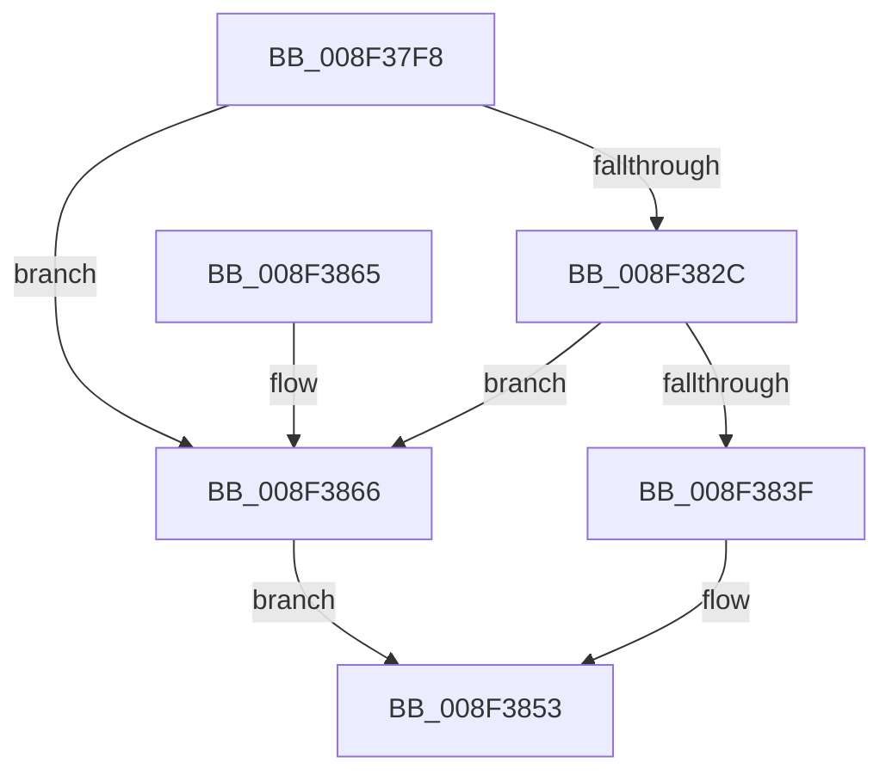

# PnpIsValidGuidString

- RVA: `0x008F37F8`–`0x008F386A` (길이 `114` bytes)
- VA: `0x00000001408F37F8`
- 실행 섹션: `PAGE`
- PDB 이름 있음: `예`; PDB Function 태그: `아니요`
- unwind 정보 RVA: `0x00087680`
- 디코드: `31`개 명령, `114/114` bytes 표시
- 미해석 바이트: `0` (있으면 어셈블리에 `.byte`로 보존)

> 이 문서는 커널 이미지의 기계어와 PDB 기호를 분석해 생성했습니다. 4번과 5번은 함수 원형과 자료형을 바이너리 사용 방식에서 추정한 C 해석이며 원본 소스 복구 결과는 아닙니다.

## 1. Dependencies

- 직접 호출 지점: **3**; 고유 호출 대상: **3**
- 직접 호출자로 확인된 함수: **7**
- RIP 상대 이미지 참조: **1**

### Outgoing calls
- `0x008F3823` → [RtlInitUnicodeStringEx](../../text/46/RtlInitUnicodeStringEx_function_00463960.md) (function, `0x00463960`)
- `0x008F3849` → [RtlGUIDFromString](RtlGUIDFromString_function_008F1EF0.md) (function, `0x008F1EF0`)
- `0x008F385B` → [_security_check_cookie](../../text/6A/_security_check_cookie_function_006AC640.md) (function, `0x006AC640`)

### Direct callers
- [PiPnpRtlCmActionCallback](../8E/PiPnpRtlCmActionCallback_function_008EF110.md) at `0x008EF3EC`
- [sub_008F1E09](Unknown_function_008F1E09.md) at `0x008F1E65`
- [CmGetDeviceInterfaceName](CmGetDeviceInterfaceName_function_008F3870.md) at `0x008F38A4`
- [CmValidateInstallerClassName](CmValidateInstallerClassName_function_008F4098.md) at `0x008F409F`
- [CmValidateDeviceContainerName](CmValidateDeviceContainerName_function_008F48B8.md) at `0x008F48C8`
- [_CmGetDeviceContainerIdFromBase](_CmGetDeviceContainerIdFromBase_function_008FD2B4.md) at `0x008FD3CF`
- [CmGetMatchingFilteredDeviceInterfaceListWorker](../A0/CmGetMatchingFilteredDeviceInterfaceListWorker_function_00A097EC.md) at `0x00A0988D`

### Static image references
- `0x008F37FC` → RVA `0x00E0A740` (`.data`; read)

## 2. Other-region calls and transfers

- 다른 실행 섹션으로 향하는 call: **2**
  - `0x008F3823` → [RtlInitUnicodeStringEx](../../text/46/RtlInitUnicodeStringEx_function_00463960.md) (`PAGE` → `.text`)
  - `0x008F385B` → [_security_check_cookie](../../text/6A/_security_check_cookie_function_006AC640.md) (`PAGE` → `.text`)
- 별도 외부 분기/꼬리 이동을 확인하지 못했습니다.

## 3. Assembly (complete function range)

```asm
008F37F8  48 83 EC 58                     sub rsp, 0x58
008F37FC  48 8B 05 3D 6F 51 00            mov rax, qword ptr [rip + 0x516f3d]
008F3803  48 33 C4                        xor rax, rsp
008F3806  48 89 44 24 40                  mov qword ptr [rsp + 0x40], rax
008F380B  0F 57 C0                        xorps xmm0, xmm0
008F380E  0F 57 C9                        xorps xmm1, xmm1
008F3811  48 8B D1                        mov rdx, rcx
008F3814  48 8D 4C 24 20                  lea rcx, [rsp + 0x20]
008F3819  0F 11 44 24 20                  movups xmmword ptr [rsp + 0x20], xmm0
008F381E  0F 11 4C 24 30                  movups xmmword ptr [rsp + 0x30], xmm1
008F3823  E8 38 01 B7 FF                  call 0x140463960
008F3828  85 C0                           test eax, eax
008F382A  78 3A                           js 0x1408f3866
008F382C  0F B7 44 24 22                  movzx eax, word ptr [rsp + 0x22]
008F3831  B9 FE FF 00 00                  mov ecx, 0xfffe
008F3836  66 23 C1                        and ax, cx
008F3839  66 83 F8 4E                     cmp ax, 0x4e
008F383D  75 27                           jne 0x1408f3866
008F383F  48 8D 54 24 30                  lea rdx, [rsp + 0x30]
008F3844  48 8D 4C 24 20                  lea rcx, [rsp + 0x20]
008F3849  E8 A2 E6 FF FF                  call 0x1408f1ef0
008F384E  85 C0                           test eax, eax
008F3850  0F 99 C0                        setns al
008F3853  48 8B 4C 24 40                  mov rcx, qword ptr [rsp + 0x40]
008F3858  48 33 CC                        xor rcx, rsp
008F385B  E8 E0 8D DB FF                  call 0x1406ac640
008F3860  48 83 C4 58                     add rsp, 0x58
008F3864  C3                              ret
008F3865  CC                              int3
008F3866  32 C0                           xor al, al
008F3868  EB E9                           jmp 0x1408f3853
```

## 4. C-style interpretation (structured pseudocode)

```c
__int64 __fastcall PnpIsValidGuidString(__int64 a1)
{
    __int64 result;
    __int64 v_rsp;
    unsigned __int64 v_stack_m18;
    unsigned __int64 v_stack_m28;
    unsigned __int16 v_stack_m36;
    unsigned __int64 v_stack_m38;

    v_rsp = (v_rsp) - (88);
    result = (*(unsigned __int64 *)(v_rip + 5336893)) ^ (v_rsp);
    v_stack_m18 = result;
    v_stack_m38 = v_xmm0;
    v_stack_m28 = v_xmm1;
    result = RtlInitUnicodeStringEx(v_stack_m38, a1, a3, a4);
    if (sign_flag) goto loc_008F3866;
    result = (unsigned __int16)((v_stack_m36) & ((unsigned __int16)((unsigned int)(0xFFFEULL))));
    if (((unsigned __int16)(result)) != 78) goto loc_008F3866;
    result = RtlGUIDFromString(v_stack_m38, v_stack_m28, a3, a4);
    result = (!sign_flag) ? 1 : 0;
loc_008F3853:
    a1 = (v_stack_m18) ^ (v_rsp);
    result = _security_check_cookie(a1, v_stack_m28, a3, a4);
    v_rsp = (v_rsp) + (88);
    return result;
loc_008F3866:
    result = 0;
    goto loc_008F3853;
}
```

## 5. (Beta) C Style

```c
int64_t PnpIsValidGuidString(int64_t Arg1)
{
    int64_t result;
    int64_t local_rsp;
    uint64_t v_stack_m18;
    uint64_t v_stack_m28;
    uint16_t v_stack_m36;
    uint64_t v_stack_m38;

    local_rsp = (local_rsp) - (88);
    result = (*(uint64_t *)(v_rip + 0x516F3D)) ^ (local_rsp);
    v_stack_m18 = result;
    v_stack_m38 = v_xmm0;
    v_stack_m28 = v_xmm1;
    result = RtlInitUnicodeStringEx(v_stack_m38, Arg1, a3, a4);
    if (sign_flag) goto loc_008F3866;
    result = (uint16_t)((v_stack_m36) & ((uint16_t)((uint32_t)(0xFFFEULL))));
    if (((uint16_t)(result)) != 78) goto loc_008F3866;
    result = RtlGUIDFromString(v_stack_m38, v_stack_m28, a3, a4);
    result = (!sign_flag) ? 1 : 0;
loc_008F3853:
    Arg1 = (v_stack_m18) ^ (local_rsp);
    result = _security_check_cookie(Arg1, v_stack_m28, a3, a4);
    local_rsp = (local_rsp) + (88);
    return result;
loc_008F3866:
    result = 0;
    goto loc_008F3853;
}
```

## 6. Execution-region graph

[열기: 2D/3D 그래프와 함수 탐색 컨트롤 패널](../../../control-panel.html?section=page&rva=0x008F37F8&view=graph)

- 2D 그래프는 위에서 아래로 흐르고, 3D 그래프는 빈 공간을 드래그해 회전합니다. Shift+드래그는 이동, 휠은 확대·축소, 함수 노드 선택은 대상 보고서 이동입니다.

### Static fallback


