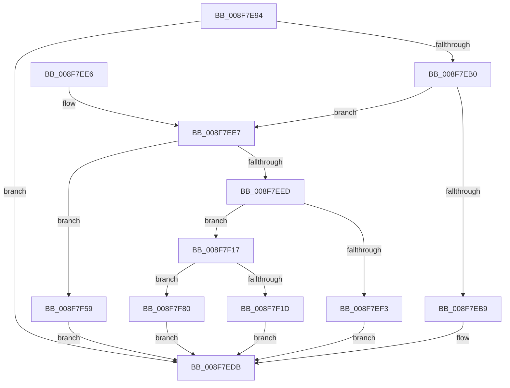

# PnpObjectRaisePropertyChangeEvent

- RVA: `0x008F7E94`–`0x008F7FA7` (길이 `275` bytes)
- VA: `0x00000001408F7E94`
- 실행 섹션: `PAGE`
- PDB 이름 있음: `예`; PDB Function 태그: `아니요`
- unwind 정보 RVA: `0x00087B2C`
- 디코드: `61`개 명령, `275/275` bytes 표시
- 미해석 바이트: `0` (있으면 어셈블리에 `.byte`로 보존)

> 이 문서는 커널 이미지의 기계어와 PDB 기호를 분석해 생성했습니다. 4번과 5번은 함수 원형과 자료형을 바이너리 사용 방식에서 추정한 C 해석이며 원본 소스 복구 결과는 아닙니다.

## 1. Dependencies

- 직접 호출 지점: **5**; 고유 호출 대상: **5**
- 직접 호출자로 확인된 함수: **8**
- RIP 상대 이미지 참조: **0**

### Outgoing calls
- `0x008F7ED6` → [PnpDeviceRaisePropertyChangeEventWorker](PnpDeviceRaisePropertyChangeEventWorker_function_008F80E0.md) (function, `0x008F80E0`)
- `0x008F7F10` → [PnpInterfaceRaisePropertyChangeEventWorker](../95/PnpInterfaceRaisePropertyChangeEventWorker_function_00951F88.md) (function, `0x00951F88`)
- `0x008F7F52` → [guard_dispatch_icall](../../text/6B/guard_dispatch_icall_function_006BAAD0.md) (function, `0x006BAAD0`)
- `0x008F7F76` → [PnpInstallerClassRaisePropertyChangeEventWorker](../AC/PnpInstallerClassRaisePropertyChangeEventWorker_function_00ACAF9C.md) (function, `0x00ACAF9C`)
- `0x008F7F9D` → [PnpInterfaceClassRaisePropertyChangeEventWorker](../82/PnpInterfaceClassRaisePropertyChangeEventWorker_function_0082DC58.md) (function, `0x0082DC58`)

### Direct callers
- [CmRemoveDeviceFromContainerWorker](../82/CmRemoveDeviceFromContainerWorker_function_0082C080.md) at `0x0082C212`
- [CmAddPanelDeviceWorker](../82/CmAddPanelDeviceWorker_function_0082DF30.md) at `0x0082E0B7`
- [CmRemovePanelDeviceWorker](../82/CmRemovePanelDeviceWorker_function_0082F470.md) at `0x0082F5A6`
- [CmSetInstallerClassMappedProperty](../83/CmSetInstallerClassMappedProperty_function_008310E8.md) at `0x00831327`
- [CmSetInterfaceClassMappedProperty](../83/CmSetInterfaceClassMappedProperty_function_00831500.md) at `0x008315DD`
- [PnpSetObjectPropertyWorker](PnpSetObjectPropertyWorker_function_008F7438.md) at `0x008F7565`
- [CmRaisePropertyChangeEvent](CmRaisePropertyChangeEvent_function_008FE93C.md) at `0x008FE99B`
- [sub_00B365E0](../B3/Unknown_function_00B365E0.md) at `0x00B36609`

### Static image references
- 디코드된 RIP-relative 메모리 참조가 없습니다.

## 2. Other-region calls and transfers

- 다른 실행 섹션으로 향하는 call: **1**
  - `0x008F7F52` → [guard_dispatch_icall](../../text/6B/guard_dispatch_icall_function_006BAAD0.md) (`PAGE` → `.text`)
- 별도 외부 분기/꼬리 이동을 확인하지 못했습니다.

## 3. Assembly (complete function range)

```asm
008F7E94  48 89 5C 24 08                  mov qword ptr [rsp + 8], rbx
008F7E99  57                              push rdi
008F7E9A  48 83 EC 50                     sub rsp, 0x50
008F7E9E  48 8B 99 F0 01 00 00            mov rbx, qword ptr [rcx + 0x1f0]
008F7EA5  49 8B F9                        mov rdi, r9
008F7EA8  4C 8B D9                        mov r11, rcx
008F7EAB  48 85 DB                        test rbx, rbx
008F7EAE  74 2B                           je 0x1408f7edb
008F7EB0  45 8B D0                        mov r10d, r8d
008F7EB3  41 83 EA 01                     sub r10d, 1
008F7EB7  75 2E                           jne 0x1408f7ee7
008F7EB9  48 8B 84 24 88 00 00 00         mov rax, qword ptr [rsp + 0x88]
008F7EC1  4C 8B C7                        mov r8, rdi
008F7EC4  4C 8B 8C 24 80 00 00 00         mov r9, qword ptr [rsp + 0x80]
008F7ECC  48 89 5C 24 28                  mov qword ptr [rsp + 0x28], rbx
008F7ED1  48 89 44 24 20                  mov qword ptr [rsp + 0x20], rax
008F7ED6  E8 05 02 00 00                  call 0x1408f80e0
008F7EDB  48 8B 5C 24 60                  mov rbx, qword ptr [rsp + 0x60]
008F7EE0  48 83 C4 50                     add rsp, 0x50
008F7EE4  5F                              pop rdi
008F7EE5  C3                              ret
008F7EE6  CC                              int3
008F7EE7  41 83 EA 01                     sub r10d, 1
008F7EEB  74 6C                           je 0x1408f7f59
008F7EED  41 83 EA 01                     sub r10d, 1
008F7EF1  75 24                           jne 0x1408f7f17
008F7EF3  48 8B 84 24 88 00 00 00         mov rax, qword ptr [rsp + 0x88]
008F7EFB  4C 8B C7                        mov r8, rdi
008F7EFE  4C 8B 8C 24 80 00 00 00         mov r9, qword ptr [rsp + 0x80]
008F7F06  48 89 5C 24 28                  mov qword ptr [rsp + 0x28], rbx
008F7F0B  48 89 44 24 20                  mov qword ptr [rsp + 0x20], rax
008F7F10  E8 73 A0 05 00                  call 0x140951f88
008F7F15  EB C4                           jmp 0x1408f7edb
008F7F17  41 83 FA 01                     cmp r10d, 1
008F7F1B  74 63                           je 0x1408f7f80
008F7F1D  48 8B 8C 24 80 00 00 00         mov rcx, qword ptr [rsp + 0x80]
008F7F25  48 8D 44 24 30                  lea rax, [rsp + 0x30]
008F7F2A  48 89 4C 24 38                  mov qword ptr [rsp + 0x38], rcx
008F7F2F  41 B9 04 00 00 00               mov r9d, 4
008F7F35  48 8B 8C 24 88 00 00 00         mov rcx, qword ptr [rsp + 0x88]
008F7F3D  48 89 4C 24 40                  mov qword ptr [rsp + 0x40], rcx
008F7F42  49 8B CB                        mov rcx, r11
008F7F45  48 89 44 24 20                  mov qword ptr [rsp + 0x20], rax
008F7F4A  48 8B C3                        mov rax, rbx
008F7F4D  48 89 7C 24 30                  mov qword ptr [rsp + 0x30], rdi
008F7F52  E8 79 2B DC FF                  call 0x1406baad0
008F7F57  EB 82                           jmp 0x1408f7edb
008F7F59  48 8B 84 24 88 00 00 00         mov rax, qword ptr [rsp + 0x88]
008F7F61  4C 8B C7                        mov r8, rdi
008F7F64  4C 8B 8C 24 80 00 00 00         mov r9, qword ptr [rsp + 0x80]
008F7F6C  48 89 5C 24 28                  mov qword ptr [rsp + 0x28], rbx
008F7F71  48 89 44 24 20                  mov qword ptr [rsp + 0x20], rax
008F7F76  E8 21 30 1D 00                  call 0x140acaf9c
008F7F7B  E9 5B FF FF FF                  jmp 0x1408f7edb
008F7F80  48 8B 84 24 88 00 00 00         mov rax, qword ptr [rsp + 0x88]
008F7F88  4C 8B C7                        mov r8, rdi
008F7F8B  4C 8B 8C 24 80 00 00 00         mov r9, qword ptr [rsp + 0x80]
008F7F93  48 89 5C 24 28                  mov qword ptr [rsp + 0x28], rbx
008F7F98  48 89 44 24 20                  mov qword ptr [rsp + 0x20], rax
008F7F9D  E8 B6 5C F3 FF                  call 0x14082dc58
008F7FA2  E9 34 FF FF FF                  jmp 0x1408f7edb
```

## 4. C-style interpretation (structured pseudocode)

```c
__int64 __fastcall PnpObjectRaisePropertyChangeEvent(__int64 a1, __int64 a2, int a3, __int64 a4, __int64 a5, __int64 a6)
{
    __int64 result;
    __int64 v_r10;
    __int64 v_rsp;
    unsigned __int64 v_stack_m30;
    unsigned __int64 v_stack_m38;
    unsigned __int64 v_stack_p20;
    unsigned __int64 v_stack_p28;
    unsigned __int64 v_stack_p30;
    unsigned __int64 v_stack_p38;
    unsigned __int64 v_stack_p40;
    unsigned __int64 v_stack_p8;

    v_stack_p8 = v_rbx;
    v_rsp = (v_rsp) - (80);
    if (*(unsigned __int64 *)(a1 + 496) == 0) goto loc_008F7EDB;
    v_r10 = (unsigned int)(((unsigned int)(a3)) - (1));
    if (condition_is_not_equal) goto loc_008F7EE7;
    v_stack_m30 = *(unsigned __int64 *)(a1 + 496);
    v_stack_m38 = a6;
    result = PnpDeviceRaisePropertyChangeEventWorker(a1, a2, a4, a5);
loc_008F7EDB:
    v_rsp = (v_rsp) + (80);
    return result;
loc_008F7EE7:
    v_r10 = (unsigned int)((v_r10) - (1));
    if (condition_is_equal) goto loc_008F7F59;
    v_r10 = (unsigned int)((v_r10) - (1));
    if (condition_is_not_equal) goto loc_008F7F17;
    v_stack_p28 = v_stack_p8;
    v_stack_p20 = a6;
    result = PnpInterfaceRaisePropertyChangeEventWorker(a1, a2, a4, a5);
    goto loc_008F7EDB;
loc_008F7F17:
    if (((unsigned int)(v_r10)) == 1) goto loc_008F7F80;
    v_stack_p38 = a5;
    v_stack_p40 = a6;
    v_stack_p20 = v_stack_p30;
    v_stack_p30 = a4;
    result = guard_dispatch_icall(a1, a2, a4, 4);
    goto loc_008F7EDB;
loc_008F7F59:
    v_stack_p28 = v_stack_p8;
    v_stack_p20 = a6;
    result = PnpInstallerClassRaisePropertyChangeEventWorker(a1, a2, a4, a5);
    goto loc_008F7EDB;
loc_008F7F80:
    v_stack_p28 = v_stack_p8;
    v_stack_p20 = a6;
    result = PnpInterfaceClassRaisePropertyChangeEventWorker(a1, a2, a4, a5);
    goto loc_008F7EDB;
}
```

## 5. (Beta) C Style

```c
int64_t PnpObjectRaisePropertyChangeEvent(void *Arg1, int64_t Arg2, int32_t Arg3, int64_t Arg4, int64_t Arg5, int64_t Arg6)
{
    uint8_t *arg1 = (uint8_t *)Arg1;

    int64_t result;
    int64_t local_r10;
    int64_t local_rsp;
    uint64_t v_stack_m30;
    uint64_t v_stack_m38;
    uint64_t v_stack_p20;
    uint64_t v_stack_p28;
    uint64_t v_stack_p30;
    uint64_t v_stack_p38;
    uint64_t v_stack_p40;
    uint64_t v_stack_p8;

    v_stack_p8 = local_rbx;
    local_rsp = (local_rsp) - (80);
    if (*(uint64_t *)(arg1 + 0x1F0) == 0) goto loc_008F7EDB;
    local_r10 = (uint32_t)(((uint32_t)(Arg3)) - (1));
    if (condition_is_not_equal) goto loc_008F7EE7;
    v_stack_m30 = *(uint64_t *)(arg1 + 0x1F0);
    v_stack_m38 = Arg6;
    result = PnpDeviceRaisePropertyChangeEventWorker(Arg1, Arg2, Arg4, Arg5);
loc_008F7EDB:
    local_rsp = (local_rsp) + (80);
    return result;
loc_008F7EE7:
    local_r10 = (uint32_t)((local_r10) - (1));
    if (condition_is_equal) goto loc_008F7F59;
    local_r10 = (uint32_t)((local_r10) - (1));
    if (condition_is_not_equal) goto loc_008F7F17;
    v_stack_p28 = v_stack_p8;
    v_stack_p20 = Arg6;
    result = PnpInterfaceRaisePropertyChangeEventWorker(Arg1, Arg2, Arg4, Arg5);
    goto loc_008F7EDB;
loc_008F7F17:
    if (((uint32_t)(local_r10)) == 1) goto loc_008F7F80;
    v_stack_p38 = Arg5;
    v_stack_p40 = Arg6;
    v_stack_p20 = v_stack_p30;
    v_stack_p30 = Arg4;
    result = guard_dispatch_icall(Arg1, Arg2, Arg4, 4);
    goto loc_008F7EDB;
loc_008F7F59:
    v_stack_p28 = v_stack_p8;
    v_stack_p20 = Arg6;
    result = PnpInstallerClassRaisePropertyChangeEventWorker(Arg1, Arg2, Arg4, Arg5);
    goto loc_008F7EDB;
loc_008F7F80:
    v_stack_p28 = v_stack_p8;
    v_stack_p20 = Arg6;
    result = PnpInterfaceClassRaisePropertyChangeEventWorker(Arg1, Arg2, Arg4, Arg5);
    goto loc_008F7EDB;
}
```

### 관측된 메모리 오프셋

구조체 형식이 확인되지 않은 접근은 인자 기준의 오프셋으로만 기록했습니다.

| 기준 인자 | 오프셋 표현 | 폭 (bit) | 접근 |
|---|---:|---:|---|
| `Arg1` | `+ 0x1F0` | `64` | `R` |

## 6. Execution-region graph

[열기: 2D/3D 그래프와 함수 탐색 컨트롤 패널](../../../control-panel.html?section=page&rva=0x008F7E94&view=graph)

- 2D 그래프는 위에서 아래로 흐르고, 3D 그래프는 빈 공간을 드래그해 회전합니다. Shift+드래그는 이동, 휠은 확대·축소, 함수 노드 선택은 대상 보고서 이동입니다.

### Static fallback


