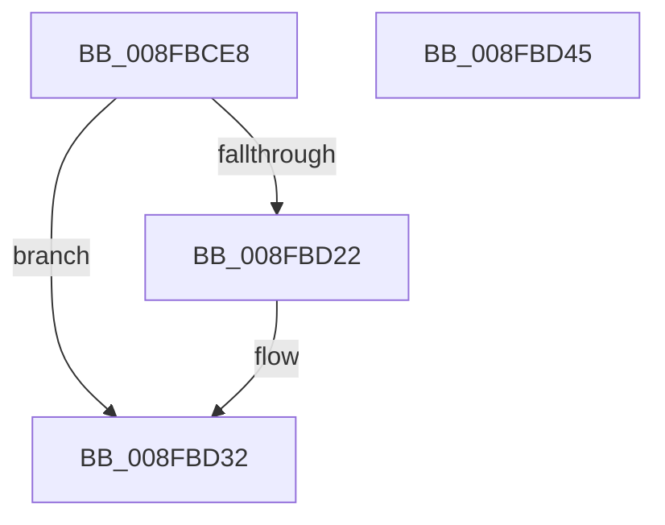

# PnpQueryAndSaveDeviceNodeCapabilities

- RVA: `0x008FBCE8`–`0x008FBD46` (길이 `94` bytes)
- VA: `0x00000001408FBCE8`
- 실행 섹션: `PAGE`
- PDB 이름 있음: `예`; PDB Function 태그: `아니요`
- unwind 정보 RVA: `0x00087EC4`
- 디코드: `26`개 명령, `94/94` bytes 표시
- 미해석 바이트: `0` (있으면 어셈블리에 `.byte`로 보존)

> 이 문서는 커널 이미지의 기계어와 PDB 기호를 분석해 생성했습니다. 4번과 5번은 함수 원형과 자료형을 바이너리 사용 방식에서 추정한 C 해석이며 원본 소스 복구 결과는 아닙니다.

## 1. Dependencies

- 직접 호출 지점: **4**; 고유 호출 대상: **4**
- 직접 호출자로 확인된 함수: **4**
- RIP 상대 이미지 참조: **1**

### Outgoing calls
- `0x008FBD0B` → [memset](../../text/6C/memset_function_006C6C40.md) (function, `0x006C6C40`)
- `0x008FBD19` → [PpIrpQueryCapabilities](PpIrpQueryCapabilities_function_008FAF8C.md) (function, `0x008FAF8C`)
- `0x008FBD2D` → [PnpSaveDeviceCapabilities](PnpSaveDeviceCapabilities_function_008FD478.md) (function, `0x008FD478`)
- `0x008FBD3A` → [_security_check_cookie](../../text/6A/_security_check_cookie_function_006AC640.md) (function, `0x006AC640`)

### Direct callers
- [PiInitializeDevice](../73/PiInitializeDevice_function_0073EC5C.md) at `0x0073EFF3`
- [PipProcessStartPhase3](PipProcessStartPhase3_function_008FBAF8.md) at `0x008FBB7F`
- [sub_00B420B0](../B4/Unknown_function_00B420B0.md) at `0x00B422AE`
- [IopInitializePlugPlayServices](../../init/C2/IopInitializePlugPlayServices_function_00C2F298.md) at `0x00C2FDA3`

### Static image references
- `0x008FBCEE` → RVA `0x00E0A740` (`.data`; read)

## 2. Other-region calls and transfers

- 다른 실행 섹션으로 향하는 call: **2**
  - `0x008FBD0B` → [memset](../../text/6C/memset_function_006C6C40.md) (`PAGE` → `.text`)
  - `0x008FBD3A` → [_security_check_cookie](../../text/6A/_security_check_cookie_function_006AC640.md) (`PAGE` → `.text`)
- 별도 외부 분기/꼬리 이동을 확인하지 못했습니다.

## 3. Assembly (complete function range)

```asm
008FBCE8  40 53                           push rbx
008FBCEA  48 83 EC 70                     sub rsp, 0x70
008FBCEE  48 8B 05 4B EA 50 00            mov rax, qword ptr [rip + 0x50ea4b]
008FBCF5  48 33 C4                        xor rax, rsp
008FBCF8  48 89 44 24 60                  mov qword ptr [rsp + 0x60], rax
008FBCFD  33 D2                           xor edx, edx
008FBCFF  48 8B D9                        mov rbx, rcx
008FBD02  48 8D 4C 24 20                  lea rcx, [rsp + 0x20]
008FBD07  44 8D 42 40                     lea r8d, [rdx + 0x40]
008FBD0B  E8 30 AF DC FF                  call 0x1406c6c40
008FBD10  48 8B 4B 20                     mov rcx, qword ptr [rbx + 0x20]
008FBD14  48 8D 54 24 20                  lea rdx, [rsp + 0x20]
008FBD19  E8 6E F2 FF FF                  call 0x1408faf8c
008FBD1E  85 C0                           test eax, eax
008FBD20  78 10                           js 0x1408fbd32
008FBD22  45 33 C0                        xor r8d, r8d
008FBD25  48 8D 54 24 20                  lea rdx, [rsp + 0x20]
008FBD2A  48 8B CB                        mov rcx, rbx
008FBD2D  E8 46 17 00 00                  call 0x1408fd478
008FBD32  48 8B 4C 24 60                  mov rcx, qword ptr [rsp + 0x60]
008FBD37  48 33 CC                        xor rcx, rsp
008FBD3A  E8 01 09 DB FF                  call 0x1406ac640
008FBD3F  48 83 C4 70                     add rsp, 0x70
008FBD43  5B                              pop rbx
008FBD44  C3                              ret
008FBD45  CC                              int3
```

## 4. C-style interpretation (structured pseudocode)

```c
__int64 __fastcall PnpQueryAndSaveDeviceNodeCapabilities(__int64 a1, int a2)
{
    __int64 result;
    __int64 v_rsp;
    unsigned __int64 v_stack_m18;
    unsigned __int64 v_stack_m58;

    v_rsp = (v_rsp) - (112);
    result = (*(unsigned __int64 *)(v_rip + 5302859)) ^ (v_rsp);
    v_stack_m18 = result;
    a2 = 0;
    result = memset(v_stack_m58, a2, a2 + 64, a4);
    result = PpIrpQueryCapabilities(*(unsigned __int64 *)(a1 + 32), v_stack_m58, a2 + 64, a4);
    if (!(sign_flag)) {
        a3 = 0;
        a2 = v_stack_m58;
        a1 = a1;
        result = PnpSaveDeviceCapabilities(a1, a2, a3, a4);
    }
    a1 = (v_stack_m18) ^ (v_rsp);
    result = _security_check_cookie(a1, a2, a3, a4);
    v_rsp = (v_rsp) + (112);
    return result;
}
```

## 5. (Beta) C Style

```c
int64_t PnpQueryAndSaveDeviceNodeCapabilities(void *Arg1, int32_t Arg2)
{
    uint8_t *arg1 = (uint8_t *)Arg1;

    int64_t result;
    int64_t local_rsp;
    uint64_t v_stack_m18;
    uint64_t v_stack_m58;

    local_rsp = (local_rsp) - (112);
    result = (*(uint64_t *)(v_rip + 0x50EA4B)) ^ (local_rsp);
    v_stack_m18 = result;
    Arg2 = 0;
    result = memset(v_stack_m58, Arg2, Arg2 + 64, a4);
    result = PpIrpQueryCapabilities(*(uint64_t *)(arg1 + 0x20), v_stack_m58, Arg2 + 64, a4);
    if (!(sign_flag)) {
        a3 = 0;
        Arg2 = v_stack_m58;
        Arg1 = Arg1;
        result = PnpSaveDeviceCapabilities(Arg1, Arg2, a3, a4);
    }
    Arg1 = (v_stack_m18) ^ (local_rsp);
    result = _security_check_cookie(Arg1, Arg2, a3, a4);
    local_rsp = (local_rsp) + (112);
    return result;
}
```

### 관측된 메모리 오프셋

구조체 형식이 확인되지 않은 접근은 인자 기준의 오프셋으로만 기록했습니다.

| 기준 인자 | 오프셋 표현 | 폭 (bit) | 접근 |
|---|---:|---:|---|
| `Arg1` | `+ 0x20` | `64` | `R` |

## 6. Execution-region graph

[열기: 2D/3D 그래프와 함수 탐색 컨트롤 패널](../../../control-panel.html?section=page&rva=0x008FBCE8&view=graph)

- 2D 그래프는 위에서 아래로 흐르고, 3D 그래프는 빈 공간을 드래그해 회전합니다. Shift+드래그는 이동, 휠은 확대·축소, 함수 노드 선택은 대상 보고서 이동입니다.

### Static fallback


