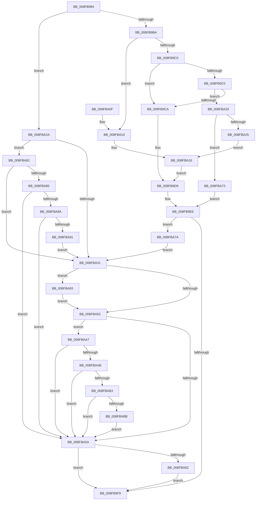

# PnpQueryID

- RVA: `0x008FB984`–`0x008FBAF0` (길이 `364` bytes)
- VA: `0x00000001408FB984`
- 실행 섹션: `PAGE`
- PDB 이름 있음: `예`; PDB Function 태그: `아니요`
- unwind 정보 RVA: `0x00087E7C`
- 디코드: `105`개 명령, `364/364` bytes 표시
- 미해석 바이트: `0` (있으면 어셈블리에 `.byte`로 보존)

> 이 문서는 커널 이미지의 기계어와 PDB 기호를 분석해 생성했습니다. 4번과 5번은 함수 원형과 자료형을 바이너리 사용 방식에서 추정한 C 해석이며 원본 소스 복구 결과는 아닙니다.

## 1. Dependencies

- 직접 호출 지점: **7**; 고유 호출 대상: **7**
- 직접 호출자로 확인된 함수: **1**
- RIP 상대 이미지 참조: **1**

### Outgoing calls
- `0x008FB9AF` → [PnpIrpQueryID](PnpIrpQueryID_function_008FB714.md) (function, `0x008FB714`)
- `0x008FB9E9` → [PnpFixupID](../A2/PnpFixupID_function_00A2B36C.md) (function, `0x00A2B36C`)
- `0x008FBA3C` → [PipSetDevNodeProblem](PipSetDevNodeProblem_function_008FDE0C.md) (function, `0x008FDE0C`)
- `0x008FBA64` → [ExFreePoolWithTag](../../poolcode/B8/ExFreePoolWithTag_function_00B82870.md) (function, `0x00B82870`)
- `0x008FBA93` → [PipSetDevNodeFlags](PipSetDevNodeFlags_function_008FC048.md) (function, `0x008FC048`)
- `0x008FBAA0` → [PnpSetInvalidIDEvent](../73/PnpSetInvalidIDEvent_function_0073832C.md) (function, `0x0073832C`)
- `0x008FBAE6` → [PnpLogEvent](../72/PnpLogEvent_function_0072C8FC.md) (function, `0x0072C8FC`)

### Direct callers
- [sub_00B1F622](../B1/Unknown_function_00B1F622.md) at `0x00B1F663`
- [sub_00B1F622](../B1/Unknown_function_00B1F622.md) at `0x00B1F678`

### Static image references
- `0x008FBABF` → RVA `0x00AFDCA0` (` ?? ::NNGAKEGL::`string'`; read)

## 2. Other-region calls and transfers

- 다른 실행 섹션으로 향하는 call: **1**
  - `0x008FBA64` → [ExFreePoolWithTag](../../poolcode/B8/ExFreePoolWithTag_function_00B82870.md) (`PAGE` → `POOLCODE`)
- 별도 외부 분기/꼬리 이동을 확인하지 못했습니다.

## 3. Assembly (complete function range)

```asm
008FB984  48 89 5C 24 10                  mov qword ptr [rsp + 0x10], rbx
008FB989  48 89 6C 24 18                  mov qword ptr [rsp + 0x18], rbp
008FB98E  56                              push rsi
008FB98F  41 56                           push r14
008FB991  41 57                           push r15
008FB993  48 83 EC 40                     sub rsp, 0x40
008FB997  83 64 24 34 00                  and dword ptr [rsp + 0x34], 0
008FB99C  48 8B E9                        mov rbp, rcx
008FB99F  48 8B 49 20                     mov rcx, qword ptr [rcx + 0x20]
008FB9A3  4D 8B F9                        mov r15, r9
008FB9A6  41 83 21 00                     and dword ptr [r9], 0
008FB9AA  4D 8B F0                        mov r14, r8
008FB9AD  8B F2                           mov esi, edx
008FB9AF  E8 60 FD FF FF                  call 0x1408fb714
008FB9B4  8B D8                           mov ebx, eax
008FB9B6  85 C0                           test eax, eax
008FB9B8  78 70                           js 0x1408fba2a
008FB9BA  8B C6                           mov eax, esi
008FB9BC  85 F6                           test esi, esi
008FB9BE  74 50                           je 0x1408fba10
008FB9C0  83 E8 01                        sub eax, 1
008FB9C3  74 05                           je 0x1408fb9ca
008FB9C5  83 E8 01                        sub eax, 1
008FB9C8  75 56                           jne 0x1408fba20
008FB9CA  41 83 C9 FF                     or r9d, 0xffffffff
008FB9CE  BA 00 04 00 00                  mov edx, 0x400
008FB9D3  41 B8 01 00 00 00               mov r8d, 1
008FB9D9  48 8B 45 10                     mov rax, qword ptr [rbp + 0x10]
008FB9DD  49 8B 0E                        mov rcx, qword ptr [r14]
008FB9E0  48 83 C0 38                     add rax, 0x38
008FB9E4  48 89 44 24 20                  mov qword ptr [rsp + 0x20], rax
008FB9E9  E8 7E F9 12 00                  call 0x140a2b36c
008FB9EE  03 C0                           add eax, eax
008FB9F0  41 89 07                        mov dword ptr [r15], eax
008FB9F3  0F 84 81 00 00 00               je 0x1408fba7a
008FB9F9  48 8B 6C 24 70                  mov rbp, qword ptr [rsp + 0x70]
008FB9FE  8B C3                           mov eax, ebx
008FBA00  48 8B 5C 24 68                  mov rbx, qword ptr [rsp + 0x68]
008FBA05  48 83 C4 40                     add rsp, 0x40
008FBA09  41 5F                           pop r15
008FBA0B  41 5E                           pop r14
008FBA0D  5E                              pop rsi
008FBA0E  C3                              ret
008FBA0F  CC                              int3
008FBA10  41 B9 01 00 00 00               mov r9d, 1
008FBA16  45 33 C0                        xor r8d, r8d
008FBA19  BA C8 00 00 00                  mov edx, 0xc8
008FBA1E  EB B9                           jmp 0x1408fb9d9
008FBA20  83 F8 01                        cmp eax, 1
008FBA23  75 4E                           jne 0x1408fba73
008FBA25  45 33 C9                        xor r9d, r9d
008FBA28  EB EC                           jmp 0x1408fba16
008FBA2A  3D 38 00 04 C0                  cmp eax, 0xc0040038
008FBA2F  75 50                           jne 0x1408fba81
008FBA31  44 8B C3                        mov r8d, ebx
008FBA34  BA 09 00 00 00                  mov edx, 9
008FBA39  48 8B CD                        mov rcx, rbp
008FBA3C  E8 CB 23 00 00                  call 0x1408fde0c
008FBA41  48 8B 4D 10                     mov rcx, qword ptr [rbp + 0x10]
008FBA45  BA 00 00 20 00                  mov edx, 0x200000
008FBA4A  85 91 8C 01 00 00               test dword ptr [rcx + 0x18c], edx
008FBA50  74 41                           je 0x1408fba93
008FBA52  81 FB 38 00 04 C0               cmp ebx, 0xc0040038
008FBA58  75 4D                           jne 0x1408fbaa7
008FBA5A  49 8B 0E                        mov rcx, qword ptr [r14]
008FBA5D  48 85 C9                        test rcx, rcx
008FBA60  74 97                           je 0x1408fb9f9
008FBA62  33 D2                           xor edx, edx
008FBA64  E8 07 6E 28 00                  call 0x140b82870
008FBA69  49 83 26 00                     and qword ptr [r14], 0
008FBA6D  41 83 27 00                     and dword ptr [r15], 0
008FBA71  EB 86                           jmp 0x1408fb9f9
008FBA73  33 C0                           xor eax, eax
008FBA75  E9 74 FF FF FF                  jmp 0x1408fb9ee
008FBA7A  BB 38 00 04 C0                  mov ebx, 0xc0040038
008FBA7F  EB B0                           jmp 0x1408fba31
008FBA81  85 F6                           test esi, esi
008FBA83  74 AC                           je 0x1408fba31
008FBA85  83 FE 03                        cmp esi, 3
008FBA88  75 D0                           jne 0x1408fba5a
008FBA8A  3D 9A 00 00 C0                  cmp eax, 0xc000009a
008FBA8F  75 C9                           jne 0x1408fba5a
008FBA91  EB 9E                           jmp 0x1408fba31
008FBA93  E8 B0 05 00 00                  call 0x1408fc048
008FBA98  48 8B 4D 10                     mov rcx, qword ptr [rbp + 0x10]
008FBA9C  48 83 C1 28                     add rcx, 0x28
008FBAA0  E8 87 C8 E3 FF                  call 0x14073832c
008FBAA5  EB AB                           jmp 0x1408fba52
008FBAA7  85 F6                           test esi, esi
008FBAA9  75 AF                           jne 0x1408fba5a
008FBAAB  81 FB 9A 00 00 C0               cmp ebx, 0xc000009a
008FBAB1  74 A7                           je 0x1408fba5a
008FBAB3  81 FB 0E 00 00 C0               cmp ebx, 0xc000000e
008FBAB9  74 9F                           je 0x1408fba5a
008FBABB  48 8B 4D 10                     mov rcx, qword ptr [rbp + 0x10]
008FBABF  48 8D 05 DA 21 20 00            lea rax, [rip + 0x2021da]
008FBAC6  21 74 24 20                     and dword ptr [rsp + 0x20], esi
008FBACA  48 8D 54 24 30                  lea rdx, [rsp + 0x30]
008FBACF  48 83 C1 38                     add rcx, 0x38
008FBAD3  C7 44 24 30 4E 00 50 00         mov dword ptr [rsp + 0x30], 0x50004e
008FBADB  45 33 C9                        xor r9d, r9d
008FBADE  48 89 44 24 38                  mov qword ptr [rsp + 0x38], rax
008FBAE3  44 8B C3                        mov r8d, ebx
008FBAE6  E8 11 0E E3 FF                  call 0x14072c8fc
008FBAEB  E9 6A FF FF FF                  jmp 0x1408fba5a
```

## 4. C-style interpretation (structured pseudocode)

```c
__int64 __fastcall PnpQueryID(__int64 a1, int a2, __int64 a3, __int64 a4)
{
    __int64 result;
    __int64 v_rsp;
    unsigned int v_stack_m24;
    unsigned __int64 v_stack_m38;
    unsigned __int64 v_stack_p10;
    unsigned __int64 v_stack_p18;
    unsigned int v_stack_p20;
    unsigned __int64 v_stack_p30;
    unsigned __int64 v_stack_p38;

    v_stack_p10 = v_rbx;
    v_stack_p18 = v_rbp;
    v_rsp = (v_rsp) - (64);
    result = PnpIrpQueryID(*(unsigned __int64 *)(a1 + 32), a2, a3, a4);
    if (sign_flag) goto loc_008FBA2A;
    if ((unsigned int)((unsigned int)(a2)) == 0) goto loc_008FBA10;
    result = (unsigned int)(((unsigned int)((unsigned int)((unsigned int)(a2)))) - (1));
    if (condition_is_equal) goto loc_008FB9CA;
    result = (unsigned int)((result) - (1));
    if (condition_is_not_equal) goto loc_008FBA20;
loc_008FB9CA:
    a4 = (unsigned int)((a4) | (0xFFFFFFFFULL));
loc_008FB9D9:
    result = (*(unsigned __int64 *)(a1 + 16)) + (56);
    v_stack_m38 = result;
    result = PnpFixupID(*(unsigned __int64 *)(a3), (unsigned int)(0x400ULL), 1, a4);
loc_008FB9EE:
    result = (unsigned int)((result) + ((unsigned int)(result)));
    *(unsigned int *)(a4) = (unsigned int)(result);
    if (condition_is_equal) goto loc_008FBA7A;
loc_008FB9F9:
    v_rsp = (v_rsp) + (64);
    return (unsigned int)((unsigned int)((unsigned int)((unsigned int)(result))));
loc_008FBA10:
loc_008FBA16:
    a3 = 0;
    goto loc_008FB9D9;
loc_008FBA20:
    if (((unsigned int)((unsigned int)((unsigned int)((unsigned int)((unsigned int)(result)))))) != 1) goto loc_008FBA73;
    a4 = 0;
    goto loc_008FBA16;
loc_008FBA2A:
    if (((unsigned int)((unsigned int)((unsigned int)((unsigned int)((unsigned int)(result)))))) != 0xC0040038ULL) goto loc_008FBA81;
loc_008FBA31:
    result = PipSetDevNodeProblem(v_stack_p18, 9, (unsigned int)((unsigned int)(v_stack_p10)), a4);
    if (((*(unsigned int *)(*(unsigned __int64 *)(v_stack_p18 + 16) + 396)) & ((unsigned int)((unsigned int)(0x200000ULL)))) == 0) goto loc_008FBA93;
loc_008FBA52:
    if (((unsigned int)(v_stack_p10)) != 0xC0040038ULL) goto loc_008FBAA7;
loc_008FBA5A:
    if (*(unsigned __int64 *)(a3) == 0) goto loc_008FB9F9;
    a2 = 0;
    result = ExFreePoolWithTag(*(unsigned __int64 *)(a3), a2, (unsigned int)((unsigned int)(v_stack_p10)), a4);
    goto loc_008FB9F9;
loc_008FBA73:
    result = 0;
    goto loc_008FB9EE;
loc_008FBA7A:
    goto loc_008FBA31;
loc_008FBA81:
    if ((unsigned int)((unsigned int)(a2)) == 0) goto loc_008FBA31;
    if (((unsigned int)((unsigned int)(a2))) != 3) goto loc_008FBA5A;
    if (0 != 0xC000009AULL) goto loc_008FBA5A;
    goto loc_008FBA31;
loc_008FBA93:
    result = PipSetDevNodeFlags(*(unsigned __int64 *)(a3), a2, (unsigned int)((unsigned int)(v_stack_p10)), a4);
    a1 = (*(unsigned __int64 *)(v_stack_p18 + 16)) + (40);
    result = PnpSetInvalidIDEvent(a1, a2, (unsigned int)((unsigned int)(v_stack_p10)), a4);
    goto loc_008FBA52;
loc_008FBAA7:
    if ((unsigned int)((unsigned int)(a2)) != 0) goto loc_008FBA5A;
    if (((unsigned int)((unsigned int)(0xC0040038ULL))) == 0xC000009AULL) goto loc_008FBA5A;
    if (((unsigned int)((unsigned int)(0xC0040038ULL))) == 0xC000000EULL) goto loc_008FBA5A;
    a1 = (*(unsigned __int64 *)(v_stack_p18 + 16)) + (56);
    v_stack_p30 = 0x50004EULL;
    a4 = 0;
    v_stack_p38 = v_rip + 2105818;
    result = PnpLogEvent(a1, v_stack_p30, (unsigned int)((unsigned int)((unsigned int)(0xC0040038ULL))), a4);
    goto loc_008FBA5A;
}
```

## 5. (Beta) C Style

```c
int64_t PnpQueryID(void *Arg1, int32_t Arg2, void *Arg3, void *Arg4)
{
    uint8_t *arg1 = (uint8_t *)Arg1;
    uint8_t *arg3 = (uint8_t *)Arg3;
    uint8_t *arg4 = (uint8_t *)Arg4;

    int64_t result;
    int64_t local_rsp;
    uint32_t v_stack_m24;
    uint64_t v_stack_m38;
    uint64_t v_stack_p10;
    uint64_t v_stack_p18;
    uint32_t v_stack_p20;
    uint64_t v_stack_p30;
    uint64_t v_stack_p38;

    v_stack_p10 = local_rbx;
    v_stack_p18 = local_rbp;
    local_rsp = (local_rsp) - (64);
    result = PnpIrpQueryID(*(uint64_t *)(arg1 + 0x20), Arg2, Arg3, Arg4);
    if (sign_flag) goto loc_008FBA2A;
    if ((uint32_t)((uint32_t)(Arg2)) == 0) goto loc_008FBA10;
    result = (uint32_t)(((uint32_t)((uint32_t)((uint32_t)(Arg2)))) - (1));
    if (condition_is_equal) goto loc_008FB9CA;
    result = (uint32_t)((result) - (1));
    if (condition_is_not_equal) goto loc_008FBA20;
loc_008FB9CA:
    Arg4 = (uint32_t)((Arg4) | (0xFFFFFFFFULL));
loc_008FB9D9:
    result = (*(uint64_t *)(arg1 + 0x10)) + (56);
    v_stack_m38 = result;
    result = PnpFixupID(*(uint64_t *)(arg3), (uint32_t)(0x400ULL), 1, Arg4);
loc_008FB9EE:
    result = (uint32_t)((result) + ((uint32_t)(result)));
    *(uint32_t *)(arg4) = (uint32_t)(result);
    if (condition_is_equal) goto loc_008FBA7A;
loc_008FB9F9:
    local_rsp = (local_rsp) + (64);
    return (uint32_t)((uint32_t)((uint32_t)((uint32_t)(result))));
loc_008FBA10:
loc_008FBA16:
    Arg3 = 0;
    goto loc_008FB9D9;
loc_008FBA20:
    if (((uint32_t)((uint32_t)((uint32_t)((uint32_t)((uint32_t)(result)))))) != 1) goto loc_008FBA73;
    Arg4 = 0;
    goto loc_008FBA16;
loc_008FBA2A:
    if (((uint32_t)((uint32_t)((uint32_t)((uint32_t)((uint32_t)(result)))))) != 0xC0040038ULL) goto loc_008FBA81;
loc_008FBA31:
    result = PipSetDevNodeProblem(v_stack_p18, 9, (uint32_t)((uint32_t)(v_stack_p10)), Arg4);
    if (((*(uint32_t *)(*(uint64_t *)(v_stack_p18 + 0x10) + 0x18C)) & ((uint32_t)((uint32_t)(0x200000ULL)))) == 0) goto loc_008FBA93;
loc_008FBA52:
    if (((uint32_t)(v_stack_p10)) != 0xC0040038ULL) goto loc_008FBAA7;
loc_008FBA5A:
    if (*(uint64_t *)(arg3) == 0) goto loc_008FB9F9;
    Arg2 = 0;
    result = ExFreePoolWithTag(*(uint64_t *)(arg3), Arg2, (uint32_t)((uint32_t)(v_stack_p10)), Arg4);
    goto loc_008FB9F9;
loc_008FBA73:
    result = 0;
    goto loc_008FB9EE;
loc_008FBA7A:
    goto loc_008FBA31;
loc_008FBA81:
    if ((uint32_t)((uint32_t)(Arg2)) == 0) goto loc_008FBA31;
    if (((uint32_t)((uint32_t)(Arg2))) != 3) goto loc_008FBA5A;
    if (0 != 0xC000009AULL) goto loc_008FBA5A;
    goto loc_008FBA31;
loc_008FBA93:
    result = PipSetDevNodeFlags(*(uint64_t *)(arg3), Arg2, (uint32_t)((uint32_t)(v_stack_p10)), Arg4);
    Arg1 = (*(uint64_t *)(v_stack_p18 + 0x10)) + (40);
    result = PnpSetInvalidIDEvent(Arg1, Arg2, (uint32_t)((uint32_t)(v_stack_p10)), Arg4);
    goto loc_008FBA52;
loc_008FBAA7:
    if ((uint32_t)((uint32_t)(Arg2)) != 0) goto loc_008FBA5A;
    if (((uint32_t)((uint32_t)(0xC0040038ULL))) == 0xC000009AULL) goto loc_008FBA5A;
    if (((uint32_t)((uint32_t)(0xC0040038ULL))) == 0xC000000EULL) goto loc_008FBA5A;
    Arg1 = (*(uint64_t *)(v_stack_p18 + 0x10)) + (56);
    v_stack_p30 = 0x50004EULL;
    Arg4 = 0;
    v_stack_p38 = v_rip + 2105818;
    result = PnpLogEvent(Arg1, v_stack_p30, (uint32_t)((uint32_t)((uint32_t)(0xC0040038ULL))), Arg4);
    goto loc_008FBA5A;
}
```

### 관측된 메모리 오프셋

구조체 형식이 확인되지 않은 접근은 인자 기준의 오프셋으로만 기록했습니다.

| 기준 인자 | 오프셋 표현 | 폭 (bit) | 접근 |
|---|---:|---:|---|
| `Arg1` | `+ 0x10` | `64` | `R` |
| `Arg1` | `+ 0x20` | `64` | `R` |
| `Arg3` | `+ 0x0` | `64` | `R` |
| `Arg3` | `+ 0x0` | `64` | `R/W` |
| `Arg4` | `+ 0x0` | `32` | `R/W` |
| `Arg4` | `+ 0x0` | `32` | `W` |

## 6. Execution-region graph

[열기: 2D/3D 그래프와 함수 탐색 컨트롤 패널](../../../control-panel.html?section=page&rva=0x008FB984&view=graph)

- 2D 그래프는 위에서 아래로 흐르고, 3D 그래프는 빈 공간을 드래그해 회전합니다. Shift+드래그는 이동, 휠은 확대·축소, 함수 노드 선택은 대상 보고서 이동입니다.

### Static fallback


