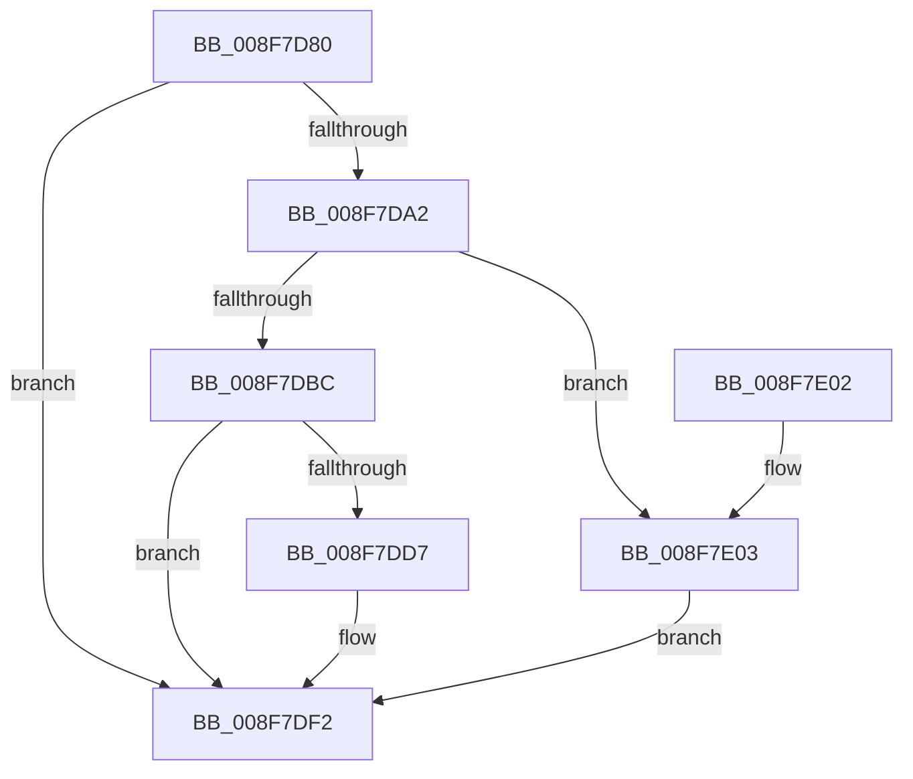

# PnpRaiseNtPlugPlayDevicePropertyChangeEvent

- RVA: `0x008F7D80`–`0x008F7E1B` (길이 `155` bytes)
- VA: `0x00000001408F7D80`
- 실행 섹션: `PAGE`
- PDB 이름 있음: `예`; PDB Function 태그: `아니요`
- unwind 정보 RVA: `0x00087B08`
- 디코드: `43`개 명령, `155/155` bytes 표시
- 미해석 바이트: `0` (있으면 어셈블리에 `.byte`로 보존)

> 이 문서는 커널 이미지의 기계어와 PDB 기호를 분석해 생성했습니다. 4번과 5번은 함수 원형과 자료형을 바이너리 사용 방식에서 추정한 C 해석이며 원본 소스 복구 결과는 아닙니다.

## 1. Dependencies

- 직접 호출 지점: **3**; 고유 호출 대상: **3**
- 직접 호출자로 확인된 함수: **19**
- RIP 상대 이미지 참조: **2**

### Outgoing calls
- `0x008F7DB3` → [CmMapPropertyKeyToRegProp](CmMapPropertyKeyToRegProp_function_008F7E24.md) (function, `0x008F7E24`)
- `0x008F7DED` → [PnpDeviceRaisePropertyChangeEventWorker](PnpDeviceRaisePropertyChangeEventWorker_function_008F80E0.md) (function, `0x008F80E0`)
- `0x008F7E14` → [CmRaisePropertyChangeEvent](CmRaisePropertyChangeEvent_function_008FE93C.md) (function, `0x008FE93C`)

### Direct callers
- [PnpRemoveLockedDeviceNode](../../text/47/PnpRemoveLockedDeviceNode_function_004702AC.md) at `0x0047043D`
- [PipSetDevNodeState](../../text/47/PipSetDevNodeState_function_00470708.md) at `0x00470809`
- [PipSetDevNodeState](../../text/47/PipSetDevNodeState_function_00470708.md) at `0x00470824`
- [PipRestoreDevNodeState](../../text/5A/PipRestoreDevNodeState_function_005A7100.md) at `0x005A71DF`
- [PipRestoreDevNodeState](../../text/5A/PipRestoreDevNodeState_function_005A7100.md) at `0x005A71FA`
- [PipNotifyDependenciesChanged](../70/PipNotifyDependenciesChanged_function_007038F8.md) at `0x0070392E`
- [PipNotifyDependenciesChanged](../70/PipNotifyDependenciesChanged_function_007038F8.md) at `0x00703960`
- [IopDecDisableableDepends](../73/IopDecDisableableDepends_function_0073DC3C.md) at `0x0073DC66`
- [PiInitializeDevice](../73/PiInitializeDevice_function_0073EC5C.md) at `0x0073F002`
- [PiInitializeDevice](../73/PiInitializeDevice_function_0073EC5C.md) at `0x0073F011`
- [PiInitializeDevice](../73/PiInitializeDevice_function_0073EC5C.md) at `0x0073F027`
- [PipEnumerateCompleted](PipEnumerateCompleted_function_008F7B1C.md) at `0x008F7BE6`
- [PipEnumerateCompleted](PipEnumerateCompleted_function_008F7B1C.md) at `0x008F7BFC`
- [PipClearDevNodeFlags](PipClearDevNodeFlags_function_008F9F54.md) at `0x008F9F8E`
- [PipClearDevNodeFlags](PipClearDevNodeFlags_function_008F9F54.md) at `0x008F9FAB`
- [PipClearDevNodeFlags](PipClearDevNodeFlags_function_008F9F54.md) at `0x008F9FC6`
- [PipSetDevNodeUserFlags](PipSetDevNodeUserFlags_function_008FB8FC.md) at `0x008FB934`
- [PipSetDevNodeUserFlags](PipSetDevNodeUserFlags_function_008FB8FC.md) at `0x008FB94F`
- [PipSetDevNodeUserFlags](PipSetDevNodeUserFlags_function_008FB8FC.md) at `0x008FB96A`
- [PipSetDevNodeFlags](PipSetDevNodeFlags_function_008FC048.md) at `0x008FC080`
- [PipSetDevNodeFlags](PipSetDevNodeFlags_function_008FC048.md) at `0x008FC09D`
- [PipSetDevNodeFlags](PipSetDevNodeFlags_function_008FC048.md) at `0x008FC0B8`
- [PipSetDevNodeProblem](PipSetDevNodeProblem_function_008FDE0C.md) at `0x008FDEED`
- [PipSetDevNodeProblem](PipSetDevNodeProblem_function_008FDE0C.md) at `0x008FE009`
- [PnpUnlinkDeviceRemovalRelations](../A0/PnpUnlinkDeviceRemovalRelations_function_00A063D8.md) at `0x00A065AC`
- [PipCallDriverAddDevice](../A2/PipCallDriverAddDevice_function_00A272E0.md) at `0x00A27776`
- [PipClearDevNodeProblem](../A2/PipClearDevNodeProblem_function_00A27C8C.md) at `0x00A27D0C`
- [PipClearDevNodeProblem](../A2/PipClearDevNodeProblem_function_00A27C8C.md) at `0x00A27DE8`
- [PiProcessNewDeviceNode](../A2/PiProcessNewDeviceNode_function_00A28F20.md) at `0x00A2A356`
- [PiProcessNewDeviceNode](../A2/PiProcessNewDeviceNode_function_00A28F20.md) at `0x00A2A365`
- [PipClearDevNodeUserFlags](../A2/PipClearDevNodeUserFlags_function_00A2ABC4.md) at `0x00A2ABFE`
- [PipClearDevNodeUserFlags](../A2/PipClearDevNodeUserFlags_function_00A2ABC4.md) at `0x00A2AC19`
- [PipClearDevNodeUserFlags](../A2/PipClearDevNodeUserFlags_function_00A2ABC4.md) at `0x00A2AC34`
- [IopIncDisableableDepends](../AA/IopIncDisableableDepends_function_00AA2144.md) at `0x00AA2172`
- [PiPnpRtlPdoRaiseNtPlugPlayPropertyChangeEvent](../AB/PiPnpRtlPdoRaiseNtPlugPlayPropertyChangeEvent_function_00AB447C.md) at `0x00AB44CF`
- [sub_00B1F622](../B1/Unknown_function_00B1F622.md) at `0x00B1F97B`

### Static image references
- `0x008F7D8F` → RVA `0x00E66398` (`.data`; read)
- `0x008F7DA5` → RVA `0x0000C480` (`.rdata`; read)

## 2. Other-region calls and transfers

- 다른 실행 섹션으로 향하는 call: **0**
- 별도 외부 분기/꼬리 이동을 확인하지 못했습니다.

## 3. Assembly (complete function range)

```asm
008F7D80  48 89 5C 24 08                  mov qword ptr [rsp + 8], rbx
008F7D85  48 89 74 24 10                  mov qword ptr [rsp + 0x10], rsi
008F7D8A  57                              push rdi
008F7D8B  48 83 EC 50                     sub rsp, 0x50
008F7D8F  48 8B 1D 02 E6 56 00            mov rbx, qword ptr [rip + 0x56e602]
008F7D96  41 8D 40 FF                     lea eax, [r8 - 1]
008F7D9A  48 8B FA                        mov rdi, rdx
008F7D9D  83 F8 1D                        cmp eax, 0x1d
008F7DA0  77 50                           ja 0x1408f7df2
008F7DA2  49 63 C0                        movsxd rax, r8d
008F7DA5  48 8D 35 D4 46 71 FF            lea rsi, [rip - 0x8eb92c]
008F7DAC  48 8B 34 C6                     mov rsi, qword ptr [rsi + rax*8]
008F7DB0  48 8B D6                        mov rdx, rsi
008F7DB3  E8 6C 00 00 00                  call 0x1408f7e24
008F7DB8  85 C0                           test eax, eax
008F7DBA  75 47                           jne 0x1408f7e03
008F7DBC  33 C0                           xor eax, eax
008F7DBE  0F 57 C0                        xorps xmm0, xmm0
008F7DC1  48 89 44 24 40                  mov qword ptr [rsp + 0x40], rax
008F7DC6  48 8B 83 F0 01 00 00            mov rax, qword ptr [rbx + 0x1f0]
008F7DCD  0F 11 44 24 30                  movups xmmword ptr [rsp + 0x30], xmm0
008F7DD2  48 85 C0                        test rax, rax
008F7DD5  74 1B                           je 0x1408f7df2
008F7DD7  48 89 44 24 28                  mov qword ptr [rsp + 0x28], rax
008F7DDC  45 33 C9                        xor r9d, r9d
008F7DDF  45 33 C0                        xor r8d, r8d
008F7DE2  48 89 74 24 20                  mov qword ptr [rsp + 0x20], rsi
008F7DE7  48 8B D7                        mov rdx, rdi
008F7DEA  48 8B CB                        mov rcx, rbx
008F7DED  E8 EE 02 00 00                  call 0x1408f80e0
008F7DF2  48 8B 5C 24 60                  mov rbx, qword ptr [rsp + 0x60]
008F7DF7  48 8B 74 24 68                  mov rsi, qword ptr [rsp + 0x68]
008F7DFC  48 83 C4 50                     add rsp, 0x50
008F7E00  5F                              pop rdi
008F7E01  C3                              ret
008F7E02  CC                              int3
008F7E03  45 33 C9                        xor r9d, r9d
008F7E06  89 44 24 20                     mov dword ptr [rsp + 0x20], eax
008F7E0A  48 8B D7                        mov rdx, rdi
008F7E0D  48 8B CB                        mov rcx, rbx
008F7E10  45 8D 41 01                     lea r8d, [r9 + 1]
008F7E14  E8 23 6B 00 00                  call 0x1408fe93c
008F7E19  EB D7                           jmp 0x1408f7df2
```

## 4. C-style interpretation (structured pseudocode)

```c
__int64 __fastcall PnpRaiseNtPlugPlayDevicePropertyChangeEvent(__int64 a1, __int64 a2, __int64 a3, int a4)
{
    __int64 result;
    __int64 v_rsp;
    unsigned __int64 v_stack_m18;
    unsigned __int64 v_stack_m28;
    unsigned __int64 v_stack_m30;
    unsigned __int64 v_stack_m38;
    unsigned __int64 v_stack_p10;
    unsigned int v_stack_p20;
    unsigned __int64 v_stack_p8;

    v_stack_p8 = v_rbx;
    v_stack_p10 = v_rsi;
    v_rsp = (v_rsp) - (80);
    if (((unsigned int)(a3 - 1)) > 29) goto loc_008F7DF2;
    result = CmMapPropertyKeyToRegProp(a1, *(unsigned __int64 *)(v_rip - 9353516 + (int)((unsigned int)(a3)) * 8), a3, a4);
    if ((unsigned int)(result) != 0) goto loc_008F7E03;
    result = 0;
    v_stack_m18 = 0;
    v_stack_m28 = v_xmm0;
    result = *(unsigned __int64 *)(*(unsigned __int64 *)(v_rip + 5694978) + 496);
    if (*(unsigned __int64 *)(*(unsigned __int64 *)(v_rip + 5694978) + 496) != 0) {
        v_stack_m30 = *(unsigned __int64 *)(*(unsigned __int64 *)(v_rip + 5694978) + 496);
        a4 = 0;
        a3 = 0;
        v_stack_m38 = *(unsigned __int64 *)(v_rip - 9353516 + (int)((unsigned int)(a3)) * 8);
        a2 = a2;
        a1 = *(unsigned __int64 *)(v_rip + 5694978);
        result = PnpDeviceRaisePropertyChangeEventWorker(a1, a2, a3, a4);
    }
    v_rsp = (v_rsp) + (80);
    return result;
loc_008F7E03:
    a4 = 0;
    v_stack_p20 = (unsigned int)(result);
    result = CmRaisePropertyChangeEvent(v_stack_p8, a2, a4 + 1, a4);
    goto loc_008F7DF2;
}
```

## 5. (Beta) C Style

```c
int64_t PnpRaiseNtPlugPlayDevicePropertyChangeEvent(int64_t Arg1, int64_t Arg2, void *Arg3, int32_t Arg4)
{
    uint8_t *arg3 = (uint8_t *)Arg3;

    int64_t result;
    int64_t local_rsp;
    uint64_t v_stack_m18;
    uint64_t v_stack_m28;
    uint64_t v_stack_m30;
    uint64_t v_stack_m38;
    uint64_t v_stack_p10;
    uint32_t v_stack_p20;
    uint64_t v_stack_p8;

    v_stack_p8 = local_rbx;
    v_stack_p10 = local_rsi;
    local_rsp = (local_rsp) - (80);
    if (((uint32_t)(Arg3 - 1)) > 29) goto loc_008F7DF2;
    result = CmMapPropertyKeyToRegProp(Arg1, *(uint64_t *)(v_rip - 0x8EB92C + (int32_t)((uint32_t)(arg3)) * 8), Arg3, Arg4);
    if ((uint32_t)(result) != 0) goto loc_008F7E03;
    result = 0;
    v_stack_m18 = 0;
    v_stack_m28 = v_xmm0;
    result = *(uint64_t *)(*(uint64_t *)(v_rip + 0x56E602) + 0x1F0);
    if (*(uint64_t *)(*(uint64_t *)(v_rip + 0x56E602) + 0x1F0) != 0) {
        v_stack_m30 = *(uint64_t *)(*(uint64_t *)(v_rip + 0x56E602) + 0x1F0);
        Arg4 = 0;
        Arg3 = 0;
        v_stack_m38 = *(uint64_t *)(v_rip - 0x8EB92C + (int32_t)((uint32_t)(arg3)) * 8);
        Arg2 = Arg2;
        Arg1 = *(uint64_t *)(v_rip + 0x56E602);
        result = PnpDeviceRaisePropertyChangeEventWorker(Arg1, Arg2, Arg3, Arg4);
    }
    local_rsp = (local_rsp) + (80);
    return result;
loc_008F7E03:
    Arg4 = 0;
    v_stack_p20 = (uint32_t)(result);
    result = CmRaisePropertyChangeEvent(v_stack_p8, Arg2, Arg4 + 1, Arg4);
    goto loc_008F7DF2;
}
```

### 관측된 메모리 오프셋

구조체 형식이 확인되지 않은 접근은 인자 기준의 오프셋으로만 기록했습니다.

| 기준 인자 | 오프셋 표현 | 폭 (bit) | 접근 |
|---|---:|---:|---|
| `Arg3` | `- 0x1` | `32` | `R` |

## 6. Execution-region graph

[열기: 2D/3D 그래프와 함수 탐색 컨트롤 패널](../../../control-panel.html?section=page&rva=0x008F7D80&view=graph)

- 2D 그래프는 위에서 아래로 흐르고, 3D 그래프는 빈 공간을 드래그해 회전합니다. Shift+드래그는 이동, 휠은 확대·축소, 함수 노드 선택은 대상 보고서 이동입니다.

### Static fallback


