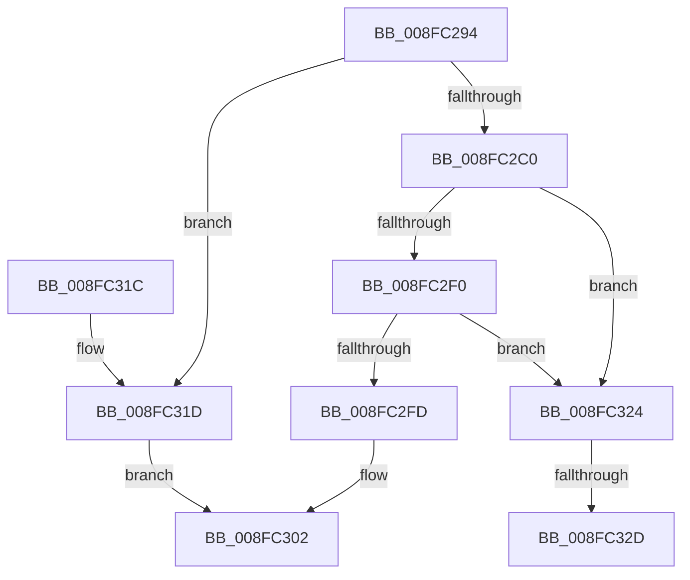

# PnpRequestDeviceRemoval

- RVA: `0x008FC294`–`0x008FC33D` (길이 `169` bytes)
- VA: `0x00000001408FC294`
- 실행 섹션: `PAGE`
- PDB 이름 있음: `예`; PDB Function 태그: `예`
- unwind 정보 RVA: `0x00087F6C`
- 디코드: `47`개 명령, `169/169` bytes 표시
- 미해석 바이트: `0` (있으면 어셈블리에 `.byte`로 보존)

> 이 문서는 커널 이미지의 기계어와 PDB 기호를 분석해 생성했습니다. 4번과 5번은 함수 원형과 자료형을 바이너리 사용 방식에서 추정한 C 해석이며 원본 소스 복구 결과는 아닙니다.

## 1. Dependencies

- 직접 호출 지점: **3**; 고유 호출 대상: **3**
- 직접 호출자로 확인된 함수: **13**
- RIP 상대 이미지 참조: **2**

### Outgoing calls
- `0x008FC2C2` → [PnpAcquireDependencyRelationsLock](../A0/PnpAcquireDependencyRelationsLock_function_00A06788.md) (function, `0x00A06788`)
- `0x008FC2D9` → [PnpRequestDeviceRemovalWorker](../A8/PnpRequestDeviceRemovalWorker_function_00A8F958.md) (function, `0x00A8F958`)
- `0x008FC2DE` → [PnpReleaseDependencyRelationsLock](../A0/PnpReleaseDependencyRelationsLock_function_00A06E14.md) (function, `0x00A06E14`)

### Direct callers
- [IopQueueDeviceResetEvent](../72/IopQueueDeviceResetEvent_function_0072AB14.md) at `0x0072ABCA`
- [PiProfileUpdateDeviceTreeCallback](../73/PiProfileUpdateDeviceTreeCallback_function_00737630.md) at `0x00737665`
- [PipDmaGuardBlockAddDevice](../73/PipDmaGuardBlockAddDevice_function_0073BD8C.md) at `0x0073BE5C`
- [PnpReallocateResources](../73/PnpReallocateResources_function_0073E924.md) at `0x0073EA92`
- [PnpRebalance](../73/PnpRebalance_function_0073F508.md) at `0x0073F7F1`
- [PipProcessRestartPhase2](../74/PipProcessRestartPhase2_function_007408B8.md) at `0x0074092C`
- [PipEnumerateCompleted](PipEnumerateCompleted_function_008F7B1C.md) at `0x008F7CEA`
- [PiProcessQueryDeviceState](PiProcessQueryDeviceState_function_008FA0F8.md) at `0x008FA217`
- [PipCallDriverAddDevice](../A2/PipCallDriverAddDevice_function_00A272E0.md) at `0x00A276E4`
- [PiProcessDriversLoadedOnSecureDevice](../A2/PiProcessDriversLoadedOnSecureDevice_function_00A27F9C.md) at `0x00A2803A`
- [sub_00B1F5B6](../B1/Unknown_function_00B1F5B6.md) at `0x00B1F5FD`
- [sub_00B26024](../B2/Unknown_function_00B26024.md) at `0x00B2604E`
- [sub_00B34B5E](../B3/Unknown_function_00B34B5E.md) at `0x00B34BB7`

### Static image references
- `0x008FC2E3` → RVA `0x00F8C5E4` (`.data`; read)
- `0x008FC2F2` → RVA `0x00E663B0` (`.data`; read)

## 2. Other-region calls and transfers

- 다른 실행 섹션으로 향하는 call: **0**
- call이 아닌 외부 분기/꼬리 이동: **2**
  - `0x008FC327` → [sub_00B1FAB0](../B1/Unknown_function_00B1FAB0.md) (`tail-transfer`)
  - `0x008FC338` → [sub_00B1FAB0 + 0x3](../B1/Unknown_function_00B1FAB0.md) (`tail-transfer`)

## 3. Assembly (complete function range)

```asm
008FC294  48 89 5C 24 08                  mov qword ptr [rsp + 8], rbx
008FC299  48 89 6C 24 10                  mov qword ptr [rsp + 0x10], rbp
008FC29E  48 89 74 24 18                  mov qword ptr [rsp + 0x18], rsi
008FC2A3  57                              push rdi
008FC2A4  41 56                           push r14
008FC2A6  41 57                           push r15
008FC2A8  48 83 EC 70                     sub rsp, 0x70
008FC2AC  45 33 FF                        xor r15d, r15d
008FC2AF  41 8B E9                        mov ebp, r9d
008FC2B2  45 8B F0                        mov r14d, r8d
008FC2B5  40 8A FA                        mov dil, dl
008FC2B8  48 8B D9                        mov rbx, rcx
008FC2BB  48 85 C9                        test rcx, rcx
008FC2BE  74 5D                           je 0x1408fc31d
008FC2C0  B1 01                           mov cl, 1
008FC2C2  E8 C1 A4 10 00                  call 0x140a06788
008FC2C7  45 8D 4F 02                     lea r9d, [r15 + 2]
008FC2CB  44 88 7C 24 20                  mov byte ptr [rsp + 0x20], r15b
008FC2D0  44 8A C7                        mov r8b, dil
008FC2D3  48 8B D3                        mov rdx, rbx
008FC2D6  48 8B CB                        mov rcx, rbx
008FC2D9  E8 7A 36 19 00                  call 0x140a8f958
008FC2DE  E8 31 AB 10 00                  call 0x140a06e14
008FC2E3  44 39 3D FA 02 69 00            cmp dword ptr [rip + 0x6902fa], r15d
008FC2EA  48 8B 5B 20                     mov rbx, qword ptr [rbx + 0x20]
008FC2EE  74 34                           je 0x1408fc324
008FC2F0  33 C0                           xor eax, eax
008FC2F2  F0 4C 0F B1 3D B5 A0 56 00      lock cmpxchg qword ptr [rip + 0x56a0b5], r15
008FC2FB  75 27                           jne 0x1408fc324
008FC2FD  B8 89 01 00 C0                  mov eax, 0xc0000189
008FC302  4C 8D 5C 24 70                  lea r11, [rsp + 0x70]
008FC307  49 8B 5B 20                     mov rbx, qword ptr [r11 + 0x20]
008FC30B  49 8B 6B 28                     mov rbp, qword ptr [r11 + 0x28]
008FC30F  49 8B 73 30                     mov rsi, qword ptr [r11 + 0x30]
008FC313  49 8B E3                        mov rsp, r11
008FC316  41 5F                           pop r15
008FC318  41 5E                           pop r14
008FC31A  5F                              pop rdi
008FC31B  C3                              ret
008FC31C  CC                              int3
008FC31D  B8 0E 00 00 C0                  mov eax, 0xc000000e
008FC322  EB DE                           jmp 0x1408fc302
008FC324  48 85 DB                        test rbx, rbx
008FC327  0F 84 83 37 22 00               je 0x140b1fab0
008FC32D  48 8B 83 38 01 00 00            mov rax, qword ptr [rbx + 0x138]
008FC334  48 8B 48 28                     mov rcx, qword ptr [rax + 0x28]
008FC338  E9 76 37 22 00                  jmp 0x140b1fab3
```

## 4. C-style interpretation (structured pseudocode)

```c
__int64 __fastcall PnpRequestDeviceRemoval(__int64 a1, unsigned __int8 a2, int a3, int a4)
{
    __int64 result;
    __int64 v_r15;
    __int64 v_rsp;
    unsigned __int64 v_stack_m18;
    unsigned __int8 v_stack_m68;
    unsigned __int64 v_stack_p10;
    unsigned __int64 v_stack_p18;
    unsigned __int64 v_stack_p8;

    v_stack_p8 = v_rbx;
    v_stack_p10 = v_rbp;
    v_stack_p18 = v_rsi;
    v_rsp = (v_rsp) - (112);
    v_r15 = 0;
    if (a1 == 0) goto loc_008FC31D;
    result = PnpAcquireDependencyRelationsLock(1, a2, a3, a4);
    v_stack_m68 = 0;
    result = PnpRequestDeviceRemovalWorker(a1, a1, a2, v_r15 + 2);
    result = PnpReleaseDependencyRelationsLock(a1, a1, a2, v_r15 + 2);
    if ((*(unsigned int *)(v_rip + 6882042)) == 0) goto loc_008FC324;
    result = 0;
    if (condition_is_not_equal) goto loc_008FC324;
loc_008FC302:
    return (unsigned int)(0xC0000189ULL);
loc_008FC31D:
    goto loc_008FC302;
loc_008FC324:
}
```

## 5. (Beta) C Style

```c
int64_t PnpRequestDeviceRemoval(void *Arg1, uint8_t Arg2, int32_t Arg3, int32_t Arg4)
{
    uint8_t *arg1 = (uint8_t *)Arg1;

    int64_t result;
    int64_t local_r15;
    int64_t local_rsp;
    uint64_t v_stack_m18;
    uint8_t v_stack_m68;
    uint64_t v_stack_p10;
    uint64_t v_stack_p18;
    uint64_t v_stack_p8;

    v_stack_p8 = local_rbx;
    v_stack_p10 = local_rbp;
    v_stack_p18 = local_rsi;
    local_rsp = (local_rsp) - (112);
    local_r15 = 0;
    if (Arg1 == NULL) goto loc_008FC31D;
    result = PnpAcquireDependencyRelationsLock(1, Arg2, Arg3, Arg4);
    v_stack_m68 = 0;
    result = PnpRequestDeviceRemovalWorker(Arg1, Arg1, Arg2, local_r15 + 2);
    result = PnpReleaseDependencyRelationsLock(Arg1, Arg1, Arg2, local_r15 + 2);
    if ((*(uint32_t *)(v_rip + 0x6902FA)) == 0) goto loc_008FC324;
    result = 0;
    if (condition_is_not_equal) goto loc_008FC324;
loc_008FC302:
    return (uint32_t)(0xC0000189ULL);
loc_008FC31D:
    goto loc_008FC302;
loc_008FC324:
}
```

### 관측된 메모리 오프셋

구조체 형식이 확인되지 않은 접근은 인자 기준의 오프셋으로만 기록했습니다.

| 기준 인자 | 오프셋 표현 | 폭 (bit) | 접근 |
|---|---:|---:|---|
| `Arg1` | `+ 0x20` | `64` | `R` |

## 6. Execution-region graph

[열기: 2D/3D 그래프와 함수 탐색 컨트롤 패널](../../../control-panel.html?section=page&rva=0x008FC294&view=graph)

- 2D 그래프는 위에서 아래로 흐르고, 3D 그래프는 빈 공간을 드래그해 회전합니다. Shift+드래그는 이동, 휠은 확대·축소, 함수 노드 선택은 대상 보고서 이동입니다.

### Static fallback


