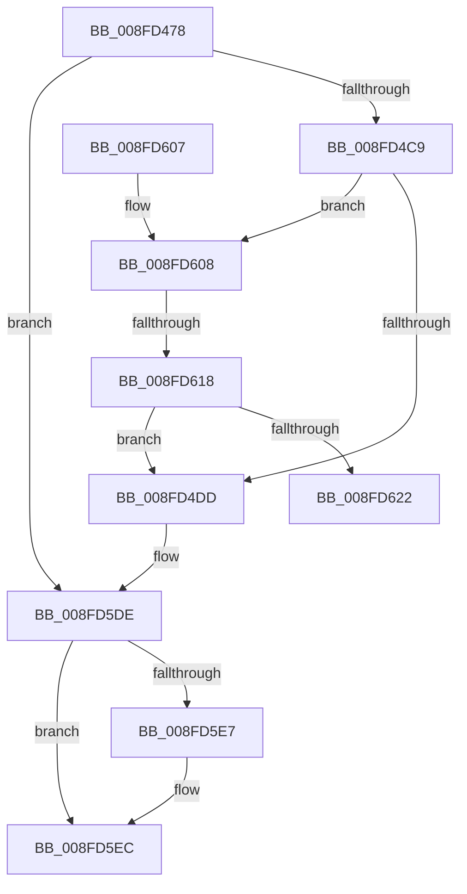

# PnpSaveDeviceCapabilities

- RVA: `0x008FD478`–`0x008FD627` (길이 `431` bytes)
- VA: `0x00000001408FD478`
- 실행 섹션: `PAGE`
- PDB 이름 있음: `예`; PDB Function 태그: `예`
- unwind 정보 RVA: `0x000880E8`
- 디코드: `118`개 명령, `431/431` bytes 표시
- 미해석 바이트: `0` (있으면 어셈블리에 `.byte`로 보존)

> 이 문서는 커널 이미지의 기계어와 PDB 기호를 분석해 생성했습니다. 4번과 5번은 함수 원형과 자료형을 바이너리 사용 방식에서 추정한 C 해석이며 원본 소스 복구 결과는 아닙니다.

## 1. Dependencies

- 직접 호출 지점: **5**; 고유 호출 대상: **3**
- 직접 호출자로 확인된 함수: **2**
- RIP 상대 이미지 참조: **1**

### Outgoing calls
- `0x008FD4B9` → [PnpDeviceObjectToDeviceInstance](PnpDeviceObjectToDeviceInstance_function_008FD630.md) (function, `0x008FD630`)
- `0x008FD543` → [CmSetDeviceRegProp](CmSetDeviceRegProp_function_008FD68C.md) (function, `0x008FD68C`)
- `0x008FD590` → [CmSetDeviceRegProp](CmSetDeviceRegProp_function_008FD68C.md) (function, `0x008FD68C`)
- `0x008FD5D9` → [CmSetDeviceRegProp](CmSetDeviceRegProp_function_008FD68C.md) (function, `0x008FD68C`)
- `0x008FD5E7` → [ZwClose](../../text/6A/ZwClose_function_006AD2B0.md) (function, `0x006AD2B0`)

### Direct callers
- [PnpQueryAndSaveDeviceNodeCapabilities](PnpQueryAndSaveDeviceNodeCapabilities_function_008FBCE8.md) at `0x008FBD2D`
- [PiProcessNewDeviceNode](../A2/PiProcessNewDeviceNode_function_00A28F20.md) at `0x00A299B5`
- [PiProcessNewDeviceNode](../A2/PiProcessNewDeviceNode_function_00A28F20.md) at `0x00A2A2BF`

### Static image references
- `0x008FD51D` → RVA `0x00E66398` (`.data`; read)

## 2. Other-region calls and transfers

- 다른 실행 섹션으로 향하는 call: **1**
  - `0x008FD5E7` → [ZwClose](../../text/6A/ZwClose_function_006AD2B0.md) (`PAGE` → `.text`)
- call이 아닌 외부 분기/꼬리 이동: **2**
  - `0x008FD612` → [sub_00B1FD0C](../B1/Unknown_function_00B1FD0C.md) (`tail-transfer`)
  - `0x008FD622` → [sub_00B1FD0C](../B1/Unknown_function_00B1FD0C.md) (`tail-transfer`)

## 3. Assembly (complete function range)

```asm
008FD478  48 89 5C 24 10                  mov qword ptr [rsp + 0x10], rbx
008FD47D  55                              push rbp
008FD47E  56                              push rsi
008FD47F  57                              push rdi
008FD480  41 54                           push r12
008FD482  41 55                           push r13
008FD484  41 56                           push r14
008FD486  41 57                           push r15
008FD488  48 8B EC                        mov rbp, rsp
008FD48B  48 83 EC 40                     sub rsp, 0x40
008FD48F  45 33 E4                        xor r12d, r12d
008FD492  48 8B FA                        mov rdi, rdx
008FD495  41 F6 D8                        neg r8b
008FD498  44 89 65 50                     mov dword ptr [rbp + 0x50], r12d
008FD49C  48 8B D9                        mov rbx, rcx
008FD49F  4C 89 65 40                     mov qword ptr [rbp + 0x40], r12
008FD4A3  48 8B 49 20                     mov rcx, qword ptr [rcx + 0x20]
008FD4A7  48 8D 55 40                     lea rdx, [rbp + 0x40]
008FD4AB  1B F6                           sbb esi, esi
008FD4AD  41 B8 3F 00 0F 00               mov r8d, 0xf003f
008FD4B3  81 E6 00 00 02 00               and esi, 0x20000
008FD4B9  E8 72 01 00 00                  call 0x1408fd630
008FD4BE  44 8B F0                        mov r14d, eax
008FD4C1  85 C0                           test eax, eax
008FD4C3  0F 88 15 01 00 00               js 0x1408fd5de
008FD4C9  8B 8B 8C 01 00 00               mov ecx, dword ptr [rbx + 0x18c]
008FD4CF  45 8D 6C 24 04                  lea r13d, [r12 + 4]
008FD4D4  F6 C1 40                        test cl, 0x40
008FD4D7  0F 85 2B 01 00 00               jne 0x1408fd608
008FD4DD  8B 47 04                        mov eax, dword ptr [rdi + 4]
008FD4E0  41 B9 10 00 00 00               mov r9d, 0x10
008FD4E6  4C 8B 45 40                     mov r8, qword ptr [rbp + 0x40]
008FD4EA  89 83 30 02 00 00               mov dword ptr [rbx + 0x230], eax
008FD4F0  8B 4F 04                        mov ecx, dword ptr [rdi + 4]
008FD4F3  8B D1                           mov edx, ecx
008FD4F5  C1 EA 04                        shr edx, 4
008FD4F8  8B C1                           mov eax, ecx
008FD4FA  25 00 C0 00 00                  and eax, 0xc000
008FD4FF  89 74 24 38                     mov dword ptr [rsp + 0x38], esi
008FD503  81 E2 00 00 01 00               and edx, 0x10000
008FD509  44 89 6C 24 30                  mov dword ptr [rsp + 0x30], r13d
008FD50E  0B D0                           or edx, eax
008FD510  8B C1                           mov eax, ecx
008FD512  C1 E8 0D                        shr eax, 0xd
008FD515  83 E0 08                        and eax, 8
008FD518  C1 EA 04                        shr edx, 4
008FD51B  0B C1                           or eax, ecx
008FD51D  48 8B 0D 74 8E 56 00            mov rcx, qword ptr [rip + 0x568e74]
008FD524  25 FC 03 00 00                  and eax, 0x3fc
008FD529  0B D0                           or edx, eax
008FD52B  48 8D 45 50                     lea rax, [rbp + 0x50]
008FD52F  C1 EA 02                        shr edx, 2
008FD532  89 55 50                        mov dword ptr [rbp + 0x50], edx
008FD535  48 8B 53 30                     mov rdx, qword ptr [rbx + 0x30]
008FD539  48 89 44 24 28                  mov qword ptr [rsp + 0x28], rax
008FD53E  44 89 6C 24 20                  mov dword ptr [rsp + 0x20], r13d
008FD543  E8 44 01 00 00                  call 0x1408fd68c
008FD548  8B 57 0C                        mov edx, dword ptr [rdi + 0xc]
008FD54B  41 83 CF FF                     or r15d, 0xffffffff
008FD54F  4C 8B 45 40                     mov r8, qword ptr [rbp + 0x40]
008FD553  8B C2                           mov eax, edx
008FD555  41 2B C7                        sub eax, r15d
008FD558  89 74 24 38                     mov dword ptr [rsp + 0x38], esi
008FD55C  F7 D8                           neg eax
008FD55E  89 55 50                        mov dword ptr [rbp + 0x50], edx
008FD561  48 8D 45 50                     lea rax, [rbp + 0x50]
008FD565  41 B9 11 00 00 00               mov r9d, 0x11
008FD56B  1B C9                           sbb ecx, ecx
008FD56D  41 23 CD                        and ecx, r13d
008FD570  89 4C 24 30                     mov dword ptr [rsp + 0x30], ecx
008FD574  41 3B D7                        cmp edx, r15d
008FD577  48 8B 53 30                     mov rdx, qword ptr [rbx + 0x30]
008FD57B  48 8B 0D 16 8E 56 00            mov rcx, qword ptr [rip + 0x568e16]
008FD582  49 0F 44 C4                     cmove rax, r12
008FD586  48 89 44 24 28                  mov qword ptr [rsp + 0x28], rax
008FD58B  44 89 6C 24 20                  mov dword ptr [rsp + 0x20], r13d
008FD590  E8 F7 00 00 00                  call 0x1408fd68c
008FD595  8B 57 08                        mov edx, dword ptr [rdi + 8]
008FD598  41 B9 1D 00 00 00               mov r9d, 0x1d
008FD59E  4C 8B 45 40                     mov r8, qword ptr [rbp + 0x40]
008FD5A2  8B C2                           mov eax, edx
008FD5A4  41 2B C7                        sub eax, r15d
008FD5A7  89 74 24 38                     mov dword ptr [rsp + 0x38], esi
008FD5AB  F7 D8                           neg eax
008FD5AD  89 55 50                        mov dword ptr [rbp + 0x50], edx
008FD5B0  48 8D 45 50                     lea rax, [rbp + 0x50]
008FD5B4  1B C9                           sbb ecx, ecx
008FD5B6  41 23 CD                        and ecx, r13d
008FD5B9  89 4C 24 30                     mov dword ptr [rsp + 0x30], ecx
008FD5BD  41 3B D7                        cmp edx, r15d
008FD5C0  48 8B 53 30                     mov rdx, qword ptr [rbx + 0x30]
008FD5C4  48 8B 0D CD 8D 56 00            mov rcx, qword ptr [rip + 0x568dcd]
008FD5CB  49 0F 44 C4                     cmove rax, r12
008FD5CF  48 89 44 24 28                  mov qword ptr [rsp + 0x28], rax
008FD5D4  44 89 6C 24 20                  mov dword ptr [rsp + 0x20], r13d
008FD5D9  E8 AE 00 00 00                  call 0x1408fd68c
008FD5DE  48 8B 4D 40                     mov rcx, qword ptr [rbp + 0x40]
008FD5E2  48 85 C9                        test rcx, rcx
008FD5E5  74 05                           je 0x1408fd5ec
008FD5E7  E8 C4 FC DA FF                  call 0x1406ad2b0
008FD5EC  48 8B 9C 24 88 00 00 00         mov rbx, qword ptr [rsp + 0x88]
008FD5F4  41 8B C6                        mov eax, r14d
008FD5F7  48 83 C4 40                     add rsp, 0x40
008FD5FB  41 5F                           pop r15
008FD5FD  41 5E                           pop r14
008FD5FF  41 5D                           pop r13
008FD601  41 5C                           pop r12
008FD603  5F                              pop rdi
008FD604  5E                              pop rsi
008FD605  5D                              pop rbp
008FD606  C3                              ret
008FD607  CC                              int3
008FD608  48 8B 8B D0 02 00 00            mov rcx, qword ptr [rbx + 0x2d0]
008FD60F  48 85 C9                        test rcx, rcx
008FD612  0F 84 F4 26 22 00               je 0x140b1fd0c
008FD618  44 84 69 10                     test byte ptr [rcx + 0x10], r13b
008FD61C  0F 85 BB FE FF FF               jne 0x1408fd4dd
008FD622  E9 E5 26 22 00                  jmp 0x140b1fd0c
```

## 4. C-style interpretation (structured pseudocode)

```c
__int64 __fastcall PnpSaveDeviceCapabilities(__int64 a1, __int64 a2, unsigned __int8 a3)
{
    __int64 result;
    __int64 v_r12;
    __int64 v_r15;
    __int64 v_rsi;
    __int64 v_rsp;
    unsigned int v_stack_m40;
    unsigned int v_stack_m48;
    unsigned __int64 v_stack_m50;
    unsigned int v_stack_m58;
    unsigned __int64 v_stack_p10;
    unsigned int v_stack_p18;
    unsigned __int64 v_stack_p8;

    v_stack_p10 = v_rbx;
    v_rsp = (v_rsp) - (64);
    v_r12 = 0;
    a3 = (unsigned __int8)(-(a3));
    v_stack_p18 = 0;
    v_stack_p8 = 0;
    v_rsi = (unsigned int)((v_rsi) & (0x20000ULL));
    result = PnpDeviceObjectToDeviceInstance(*(unsigned __int64 *)(a1 + 32), v_stack_p8, (unsigned int)(0xF003FULL), a4);
    if (sign_flag) goto loc_008FD5DE;
    if ((((unsigned __int8)((unsigned int)(*(unsigned int *)(a1 + 396)))) & (64)) != 0) goto loc_008FD608;
loc_008FD4DD:
    *(unsigned int *)(a1 + 560) = (unsigned int)((unsigned int)(*(unsigned int *)(a2 + 4)));
    a2 = (unsigned int)(((unsigned int)((unsigned int)((unsigned int)(*(unsigned int *)(a2 + 4))))) >> (4));
    result = (unsigned int)(((unsigned int)((unsigned int)((unsigned int)(*(unsigned int *)(a2 + 4))))) & (0xC000ULL));
    v_stack_m40 = (unsigned int)(v_rsi);
    a2 = (unsigned int)((a2) & (0x10000ULL));
    v_stack_m48 = (unsigned int)(v_r12 + 4);
    a2 = (unsigned int)((a2) | ((unsigned int)(result)));
    result = (unsigned int)(((unsigned int)((unsigned int)((unsigned int)(*(unsigned int *)(a2 + 4))))) >> (13));
    result = (unsigned int)((result) & (8));
    a2 = (unsigned int)((a2) >> (4));
    result = (unsigned int)((result) | ((unsigned int)((unsigned int)(*(unsigned int *)(a2 + 4)))));
    result = (unsigned int)((result) & (0x3FCULL));
    a2 = (unsigned int)((a2) | ((unsigned int)(result)));
    a2 = (unsigned int)((a2) >> (2));
    v_stack_p18 = (unsigned int)(a2);
    v_stack_m50 = v_stack_p18;
    v_stack_m58 = (unsigned int)(v_r12 + 4);
    result = CmSetDeviceRegProp(*(unsigned __int64 *)(v_rip + 5672564), *(unsigned __int64 *)(a1 + 48), v_stack_p8, 16);
    v_r15 = (unsigned int)((v_r15) | (0xFFFFFFFFULL));
    result = (unsigned int)(((unsigned int)((unsigned int)((unsigned int)(*(unsigned int *)(a2 + 12))))) - ((unsigned int)(v_r15)));
    v_stack_m40 = (unsigned int)(v_rsi);
    result = (unsigned int)(-(result));
    v_stack_p18 = (unsigned int)((unsigned int)(*(unsigned int *)(a2 + 12)));
    a1 = (unsigned int)((*(unsigned __int64 *)(v_rip + 5672564)) & ((unsigned int)(v_r12 + 4)));
    v_stack_m48 = (unsigned int)(a1);
    result = v_stack_p18;
    if (((unsigned int)((unsigned int)(*(unsigned int *)(a2 + 12)))) == ((unsigned int)(v_r15))) { result = 0; }
    v_stack_m50 = result;
    v_stack_m58 = (unsigned int)(v_r12 + 4);
    result = CmSetDeviceRegProp(*(unsigned __int64 *)(v_rip + 5672470), *(unsigned __int64 *)(a1 + 48), v_stack_p8, 17);
    result = (unsigned int)(((unsigned int)((unsigned int)((unsigned int)(*(unsigned int *)(a2 + 8))))) - ((unsigned int)(v_r15)));
    v_stack_m40 = (unsigned int)(v_rsi);
    result = (unsigned int)(-(result));
    v_stack_p18 = (unsigned int)((unsigned int)(*(unsigned int *)(a2 + 8)));
    a1 = (unsigned int)((*(unsigned __int64 *)(v_rip + 5672470)) & ((unsigned int)(v_r12 + 4)));
    v_stack_m48 = (unsigned int)(a1);
    result = v_stack_p18;
    if (((unsigned int)((unsigned int)(*(unsigned int *)(a2 + 8)))) == ((unsigned int)(v_r15))) { result = 0; }
    v_stack_m50 = result;
    v_stack_m58 = (unsigned int)(v_r12 + 4);
    result = CmSetDeviceRegProp(*(unsigned __int64 *)(v_rip + 5672397), *(unsigned __int64 *)(a1 + 48), v_stack_p8, 29);
loc_008FD5DE:
    if (v_stack_p8 != 0) {
        result = ZwClose(v_stack_p8, *(unsigned __int64 *)(a1 + 48), v_stack_p8, 29);
    }
    v_rsp = (v_rsp) + (64);
    return (unsigned int)((unsigned int)((unsigned int)((unsigned int)(result))));
loc_008FD608:
    if (((*(unsigned __int8 *)(*(unsigned __int64 *)(v_stack_p10 + 720) + 16)) & ((unsigned __int8)(v_r12 + 4))) != 0) goto loc_008FD4DD;
}
```

## 5. (Beta) C Style

```c
int64_t PnpSaveDeviceCapabilities(void *Arg1, void *Arg2, uint8_t Arg3)
{
    uint8_t *arg1 = (uint8_t *)Arg1;
    uint8_t *arg2 = (uint8_t *)Arg2;

    int64_t result;
    int64_t local_r12;
    int64_t local_r15;
    int64_t local_rsi;
    int64_t local_rsp;
    uint32_t v_stack_m40;
    uint32_t v_stack_m48;
    uint64_t v_stack_m50;
    uint32_t v_stack_m58;
    uint64_t v_stack_p10;
    uint32_t v_stack_p18;
    uint64_t v_stack_p8;

    v_stack_p10 = local_rbx;
    local_rsp = (local_rsp) - (64);
    local_r12 = 0;
    Arg3 = (uint8_t)(-(Arg3));
    v_stack_p18 = 0;
    v_stack_p8 = 0;
    local_rsi = (uint32_t)((local_rsi) & (0x20000ULL));
    result = PnpDeviceObjectToDeviceInstance(*(uint64_t *)(arg1 + 0x20), v_stack_p8, (uint32_t)(0xF003FULL), a4);
    if (sign_flag) goto loc_008FD5DE;
    if ((((uint8_t)((uint32_t)(*(uint32_t *)(arg1 + 0x18C)))) & (64)) != 0) goto loc_008FD608;
loc_008FD4DD:
    *(uint32_t *)(arg1 + 0x230) = (uint32_t)((uint32_t)(*(uint32_t *)(arg2 + 0x4)));
    Arg2 = (uint32_t)(((uint32_t)((uint32_t)((uint32_t)(*(uint32_t *)(arg2 + 0x4))))) >> (4));
    result = (uint32_t)(((uint32_t)((uint32_t)((uint32_t)(*(uint32_t *)(arg2 + 0x4))))) & (0xC000ULL));
    v_stack_m40 = (uint32_t)(local_rsi);
    Arg2 = (uint32_t)((Arg2) & (0x10000ULL));
    v_stack_m48 = (uint32_t)(local_r12 + 4);
    Arg2 = (uint32_t)((Arg2) | ((uint32_t)(result)));
    result = (uint32_t)(((uint32_t)((uint32_t)((uint32_t)(*(uint32_t *)(arg2 + 0x4))))) >> (13));
    result = (uint32_t)((result) & (8));
    Arg2 = (uint32_t)((Arg2) >> (4));
    result = (uint32_t)((result) | ((uint32_t)((uint32_t)(*(uint32_t *)(arg2 + 0x4)))));
    result = (uint32_t)((result) & (0x3FCULL));
    Arg2 = (uint32_t)((Arg2) | ((uint32_t)(result)));
    Arg2 = (uint32_t)((Arg2) >> (2));
    v_stack_p18 = (uint32_t)(Arg2);
    v_stack_m50 = v_stack_p18;
    v_stack_m58 = (uint32_t)(local_r12 + 4);
    result = CmSetDeviceRegProp(*(uint64_t *)(v_rip + 0x568E74), *(uint64_t *)(arg1 + 0x30), v_stack_p8, 16);
    local_r15 = (uint32_t)((local_r15) | (0xFFFFFFFFULL));
    result = (uint32_t)(((uint32_t)((uint32_t)((uint32_t)(*(uint32_t *)(arg2 + 0xC))))) - ((uint32_t)(local_r15)));
    v_stack_m40 = (uint32_t)(local_rsi);
    result = (uint32_t)(-(result));
    v_stack_p18 = (uint32_t)((uint32_t)(*(uint32_t *)(arg2 + 0xC)));
    Arg1 = (uint32_t)((*(uint64_t *)(v_rip + 0x568E74)) & ((uint32_t)(local_r12 + 4)));
    v_stack_m48 = (uint32_t)(Arg1);
    result = v_stack_p18;
    if (((uint32_t)((uint32_t)(*(uint32_t *)(arg2 + 0xC)))) == ((uint32_t)(local_r15))) { result = 0; }
    v_stack_m50 = result;
    v_stack_m58 = (uint32_t)(local_r12 + 4);
    result = CmSetDeviceRegProp(*(uint64_t *)(v_rip + 0x568E16), *(uint64_t *)(arg1 + 0x30), v_stack_p8, 17);
    result = (uint32_t)(((uint32_t)((uint32_t)((uint32_t)(*(uint32_t *)(arg2 + 0x8))))) - ((uint32_t)(local_r15)));
    v_stack_m40 = (uint32_t)(local_rsi);
    result = (uint32_t)(-(result));
    v_stack_p18 = (uint32_t)((uint32_t)(*(uint32_t *)(arg2 + 0x8)));
    Arg1 = (uint32_t)((*(uint64_t *)(v_rip + 0x568E16)) & ((uint32_t)(local_r12 + 4)));
    v_stack_m48 = (uint32_t)(Arg1);
    result = v_stack_p18;
    if (((uint32_t)((uint32_t)(*(uint32_t *)(arg2 + 0x8)))) == ((uint32_t)(local_r15))) { result = 0; }
    v_stack_m50 = result;
    v_stack_m58 = (uint32_t)(local_r12 + 4);
    result = CmSetDeviceRegProp(*(uint64_t *)(v_rip + 0x568DCD), *(uint64_t *)(arg1 + 0x30), v_stack_p8, 29);
loc_008FD5DE:
    if (v_stack_p8 != 0) {
        result = ZwClose(v_stack_p8, *(uint64_t *)(arg1 + 0x30), v_stack_p8, 29);
    }
    local_rsp = (local_rsp) + (64);
    return (uint32_t)((uint32_t)((uint32_t)((uint32_t)(result))));
loc_008FD608:
    if (((*(uint8_t *)(*(uint64_t *)(v_stack_p10 + 0x2D0) + 0x10)) & ((uint8_t)(local_r12 + 4))) != 0) goto loc_008FD4DD;
}
```

### 관측된 메모리 오프셋

구조체 형식이 확인되지 않은 접근은 인자 기준의 오프셋으로만 기록했습니다.

| 기준 인자 | 오프셋 표현 | 폭 (bit) | 접근 |
|---|---:|---:|---|
| `Arg1` | `+ 0x20` | `64` | `R` |
| `Arg1` | `+ 0x30` | `64` | `R` |
| `Arg1` | `+ 0x18C` | `32` | `R` |
| `Arg1` | `+ 0x230` | `32` | `W` |
| `Arg1` | `+ 0x2D0` | `64` | `R` |
| `Arg2` | `+ 0x4` | `32` | `R` |
| `Arg2` | `+ 0x8` | `32` | `R` |
| `Arg2` | `+ 0xC` | `32` | `R` |

## 6. Execution-region graph

[열기: 2D/3D 그래프와 함수 탐색 컨트롤 패널](../../../control-panel.html?section=page&rva=0x008FD478&view=graph)

- 2D 그래프는 위에서 아래로 흐르고, 3D 그래프는 빈 공간을 드래그해 회전합니다. Shift+드래그는 이동, 휠은 확대·축소, 함수 노드 선택은 대상 보고서 이동입니다.

### Static fallback


