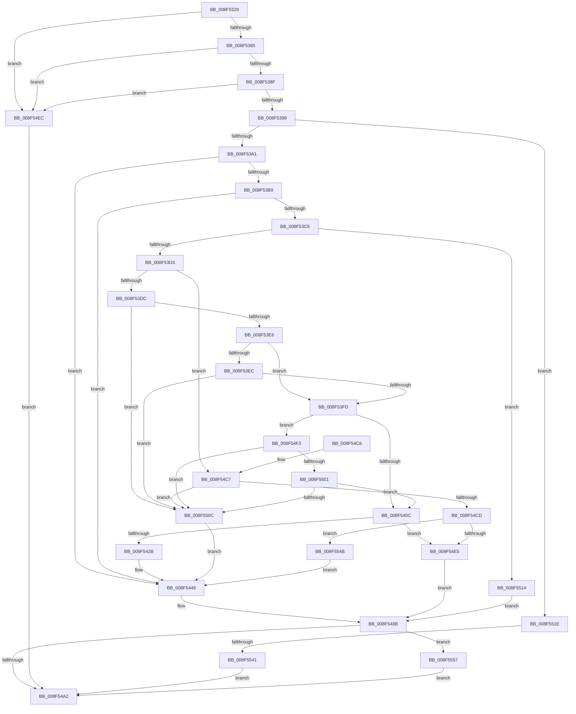

# PnpSetDeviceInterfacePropertyData

- RVA: `0x008F5328`–`0x008F5561` (길이 `569` bytes)
- VA: `0x00000001408F5328`
- 실행 섹션: `PAGE`
- PDB 이름 있음: `예`; PDB Function 태그: `예`
- unwind 정보 RVA: `0x000877B0`
- 디코드: `141`개 명령, `569/569` bytes 표시
- 미해석 바이트: `0` (있으면 어셈블리에 `.byte`로 보존)

> 이 문서는 커널 이미지의 기계어와 PDB 기호를 분석해 생성했습니다. 4번과 5번은 함수 원형과 자료형을 바이너리 사용 방식에서 추정한 C 해석이며 원본 소스 복구 결과는 아닙니다.

## 1. Dependencies

- 직접 호출 지점: **8**; 고유 호출 대상: **7**
- 직접 호출자로 확인된 함수: **1**
- RIP 상대 이미지 참조: **2**

### Outgoing calls
- `0x008F536C` → [memset](../../text/6C/memset_function_006C6C40.md) (function, `0x006C6C40`)
- `0x008F541A` → [ExAllocatePool2](../../poolcode/B8/ExAllocatePool2_function_00B820F0.md) (function, `0x00B820F0`)
- `0x008F5436` → [memcpy](../../text/6C/memcpy_function_006C6840.md) (function, `0x006C6840`)
- `0x008F5484` → [PiPnpRtlSetObjectProperty](PiPnpRtlSetObjectProperty_function_008F62A0.md) (function, `0x008F62A0`)
- `0x008F5491` → [PnpUnicodeStringToWstrFree](PnpUnicodeStringToWstrFree_function_008F59F0.md) (function, `0x008F59F0`)
- `0x008F54AF` → [_security_check_cookie](../../text/6A/_security_check_cookie_function_006AC640.md) (function, `0x006AC640`)
- `0x008F54DB` → [ExAllocatePool2](../../poolcode/B8/ExAllocatePool2_function_00B820F0.md) (function, `0x00B820F0`)
- `0x008F5534` → [RtlLCIDToCultureName](../AD/RtlLCIDToCultureName_function_00AD3010.md) (function, `0x00AD3010`)

### Direct callers
- [IoSetDeviceInterfacePropertyData](IoSetDeviceInterfacePropertyData_function_008F52E0.md) at `0x008F5317`

### Static image references
- `0x008F533A` → RVA `0x00E0A740` (`.data`; read)
- `0x008F5453` → RVA `0x00E66398` (`.data`; read)

## 2. Other-region calls and transfers

- 다른 실행 섹션으로 향하는 call: **5**
  - `0x008F536C` → [memset](../../text/6C/memset_function_006C6C40.md) (`PAGE` → `.text`)
  - `0x008F541A` → [ExAllocatePool2](../../poolcode/B8/ExAllocatePool2_function_00B820F0.md) (`PAGE` → `POOLCODE`)
  - `0x008F5436` → [memcpy](../../text/6C/memcpy_function_006C6840.md) (`PAGE` → `.text`)
  - `0x008F54AF` → [_security_check_cookie](../../text/6A/_security_check_cookie_function_006AC640.md) (`PAGE` → `.text`)
  - `0x008F54DB` → [ExAllocatePool2](../../poolcode/B8/ExAllocatePool2_function_00B820F0.md) (`PAGE` → `POOLCODE`)
- call이 아닌 외부 분기/꼬리 이동: **1**
  - `0x008F553B` → [sub_00B1EAA6](../B1/Unknown_function_00B1EAA6.md) (`tail-transfer`)

## 3. Assembly (complete function range)

```asm
008F5328  40 53                           push rbx
008F532A  55                              push rbp
008F532B  56                              push rsi
008F532C  57                              push rdi
008F532D  41 54                           push r12
008F532F  41 56                           push r14
008F5331  41 57                           push r15
008F5333  48 81 EC 20 01 00 00            sub rsp, 0x120
008F533A  48 8B 05 FF 53 51 00            mov rax, qword ptr [rip + 0x5153ff]
008F5341  48 33 C4                        xor rax, rsp
008F5344  48 89 84 24 10 01 00 00         mov qword ptr [rsp + 0x110], rax
008F534C  4C 8B BC 24 90 01 00 00         mov r15, qword ptr [rsp + 0x190]
008F5354  41 8B D8                        mov ebx, r8d
008F5357  4C 8B F2                        mov r14, rdx
008F535A  48 8B F9                        mov rdi, rcx
008F535D  BD AA 00 00 00                  mov ebp, 0xaa
008F5362  48 8D 4C 24 60                  lea rcx, [rsp + 0x60]
008F5367  44 8B C5                        mov r8d, ebp
008F536A  33 D2                           xor edx, edx
008F536C  E8 CF 18 DD FF                  call 0x1406c6c40
008F5371  45 33 E4                        xor r12d, r12d
008F5374  4C 89 64 24 50                  mov qword ptr [rsp + 0x50], r12
008F5379  41 8B F4                        mov esi, r12d
008F537C  48 85 FF                        test rdi, rdi
008F537F  0F 84 67 01 00 00               je 0x1408f54ec
008F5385  4C 39 67 08                     cmp qword ptr [rdi + 8], r12
008F5389  0F 84 5D 01 00 00               je 0x1408f54ec
008F538F  66 44 39 27                     cmp word ptr [rdi], r12w
008F5393  0F 84 53 01 00 00               je 0x1408f54ec
008F5399  85 DB                           test ebx, ebx
008F539B  0F 85 7D 01 00 00               jne 0x1408f551e
008F53A1  41 8B EC                        mov ebp, r12d
008F53A4  44 0F B7 47 02                  movzx r8d, word ptr [rdi + 2]
008F53A9  41 B9 02 00 00 00               mov r9d, 2
008F53AF  66 45 3B C1                     cmp r8w, r9w
008F53B3  0F 82 90 00 00 00               jb 0x1408f5449
008F53B9  48 8B 4F 08                     mov rcx, qword ptr [rdi + 8]
008F53BD  48 85 C9                        test rcx, rcx
008F53C0  0F 84 83 00 00 00               je 0x1408f5449
008F53C6  0F B7 17                        movzx edx, word ptr [rdi]
008F53C9  66 41 3B D0                     cmp dx, r8w
008F53CD  0F 87 41 01 00 00               ja 0x1408f5514
008F53D3  66 85 D2                        test dx, dx
008F53D6  0F 84 EB 00 00 00               je 0x1408f54c7
008F53DC  66 44 39 21                     cmp word ptr [rcx], r12w
008F53E0  0F 84 26 01 00 00               je 0x1408f550c
008F53E6  66 41 3B D0                     cmp dx, r8w
008F53EA  75 11                           jne 0x1408f53fd
008F53EC  8B C2                           mov eax, edx
008F53EE  48 D1 E8                        shr rax, 1
008F53F1  66 44 39 64 41 FE               cmp word ptr [rcx + rax*2 - 2], r12w
008F53F7  0F 84 0F 01 00 00               je 0x1408f550c
008F53FD  49 8B C0                        mov rax, r8
008F5400  49 2B C1                        sub rax, r9
008F5403  48 3B D0                        cmp rdx, rax
008F5406  0F 86 E7 00 00 00               jbe 0x1408f54f3
008F540C  49 03 D1                        add rdx, r9
008F540F  B9 00 01 00 00                  mov ecx, 0x100
008F5414  41 B8 50 70 73 75               mov r8d, 0x75737050
008F541A  E8 D1 CC 28 00                  call 0x140b820f0
008F541F  48 8B D8                        mov rbx, rax
008F5422  48 85 C0                        test rax, rax
008F5425  0F 84 BA 00 00 00               je 0x1408f54e5
008F542B  44 0F B7 07                     movzx r8d, word ptr [rdi]
008F542F  48 8B C8                        mov rcx, rax
008F5432  48 8B 57 08                     mov rdx, qword ptr [rdi + 8]
008F5436  E8 05 14 DD FF                  call 0x1406c6840
008F543B  0F B7 07                        movzx eax, word ptr [rdi]
008F543E  48 8B F3                        mov rsi, rbx
008F5441  48 D1 E8                        shr rax, 1
008F5444  66 44 89 24 43                  mov word ptr [rbx + rax*2], r12w
008F5449  8B 84 24 88 01 00 00            mov eax, dword ptr [rsp + 0x188]
008F5450  45 33 C9                        xor r9d, r9d
008F5453  48 8B 0D 3E 0F 57 00            mov rcx, qword ptr [rip + 0x570f3e]
008F545A  48 8B D6                        mov rdx, rsi
008F545D  44 89 64 24 48                  mov dword ptr [rsp + 0x48], r12d
008F5462  89 44 24 40                     mov dword ptr [rsp + 0x40], eax
008F5466  8B 84 24 80 01 00 00            mov eax, dword ptr [rsp + 0x180]
008F546D  45 8D 41 03                     lea r8d, [r9 + 3]
008F5471  4C 89 7C 24 38                  mov qword ptr [rsp + 0x38], r15
008F5476  89 44 24 30                     mov dword ptr [rsp + 0x30], eax
008F547A  4C 89 74 24 28                  mov qword ptr [rsp + 0x28], r14
008F547F  48 89 6C 24 20                  mov qword ptr [rsp + 0x20], rbp
008F5484  E8 17 0E 00 00                  call 0x1408f62a0
008F5489  8B D8                           mov ebx, eax
008F548B  48 8B D7                        mov rdx, rdi
008F548E  48 8B CE                        mov rcx, rsi
008F5491  E8 5A 05 00 00                  call 0x1408f59f0
008F5496  81 FB 25 02 00 C0               cmp ebx, 0xc0000225
008F549C  0F 84 B5 00 00 00               je 0x1408f5557
008F54A2  8B C3                           mov eax, ebx
008F54A4  48 8B 8C 24 10 01 00 00         mov rcx, qword ptr [rsp + 0x110]
008F54AC  48 33 CC                        xor rcx, rsp
008F54AF  E8 8C 71 DB FF                  call 0x1406ac640
008F54B4  48 81 C4 20 01 00 00            add rsp, 0x120
008F54BB  41 5F                           pop r15
008F54BD  41 5E                           pop r14
008F54BF  41 5C                           pop r12
008F54C1  5F                              pop rdi
008F54C2  5E                              pop rsi
008F54C3  5D                              pop rbp
008F54C4  5B                              pop rbx
008F54C5  C3                              ret
008F54C6  CC                              int3
008F54C7  66 44 39 21                     cmp word ptr [rcx], r12w
008F54CB  74 3F                           je 0x1408f550c
008F54CD  41 B8 50 70 73 75               mov r8d, 0x75737050
008F54D3  49 8B D1                        mov rdx, r9
008F54D6  B9 00 01 00 00                  mov ecx, 0x100
008F54DB  E8 10 CC 28 00                  call 0x140b820f0
008F54E0  48 85 C0                        test rax, rax
008F54E3  75 66                           jne 0x1408f554b
008F54E5  BB 9A 00 00 C0                  mov ebx, 0xc000009a
008F54EA  EB 9F                           jmp 0x1408f548b
008F54EC  BB 0D 00 00 C0                  mov ebx, 0xc000000d
008F54F1  EB AF                           jmp 0x1408f54a2
008F54F3  48 8B C2                        mov rax, rdx
008F54F6  48 D1 E8                        shr rax, 1
008F54F9  66 44 39 64 41 FE               cmp word ptr [rcx + rax*2 - 2], r12w
008F54FF  74 0B                           je 0x1408f550c
008F5501  66 44 39 24 41                  cmp word ptr [rcx + rax*2], r12w
008F5506  0F 85 00 FF FF FF               jne 0x1408f540c
008F550C  48 8B F1                        mov rsi, rcx
008F550F  E9 35 FF FF FF                  jmp 0x1408f5449
008F5514  BB 0D 00 00 C0                  mov ebx, 0xc000000d
008F5519  E9 6D FF FF FF                  jmp 0x1408f548b
008F551E  48 8D 44 24 60                  lea rax, [rsp + 0x60]
008F5523  66 89 6C 24 52                  mov word ptr [rsp + 0x52], bp
008F5528  48 8D 54 24 50                  lea rdx, [rsp + 0x50]
008F552D  48 89 44 24 58                  mov qword ptr [rsp + 0x58], rax
008F5532  8B CB                           mov ecx, ebx
008F5534  E8 D7 DA 1D 00                  call 0x140ad3010
008F5539  84 C0                           test al, al
008F553B  0F 85 65 95 22 00               jne 0x140b1eaa6
008F5541  BB 01 00 00 C0                  mov ebx, 0xc0000001
008F5546  E9 57 FF FF FF                  jmp 0x1408f54a2
008F554B  66 44 89 20                     mov word ptr [rax], r12w
008F554F  48 8B F0                        mov rsi, rax
008F5552  E9 F2 FE FF FF                  jmp 0x1408f5449
008F5557  BB 34 00 00 C0                  mov ebx, 0xc0000034
008F555C  E9 41 FF FF FF                  jmp 0x1408f54a2
```

## 4. C-style interpretation (structured pseudocode)

```c
__int64 __fastcall PnpSetDeviceInterfacePropertyData(__int64 a1, __int64 a2, int a3, __int64 a4, unsigned int a5, unsigned int a6, __int64 a7)
{
    __int64 result;
    __int64 v_r12;
    __int64 v_rsp;
    unsigned __int64 v_stack_m108;
    unsigned int v_stack_m110;
    unsigned int v_stack_m118;
    unsigned __int64 v_stack_m120;
    unsigned int v_stack_m128;
    unsigned __int64 v_stack_m130;
    unsigned __int64 v_stack_m138;
    unsigned __int64 v_stack_m48;
    unsigned __int64 v_stack_mF8;
    unsigned __int64 v_stack_p50;
    unsigned __int16 v_stack_p52;
    unsigned __int64 v_stack_p58;
    unsigned __int64 v_stack_p60;

    v_rsp = (v_rsp) - (288);
    result = (*(unsigned __int64 *)(v_rip + 5329919)) ^ (v_rsp);
    v_stack_m48 = result;
    a2 = 0;
    result = memset(v_stack_mF8, a2, 170, a4);
    v_r12 = 0;
    v_stack_m108 = 0;
    if (a1 == 0) goto loc_008F54EC;
    if ((*(unsigned __int64 *)(a1 + 8)) == 0) goto loc_008F54EC;
    if ((*(unsigned __int16 *)(a1)) == 0) goto loc_008F54EC;
    if ((unsigned int)((unsigned int)(a3)) != 0) goto loc_008F551E;
    if (((unsigned __int16)(*(unsigned __int16 *)(a1 + 2))) < 2) goto loc_008F5449;
    if (*(unsigned __int64 *)(a1 + 8) == 0) goto loc_008F5449;
    if (((unsigned __int16)(*(unsigned __int16 *)(a1))) > ((unsigned __int16)(*(unsigned __int16 *)(a1 + 2)))) goto loc_008F5514;
    if ((unsigned __int16)(*(unsigned __int16 *)(a1)) == 0) goto loc_008F54C7;
    if ((*(unsigned __int16 *)(*(unsigned __int64 *)(a1 + 8))) == 0) goto loc_008F550C;
    if (((unsigned __int16)(*(unsigned __int16 *)(a1))) != ((unsigned __int16)(*(unsigned __int16 *)(a1 + 2)))) goto loc_008F53FD;
    result = ((unsigned int)((unsigned int)(*(unsigned __int16 *)(a1)))) >> (1);
    if ((*(unsigned __int16 *)(*(unsigned __int64 *)(a1 + 8) + result * 2 - 2)) == 0) goto loc_008F550C;
loc_008F53FD:
    result = (*(unsigned __int16 *)(a1 + 2)) - (2);
    if ((*(unsigned __int16 *)(a1)) <= result) goto loc_008F54F3;
loc_008F540C:
    a2 = (*(unsigned __int16 *)(a1)) + (2);
    result = ExAllocatePool2(256, a2, (unsigned int)(0x75737050ULL), 2);
    if (result == 0) goto loc_008F54E5;
    result = memcpy(result, *(unsigned __int64 *)(a1 + 8), *(unsigned __int16 *)(a1), 2);
    result = (*(unsigned __int16 *)(a1)) >> (1);
    *(unsigned __int16 *)(result + result * 2) = 0;
loc_008F5449:
    a4 = 0;
    v_stack_m110 = 0;
    v_stack_m118 = (unsigned int)((unsigned int)(a6));
    v_stack_m120 = a7;
    v_stack_m128 = (unsigned int)((unsigned int)(a5));
    v_stack_m130 = a2;
    v_stack_m138 = 0;
    result = PiPnpRtlSetObjectProperty(*(unsigned __int64 *)(v_rip + 5705534), result, a4 + 3, a4);
loc_008F548B:
    result = PnpUnicodeStringToWstrFree(result, a1, a4 + 3, a4);
    if (((unsigned int)((unsigned int)((unsigned int)(result)))) == 0xC0000225ULL) goto loc_008F5557;
loc_008F54A2:
    a1 = (v_stack_m48) ^ (v_rsp);
    result = _security_check_cookie(a1, a1, a4 + 3, a4);
    v_rsp = (v_rsp) + (288);
    return result;
loc_008F54C7:
    if ((*(unsigned __int16 *)(a1)) == 0) goto loc_008F550C;
    result = ExAllocatePool2(256, 0, (unsigned int)(0x75737050ULL), a4);
    if (result != 0) goto loc_008F554B;
loc_008F54E5:
    goto loc_008F548B;
loc_008F54EC:
    goto loc_008F54A2;
loc_008F54F3:
    result = (0) >> (1);
    if ((*(unsigned __int16 *)(256 + result * 2 - 2)) == 0) goto loc_008F550C;
    if ((*(unsigned __int16 *)(256 + result * 2)) != 0) goto loc_008F540C;
loc_008F550C:
    goto loc_008F5449;
loc_008F5514:
    goto loc_008F548B;
loc_008F551E:
    v_stack_p52 = 0;
    v_stack_p58 = v_stack_p60;
    result = RtlLCIDToCultureName((unsigned int)((unsigned int)((unsigned int)(0xC000000DULL))), v_stack_p50, (unsigned int)(0x75737050ULL), a4);
    goto loc_008F54A2;
loc_008F554B:
    *(unsigned __int16 *)(result) = 0;
    goto loc_008F5449;
loc_008F5557:
    goto loc_008F54A2;
}
```

## 5. (Beta) C Style

```c
int64_t PnpSetDeviceInterfacePropertyData(int64_t Arg1, int64_t Arg2, int32_t Arg3, int64_t Arg4, uint32_t Arg5, uint32_t Arg6, int64_t Arg7)
{
    int64_t result;
    int64_t local_r12;
    int64_t local_rsp;
    uint64_t v_stack_m108;
    uint32_t v_stack_m110;
    uint32_t v_stack_m118;
    uint64_t v_stack_m120;
    uint32_t v_stack_m128;
    uint64_t v_stack_m130;
    uint64_t v_stack_m138;
    uint64_t v_stack_m48;
    uint64_t v_stack_mF8;
    uint64_t v_stack_p50;
    uint16_t v_stack_p52;
    uint64_t v_stack_p58;
    uint64_t v_stack_p60;

    local_rsp = (local_rsp) - (288);
    result = (*(uint64_t *)(v_rip + 0x5153FF)) ^ (local_rsp);
    v_stack_m48 = result;
    Arg2 = 0;
    result = memset(v_stack_mF8, Arg2, 170, Arg4);
    local_r12 = 0;
    v_stack_m108 = 0;
    if (Arg1 == 0) goto loc_008F54EC;
    if ((*(uint64_t *)(Arg1 + 0x8)) == 0) goto loc_008F54EC;
    if ((*(uint16_t *)(Arg1)) == 0) goto loc_008F54EC;
    if ((uint32_t)((uint32_t)(Arg3)) != 0) goto loc_008F551E;
    if (((uint16_t)(*(uint16_t *)(Arg1 + 0x2))) < 2) goto loc_008F5449;
    if (*(uint64_t *)(Arg1 + 0x8) == 0) goto loc_008F5449;
    if (((uint16_t)(*(uint16_t *)(Arg1))) > ((uint16_t)(*(uint16_t *)(Arg1 + 0x2)))) goto loc_008F5514;
    if ((uint16_t)(*(uint16_t *)(Arg1)) == 0) goto loc_008F54C7;
    if ((*(uint16_t *)(*(uint64_t *)(Arg1 + 0x8))) == 0) goto loc_008F550C;
    if (((uint16_t)(*(uint16_t *)(Arg1))) != ((uint16_t)(*(uint16_t *)(Arg1 + 0x2)))) goto loc_008F53FD;
    result = ((uint32_t)((uint32_t)(*(uint16_t *)(Arg1)))) >> (1);
    if ((*(uint16_t *)(*(uint64_t *)(Arg1 + 0x8) + result * 2 - 0x2)) == 0) goto loc_008F550C;
loc_008F53FD:
    result = (*(uint16_t *)(Arg1 + 0x2)) - (2);
    if ((*(uint16_t *)(Arg1)) <= result) goto loc_008F54F3;
loc_008F540C:
    Arg2 = (*(uint16_t *)(Arg1)) + (2);
    result = ExAllocatePool2(256, Arg2, (uint32_t)(0x75737050ULL), 2);
    if (result == 0) goto loc_008F54E5;
    result = memcpy(result, *(uint64_t *)(Arg1 + 0x8), *(uint16_t *)(Arg1), 2);
    result = (*(uint16_t *)(Arg1)) >> (1);
    *(uint16_t *)(result + result * 2) = 0;
loc_008F5449:
    Arg4 = 0;
    v_stack_m110 = 0;
    v_stack_m118 = (uint32_t)((uint32_t)(Arg6));
    v_stack_m120 = Arg7;
    v_stack_m128 = (uint32_t)((uint32_t)(Arg5));
    v_stack_m130 = Arg2;
    v_stack_m138 = 0;
    result = PiPnpRtlSetObjectProperty(*(uint64_t *)(v_rip + 0x570F3E), result, Arg4 + 3, Arg4);
loc_008F548B:
    result = PnpUnicodeStringToWstrFree(result, Arg1, Arg4 + 3, Arg4);
    if (((uint32_t)((uint32_t)((uint32_t)(result)))) == 0xC0000225ULL) goto loc_008F5557;
loc_008F54A2:
    Arg1 = (v_stack_m48) ^ (local_rsp);
    result = _security_check_cookie(Arg1, Arg1, Arg4 + 3, Arg4);
    local_rsp = (local_rsp) + (288);
    return result;
loc_008F54C7:
    if ((*(uint16_t *)(Arg1)) == 0) goto loc_008F550C;
    result = ExAllocatePool2(256, 0, (uint32_t)(0x75737050ULL), Arg4);
    if (result != 0) goto loc_008F554B;
loc_008F54E5:
    goto loc_008F548B;
loc_008F54EC:
    goto loc_008F54A2;
loc_008F54F3:
    result = (0) >> (1);
    if ((*(uint16_t *)(256 + result * 2 - 0x2)) == 0) goto loc_008F550C;
    if ((*(uint16_t *)(256 + result * 2)) != 0) goto loc_008F540C;
loc_008F550C:
    goto loc_008F5449;
loc_008F5514:
    goto loc_008F548B;
loc_008F551E:
    v_stack_p52 = 0;
    v_stack_p58 = v_stack_p60;
    result = RtlLCIDToCultureName((uint32_t)((uint32_t)((uint32_t)(0xC000000DULL))), v_stack_p50, (uint32_t)(0x75737050ULL), Arg4);
    goto loc_008F54A2;
loc_008F554B:
    *(uint16_t *)(result) = 0;
    goto loc_008F5449;
loc_008F5557:
    goto loc_008F54A2;
}
```

## 6. Execution-region graph

[열기: 2D/3D 그래프와 함수 탐색 컨트롤 패널](../../../control-panel.html?section=page&rva=0x008F5328&view=graph)

- 2D 그래프는 위에서 아래로 흐르고, 3D 그래프는 빈 공간을 드래그해 회전합니다. Shift+드래그는 이동, 휠은 확대·축소, 함수 노드 선택은 대상 보고서 이동입니다.

### Static fallback


