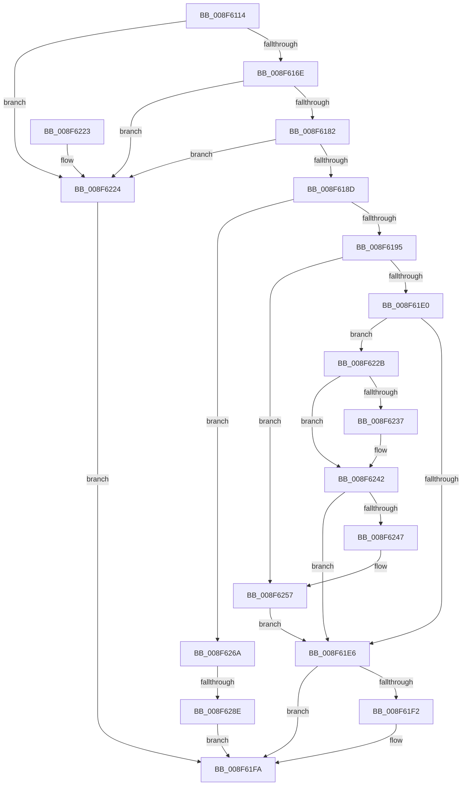

# PnpSetDevicePropertyData

- RVA: `0x008F6114`–`0x008F6298` (길이 `388` bytes)
- VA: `0x00000001408F6114`
- 실행 섹션: `PAGE`
- PDB 이름 있음: `예`; PDB Function 태그: `예`
- unwind 정보 RVA: `0x000878F8`
- 디코드: `94`개 명령, `388/388` bytes 표시
- 미해석 바이트: `0` (있으면 어셈블리에 `.byte`로 보존)

> 이 문서는 커널 이미지의 기계어와 PDB 기호를 분석해 생성했습니다. 4번과 5번은 함수 원형과 자료형을 바이너리 사용 방식에서 추정한 C 해석이며 원본 소스 복구 결과는 아닙니다.

## 1. Dependencies

- 직접 호출 지점: **6**; 고유 호출 대상: **6**
- 직접 호출자로 확인된 함수: **1**
- RIP 상대 이미지 참조: **4**

### Outgoing calls
- `0x008F615A` → [memset](../../text/6C/memset_function_006C6C40.md) (function, `0x006C6C40`)
- `0x008F61D5` → [PiPnpRtlSetObjectProperty](PiPnpRtlSetObjectProperty_function_008F62A0.md) (function, `0x008F62A0`)
- `0x008F61F5` → [PnpSetDeviceInstancePropertyChangeEvent](../../text/49/PnpSetDeviceInstancePropertyChangeEvent_function_004934E4.md) (function, `0x004934E4`)
- `0x008F6207` → [_security_check_cookie](../../text/6A/_security_check_cookie_function_006AC640.md) (function, `0x006AC640`)
- `0x008F6250` → [PnpSetInterruptInformation](../72/PnpSetInterruptInformation_function_0072DC8C.md) (function, `0x0072DC8C`)
- `0x008F6281` → [RtlLCIDToCultureName](../AD/RtlLCIDToCultureName_function_00AD3010.md) (function, `0x00AD3010`)

### Direct callers
- [IoSetDevicePropertyData](IoSetDevicePropertyData_function_008F6010.md) at `0x008F608A`

### Static image references
- `0x008F6127` → RVA `0x00E0A740` (`.data`; read)
- `0x008F61CE` → RVA `0x00E66398` (`.data`; read)
- `0x008F622E` → RVA `0x00011710` (`.rdata`; read)
- `0x008F623B` → RVA `0x00011718` (`.rdata`; read)

## 2. Other-region calls and transfers

- 다른 실행 섹션으로 향하는 call: **3**
  - `0x008F615A` → [memset](../../text/6C/memset_function_006C6C40.md) (`PAGE` → `.text`)
  - `0x008F61F5` → [PnpSetDeviceInstancePropertyChangeEvent](../../text/49/PnpSetDeviceInstancePropertyChangeEvent_function_004934E4.md) (`PAGE` → `.text`)
  - `0x008F6207` → [_security_check_cookie](../../text/6A/_security_check_cookie_function_006AC640.md) (`PAGE` → `.text`)
- call이 아닌 외부 분기/꼬리 이동: **1**
  - `0x008F6288` → [sub_00B1EBD6](../B1/Unknown_function_00B1EBD6.md) (`tail-transfer`)

## 3. Assembly (complete function range)

```asm
008F6114  48 89 5C 24 20                  mov qword ptr [rsp + 0x20], rbx
008F6119  55                              push rbp
008F611A  56                              push rsi
008F611B  57                              push rdi
008F611C  41 56                           push r14
008F611E  41 57                           push r15
008F6120  48 81 EC 20 01 00 00            sub rsp, 0x120
008F6127  48 8B 05 12 46 51 00            mov rax, qword ptr [rip + 0x514612]
008F612E  48 33 C4                        xor rax, rsp
008F6131  48 89 84 24 10 01 00 00         mov qword ptr [rsp + 0x110], rax
008F6139  4C 8B BC 24 80 01 00 00         mov r15, qword ptr [rsp + 0x180]
008F6141  41 8B D8                        mov ebx, r8d
008F6144  48 8B F2                        mov rsi, rdx
008F6147  48 8B E9                        mov rbp, rcx
008F614A  41 BE AA 00 00 00               mov r14d, 0xaa
008F6150  48 8D 4C 24 60                  lea rcx, [rsp + 0x60]
008F6155  45 8B C6                        mov r8d, r14d
008F6158  33 D2                           xor edx, edx
008F615A  E8 E1 0A DD FF                  call 0x1406c6c40
008F615F  48 83 64 24 50 00               and qword ptr [rsp + 0x50], 0
008F6165  48 85 ED                        test rbp, rbp
008F6168  0F 84 B6 00 00 00               je 0x1408f6224
008F616E  48 8B 85 38 01 00 00            mov rax, qword ptr [rbp + 0x138]
008F6175  48 8B 78 28                     mov rdi, qword ptr [rax + 0x28]
008F6179  48 85 FF                        test rdi, rdi
008F617C  0F 84 A2 00 00 00               je 0x1408f6224
008F6182  48 83 7F 30 00                  cmp qword ptr [rdi + 0x30], 0
008F6187  0F 84 97 00 00 00               je 0x1408f6224
008F618D  85 DB                           test ebx, ebx
008F618F  0F 85 D5 00 00 00               jne 0x1408f626a
008F6195  33 C9                           xor ecx, ecx
008F6197  83 64 24 48 00                  and dword ptr [rsp + 0x48], 0
008F619C  45 33 C9                        xor r9d, r9d
008F619F  8B 84 24 70 01 00 00            mov eax, dword ptr [rsp + 0x170]
008F61A6  44 8B B4 24 78 01 00 00         mov r14d, dword ptr [rsp + 0x178]
008F61AE  48 8B 57 30                     mov rdx, qword ptr [rdi + 0x30]
008F61B2  44 89 74 24 40                  mov dword ptr [rsp + 0x40], r14d
008F61B7  45 8D 41 01                     lea r8d, [r9 + 1]
008F61BB  4C 89 7C 24 38                  mov qword ptr [rsp + 0x38], r15
008F61C0  89 44 24 30                     mov dword ptr [rsp + 0x30], eax
008F61C4  48 89 74 24 28                  mov qword ptr [rsp + 0x28], rsi
008F61C9  48 89 4C 24 20                  mov qword ptr [rsp + 0x20], rcx
008F61CE  48 8B 0D C3 01 57 00            mov rcx, qword ptr [rip + 0x5701c3]
008F61D5  E8 C6 00 00 00                  call 0x1408f62a0
008F61DA  8B D8                           mov ebx, eax
008F61DC  85 C0                           test eax, eax
008F61DE  78 77                           js 0x1408f6257
008F61E0  83 7E 10 02                     cmp dword ptr [rsi + 0x10], 2
008F61E4  74 45                           je 0x1408f622b
008F61E6  81 BF 2C 01 00 00 05 03 00 00   cmp dword ptr [rdi + 0x12c], 0x305
008F61F0  7C 08                           jl 0x1408f61fa
008F61F2  48 8B CF                        mov rcx, rdi
008F61F5  E8 EA D2 B9 FF                  call 0x1404934e4
008F61FA  8B C3                           mov eax, ebx
008F61FC  48 8B 8C 24 10 01 00 00         mov rcx, qword ptr [rsp + 0x110]
008F6204  48 33 CC                        xor rcx, rsp
008F6207  E8 34 64 DB FF                  call 0x1406ac640
008F620C  48 8B 9C 24 68 01 00 00         mov rbx, qword ptr [rsp + 0x168]
008F6214  48 81 C4 20 01 00 00            add rsp, 0x120
008F621B  41 5F                           pop r15
008F621D  41 5E                           pop r14
008F621F  5F                              pop rdi
008F6220  5E                              pop rsi
008F6221  5D                              pop rbp
008F6222  C3                              ret
008F6223  CC                              int3
008F6224  BB 10 00 00 C0                  mov ebx, 0xc0000010
008F6229  EB CF                           jmp 0x1408f61fa
008F622B  48 8B 06                        mov rax, qword ptr [rsi]
008F622E  48 2B 05 DB B4 71 FF            sub rax, qword ptr [rip - 0x8e4b25]
008F6235  75 0B                           jne 0x1408f6242
008F6237  48 8B 46 08                     mov rax, qword ptr [rsi + 8]
008F623B  48 2B 05 D6 B4 71 FF            sub rax, qword ptr [rip - 0x8e4b2a]
008F6242  48 85 C0                        test rax, rax
008F6245  75 9F                           jne 0x1408f61e6
008F6247  45 8B C6                        mov r8d, r14d
008F624A  49 8B D7                        mov rdx, r15
008F624D  48 8B CD                        mov rcx, rbp
008F6250  E8 37 7A E3 FF                  call 0x14072dc8c
008F6255  8B D8                           mov ebx, eax
008F6257  81 FB 25 02 00 C0               cmp ebx, 0xc0000225
008F625D  B8 34 00 00 C0                  mov eax, 0xc0000034
008F6262  0F 44 D8                        cmove ebx, eax
008F6265  E9 7C FF FF FF                  jmp 0x1408f61e6
008F626A  48 8D 44 24 60                  lea rax, [rsp + 0x60]
008F626F  66 44 89 74 24 52               mov word ptr [rsp + 0x52], r14w
008F6275  48 8D 54 24 50                  lea rdx, [rsp + 0x50]
008F627A  48 89 44 24 58                  mov qword ptr [rsp + 0x58], rax
008F627F  8B CB                           mov ecx, ebx
008F6281  E8 8A CD 1D 00                  call 0x140ad3010
008F6286  84 C0                           test al, al
008F6288  0F 85 48 89 22 00               jne 0x140b1ebd6
008F628E  BB 01 00 00 C0                  mov ebx, 0xc0000001
008F6293  E9 62 FF FF FF                  jmp 0x1408f61fa
```

## 4. C-style interpretation (structured pseudocode)

```c
__int64 __fastcall PnpSetDevicePropertyData(__int64 a1, __int64 a2, int a3, int a4, unsigned int a5, unsigned int a6, __int64 a7)
{
    __int64 result;
    __int64 v_rbx;
    __int64 v_rsp;
    unsigned int v_stack_m100;
    unsigned int v_stack_m108;
    unsigned __int64 v_stack_m110;
    unsigned int v_stack_m118;
    unsigned __int64 v_stack_m120;
    unsigned __int64 v_stack_m128;
    unsigned __int64 v_stack_m38;
    unsigned __int64 v_stack_mE8;
    unsigned __int64 v_stack_mF8;
    unsigned __int64 v_stack_p20;
    unsigned __int64 v_stack_p50;
    unsigned __int16 v_stack_p52;
    unsigned __int64 v_stack_p58;
    unsigned __int64 v_stack_p60;

    v_stack_p20 = v_rbx;
    v_rsp = (v_rsp) - (288);
    result = (*(unsigned __int64 *)(v_rip + 5326354)) ^ (v_rsp);
    v_stack_m38 = result;
    a2 = 0;
    result = memset(v_stack_mE8, a2, 170, a4);
    if (a1 == 0) goto loc_008F6224;
    if (*(unsigned __int64 *)(*(unsigned __int64 *)(a1 + 312) + 40) == 0) goto loc_008F6224;
    if ((*(unsigned __int64 *)(*(unsigned __int64 *)(*(unsigned __int64 *)(a1 + 312) + 40) + 48)) == 0) goto loc_008F6224;
    if ((unsigned int)((unsigned int)(a3)) != 0) goto loc_008F626A;
    a1 = 0;
    a4 = 0;
    v_stack_m108 = (unsigned int)((unsigned int)(a6));
    v_stack_m110 = a7;
    v_stack_m118 = (unsigned int)((unsigned int)(a5));
    v_stack_m120 = 0;
    v_stack_m128 = 0;
    result = PiPnpRtlSetObjectProperty(*(unsigned __int64 *)(v_rip + 5702083), *(unsigned __int64 *)(*(unsigned __int64 *)(*(unsigned __int64 *)(a1 + 312) + 40) + 48), a4 + 1, a4);
    if (sign_flag) goto loc_008F6257;
    if ((*(unsigned int *)(a2 + 16)) == 2) goto loc_008F622B;
loc_008F61E6:
    if ((*(unsigned int *)(*(unsigned __int64 *)(*(unsigned __int64 *)(a1 + 312) + 40) + 300)) >= 773) {
        a1 = *(unsigned __int64 *)(*(unsigned __int64 *)(a1 + 312) + 40);
        result = PnpSetDeviceInstancePropertyChangeEvent(a1, *(unsigned __int64 *)(*(unsigned __int64 *)(*(unsigned __int64 *)(a1 + 312) + 40) + 48), a4 + 1, a4);
    }
    a1 = (v_stack_m38) ^ (v_rsp);
    result = _security_check_cookie(a1, *(unsigned __int64 *)(*(unsigned __int64 *)(*(unsigned __int64 *)(a1 + 312) + 40) + 48), a4 + 1, a4);
    v_rsp = (v_rsp) + (288);
    return result;
loc_008F6224:
    goto loc_008F61FA;
loc_008F622B:
    result = (*(unsigned __int64 *)(a2)) - (*(unsigned __int64 *)(v_rip - 9325349));
    if (!(condition_is_not_equal)) {
        result = *(unsigned __int64 *)(a2 + 8);
        result = (result) - (*(unsigned __int64 *)(v_rip - 9325354));
    }
    if (result != 0) goto loc_008F61E6;
    result = PnpSetInterruptInformation(a1, a7, (unsigned int)((unsigned int)((unsigned int)(a6))), a4);
loc_008F6257:
    v_rbx = (unsigned int)((unsigned int)(result));
    if (((unsigned int)((unsigned int)((unsigned int)(result)))) == 0xC0000225ULL) { v_rbx = (unsigned int)((unsigned int)(0xC0000034ULL)); }
    goto loc_008F61E6;
loc_008F626A:
    v_stack_p52 = (unsigned __int16)((unsigned int)(a6));
    v_stack_p58 = v_stack_p60;
    result = RtlLCIDToCultureName((unsigned int)((unsigned int)(v_rbx)), v_stack_p50, (unsigned int)((unsigned int)((unsigned int)(a6))), a4);
    goto loc_008F61FA;
}
```

## 5. (Beta) C Style

```c
int64_t PnpSetDevicePropertyData(int64_t Arg1, void *Arg2, int32_t Arg3, int32_t Arg4, uint32_t Arg5, uint32_t Arg6, int64_t Arg7)
{
    uint8_t *arg2 = (uint8_t *)Arg2;

    int64_t result;
    int64_t local_rbx;
    int64_t local_rsp;
    uint32_t v_stack_m100;
    uint32_t v_stack_m108;
    uint64_t v_stack_m110;
    uint32_t v_stack_m118;
    uint64_t v_stack_m120;
    uint64_t v_stack_m128;
    uint64_t v_stack_m38;
    uint64_t v_stack_mE8;
    uint64_t v_stack_mF8;
    uint64_t v_stack_p20;
    uint64_t v_stack_p50;
    uint16_t v_stack_p52;
    uint64_t v_stack_p58;
    uint64_t v_stack_p60;

    v_stack_p20 = local_rbx;
    local_rsp = (local_rsp) - (288);
    result = (*(uint64_t *)(v_rip + 0x514612)) ^ (local_rsp);
    v_stack_m38 = result;
    Arg2 = 0;
    result = memset(v_stack_mE8, Arg2, 170, Arg4);
    if (Arg1 == 0) goto loc_008F6224;
    if (*(uint64_t *)(*(uint64_t *)(Arg1 + 0x138) + 0x28) == 0) goto loc_008F6224;
    if ((*(uint64_t *)(*(uint64_t *)(*(uint64_t *)(Arg1 + 0x138) + 0x28) + 0x30)) == 0) goto loc_008F6224;
    if ((uint32_t)((uint32_t)(Arg3)) != 0) goto loc_008F626A;
    Arg1 = 0;
    Arg4 = 0;
    v_stack_m108 = (uint32_t)((uint32_t)(Arg6));
    v_stack_m110 = Arg7;
    v_stack_m118 = (uint32_t)((uint32_t)(Arg5));
    v_stack_m120 = 0;
    v_stack_m128 = 0;
    result = PiPnpRtlSetObjectProperty(*(uint64_t *)(v_rip + 0x5701C3), *(uint64_t *)(*(uint64_t *)(*(uint64_t *)(Arg1 + 0x138) + 0x28) + 0x30), Arg4 + 1, Arg4);
    if (sign_flag) goto loc_008F6257;
    if ((*(uint32_t *)(arg2 + 0x10)) == 2) goto loc_008F622B;
loc_008F61E6:
    if ((*(uint32_t *)(*(uint64_t *)(*(uint64_t *)(Arg1 + 0x138) + 0x28) + 0x12C)) >= 773) {
        Arg1 = *(uint64_t *)(*(uint64_t *)(Arg1 + 0x138) + 0x28);
        result = PnpSetDeviceInstancePropertyChangeEvent(Arg1, *(uint64_t *)(*(uint64_t *)(*(uint64_t *)(Arg1 + 0x138) + 0x28) + 0x30), Arg4 + 1, Arg4);
    }
    Arg1 = (v_stack_m38) ^ (local_rsp);
    result = _security_check_cookie(Arg1, *(uint64_t *)(*(uint64_t *)(*(uint64_t *)(Arg1 + 0x138) + 0x28) + 0x30), Arg4 + 1, Arg4);
    local_rsp = (local_rsp) + (288);
    return result;
loc_008F6224:
    goto loc_008F61FA;
loc_008F622B:
    result = (*(uint64_t *)(arg2)) - (*(uint64_t *)(v_rip - 0x8E4B25));
    if (!(condition_is_not_equal)) {
        result = *(uint64_t *)(arg2 + 0x8);
        result = (result) - (*(uint64_t *)(v_rip - 0x8E4B2A));
    }
    if (result != 0) goto loc_008F61E6;
    result = PnpSetInterruptInformation(Arg1, Arg7, (uint32_t)((uint32_t)((uint32_t)(Arg6))), Arg4);
loc_008F6257:
    local_rbx = (uint32_t)((uint32_t)(result));
    if (((uint32_t)((uint32_t)((uint32_t)(result)))) == 0xC0000225ULL) { local_rbx = (uint32_t)((uint32_t)(0xC0000034ULL)); }
    goto loc_008F61E6;
loc_008F626A:
    v_stack_p52 = (uint16_t)((uint32_t)(Arg6));
    v_stack_p58 = v_stack_p60;
    result = RtlLCIDToCultureName((uint32_t)((uint32_t)(local_rbx)), v_stack_p50, (uint32_t)((uint32_t)((uint32_t)(Arg6))), Arg4);
    goto loc_008F61FA;
}
```

### 관측된 메모리 오프셋

구조체 형식이 확인되지 않은 접근은 인자 기준의 오프셋으로만 기록했습니다.

| 기준 인자 | 오프셋 표현 | 폭 (bit) | 접근 |
|---|---:|---:|---|
| `Arg2` | `+ 0x0` | `64` | `R` |
| `Arg2` | `+ 0x8` | `64` | `R` |
| `Arg2` | `+ 0x10` | `32` | `R` |

## 6. Execution-region graph

[열기: 2D/3D 그래프와 함수 탐색 컨트롤 패널](../../../control-panel.html?section=page&rva=0x008F6114&view=graph)

- 2D 그래프는 위에서 아래로 흐르고, 3D 그래프는 빈 공간을 드래그해 회전합니다. Shift+드래그는 이동, 휠은 확대·축소, 함수 노드 선택은 대상 보고서 이동입니다.

### Static fallback


