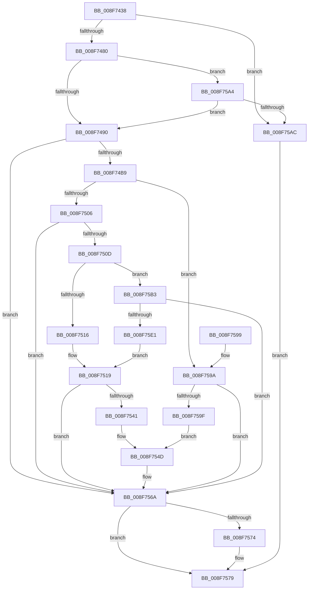

# PnpSetObjectPropertyWorker

- RVA: `0x008F7438`–`0x008F75EB` (길이 `435` bytes)
- VA: `0x00000001408F7438`
- 실행 섹션: `PAGE`
- PDB 이름 있음: `예`; PDB Function 태그: `아니요`
- unwind 정보 RVA: `0x00087A78`
- 디코드: `113`개 명령, `435/435` bytes 표시
- 미해석 바이트: `0` (있으면 어셈블리에 `.byte`로 보존)

> 이 문서는 커널 이미지의 기계어와 PDB 기호를 분석해 생성했습니다. 4번과 5번은 함수 원형과 자료형을 바이너리 사용 방식에서 추정한 C 해석이며 원본 소스 복구 결과는 아닙니다.

## 1. Dependencies

- 직접 호출 지점: **6**; 고유 호출 대상: **6**
- 직접 호출자로 확인된 함수: **1**
- RIP 상대 이미지 참조: **0**

### Outgoing calls
- `0x008F74AA` → [PnpValidatePropertyData](PnpValidatePropertyData_function_008F7658.md) (function, `0x008F7658`)
- `0x008F74F7` → [PnpSetMappedPropertyDispatch](../A7/PnpSetMappedPropertyDispatch_function_00A70E6C.md) (function, `0x00A70E6C`)
- `0x008F7536` → [PnpSetGenericStoreProperty](../99/PnpSetGenericStoreProperty_function_00991BC0.md) (function, `0x00991BC0`)
- `0x008F7565` → [PnpObjectRaisePropertyChangeEvent](PnpObjectRaisePropertyChangeEvent_function_008F7E94.md) (function, `0x008F7E94`)
- `0x008F7574` → [ZwClose](../../text/6A/ZwClose_function_006AD2B0.md) (function, `0x006AD2B0`)
- `0x008F75D6` → [PnpOpenObjectRegKey](../8E/PnpOpenObjectRegKey_function_008E15E8.md) (function, `0x008E15E8`)

### Direct callers
- [PnpSetObjectProperty](PnpSetObjectProperty_function_008F66E8.md) at `0x008F67FE`

### Static image references
- 디코드된 RIP-relative 메모리 참조가 없습니다.

## 2. Other-region calls and transfers

- 다른 실행 섹션으로 향하는 call: **1**
  - `0x008F7574` → [ZwClose](../../text/6A/ZwClose_function_006AD2B0.md) (`PAGE` → `.text`)
- 별도 외부 분기/꼬리 이동을 확인하지 못했습니다.

## 3. Assembly (complete function range)

```asm
008F7438  48 8B C4                        mov rax, rsp
008F743B  48 89 58 08                     mov qword ptr [rax + 8], rbx
008F743F  48 89 68 18                     mov qword ptr [rax + 0x18], rbp
008F7443  48 89 70 20                     mov qword ptr [rax + 0x20], rsi
008F7447  48 89 50 10                     mov qword ptr [rax + 0x10], rdx
008F744B  57                              push rdi
008F744C  41 54                           push r12
008F744E  41 55                           push r13
008F7450  41 56                           push r14
008F7452  41 57                           push r15
008F7454  48 83 EC 60                     sub rsp, 0x60
008F7458  48 83 60 C8 00                  and qword ptr [rax - 0x38], 0
008F745D  4C 8B F1                        mov r14, rcx
008F7460  44 8B A4 24 D8 00 00 00         mov r12d, dword ptr [rsp + 0xd8]
008F7468  49 8B F9                        mov rdi, r9
008F746B  48 8B 8C 24 C8 00 00 00         mov rcx, qword ptr [rsp + 0xc8]
008F7473  41 8B E8                        mov ebp, r8d
008F7476  66 45 85 E4                     test r12w, r12w
008F747A  0F 85 2C 01 00 00               jne 0x1408f75ac
008F7480  8B B4 24 D0 00 00 00            mov esi, dword ptr [rsp + 0xd0]
008F7487  48 85 C9                        test rcx, rcx
008F748A  0F 84 14 01 00 00               je 0x1408f75a4
008F7490  44 8B AC 24 C0 00 00 00         mov r13d, dword ptr [rsp + 0xc0]
008F7498  8B C6                           mov eax, esi
008F749A  F7 D8                           neg eax
008F749C  45 8B C5                        mov r8d, r13d
008F749F  8B D6                           mov edx, esi
008F74A1  4D 1B FF                        sbb r15, r15
008F74A4  4C 23 F9                        and r15, rcx
008F74A7  49 8B CF                        mov rcx, r15
008F74AA  E8 A9 01 00 00                  call 0x1408f7658
008F74AF  8B D8                           mov ebx, eax
008F74B1  85 C0                           test eax, eax
008F74B3  0F 88 B1 00 00 00               js 0x1408f756a
008F74B9  48 8B 94 24 98 00 00 00         mov rdx, qword ptr [rsp + 0x98]
008F74C1  4C 8B CF                        mov r9, rdi
008F74C4  44 89 64 24 48                  mov dword ptr [rsp + 0x48], r12d
008F74C9  44 8B C5                        mov r8d, ebp
008F74CC  4C 8B A4 24 B8 00 00 00         mov r12, qword ptr [rsp + 0xb8]
008F74D4  49 8B CE                        mov rcx, r14
008F74D7  89 74 24 40                     mov dword ptr [rsp + 0x40], esi
008F74DB  4C 89 7C 24 38                  mov qword ptr [rsp + 0x38], r15
008F74E0  44 89 6C 24 30                  mov dword ptr [rsp + 0x30], r13d
008F74E5  4C 8B AC 24 B0 00 00 00         mov r13, qword ptr [rsp + 0xb0]
008F74ED  4C 89 64 24 28                  mov qword ptr [rsp + 0x28], r12
008F74F2  4C 89 6C 24 20                  mov qword ptr [rsp + 0x20], r13
008F74F7  E8 70 99 17 00                  call 0x140a70e6c
008F74FC  8B D8                           mov ebx, eax
008F74FE  85 C0                           test eax, eax
008F7500  0F 89 94 00 00 00               jns 0x1408f759a
008F7506  3D 16 00 00 C0                  cmp eax, 0xc0000016
008F750B  75 5D                           jne 0x1408f756a
008F750D  48 85 FF                        test rdi, rdi
008F7510  0F 84 9D 00 00 00               je 0x1408f75b3
008F7516  48 8B D7                        mov rdx, rdi
008F7519  8B 84 24 C0 00 00 00            mov eax, dword ptr [rsp + 0xc0]
008F7520  4D 8B CC                        mov r9, r12
008F7523  89 74 24 30                     mov dword ptr [rsp + 0x30], esi
008F7527  4D 8B C5                        mov r8, r13
008F752A  4C 89 7C 24 28                  mov qword ptr [rsp + 0x28], r15
008F752F  49 8B CE                        mov rcx, r14
008F7532  89 44 24 20                     mov dword ptr [rsp + 0x20], eax
008F7536  E8 85 A6 09 00                  call 0x140991bc0
008F753B  8B D8                           mov ebx, eax
008F753D  85 C0                           test eax, eax
008F753F  78 29                           js 0x1408f756a
008F7541  4C 8B 4C 24 50                  mov r9, qword ptr [rsp + 0x50]
008F7546  48 85 FF                        test rdi, rdi
008F7549  4C 0F 45 CF                     cmovne r9, rdi
008F754D  48 8B 94 24 98 00 00 00         mov rdx, qword ptr [rsp + 0x98]
008F7555  44 8B C5                        mov r8d, ebp
008F7558  4C 89 64 24 28                  mov qword ptr [rsp + 0x28], r12
008F755D  49 8B CE                        mov rcx, r14
008F7560  4C 89 6C 24 20                  mov qword ptr [rsp + 0x20], r13
008F7565  E8 2A 09 00 00                  call 0x1408f7e94
008F756A  48 8B 4C 24 50                  mov rcx, qword ptr [rsp + 0x50]
008F756F  48 85 C9                        test rcx, rcx
008F7572  74 05                           je 0x1408f7579
008F7574  E8 37 5D DB FF                  call 0x1406ad2b0
008F7579  4C 8D 5C 24 60                  lea r11, [rsp + 0x60]
008F757E  8B C3                           mov eax, ebx
008F7580  49 8B 5B 30                     mov rbx, qword ptr [r11 + 0x30]
008F7584  49 8B 6B 40                     mov rbp, qword ptr [r11 + 0x40]
008F7588  49 8B 73 48                     mov rsi, qword ptr [r11 + 0x48]
008F758C  49 8B E3                        mov rsp, r11
008F758F  41 5F                           pop r15
008F7591  41 5E                           pop r14
008F7593  41 5D                           pop r13
008F7595  41 5C                           pop r12
008F7597  5F                              pop rdi
008F7598  C3                              ret
008F7599  CC                              int3
008F759A  83 FD 07                        cmp ebp, 7
008F759D  7C CB                           jl 0x1408f756a
008F759F  4C 8B CF                        mov r9, rdi
008F75A2  EB A9                           jmp 0x1408f754d
008F75A4  85 F6                           test esi, esi
008F75A6  0F 84 E4 FE FF FF               je 0x1408f7490
008F75AC  BB 0D 00 00 C0                  mov ebx, 0xc000000d
008F75B1  EB C6                           jmp 0x1408f7579
008F75B3  48 8B 94 24 98 00 00 00         mov rdx, qword ptr [rsp + 0x98]
008F75BB  48 8D 44 24 50                  lea rax, [rsp + 0x50]
008F75C0  48 89 44 24 28                  mov qword ptr [rsp + 0x28], rax
008F75C5  41 B9 07 00 00 02               mov r9d, 0x2000007
008F75CB  44 8B C5                        mov r8d, ebp
008F75CE  C6 44 24 20 00                  mov byte ptr [rsp + 0x20], 0
008F75D3  49 8B CE                        mov rcx, r14
008F75D6  E8 0D A0 FE FF                  call 0x1408e15e8
008F75DB  8B D8                           mov ebx, eax
008F75DD  85 C0                           test eax, eax
008F75DF  78 89                           js 0x1408f756a
008F75E1  48 8B 54 24 50                  mov rdx, qword ptr [rsp + 0x50]
008F75E6  E9 2E FF FF FF                  jmp 0x1408f7519
```

## 4. C-style interpretation (structured pseudocode)

```c
__int64 __fastcall PnpSetObjectPropertyWorker(__int64 a1, __int64 a2, int a3, __int64 a4, __int64 a5, __int64 a6, unsigned int a7, __int64 a8, unsigned int a9, unsigned int a10)
{
    __int64 result;
    __int64 v_r15;
    __int64 v_rsp;
    unsigned __int64 v_stack_m10;
    unsigned __int64 v_stack_m28;
    unsigned __int64 v_stack_m38;
    unsigned int v_stack_m40;
    unsigned int v_stack_m48;
    unsigned __int64 v_stack_m50;
    unsigned int v_stack_m58;
    unsigned __int64 v_stack_m60;
    unsigned __int64 v_stack_m68;
    unsigned __int64 v_stack_p10;
    unsigned __int64 v_stack_p38;

    *(unsigned __int64 *)(v_rsp + 8) = v_rbx;
    *(unsigned __int64 *)(v_rsp + 24) = v_rbp;
    *(unsigned __int64 *)(v_rsp + 32) = v_rsi;
    *(unsigned __int64 *)(v_rsp + 16) = a2;
    v_rsp = (v_rsp) - (96);
    if ((unsigned __int16)((unsigned int)(a10)) != 0) goto loc_008F75AC;
    if (a8 == 0) goto loc_008F75A4;
loc_008F7490:
    result = (unsigned int)(-((unsigned int)((unsigned int)((unsigned int)(a9)))));
    v_r15 = (v_r15) & (a8);
    result = PnpValidatePropertyData(v_r15, (unsigned int)((unsigned int)((unsigned int)(a9))), (unsigned int)((unsigned int)((unsigned int)(a7))), a4);
    if (sign_flag) goto loc_008F756A;
    v_stack_m40 = (unsigned int)((unsigned int)(a10));
    v_stack_m48 = (unsigned int)((unsigned int)(a9));
    v_stack_m50 = v_r15;
    v_stack_m58 = (unsigned int)((unsigned int)(a7));
    v_stack_m60 = a6;
    v_stack_m68 = a5;
    result = PnpSetMappedPropertyDispatch(a1, v_stack_p10, (unsigned int)((unsigned int)((unsigned int)(a3))), a4);
    if (!sign_flag) goto loc_008F759A;
    if (((unsigned int)(result)) != 0xC0000016ULL) goto loc_008F756A;
    if (a4 == 0) goto loc_008F75B3;
loc_008F7519:
    v_stack_m58 = (unsigned int)((unsigned int)(a9));
    v_stack_m60 = v_r15;
    v_stack_m68 = (unsigned int)((unsigned int)(a7));
    result = PnpSetGenericStoreProperty(a1, a4, a5, a6);
    if (sign_flag) goto loc_008F756A;
    a4 = v_stack_m38;
    if (a4 != 0) { a4 = a4; }
loc_008F754D:
    v_stack_m60 = a6;
    v_stack_m68 = a5;
    result = PnpObjectRaisePropertyChangeEvent(a1, v_stack_p10, (unsigned int)((unsigned int)((unsigned int)(a3))), a4);
loc_008F756A:
    if (v_stack_m38 != 0) {
        result = ZwClose(v_stack_m38, v_stack_p10, (unsigned int)((unsigned int)((unsigned int)(a3))), a4);
    }
    return (unsigned int)((unsigned int)((unsigned int)((unsigned int)(result))));
loc_008F759A:
    if (((unsigned int)(*(unsigned __int64 *)(v_stack_m28 + 64))) < 7) goto loc_008F756A;
    goto loc_008F754D;
loc_008F75A4:
    if ((unsigned int)(*(unsigned __int64 *)(v_stack_m28 + 72)) == 0) goto loc_008F7490;
loc_008F75AC:
    goto loc_008F7579;
loc_008F75B3:
    v_stack_m38 = v_stack_m10;
    v_stack_m40 = 0;
    result = PnpOpenObjectRegKey(a1, v_stack_p38, (unsigned int)((unsigned int)(*(unsigned __int64 *)(v_stack_m28 + 64))), (unsigned int)(0x2000007ULL));
    if (sign_flag) goto loc_008F756A;
    goto loc_008F7519;
}
```

## 5. (Beta) C Style

```c
int64_t PnpSetObjectPropertyWorker(int64_t Arg1, int64_t Arg2, int32_t Arg3, int64_t Arg4, int64_t Arg5, int64_t Arg6, uint32_t Arg7, int64_t Arg8, uint32_t Arg9, uint32_t Arg10)
{
    int64_t result;
    int64_t local_r15;
    int64_t local_rsp;
    uint64_t v_stack_m10;
    uint64_t v_stack_m28;
    uint64_t v_stack_m38;
    uint32_t v_stack_m40;
    uint32_t v_stack_m48;
    uint64_t v_stack_m50;
    uint32_t v_stack_m58;
    uint64_t v_stack_m60;
    uint64_t v_stack_m68;
    uint64_t v_stack_p10;
    uint64_t v_stack_p38;

    *(uint64_t *)(local_rsp + 0x8) = local_rbx;
    *(uint64_t *)(local_rsp + 0x18) = local_rbp;
    *(uint64_t *)(local_rsp + 0x20) = local_rsi;
    *(uint64_t *)(local_rsp + 0x10) = Arg2;
    local_rsp = (local_rsp) - (96);
    if ((uint16_t)((uint32_t)(Arg10)) != 0) goto loc_008F75AC;
    if (Arg8 == 0) goto loc_008F75A4;
loc_008F7490:
    result = (uint32_t)(-((uint32_t)((uint32_t)((uint32_t)(Arg9)))));
    local_r15 = (local_r15) & (Arg8);
    result = PnpValidatePropertyData(local_r15, (uint32_t)((uint32_t)((uint32_t)(Arg9))), (uint32_t)((uint32_t)((uint32_t)(Arg7))), Arg4);
    if (sign_flag) goto loc_008F756A;
    v_stack_m40 = (uint32_t)((uint32_t)(Arg10));
    v_stack_m48 = (uint32_t)((uint32_t)(Arg9));
    v_stack_m50 = local_r15;
    v_stack_m58 = (uint32_t)((uint32_t)(Arg7));
    v_stack_m60 = Arg6;
    v_stack_m68 = Arg5;
    result = PnpSetMappedPropertyDispatch(Arg1, v_stack_p10, (uint32_t)((uint32_t)((uint32_t)(Arg3))), Arg4);
    if (!sign_flag) goto loc_008F759A;
    if (((uint32_t)(result)) != 0xC0000016ULL) goto loc_008F756A;
    if (Arg4 == 0) goto loc_008F75B3;
loc_008F7519:
    v_stack_m58 = (uint32_t)((uint32_t)(Arg9));
    v_stack_m60 = local_r15;
    v_stack_m68 = (uint32_t)((uint32_t)(Arg7));
    result = PnpSetGenericStoreProperty(Arg1, Arg4, Arg5, Arg6);
    if (sign_flag) goto loc_008F756A;
    Arg4 = v_stack_m38;
    if (Arg4 != 0) { Arg4 = Arg4; }
loc_008F754D:
    v_stack_m60 = Arg6;
    v_stack_m68 = Arg5;
    result = PnpObjectRaisePropertyChangeEvent(Arg1, v_stack_p10, (uint32_t)((uint32_t)((uint32_t)(Arg3))), Arg4);
loc_008F756A:
    if (v_stack_m38 != 0) {
        result = ZwClose(v_stack_m38, v_stack_p10, (uint32_t)((uint32_t)((uint32_t)(Arg3))), Arg4);
    }
    return (uint32_t)((uint32_t)((uint32_t)((uint32_t)(result))));
loc_008F759A:
    if (((uint32_t)(*(uint64_t *)(v_stack_m28 + 0x40))) < 7) goto loc_008F756A;
    goto loc_008F754D;
loc_008F75A4:
    if ((uint32_t)(*(uint64_t *)(v_stack_m28 + 0x48)) == 0) goto loc_008F7490;
loc_008F75AC:
    goto loc_008F7579;
loc_008F75B3:
    v_stack_m38 = v_stack_m10;
    v_stack_m40 = 0;
    result = PnpOpenObjectRegKey(Arg1, v_stack_p38, (uint32_t)((uint32_t)(*(uint64_t *)(v_stack_m28 + 0x40))), (uint32_t)(0x2000007ULL));
    if (sign_flag) goto loc_008F756A;
    goto loc_008F7519;
}
```

## 6. Execution-region graph

[열기: 2D/3D 그래프와 함수 탐색 컨트롤 패널](../../../control-panel.html?section=page&rva=0x008F7438&view=graph)

- 2D 그래프는 위에서 아래로 흐르고, 3D 그래프는 빈 공간을 드래그해 회전합니다. Shift+드래그는 이동, 휠은 확대·축소, 함수 노드 선택은 대상 보고서 이동입니다.

### Static fallback


