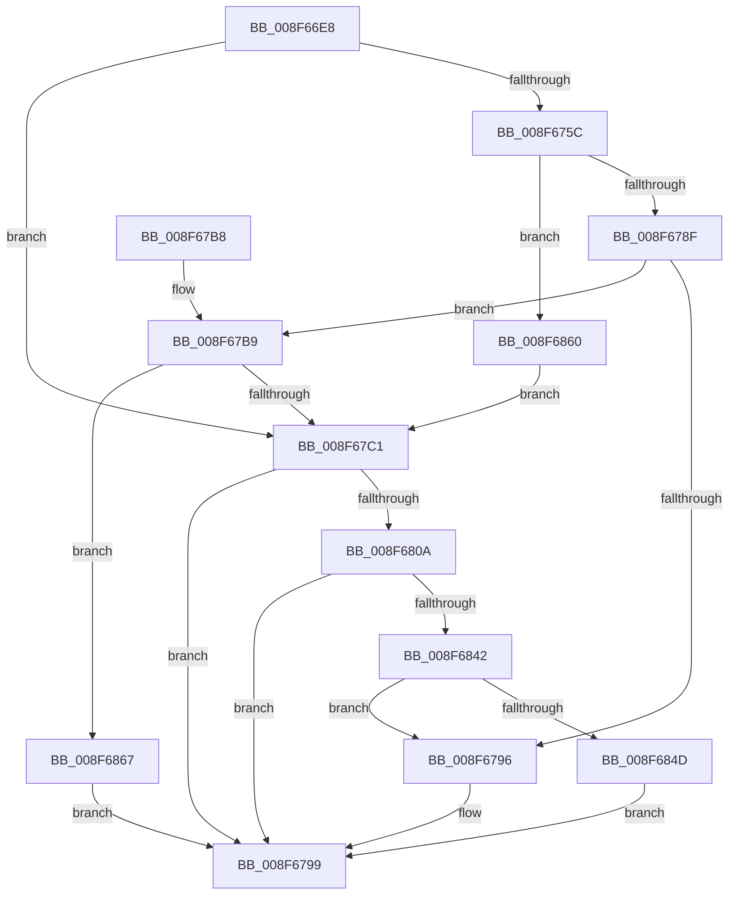

# PnpSetObjectProperty

- RVA: `0x008F66E8`–`0x008F6871` (길이 `393` bytes)
- VA: `0x00000001408F66E8`
- 실행 섹션: `PAGE`
- PDB 이름 있음: `예`; PDB Function 태그: `아니요`
- unwind 정보 RVA: `0x00087960`
- 디코드: `105`개 명령, `393/393` bytes 표시
- 미해석 바이트: `0` (있으면 어셈블리에 `.byte`로 보존)

> 이 문서는 커널 이미지의 기계어와 PDB 기호를 분석해 생성했습니다. 4번과 5번은 함수 원형과 자료형을 바이너리 사용 방식에서 추정한 C 해석이며 원본 소스 복구 결과는 아닙니다.

## 1. Dependencies

- 직접 호출 지점: **4**; 고유 호출 대상: **3**
- 직접 호출자로 확인된 함수: **36**
- RIP 상대 이미지 참조: **0**

### Outgoing calls
- `0x008F671D` → [memset](../../text/6C/memset_function_006C6C40.md) (function, `0x006C6C40`)
- `0x008F677F` → [guard_dispatch_icall](../../text/6B/guard_dispatch_icall_function_006BAAD0.md) (function, `0x006BAAD0`)
- `0x008F67FE` → [PnpSetObjectPropertyWorker](PnpSetObjectPropertyWorker_function_008F7438.md) (function, `0x008F7438`)
- `0x008F6830` → [guard_dispatch_icall](../../text/6B/guard_dispatch_icall_function_006BAAD0.md) (function, `0x006BAAD0`)

### Direct callers
- [IoReportDetectedDevice](../72/IoReportDetectedDevice_function_00725CD0.md) at `0x00726299`
- [IoReportRootDevice](../72/IoReportRootDevice_function_00726780.md) at `0x00726A36`
- [IoGetDeviceDirectory](../72/IoGetDeviceDirectory_function_00728370.md) at `0x00728694`
- [PnpUpdateRebootRequiredReason](../72/PnpUpdateRebootRequiredReason_function_0072CE64.md) at `0x0072CF9A`
- [PnpUpdateRebootRequiredReason](../72/PnpUpdateRebootRequiredReason_function_0072CE64.md) at `0x0072CFBD`
- [PipDmgSaveDeviceDmarPolicy](../73/PipDmgSaveDeviceDmarPolicy_function_0073C630.md) at `0x0073C683`
- [PipDmgSaveDeviceDmarPolicy](../73/PipDmgSaveDeviceDmarPolicy_function_0073C630.md) at `0x0073C6B5`
- [PipDmgSetIommuDomainPolicyAndNotifyHal](../73/PipDmgSetIommuDomainPolicyAndNotifyHal_function_0073C718.md) at `0x0073C7B1`
- [PiIommuSaveDeviceAtsSettings](../74/PiIommuSaveDeviceAtsSettings_function_00740290.md) at `0x007402F4`
- [PipSetGuestAssignedProperty](../74/PipSetGuestAssignedProperty_function_00740558.md) at `0x007405A7`
- [PipSetGuestAssignedProperty](../74/PipSetGuestAssignedProperty_function_00740558.md) at `0x007405D5`
- [PiDrvDbRegisterNode](../74/PiDrvDbRegisterNode_function_00742658.md) at `0x00742809`
- [PiDrvDbRegisterNode](../74/PiDrvDbRegisterNode_function_00742658.md) at `0x00742A08`
- [PiDrvDbSetupNodeHive](../74/PiDrvDbSetupNodeHive_function_00743884.md) at `0x00743C7E`
- [PiDrvDbSetupNodes](../74/PiDrvDbSetupNodes_function_00743D0C.md) at `0x00743E65`
- [CmGetInstallerClassCompoundFiltersWorker](../83/CmGetInstallerClassCompoundFiltersWorker_function_00830130.md) at `0x00830577`
- [PiPnpRtlSetObjectProperty](PiPnpRtlSetObjectProperty_function_008F62A0.md) at `0x008F63BA`
- [PnpStartDeviceNode](PnpStartDeviceNode_function_008FE38C.md) at `0x008FE3FD`
- [IopRegisterDeviceInterface](../95/IopRegisterDeviceInterface_function_009501B0.md) at `0x009504B1`
- [PnpUnlinkDeviceRemovalRelations](../A0/PnpUnlinkDeviceRemovalRelations_function_00A063D8.md) at `0x00A0659D`
- [_CmUpdateDevicePanel](../A0/_CmUpdateDevicePanel_function_00A0A16C.md) at `0x00A0A5F1`
- [_CmUpdateDevicePanel](../A0/_CmUpdateDevicePanel_function_00A0A16C.md) at `0x00A0A655`
- [_CmUpdateDevicePanel](../A0/_CmUpdateDevicePanel_function_00A0A16C.md) at `0x00A0A68B`
- [_CmUpdateDevicePanel](../A0/_CmUpdateDevicePanel_function_00A0A16C.md) at `0x00A0A6C3`
- [_CmUpdateDevicePanel](../A0/_CmUpdateDevicePanel_function_00A0A16C.md) at `0x00A0A73A`
- [_CmUpdateDevicePanel](../A0/_CmUpdateDevicePanel_function_00A0A16C.md) at `0x00A0A874`
- [_CmUpdateDevicePanel](../A0/_CmUpdateDevicePanel_function_00A0A16C.md) at `0x00A0A8C0`
- [_CmUpdateDevicePanel](../A0/_CmUpdateDevicePanel_function_00A0A16C.md) at `0x00A0A90C`
- [_CmUpdateDevicePanel](../A0/_CmUpdateDevicePanel_function_00A0A16C.md) at `0x00A0A97C`
- [_CmUpdateDevicePanel](../A0/_CmUpdateDevicePanel_function_00A0A16C.md) at `0x00A0A9D3`
- [_CmUpdateDevicePanel](../A0/_CmUpdateDevicePanel_function_00A0A16C.md) at `0x00A0AA4E`
- [_CmUpdateDevicePanel](../A0/_CmUpdateDevicePanel_function_00A0A16C.md) at `0x00A0AA84`
- [_CmUpdateDevicePanel](../A0/_CmUpdateDevicePanel_function_00A0A16C.md) at `0x00A0AABA`
- [_CmUpdateDevicePanel](../A0/_CmUpdateDevicePanel_function_00A0A16C.md) at `0x00A0ABD8`
- [_CmUpdateDevicePanel](../A0/_CmUpdateDevicePanel_function_00A0A16C.md) at `0x00A0AC41`
- [_CmUpdateDevicePanel](../A0/_CmUpdateDevicePanel_function_00A0A16C.md) at `0x00A0AC91`
- [_CmUpdateDevicePanel](../A0/_CmUpdateDevicePanel_function_00A0A16C.md) at `0x00A0ACCE`
- [PipCallDriverAddDevice](../A2/PipCallDriverAddDevice_function_00A272E0.md) at `0x00A27A20`
- [PipCallDriverAddDevice](../A2/PipCallDriverAddDevice_function_00A272E0.md) at `0x00A27A65`
- [PipClearDevNodeProblem](../A2/PipClearDevNodeProblem_function_00A27C8C.md) at `0x00A27D72`
- [PiProcessNewDeviceNode](../A2/PiProcessNewDeviceNode_function_00A28F20.md) at `0x00A29752`
- [PiProcessNewDeviceNode](../A2/PiProcessNewDeviceNode_function_00A28F20.md) at `0x00A29797`
- [PiProcessNewDeviceNode](../A2/PiProcessNewDeviceNode_function_00A28F20.md) at `0x00A297D2`
- [PiProcessNewDeviceNode](../A2/PiProcessNewDeviceNode_function_00A28F20.md) at `0x00A2981A`
- [PiProcessNewDeviceNode](../A2/PiProcessNewDeviceNode_function_00A28F20.md) at `0x00A29A04`
- [PiProcessNewDeviceNode](../A2/PiProcessNewDeviceNode_function_00A28F20.md) at `0x00A2A0BA`
- [PiProcessNewDeviceNode](../A2/PiProcessNewDeviceNode_function_00A28F20.md) at `0x00A2A11E`
- [PnpInitializeInheritedRestrictedSd](../A7/PnpInitializeInheritedRestrictedSd_function_00A7FB28.md) at `0x00A7FC38`
- [PnpClearDeviceTemporaryProperties](../A8/PnpClearDeviceTemporaryProperties_function_00A8F4DC.md) at `0x00A8F538`
- [PnpInitializeSessionId](../A9/PnpInitializeSessionId_function_00A949E4.md) at `0x00A94AA7`
- [CmDeleteDeviceMappedPropertyForAllDriverKeyRegValues](../AB/CmDeleteDeviceMappedPropertyForAllDriverKeyRegValues_function_00AB0218.md) at `0x00AB026E`
- [PiDcContainerRequiresConfiguration](../AB/PiDcContainerRequiresConfiguration_function_00AB6004.md) at `0x00AB60E5`
- [CmGetDeviceCompoundFiltersWorker](../AF/CmGetDeviceCompoundFiltersWorker_function_00AF9CE8.md) at `0x00AFA174`
- [sub_00B1DC0E](../B1/Unknown_function_00B1DC0E.md) at `0x00B1DDA8`
- [sub_00B1F622](../B1/Unknown_function_00B1F622.md) at `0x00B1F8E6`
- [sub_00B348F8](../B3/Unknown_function_00B348F8.md) at `0x00B349DA`
- [sub_00B34B5E](../B3/Unknown_function_00B34B5E.md) at `0x00B34B94`
- [sub_00B34C12](../B3/Unknown_function_00B34C12.md) at `0x00B34CFC`
- [sub_00B34C12](../B3/Unknown_function_00B34C12.md) at `0x00B34D47`
- [sub_00B34C12](../B3/Unknown_function_00B34C12.md) at `0x00B34D92`
- [sub_00B34C12](../B3/Unknown_function_00B34C12.md) at `0x00B34E25`
- [sub_00B34C12](../B3/Unknown_function_00B34C12.md) at `0x00B34E5B`
- [sub_00B34C12](../B3/Unknown_function_00B34C12.md) at `0x00B34E91`
- [sub_00B34E9C](../B3/Unknown_function_00B34E9C.md) at `0x00B34F96`
- [sub_00B34E9C](../B3/Unknown_function_00B34E9C.md) at `0x00B34FF0`
- [sub_00B34E9C](../B3/Unknown_function_00B34E9C.md) at `0x00B3504C`
- [sub_00B34E9C](../B3/Unknown_function_00B34E9C.md) at `0x00B350A1`
- [sub_00B34E9C](../B3/Unknown_function_00B34E9C.md) at `0x00B350D7`
- [sub_00B34E9C](../B3/Unknown_function_00B34E9C.md) at `0x00B3510D`
- [sub_00B34E9C](../B3/Unknown_function_00B34E9C.md) at `0x00B35168`
- [sub_00B34E9C](../B3/Unknown_function_00B34E9C.md) at `0x00B351C4`
- [sub_00B34E9C](../B3/Unknown_function_00B34E9C.md) at `0x00B3521E`
- [sub_00B34E9C](../B3/Unknown_function_00B34E9C.md) at `0x00B35269`
- [sub_00B34E9C](../B3/Unknown_function_00B34E9C.md) at `0x00B352C2`
- [sub_00B34E9C](../B3/Unknown_function_00B34E9C.md) at `0x00B3537F`
- [sub_00B34E9C](../B3/Unknown_function_00B34E9C.md) at `0x00B353FE`
- [sub_00B34E9C](../B3/Unknown_function_00B34E9C.md) at `0x00B35477`
- [sub_00B34E9C](../B3/Unknown_function_00B34E9C.md) at `0x00B354F7`
- [sub_00B34E9C](../B3/Unknown_function_00B34E9C.md) at `0x00B35545`
- [sub_00B34E9C](../B3/Unknown_function_00B34E9C.md) at `0x00B3557B`
- [sub_00B34E9C](../B3/Unknown_function_00B34E9C.md) at `0x00B355B8`
- [sub_00B34E9C](../B3/Unknown_function_00B34E9C.md) at `0x00B355EE`
- [sub_00B34E9C](../B3/Unknown_function_00B34E9C.md) at `0x00B35624`
- [sub_00B34E9C](../B3/Unknown_function_00B34E9C.md) at `0x00B35684`
- [sub_00B34E9C](../B3/Unknown_function_00B34E9C.md) at `0x00B35782`
- [sub_00B34E9C](../B3/Unknown_function_00B34E9C.md) at `0x00B357D9`
- [sub_00B34E9C](../B3/Unknown_function_00B34E9C.md) at `0x00B35856`
- [sub_00B34E9C](../B3/Unknown_function_00B34E9C.md) at `0x00B358A0`
- [sub_00B34E9C](../B3/Unknown_function_00B34E9C.md) at `0x00B35A03`
- [sub_00B34E9C](../B3/Unknown_function_00B34E9C.md) at `0x00B35A79`
- [sub_00B34E9C](../B3/Unknown_function_00B34E9C.md) at `0x00B35B4B`
- [sub_00B34E9C](../B3/Unknown_function_00B34E9C.md) at `0x00B35BC1`
- [sub_00B34E9C](../B3/Unknown_function_00B34E9C.md) at `0x00B35C39`
- [sub_00B34E9C](../B3/Unknown_function_00B34E9C.md) at `0x00B35C92`
- [sub_00B34E9C](../B3/Unknown_function_00B34E9C.md) at `0x00B35D0F`
- [sub_00B34E9C](../B3/Unknown_function_00B34E9C.md) at `0x00B35D45`
- [sub_00B34E9C](../B3/Unknown_function_00B34E9C.md) at `0x00B35D7B`
- [sub_00B34E9C](../B3/Unknown_function_00B34E9C.md) at `0x00B35DCE`
- [sub_00B34E9C](../B3/Unknown_function_00B34E9C.md) at `0x00B35E27`
- [sub_00B34E9C](../B3/Unknown_function_00B34E9C.md) at `0x00B35E82`
- [sub_00B34E9C](../B3/Unknown_function_00B34E9C.md) at `0x00B35EFB`
- [sub_00B34E9C](../B3/Unknown_function_00B34E9C.md) at `0x00B35F64`
- [sub_00B34E9C](../B3/Unknown_function_00B34E9C.md) at `0x00B35FE1`
- [sub_00B34E9C](../B3/Unknown_function_00B34E9C.md) at `0x00B3608A`
- [sub_00B34E9C](../B3/Unknown_function_00B34E9C.md) at `0x00B36105`
- [sub_00B34E9C](../B3/Unknown_function_00B34E9C.md) at `0x00B361BD`
- [sub_00B34E9C](../B3/Unknown_function_00B34E9C.md) at `0x00B36233`
- [sub_00B34E9C](../B3/Unknown_function_00B34E9C.md) at `0x00B36269`
- [sub_00B34E9C](../B3/Unknown_function_00B34E9C.md) at `0x00B3629F`
- [sub_00B34E9C](../B3/Unknown_function_00B34E9C.md) at `0x00B362D5`
- [sub_00B34E9C](../B3/Unknown_function_00B34E9C.md) at `0x00B3630B`
- [sub_00B34E9C](../B3/Unknown_function_00B34E9C.md) at `0x00B36341`
- [sub_00B34E9C](../B3/Unknown_function_00B34E9C.md) at `0x00B36377`
- [sub_00B34E9C](../B3/Unknown_function_00B34E9C.md) at `0x00B363AD`
- [sub_00B34E9C](../B3/Unknown_function_00B34E9C.md) at `0x00B363E3`
- [sub_00B34E9C](../B3/Unknown_function_00B34E9C.md) at `0x00B36419`
- [sub_00B34E9C](../B3/Unknown_function_00B34E9C.md) at `0x00B3644F`
- [sub_00B34E9C](../B3/Unknown_function_00B34E9C.md) at `0x00B36485`
- [sub_00B34E9C](../B3/Unknown_function_00B34E9C.md) at `0x00B364BB`
- [sub_00B34E9C](../B3/Unknown_function_00B34E9C.md) at `0x00B364F1`
- [sub_00B34E9C](../B3/Unknown_function_00B34E9C.md) at `0x00B36529`
- [sub_00B34E9C](../B3/Unknown_function_00B34E9C.md) at `0x00B3655F`
- [sub_00B34E9C](../B3/Unknown_function_00B34E9C.md) at `0x00B36595`
- [sub_00B34E9C](../B3/Unknown_function_00B34E9C.md) at `0x00B365CB`
- [sub_00B3C62C](../B3/Unknown_function_00B3C62C.md) at `0x00B3C6D7`
- [sub_00B46EDE](../B4/Unknown_function_00B46EDE.md) at `0x00B4708D`
- [PipMigrateResetDeviceCallback](../../init/C3/PipMigrateResetDeviceCallback_function_00C31D40.md) at `0x00C31E40`
- [PipInitComputerIds](../../init/C7/PipInitComputerIds_function_00C74734.md) at `0x00C75700`

### Static image references
- 디코드된 RIP-relative 메모리 참조가 없습니다.

## 2. Other-region calls and transfers

- 다른 실행 섹션으로 향하는 call: **3**
  - `0x008F671D` → [memset](../../text/6C/memset_function_006C6C40.md) (`PAGE` → `.text`)
  - `0x008F677F` → [guard_dispatch_icall](../../text/6B/guard_dispatch_icall_function_006BAAD0.md) (`PAGE` → `.text`)
  - `0x008F6830` → [guard_dispatch_icall](../../text/6B/guard_dispatch_icall_function_006BAAD0.md) (`PAGE` → `.text`)
- 별도 외부 분기/꼬리 이동을 확인하지 못했습니다.

## 3. Assembly (complete function range)

```asm
008F66E8  48 8B C4                        mov rax, rsp
008F66EB  48 89 58 08                     mov qword ptr [rax + 8], rbx
008F66EF  48 89 70 10                     mov qword ptr [rax + 0x10], rsi
008F66F3  48 89 78 18                     mov qword ptr [rax + 0x18], rdi
008F66F7  55                              push rbp
008F66F8  41 56                           push r14
008F66FA  41 57                           push r15
008F66FC  48 8D 68 D1                     lea rbp, [rax - 0x2f]
008F6700  48 81 EC A0 00 00 00            sub rsp, 0xa0
008F6707  4C 8B FA                        mov r15, rdx
008F670A  45 8B F0                        mov r14d, r8d
008F670D  33 D2                           xor edx, edx
008F670F  48 8B F1                        mov rsi, rcx
008F6712  48 8D 4D C7                     lea rcx, [rbp - 0x39]
008F6716  49 8B D9                        mov rbx, r9
008F6719  44 8D 42 50                     lea r8d, [rdx + 0x50]
008F671D  E8 1E 05 DD FF                  call 0x1406c6c40
008F6722  48 8B 45 57                     mov rax, qword ptr [rbp + 0x57]
008F6726  48 8B BE E8 01 00 00            mov rdi, qword ptr [rsi + 0x1e8]
008F672D  48 89 45 DF                     mov qword ptr [rbp - 0x21], rax
008F6731  48 8B 45 5F                     mov rax, qword ptr [rbp + 0x5f]
008F6735  48 89 45 E7                     mov qword ptr [rbp - 0x19], rax
008F6739  8B 45 67                        mov eax, dword ptr [rbp + 0x67]
008F673C  89 45 EF                        mov dword ptr [rbp - 0x11], eax
008F673F  48 8B 45 6F                     mov rax, qword ptr [rbp + 0x6f]
008F6743  48 89 45 F7                     mov qword ptr [rbp - 9], rax
008F6747  8B 45 77                        mov eax, dword ptr [rbp + 0x77]
008F674A  89 45 FF                        mov dword ptr [rbp - 1], eax
008F674D  8B 45 7F                        mov eax, dword ptr [rbp + 0x7f]
008F6750  89 45 03                        mov dword ptr [rbp + 3], eax
008F6753  48 89 5D D7                     mov qword ptr [rbp - 0x29], rbx
008F6757  48 85 FF                        test rdi, rdi
008F675A  74 65                           je 0x1408f67c1
008F675C  48 8D 45 C7                     lea rax, [rbp - 0x39]
008F6760  41 B9 09 00 00 00               mov r9d, 9
008F6766  48 89 44 24 28                  mov qword ptr [rsp + 0x28], rax
008F676B  45 8B C6                        mov r8d, r14d
008F676E  48 8B C7                        mov rax, rdi
008F6771  C7 44 24 20 01 00 00 00         mov dword ptr [rsp + 0x20], 1
008F6779  49 8B D7                        mov rdx, r15
008F677C  48 8B CE                        mov rcx, rsi
008F677F  E8 4C 43 DC FF                  call 0x1406baad0
008F6784  3D 02 00 00 C0                  cmp eax, 0xc0000002
008F6789  0F 84 D1 00 00 00               je 0x1408f6860
008F678F  3D 20 01 00 C0                  cmp eax, 0xc0000120
008F6794  75 23                           jne 0x1408f67b9
008F6796  8B 5D C7                        mov ebx, dword ptr [rbp - 0x39]
008F6799  4C 8D 9C 24 A0 00 00 00         lea r11, [rsp + 0xa0]
008F67A1  8B C3                           mov eax, ebx
008F67A3  49 8B 5B 20                     mov rbx, qword ptr [r11 + 0x20]
008F67A7  49 8B 73 28                     mov rsi, qword ptr [r11 + 0x28]
008F67AB  49 8B 7B 30                     mov rdi, qword ptr [r11 + 0x30]
008F67AF  49 8B E3                        mov rsp, r11
008F67B2  41 5F                           pop r15
008F67B4  41 5E                           pop r14
008F67B6  5D                              pop rbp
008F67B7  C3                              ret
008F67B8  CC                              int3
008F67B9  85 C0                           test eax, eax
008F67BB  0F 85 A6 00 00 00               jne 0x1408f6867
008F67C1  8B 45 03                        mov eax, dword ptr [rbp + 3]
008F67C4  45 8B C6                        mov r8d, r14d
008F67C7  4C 8B 4D D7                     mov r9, qword ptr [rbp - 0x29]
008F67CB  49 8B D7                        mov rdx, r15
008F67CE  89 44 24 48                     mov dword ptr [rsp + 0x48], eax
008F67D2  48 8B CE                        mov rcx, rsi
008F67D5  8B 45 FF                        mov eax, dword ptr [rbp - 1]
008F67D8  89 44 24 40                     mov dword ptr [rsp + 0x40], eax
008F67DC  48 8B 45 F7                     mov rax, qword ptr [rbp - 9]
008F67E0  48 89 44 24 38                  mov qword ptr [rsp + 0x38], rax
008F67E5  8B 45 EF                        mov eax, dword ptr [rbp - 0x11]
008F67E8  89 44 24 30                     mov dword ptr [rsp + 0x30], eax
008F67EC  48 8B 45 E7                     mov rax, qword ptr [rbp - 0x19]
008F67F0  48 89 44 24 28                  mov qword ptr [rsp + 0x28], rax
008F67F5  48 8B 45 DF                     mov rax, qword ptr [rbp - 0x21]
008F67F9  48 89 44 24 20                  mov qword ptr [rsp + 0x20], rax
008F67FE  E8 35 0C 00 00                  call 0x1408f7438
008F6803  8B D8                           mov ebx, eax
008F6805  48 85 FF                        test rdi, rdi
008F6808  74 8F                           je 0x1408f6799
008F680A  89 45 C7                        mov dword ptr [rbp - 0x39], eax
008F680D  41 B9 09 00 00 00               mov r9d, 9
008F6813  48 8D 45 C7                     lea rax, [rbp - 0x39]
008F6817  45 8B C6                        mov r8d, r14d
008F681A  48 89 44 24 28                  mov qword ptr [rsp + 0x28], rax
008F681F  49 8B D7                        mov rdx, r15
008F6822  48 8B C7                        mov rax, rdi
008F6825  C7 44 24 20 02 00 00 00         mov dword ptr [rsp + 0x20], 2
008F682D  48 8B CE                        mov rcx, rsi
008F6830  E8 9B 42 DC FF                  call 0x1406baad0
008F6835  8B C8                           mov ecx, eax
008F6837  3D 02 00 00 C0                  cmp eax, 0xc0000002
008F683C  0F 84 57 FF FF FF               je 0x1408f6799
008F6842  3D 20 01 00 C0                  cmp eax, 0xc0000120
008F6847  0F 84 49 FF FF FF               je 0x1408f6796
008F684D  8B C3                           mov eax, ebx
008F684F  85 C9                           test ecx, ecx
008F6851  BB E5 00 00 C0                  mov ebx, 0xc00000e5
008F6856  0F 45 C3                        cmovne eax, ebx
008F6859  8B D8                           mov ebx, eax
008F685B  E9 39 FF FF FF                  jmp 0x1408f6799
008F6860  33 FF                           xor edi, edi
008F6862  E9 5A FF FF FF                  jmp 0x1408f67c1
008F6867  BB E5 00 00 C0                  mov ebx, 0xc00000e5
008F686C  E9 28 FF FF FF                  jmp 0x1408f6799
```

## 4. C-style interpretation (structured pseudocode)

```c
__int64 __fastcall PnpSetObjectProperty(__int64 a1, __int64 a2, int a3, __int64 a4)
{
    __int64 result;
    __int64 v_rdi;
    __int64 v_rsp;
    unsigned __int64 v_stack_m18;
    unsigned int v_stack_m58;
    unsigned int v_stack_m60;
    unsigned __int64 v_stack_m68;
    unsigned int v_stack_m70;
    unsigned __int64 v_stack_m78;
    unsigned __int64 v_stack_m80;
    unsigned __int64 v_stack_m90;
    unsigned int v_stack_m98;

    *(unsigned __int64 *)(v_rsp + 8) = v_rbx;
    *(unsigned __int64 *)(v_rsp + 16) = v_rsi;
    *(unsigned __int64 *)(v_rsp + 24) = v_rdi;
    v_rsp = (v_rsp) - (160);
    a2 = 0;
    result = memset(v_rsp - 47 - 57, a2, a2 + 80, a4);
    *(unsigned __int64 *)(v_rsp - 47 - 33) = *(unsigned __int64 *)(v_rsp - 47 + 87);
    *(unsigned __int64 *)(v_rsp - 47 - 25) = *(unsigned __int64 *)(v_rsp - 47 + 95);
    *(unsigned int *)(v_rsp - 47 - 17) = (unsigned int)((unsigned int)(*(unsigned int *)(v_rsp - 47 + 103)));
    *(unsigned __int64 *)(v_rsp - 47 - 9) = *(unsigned __int64 *)(v_rsp - 47 + 111);
    *(unsigned int *)(v_rsp - 47 - 1) = (unsigned int)((unsigned int)(*(unsigned int *)(v_rsp - 47 + 119)));
    *(unsigned int *)(v_rsp - 47 + 3) = (unsigned int)((unsigned int)(*(unsigned int *)(v_rsp - 47 + 127)));
    *(unsigned __int64 *)(v_rsp - 47 - 41) = a4;
    if (*(unsigned __int64 *)(a1 + 488) == 0) goto loc_008F67C1;
    v_stack_m90 = v_rsp - 47 - 57;
    v_stack_m98 = 1;
    result = guard_dispatch_icall(a1, 0, (unsigned int)((unsigned int)((unsigned int)(a3))), 9);
    if (((unsigned int)(result)) == 0xC0000002ULL) goto loc_008F6860;
    if (((unsigned int)(result)) != 0xC0000120ULL) goto loc_008F67B9;
loc_008F6796:
loc_008F6799:
    return (unsigned int)((unsigned int)((unsigned int)(*(unsigned int *)(v_rsp - 47 - 57))));
loc_008F67B9:
    if ((unsigned int)((unsigned int)((unsigned int)((unsigned int)(*(unsigned int *)(v_rsp - 47 - 57))))) != 0) goto loc_008F6867;
loc_008F67C1:
    v_stack_m58 = (unsigned int)((unsigned int)(*(unsigned int *)(v_rsp - 47 + 3)));
    v_stack_m60 = (unsigned int)((unsigned int)(*(unsigned int *)(v_rsp - 47 - 1)));
    v_stack_m68 = *(unsigned __int64 *)(v_rsp - 47 - 9);
    v_stack_m70 = (unsigned int)((unsigned int)(*(unsigned int *)(v_rsp - 47 - 17)));
    v_stack_m78 = *(unsigned __int64 *)(v_rsp - 47 - 25);
    v_stack_m80 = *(unsigned __int64 *)(v_rsp - 47 - 33);
    result = PnpSetObjectPropertyWorker(*(unsigned __int64 *)(v_stack_m18 + 40), 0, (unsigned int)((unsigned int)((unsigned int)(a3))), *(unsigned __int64 *)(v_rsp - 47 - 41));
    if (*(unsigned __int64 *)(v_stack_m18 + 48) == 0) goto loc_008F6799;
    *(unsigned int *)(v_rsp - 47 - 57) = (unsigned int)(result);
    v_stack_m78 = v_rsp - 47 - 57;
    v_stack_m80 = 2;
    result = guard_dispatch_icall(*(unsigned __int64 *)(v_stack_m18 + 40), 0, (unsigned int)((unsigned int)((unsigned int)(a3))), 9);
    if (((unsigned int)(result)) == 0xC0000002ULL) goto loc_008F6799;
    if (((unsigned int)(result)) == 0xC0000120ULL) goto loc_008F6796;
    result = (unsigned int)((unsigned int)((unsigned int)((unsigned int)(result))));
    if ((unsigned int)((unsigned int)((unsigned int)(result))) != 0) { result = (unsigned int)((unsigned int)(0xC00000E5ULL)); }
    goto loc_008F6799;
loc_008F6860:
    v_rdi = 0;
    goto loc_008F67C1;
loc_008F6867:
    goto loc_008F6799;
}
```

## 5. (Beta) C Style

```c
int64_t PnpSetObjectProperty(void *Arg1, int64_t Arg2, int32_t Arg3, int64_t Arg4)
{
    uint8_t *arg1 = (uint8_t *)Arg1;

    int64_t result;
    int64_t local_rdi;
    int64_t local_rsp;
    uint64_t v_stack_m18;
    uint32_t v_stack_m58;
    uint32_t v_stack_m60;
    uint64_t v_stack_m68;
    uint32_t v_stack_m70;
    uint64_t v_stack_m78;
    uint64_t v_stack_m80;
    uint64_t v_stack_m90;
    uint32_t v_stack_m98;

    *(uint64_t *)(local_rsp + 0x8) = local_rbx;
    *(uint64_t *)(local_rsp + 0x10) = local_rsi;
    *(uint64_t *)(local_rsp + 0x18) = local_rdi;
    local_rsp = (local_rsp) - (160);
    Arg2 = 0;
    result = memset(local_rsp - 47 - 57, Arg2, Arg2 + 80, Arg4);
    *(uint64_t *)(local_rsp - 0x2F - 0x21) = *(uint64_t *)(local_rsp - 0x2F + 0x57);
    *(uint64_t *)(local_rsp - 0x2F - 0x19) = *(uint64_t *)(local_rsp - 0x2F + 0x5F);
    *(uint32_t *)(local_rsp - 0x2F - 0x11) = (uint32_t)((uint32_t)(*(uint32_t *)(local_rsp - 0x2F + 0x67)));
    *(uint64_t *)(local_rsp - 0x2F - 0x9) = *(uint64_t *)(local_rsp - 0x2F + 0x6F);
    *(uint32_t *)(local_rsp - 0x2F - 0x1) = (uint32_t)((uint32_t)(*(uint32_t *)(local_rsp - 0x2F + 0x77)));
    *(uint32_t *)(local_rsp - 0x2F + 0x3) = (uint32_t)((uint32_t)(*(uint32_t *)(local_rsp - 0x2F + 0x7F)));
    *(uint64_t *)(local_rsp - 0x2F - 0x29) = Arg4;
    if (*(uint64_t *)(arg1 + 0x1E8) == 0) goto loc_008F67C1;
    v_stack_m90 = local_rsp - 47 - 57;
    v_stack_m98 = 1;
    result = guard_dispatch_icall(Arg1, 0, (uint32_t)((uint32_t)((uint32_t)(Arg3))), 9);
    if (((uint32_t)(result)) == 0xC0000002ULL) goto loc_008F6860;
    if (((uint32_t)(result)) != 0xC0000120ULL) goto loc_008F67B9;
loc_008F6796:
loc_008F6799:
    return (uint32_t)((uint32_t)((uint32_t)(*(uint32_t *)(local_rsp - 0x2F - 0x39))));
loc_008F67B9:
    if ((uint32_t)((uint32_t)((uint32_t)((uint32_t)(*(uint32_t *)(local_rsp - 0x2F - 0x39))))) != 0) goto loc_008F6867;
loc_008F67C1:
    v_stack_m58 = (uint32_t)((uint32_t)(*(uint32_t *)(local_rsp - 0x2F + 0x3)));
    v_stack_m60 = (uint32_t)((uint32_t)(*(uint32_t *)(local_rsp - 0x2F - 0x1)));
    v_stack_m68 = *(uint64_t *)(local_rsp - 0x2F - 0x9);
    v_stack_m70 = (uint32_t)((uint32_t)(*(uint32_t *)(local_rsp - 0x2F - 0x11)));
    v_stack_m78 = *(uint64_t *)(local_rsp - 0x2F - 0x19);
    v_stack_m80 = *(uint64_t *)(local_rsp - 0x2F - 0x21);
    result = PnpSetObjectPropertyWorker(*(uint64_t *)(v_stack_m18 + 0x28), 0, (uint32_t)((uint32_t)((uint32_t)(Arg3))), *(uint64_t *)(local_rsp - 0x2F - 0x29));
    if (*(uint64_t *)(v_stack_m18 + 0x30) == 0) goto loc_008F6799;
    *(uint32_t *)(local_rsp - 0x2F - 0x39) = (uint32_t)(result);
    v_stack_m78 = local_rsp - 47 - 57;
    v_stack_m80 = 2;
    result = guard_dispatch_icall(*(uint64_t *)(v_stack_m18 + 0x28), 0, (uint32_t)((uint32_t)((uint32_t)(Arg3))), 9);
    if (((uint32_t)(result)) == 0xC0000002ULL) goto loc_008F6799;
    if (((uint32_t)(result)) == 0xC0000120ULL) goto loc_008F6796;
    result = (uint32_t)((uint32_t)((uint32_t)((uint32_t)(result))));
    if ((uint32_t)((uint32_t)((uint32_t)(result))) != 0) { result = (uint32_t)((uint32_t)(0xC00000E5ULL)); }
    goto loc_008F6799;
loc_008F6860:
    local_rdi = 0;
    goto loc_008F67C1;
loc_008F6867:
    goto loc_008F6799;
}
```

### 관측된 메모리 오프셋

구조체 형식이 확인되지 않은 접근은 인자 기준의 오프셋으로만 기록했습니다.

| 기준 인자 | 오프셋 표현 | 폭 (bit) | 접근 |
|---|---:|---:|---|
| `Arg1` | `+ 0x1E8` | `64` | `R` |

## 6. Execution-region graph

[열기: 2D/3D 그래프와 함수 탐색 컨트롤 패널](../../../control-panel.html?section=page&rva=0x008F66E8&view=graph)

- 2D 그래프는 위에서 아래로 흐르고, 3D 그래프는 빈 공간을 드래그해 회전합니다. Shift+드래그는 이동, 휠은 확대·축소, 함수 노드 선택은 대상 보고서 이동입니다.

### Static fallback


