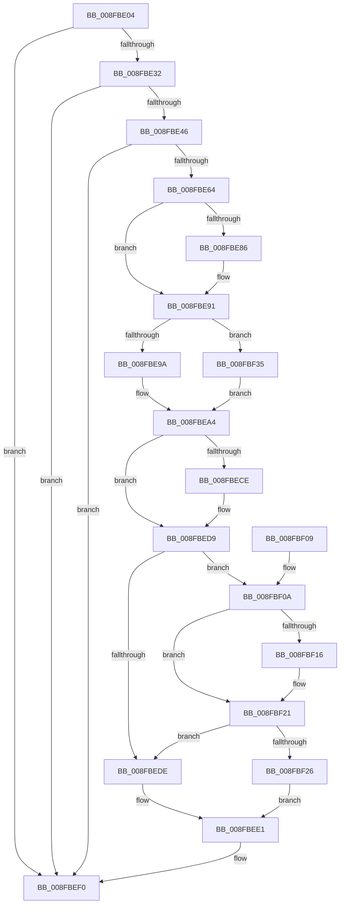

# PnpSetPlugPlayEvent

- RVA: `0x008FBE04`–`0x008FBF44` (길이 `320` bytes)
- VA: `0x00000001408FBE04`
- 실행 섹션: `PAGE`
- PDB 이름 있음: `예`; PDB Function 태그: `아니요`
- unwind 정보 RVA: `0x00087EEC`
- 디코드: `74`개 명령, `320/320` bytes 표시
- 미해석 바이트: `0` (있으면 어셈블리에 `.byte`로 보존)

> 이 문서는 커널 이미지의 기계어와 PDB 기호를 분석해 생성했습니다. 4번과 5번은 함수 원형과 자료형을 바이너리 사용 방식에서 추정한 C 해석이며 원본 소스 복구 결과는 아닙니다.

## 1. Dependencies

- 직접 호출 지점: **4**; 고유 호출 대상: **4**
- 직접 호출자로 확인된 함수: **4**
- RIP 상대 이미지 참조: **5**

### Outgoing calls
- `0x008FBE53` → [PnpCreateDeviceEventEntry](../95/PnpCreateDeviceEventEntry_function_00951B48.md) (function, `0x00951B48`)
- `0x008FBEAD` → [memcpy](../../text/6C/memcpy_function_006C6840.md) (function, `0x006C6840`)
- `0x008FBEEB` → [PnpInsertEventInQueue](../95/PnpInsertEventInQueue_function_00951B78.md) (function, `0x00951B78`)
- `0x008FBF2E` → [ObfReferenceObjectWithTag](../../text/21/ObfReferenceObjectWithTag_function_00210710.md) (function, `0x00210710`)

### Direct callers
- [PiInitializeDevice](../73/PiInitializeDevice_function_0073EC5C.md) at `0x0073F037`
- [PipProcessStartPhase3](PipProcessStartPhase3_function_008FBAF8.md) at `0x008FBBAB`
- [PiProcessNewDeviceNode](../A2/PiProcessNewDeviceNode_function_00A28F20.md) at `0x00A2A374`
- [sub_00B1F622](../B1/Unknown_function_00B1F622.md) at `0x00B1F98B`

### Static image references
- `0x008FBE22` → RVA `0x00F8C5E4` (`.data`; read)
- `0x008FBE7D` → RVA `0x00011610` (`.rdata`; read)
- `0x008FBE8A` → RVA `0x00011618` (`.rdata`; read)
- `0x008FBF0D` → RVA `0x00014D58` (`.rdata`; read)
- `0x008FBF1A` → RVA `0x00014D60` (`.rdata`; read)

## 2. Other-region calls and transfers

- 다른 실행 섹션으로 향하는 call: **2**
  - `0x008FBEAD` → [memcpy](../../text/6C/memcpy_function_006C6840.md) (`PAGE` → `.text`)
  - `0x008FBF2E` → [ObfReferenceObjectWithTag](../../text/21/ObfReferenceObjectWithTag_function_00210710.md) (`PAGE` → `.text`)
- 별도 외부 분기/꼬리 이동을 확인하지 못했습니다.

## 3. Assembly (complete function range)

```asm
008FBE04  48 89 5C 24 08                  mov qword ptr [rsp + 8], rbx
008FBE09  48 89 6C 24 10                  mov qword ptr [rsp + 0x10], rbp
008FBE0E  48 89 74 24 18                  mov qword ptr [rsp + 0x18], rsi
008FBE13  57                              push rdi
008FBE14  41 56                           push r14
008FBE16  41 57                           push r15
008FBE18  48 83 EC 20                     sub rsp, 0x20
008FBE1C  45 33 FF                        xor r15d, r15d
008FBE1F  48 8B EA                        mov rbp, rdx
008FBE22  44 39 3D BB 07 69 00            cmp dword ptr [rip + 0x6907bb], r15d
008FBE29  48 8B F9                        mov rdi, rcx
008FBE2C  0F 85 BE 00 00 00               jne 0x1408fbef0
008FBE32  48 8B 82 38 01 00 00            mov rax, qword ptr [rdx + 0x138]
008FBE39  48 8B 70 28                     mov rsi, qword ptr [rax + 0x28]
008FBE3D  48 85 F6                        test rsi, rsi
008FBE40  0F 84 AA 00 00 00               je 0x1408fbef0
008FBE46  44 0F B7 76 28                  movzx r14d, word ptr [rsi + 0x28]
008FBE4B  41 83 C6 50                     add r14d, 0x50
008FBE4F  41 8D 4E 78                     lea ecx, [r14 + 0x78]
008FBE53  E8 F0 5C 05 00                  call 0x140951b48
008FBE58  48 8B D8                        mov rbx, rax
008FBE5B  48 85 C0                        test rax, rax
008FBE5E  0F 84 8C 00 00 00               je 0x1408fbef0
008FBE64  0F 10 07                        movups xmm0, xmmword ptr [rdi]
008FBE67  44 89 B0 9C 00 00 00            mov dword ptr [rax + 0x9c], r14d
008FBE6E  48 8D 88 A8 00 00 00            lea rcx, [rax + 0xa8]
008FBE75  F3 0F 7F 40 78                  movdqu xmmword ptr [rax + 0x78], xmm0
008FBE7A  48 8B 07                        mov rax, qword ptr [rdi]
008FBE7D  48 2B 05 8C 57 71 FF            sub rax, qword ptr [rip - 0x8ea874]
008FBE84  75 0B                           jne 0x1408fbe91
008FBE86  48 8B 47 08                     mov rax, qword ptr [rdi + 8]
008FBE8A  48 2B 05 87 57 71 FF            sub rax, qword ptr [rip - 0x8ea879]
008FBE91  48 85 C0                        test rax, rax
008FBE94  0F 84 9B 00 00 00               je 0x1408fbf35
008FBE9A  C7 83 88 00 00 00 01 00 00 00   mov dword ptr [rbx + 0x88], 1
008FBEA4  44 0F B7 46 28                  movzx r8d, word ptr [rsi + 0x28]
008FBEA9  48 8B 56 30                     mov rdx, qword ptr [rsi + 0x30]
008FBEAD  E8 8E A9 DC FF                  call 0x1406c6840
008FBEB2  0F B7 46 28                     movzx eax, word ptr [rsi + 0x28]
008FBEB6  48 D1 E8                        shr rax, 1
008FBEB9  66 44 89 BC 43 A8 00 00 00      mov word ptr [rbx + rax*2 + 0xa8], r15w
008FBEC2  48 8B 07                        mov rax, qword ptr [rdi]
008FBEC5  48 2B 05 44 57 71 FF            sub rax, qword ptr [rip - 0x8ea8bc]
008FBECC  75 0B                           jne 0x1408fbed9
008FBECE  48 8B 47 08                     mov rax, qword ptr [rdi + 8]
008FBED2  48 2B 05 3F 57 71 FF            sub rax, qword ptr [rip - 0x8ea8c1]
008FBED9  48 85 C0                        test rax, rax
008FBEDC  75 2C                           jne 0x1408fbf0a
008FBEDE  49 8B EF                        mov rbp, r15
008FBEE1  48 8B CB                        mov rcx, rbx
008FBEE4  48 89 AB A0 00 00 00            mov qword ptr [rbx + 0xa0], rbp
008FBEEB  E8 88 5C 05 00                  call 0x140951b78
008FBEF0  48 8B 5C 24 40                  mov rbx, qword ptr [rsp + 0x40]
008FBEF5  48 8B 6C 24 48                  mov rbp, qword ptr [rsp + 0x48]
008FBEFA  48 8B 74 24 50                  mov rsi, qword ptr [rsp + 0x50]
008FBEFF  48 83 C4 20                     add rsp, 0x20
008FBF03  41 5F                           pop r15
008FBF05  41 5E                           pop r14
008FBF07  5F                              pop rdi
008FBF08  C3                              ret
008FBF09  CC                              int3
008FBF0A  48 8B 07                        mov rax, qword ptr [rdi]
008FBF0D  48 2B 05 44 8E 71 FF            sub rax, qword ptr [rip - 0x8e71bc]
008FBF14  75 0B                           jne 0x1408fbf21
008FBF16  48 8B 47 08                     mov rax, qword ptr [rdi + 8]
008FBF1A  48 2B 05 3F 8E 71 FF            sub rax, qword ptr [rip - 0x8e71c1]
008FBF21  48 85 C0                        test rax, rax
008FBF24  74 B8                           je 0x1408fbede
008FBF26  BA 50 6E 70 56                  mov edx, 0x56706e50
008FBF2B  48 8B CD                        mov rcx, rbp
008FBF2E  E8 DD 47 91 FF                  call 0x140210710
008FBF33  EB AC                           jmp 0x1408fbee1
008FBF35  C7 83 88 00 00 00 04 00 00 00   mov dword ptr [rbx + 0x88], 4
008FBF3F  E9 60 FF FF FF                  jmp 0x1408fbea4
```

## 4. C-style interpretation (structured pseudocode)

```c
__int64 __fastcall PnpSetPlugPlayEvent(__int64 a1, __int64 a2)
{
    __int64 result;
    __int64 v_r14;
    __int64 v_r15;
    __int64 v_rsp;
    unsigned __int64 v_stack_p10;
    unsigned __int64 v_stack_p18;
    unsigned __int64 v_stack_p8;

    v_stack_p8 = v_rbx;
    v_stack_p10 = v_rbp;
    v_stack_p18 = v_rsi;
    v_rsp = (v_rsp) - (32);
    v_r15 = 0;
    if ((*(unsigned int *)(v_rip + 6883259)) != 0) goto loc_008FBEF0;
    if (*(unsigned __int64 *)(*(unsigned __int64 *)(a2 + 312) + 40) == 0) goto loc_008FBEF0;
    v_r14 = (unsigned int)((*(unsigned __int16 *)(*(unsigned __int64 *)(*(unsigned __int64 *)(a2 + 312) + 40) + 40)) + (80));
    result = PnpCreateDeviceEventEntry(v_r14 + 120, a2, a3, a4);
    if (result == 0) goto loc_008FBEF0;
    *(unsigned int *)(result + 156) = (unsigned int)(v_r14);
    *(unsigned __int64 *)(result + 120) = v_xmm0;
    result = (*(unsigned __int64 *)(a1)) - (*(unsigned __int64 *)(v_rip - 9349236));
    if (!(condition_is_not_equal)) {
        result = *(unsigned __int64 *)(a1 + 8);
        result = (result) - (*(unsigned __int64 *)(v_rip - 9349241));
    }
    if (result == 0) goto loc_008FBF35;
    *(unsigned int *)(result + 136) = 1;
loc_008FBEA4:
    result = memcpy(result + 168, *(unsigned __int64 *)(*(unsigned __int64 *)(*(unsigned __int64 *)(a2 + 312) + 40) + 48), *(unsigned __int16 *)(*(unsigned __int64 *)(*(unsigned __int64 *)(a2 + 312) + 40) + 40), a4);
    result = (*(unsigned __int16 *)(*(unsigned __int64 *)(*(unsigned __int64 *)(a2 + 312) + 40) + 40)) >> (1);
    *(unsigned __int16 *)(result + result * 2 + 168) = 0;
    result = (*(unsigned __int64 *)(a1)) - (*(unsigned __int64 *)(v_rip - 9349308));
    if (!(condition_is_not_equal)) {
        result = *(unsigned __int64 *)(a1 + 8);
        result = (result) - (*(unsigned __int64 *)(v_rip - 9349313));
    }
    if (result != 0) goto loc_008FBF0A;
loc_008FBEDE:
loc_008FBEE1:
    *(unsigned __int64 *)(result + 160) = 0;
    result = PnpInsertEventInQueue(result, *(unsigned __int64 *)(*(unsigned __int64 *)(*(unsigned __int64 *)(a2 + 312) + 40) + 48), *(unsigned __int16 *)(*(unsigned __int64 *)(*(unsigned __int64 *)(a2 + 312) + 40) + 40), a4);
loc_008FBEF0:
    v_rsp = (v_rsp) + (32);
    return result;
loc_008FBF0A:
    result = (*(unsigned __int64 *)(a1)) - (*(unsigned __int64 *)(v_rip - 9335228));
    if (!(condition_is_not_equal)) {
        result = *(unsigned __int64 *)(a1 + 8);
        result = (result) - (*(unsigned __int64 *)(v_rip - 9335233));
    }
    if (result == 0) goto loc_008FBEDE;
    result = ObfReferenceObjectWithTag(v_stack_p10, (unsigned int)(0x56706E50ULL), *(unsigned __int16 *)(*(unsigned __int64 *)(*(unsigned __int64 *)(a2 + 312) + 40) + 40), a4);
    goto loc_008FBEE1;
loc_008FBF35:
    *(unsigned int *)(v_stack_p8 + 136) = 4;
    goto loc_008FBEA4;
}
```

## 5. (Beta) C Style

```c
int64_t PnpSetPlugPlayEvent(void *Arg1, void *Arg2)
{
    uint8_t *arg1 = (uint8_t *)Arg1;
    uint8_t *arg2 = (uint8_t *)Arg2;

    int64_t result;
    int64_t local_r14;
    int64_t local_r15;
    int64_t local_rsp;
    uint64_t v_stack_p10;
    uint64_t v_stack_p18;
    uint64_t v_stack_p8;

    v_stack_p8 = local_rbx;
    v_stack_p10 = local_rbp;
    v_stack_p18 = local_rsi;
    local_rsp = (local_rsp) - (32);
    local_r15 = 0;
    if ((*(uint32_t *)(v_rip + 0x6907BB)) != 0) goto loc_008FBEF0;
    if (*(uint64_t *)(*(uint64_t *)(arg2 + 0x138) + 0x28) == 0) goto loc_008FBEF0;
    local_r14 = (uint32_t)((*(uint16_t *)(*(uint64_t *)(*(uint64_t *)(arg2 + 0x138) + 0x28) + 0x28)) + (80));
    result = PnpCreateDeviceEventEntry(local_r14 + 120, Arg2, a3, a4);
    if (result == 0) goto loc_008FBEF0;
    *(uint32_t *)(result + 0x9C) = (uint32_t)(local_r14);
    *(uint64_t *)(result + 0x78) = v_xmm0;
    result = (*(uint64_t *)(arg1)) - (*(uint64_t *)(v_rip - 0x8EA874));
    if (!(condition_is_not_equal)) {
        result = *(uint64_t *)(arg1 + 0x8);
        result = (result) - (*(uint64_t *)(v_rip - 0x8EA879));
    }
    if (result == 0) goto loc_008FBF35;
    *(uint32_t *)(result + 0x88) = 1;
loc_008FBEA4:
    result = memcpy(result + 168, *(uint64_t *)(*(uint64_t *)(*(uint64_t *)(arg2 + 0x138) + 0x28) + 0x30), *(uint16_t *)(*(uint64_t *)(*(uint64_t *)(arg2 + 0x138) + 0x28) + 0x28), a4);
    result = (*(uint16_t *)(*(uint64_t *)(*(uint64_t *)(arg2 + 0x138) + 0x28) + 0x28)) >> (1);
    *(uint16_t *)(result + result * 2 + 0xA8) = 0;
    result = (*(uint64_t *)(arg1)) - (*(uint64_t *)(v_rip - 0x8EA8BC));
    if (!(condition_is_not_equal)) {
        result = *(uint64_t *)(arg1 + 0x8);
        result = (result) - (*(uint64_t *)(v_rip - 0x8EA8C1));
    }
    if (result != 0) goto loc_008FBF0A;
loc_008FBEDE:
loc_008FBEE1:
    *(uint64_t *)(result + 0xA0) = 0;
    result = PnpInsertEventInQueue(result, *(uint64_t *)(*(uint64_t *)(*(uint64_t *)(arg2 + 0x138) + 0x28) + 0x30), *(uint16_t *)(*(uint64_t *)(*(uint64_t *)(arg2 + 0x138) + 0x28) + 0x28), a4);
loc_008FBEF0:
    local_rsp = (local_rsp) + (32);
    return result;
loc_008FBF0A:
    result = (*(uint64_t *)(arg1)) - (*(uint64_t *)(v_rip - 0x8E71BC));
    if (!(condition_is_not_equal)) {
        result = *(uint64_t *)(arg1 + 0x8);
        result = (result) - (*(uint64_t *)(v_rip - 0x8E71C1));
    }
    if (result == 0) goto loc_008FBEDE;
    result = ObfReferenceObjectWithTag(v_stack_p10, (uint32_t)(0x56706E50ULL), *(uint16_t *)(*(uint64_t *)(*(uint64_t *)(arg2 + 0x138) + 0x28) + 0x28), a4);
    goto loc_008FBEE1;
loc_008FBF35:
    *(uint32_t *)(v_stack_p8 + 0x88) = 4;
    goto loc_008FBEA4;
}
```

### 관측된 메모리 오프셋

구조체 형식이 확인되지 않은 접근은 인자 기준의 오프셋으로만 기록했습니다.

| 기준 인자 | 오프셋 표현 | 폭 (bit) | 접근 |
|---|---:|---:|---|
| `Arg1` | `+ 0x0` | `64` | `R` |
| `Arg1` | `+ 0x0` | `128` | `R` |
| `Arg1` | `+ 0x8` | `64` | `R` |
| `Arg2` | `+ 0x138` | `64` | `R` |

## 6. Execution-region graph

[열기: 2D/3D 그래프와 함수 탐색 컨트롤 패널](../../../control-panel.html?section=page&rva=0x008FBE04&view=graph)

- 2D 그래프는 위에서 아래로 흐르고, 3D 그래프는 빈 공간을 드래그해 회전합니다. Shift+드래그는 이동, 휠은 확대·축소, 함수 노드 선택은 대상 보고서 이동입니다.

### Static fallback


