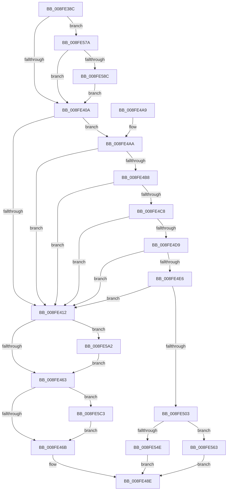

# PnpStartDeviceNode

- RVA: `0x008FE38C`–`0x008FE5DA` (길이 `590` bytes)
- VA: `0x00000001408FE38C`
- 실행 섹션: `PAGE`
- PDB 이름 있음: `예`; PDB Function 태그: `아니요`
- unwind 정보 RVA: `0x00088228`
- 디코드: `133`개 명령, `590/590` bytes 표시
- 미해석 바이트: `0` (있으면 어셈블리에 `.byte`로 보존)

> 이 문서는 커널 이미지의 기계어와 PDB 기호를 분석해 생성했습니다. 4번과 5번은 함수 원형과 자료형을 바이너리 사용 방식에서 추정한 C 해석이며 원본 소스 복구 결과는 아닙니다.

## 1. Dependencies

- 직접 호출 지점: **19**; 고유 호출 대상: **15**
- 직접 호출자로 확인된 함수: **3**
- RIP 상대 이미지 참조: **8**

### Outgoing calls
- `0x008FE3FD` → [PnpSetObjectProperty](PnpSetObjectProperty_function_008F66E8.md) (function, `0x008F66E8`)
- `0x008FE41D` → [PnpDiagnosticTraceObject](../../text/26/PnpDiagnosticTraceObject_function_0026E834.md) (function, `0x0026E834`)
- `0x008FE43C` → [KeInitializeEvent](../../text/40/KeInitializeEvent_function_0040DD10.md) (function, `0x0040DD10`)
- `0x008FE451` → [PnpStartDevice](../../text/49/PnpStartDevice_function_00499E60.md) (function, `0x00499E60`)
- `0x008FE47B` → [PnpTraceStartDevice](../../text/26/PnpTraceStartDevice_function_0026E3F8.md) (function, `0x0026E3F8`)
- `0x008FE489` → [PipSetDevNodeState](../../text/47/PipSetDevNodeState_function_00470708.md) (function, `0x00470708`)
- `0x008FE4F2` → [PnpDeviceCompletionRequestCreate](PnpDeviceCompletionRequestCreate_function_008F9BB4.md) (function, `0x008F9BB4`)
- `0x008FE50E` → [PnpDiagnosticTraceObject](../../text/26/PnpDiagnosticTraceObject_function_0026E834.md) (function, `0x0026E834`)
- `0x008FE51B` → [PipSetDevNodeState](../../text/47/PipSetDevNodeState_function_00470708.md) (function, `0x00470708`)
- `0x008FE52D` → [PnpDeviceCompletionQueueAddDispatchedRequest](../../text/49/PnpDeviceCompletionQueueAddDispatchedRequest_function_0049619C.md) (function, `0x0049619C`)
- `0x008FE540` → [PnpStartDevice](../../text/49/PnpStartDevice_function_00499E60.md) (function, `0x00499E60`)
- `0x008FE559` → [PnpDiagnosticTraceObject](../../text/26/PnpDiagnosticTraceObject_function_0026E834.md) (function, `0x0026E834`)
- `0x008FE566` → [PnpDeviceCompletionQueueRemoveCompletedRequest](../../text/49/PnpDeviceCompletionQueueRemoveCompletedRequest_function_0049D73C.md) (function, `0x0049D73C`)
- `0x008FE56E` → [PnpDeviceCompletionProcessCompletedRequest](PnpDeviceCompletionProcessCompletedRequest_function_008FB654.md) (function, `0x008FB654`)
- `0x008FE57E` → [IopGetSessionIdFromPDO](IopGetSessionIdFromPDO_function_008FFDD8.md) (function, `0x008FFDD8`)
- `0x008FE598` → [PpMarkDeviceStackExtensionFlag](../../text/4A/PpMarkDeviceStackExtensionFlag_function_004AD8D0.md) (function, `0x004AD8D0`)
- `0x008FE5B5` → [KeWaitForSingleObject](../../text/20/KeWaitForSingleObject_function_0020E6B0.md) (function, `0x0020E6B0`)
- `0x008FE5C7` → [PipUpdatePostStartCharacteristics](../../text/4A/PipUpdatePostStartCharacteristics_function_004AB4E8.md) (function, `0x004AB4E8`)
- `0x008FE5D0` → [PiSwProcessParentStartIrp](../A9/PiSwProcessParentStartIrp_function_00A97FC0.md) (function, `0x00A97FC0`)

### Direct callers
- [PnpReallocateResources](../73/PnpReallocateResources_function_0073E924.md) at `0x0073EA51`
- [PipProcessRestartPhase1](../74/PipProcessRestartPhase1_function_007407EC.md) at `0x0074084D`
- [PipProcessStartPhase1](PipProcessStartPhase1_function_008FE1F8.md) at `0x008FE250`

### Static image references
- `0x008FE3C3` → RVA `0x00011648` (`.rdata`; read)
- `0x008FE3CD` → RVA `0x00E66398` (`.data`; read)
- `0x008FE416` → RVA `0x00011660` (`.rdata`; read)
- `0x008FE44A` → RVA `0x005AA540` (`PnpDiagnosticCompletionRoutine`; read)
- `0x008FE4AA` → RVA `0x00E0AA18` (`.data`; read)
- `0x008FE4D9` → RVA `0x00FC41C4` (`.data`; read)
- `0x008FE536` → RVA `0x0026E6C0` (`PnpDeviceCompletionRoutine`; read)
- `0x008FE552` → RVA `0x000116E8` (`.rdata`; read)

## 2. Other-region calls and transfers

- 다른 실행 섹션으로 향하는 call: **14**
  - `0x008FE41D` → [PnpDiagnosticTraceObject](../../text/26/PnpDiagnosticTraceObject_function_0026E834.md) (`PAGE` → `.text`)
  - `0x008FE43C` → [KeInitializeEvent](../../text/40/KeInitializeEvent_function_0040DD10.md) (`PAGE` → `.text`)
  - `0x008FE451` → [PnpStartDevice](../../text/49/PnpStartDevice_function_00499E60.md) (`PAGE` → `.text`)
  - `0x008FE47B` → [PnpTraceStartDevice](../../text/26/PnpTraceStartDevice_function_0026E3F8.md) (`PAGE` → `.text`)
  - `0x008FE489` → [PipSetDevNodeState](../../text/47/PipSetDevNodeState_function_00470708.md) (`PAGE` → `.text`)
  - `0x008FE50E` → [PnpDiagnosticTraceObject](../../text/26/PnpDiagnosticTraceObject_function_0026E834.md) (`PAGE` → `.text`)
  - `0x008FE51B` → [PipSetDevNodeState](../../text/47/PipSetDevNodeState_function_00470708.md) (`PAGE` → `.text`)
  - `0x008FE52D` → [PnpDeviceCompletionQueueAddDispatchedRequest](../../text/49/PnpDeviceCompletionQueueAddDispatchedRequest_function_0049619C.md) (`PAGE` → `.text`)
  - `0x008FE540` → [PnpStartDevice](../../text/49/PnpStartDevice_function_00499E60.md) (`PAGE` → `.text`)
  - `0x008FE559` → [PnpDiagnosticTraceObject](../../text/26/PnpDiagnosticTraceObject_function_0026E834.md) (`PAGE` → `.text`)
  - `0x008FE566` → [PnpDeviceCompletionQueueRemoveCompletedRequest](../../text/49/PnpDeviceCompletionQueueRemoveCompletedRequest_function_0049D73C.md) (`PAGE` → `.text`)
  - `0x008FE598` → [PpMarkDeviceStackExtensionFlag](../../text/4A/PpMarkDeviceStackExtensionFlag_function_004AD8D0.md) (`PAGE` → `.text`)
  - `0x008FE5B5` → [KeWaitForSingleObject](../../text/20/KeWaitForSingleObject_function_0020E6B0.md) (`PAGE` → `.text`)
  - `0x008FE5C7` → [PipUpdatePostStartCharacteristics](../../text/4A/PipUpdatePostStartCharacteristics_function_004AB4E8.md) (`PAGE` → `.text`)
- 별도 외부 분기/꼬리 이동을 확인하지 못했습니다.

## 3. Assembly (complete function range)

```asm
008FE38C  4C 8B DC                        mov r11, rsp
008FE38F  49 89 5B 08                     mov qword ptr [r11 + 8], rbx
008FE393  49 89 6B 10                     mov qword ptr [r11 + 0x10], rbp
008FE397  49 89 73 18                     mov qword ptr [r11 + 0x18], rsi
008FE39B  57                              push rdi
008FE39C  48 81 EC 80 00 00 00            sub rsp, 0x80
008FE3A3  8B C2                           mov eax, edx
008FE3A5  0F 57 C0                        xorps xmm0, xmm0
008FE3A8  F3 0F 7F 44 24 58               movdqu xmmword ptr [rsp + 0x58], xmm0
008FE3AE  49 83 63 E0 00                  and qword ptr [r11 - 0x20], 0
008FE3B3  8B DA                           mov ebx, edx
008FE3B5  83 64 24 74 00                  and dword ptr [rsp + 0x74], 0
008FE3BA  41 8B F0                        mov esi, r8d
008FE3BD  48 8B 51 30                     mov rdx, qword ptr [rcx + 0x30]
008FE3C1  F7 D8                           neg eax
008FE3C3  48 8D 05 7E 32 71 FF            lea rax, [rip - 0x8ecd82]
008FE3CA  48 8B F9                        mov rdi, rcx
008FE3CD  48 8B 0D C4 7F 56 00            mov rcx, qword ptr [rip + 0x567fc4]
008FE3D4  1B ED                           sbb ebp, ebp
008FE3D6  83 64 24 48 00                  and dword ptr [rsp + 0x48], 0
008FE3DB  45 33 C9                        xor r9d, r9d
008FE3DE  83 64 24 40 00                  and dword ptr [rsp + 0x40], 0
008FE3E3  83 E5 05                        and ebp, 5
008FE3E6  49 83 63 B0 00                  and qword ptr [r11 - 0x50], 0
008FE3EB  83 64 24 30 00                  and dword ptr [rsp + 0x30], 0
008FE3F0  49 89 43 A0                     mov qword ptr [r11 - 0x60], rax
008FE3F4  45 8D 41 01                     lea r8d, [r9 + 1]
008FE3F8  49 83 63 98 00                  and qword ptr [r11 - 0x68], 0
008FE3FD  E8 E6 82 FF FF                  call 0x1408f66e8
008FE402  85 DB                           test ebx, ebx
008FE404  0F 84 70 01 00 00               je 0x1408fe57a
008FE40A  85 F6                           test esi, esi
008FE40C  0F 84 98 00 00 00               je 0x1408fe4aa
008FE412  48 8D 57 28                     lea rdx, [rdi + 0x28]
008FE416  48 8D 0D 43 32 71 FF            lea rcx, [rip - 0x8ecdbd]
008FE41D  E8 12 04 97 FF                  call 0x14026e834
008FE422  48 83 64 24 50 00               and qword ptr [rsp + 0x50], 0
008FE428  48 8D 4C 24 58                  lea rcx, [rsp + 0x58]
008FE42D  45 33 C0                        xor r8d, r8d
008FE430  C7 44 24 70 01 00 00 C0         mov dword ptr [rsp + 0x70], 0xc0000001
008FE438  41 8D 50 01                     lea edx, [r8 + 1]
008FE43C  E8 CF F8 B0 FF                  call 0x14040dd10
008FE441  48 8B 4F 20                     mov rcx, qword ptr [rdi + 0x20]
008FE445  4C 8D 44 24 50                  lea r8, [rsp + 0x50]
008FE44A  48 8D 15 EF C0 CA FF            lea rdx, [rip - 0x353f11]
008FE451  E8 0A BA B9 FF                  call 0x140499e60
008FE456  8B D8                           mov ebx, eax
008FE458  3D 03 01 00 00                  cmp eax, 0x103
008FE45D  0F 84 3F 01 00 00               je 0x1408fe5a2
008FE463  85 DB                           test ebx, ebx
008FE465  0F 89 58 01 00 00               jns 0x1408fe5c3
008FE46B  4C 8B 44 24 50                  mov r8, qword ptr [rsp + 0x50]
008FE470  8B D3                           mov edx, ebx
008FE472  48 8B CF                        mov rcx, rdi
008FE475  89 9F 88 01 00 00               mov dword ptr [rdi + 0x188], ebx
008FE47B  E8 78 FF 96 FF                  call 0x14026e3f8
008FE480  8D 95 08 03 00 00               lea edx, [rbp + 0x308]
008FE486  48 8B CF                        mov rcx, rdi
008FE489  E8 7A 22 B7 FF                  call 0x140470708
008FE48E  4C 8D 9C 24 80 00 00 00         lea r11, [rsp + 0x80]
008FE496  8B C3                           mov eax, ebx
008FE498  49 8B 5B 10                     mov rbx, qword ptr [r11 + 0x10]
008FE49C  49 8B 6B 18                     mov rbp, qword ptr [r11 + 0x18]
008FE4A0  49 8B 73 20                     mov rsi, qword ptr [r11 + 0x20]
008FE4A4  49 8B E3                        mov rsp, r11
008FE4A7  5F                              pop rdi
008FE4A8  C3                              ret
008FE4A9  CC                              int3
008FE4AA  8B 05 68 C5 50 00               mov eax, dword ptr [rip + 0x50c568]
008FE4B0  A8 01                           test al, 1
008FE4B2  0F 84 5A FF FF FF               je 0x1408fe412
008FE4B8  F7 87 8C 01 00 00 00 00 40 00   test dword ptr [rdi + 0x18c], 0x400000
008FE4C2  0F 85 4A FF FF FF               jne 0x1408fe412
008FE4C8  48 8B 47 20                     mov rax, qword ptr [rdi + 0x20]
008FE4CC  F7 40 30 00 40 00 00            test dword ptr [rax + 0x30], 0x4000
008FE4D3  0F 85 39 FF FF FF               jne 0x1408fe412
008FE4D9  83 3D E4 5C 6C 00 00            cmp dword ptr [rip + 0x6c5ce4], 0
008FE4E0  0F 85 2C FF FF FF               jne 0x1408fe412
008FE4E6  45 33 C0                        xor r8d, r8d
008FE4E9  8D 95 08 03 00 00               lea edx, [rbp + 0x308]
008FE4EF  48 8B CF                        mov rcx, rdi
008FE4F2  E8 BD B6 FF FF                  call 0x1408f9bb4
008FE4F7  48 8B F0                        mov rsi, rax
008FE4FA  48 85 C0                        test rax, rax
008FE4FD  0F 84 0F FF FF FF               je 0x1408fe412
008FE503  48 8D 57 28                     lea rdx, [rdi + 0x28]
008FE507  48 8D 0D 52 31 71 FF            lea rcx, [rip - 0x8eceae]
008FE50E  E8 21 03 97 FF                  call 0x14026e834
008FE513  BA 07 03 00 00                  mov edx, 0x307
008FE518  48 8B CF                        mov rcx, rdi
008FE51B  E8 E8 21 B7 FF                  call 0x140470708
008FE520  48 8B D6                        mov rdx, rsi
008FE523  C7 87 88 01 00 00 03 01 00 00   mov dword ptr [rdi + 0x188], 0x103
008FE52D  E8 6A 7C B9 FF                  call 0x14049619c
008FE532  48 8B 4F 20                     mov rcx, qword ptr [rdi + 0x20]
008FE536  48 8D 15 83 01 97 FF            lea rdx, [rip - 0x68fe7d]
008FE53D  4C 8B C6                        mov r8, rsi
008FE540  E8 1B B9 B9 FF                  call 0x140499e60
008FE545  8B D8                           mov ebx, eax
008FE547  3D 03 01 00 00                  cmp eax, 0x103
008FE54C  75 15                           jne 0x1408fe563
008FE54E  48 8D 57 28                     lea rdx, [rdi + 0x28]
008FE552  48 8D 0D 8F 31 71 FF            lea rcx, [rip - 0x8ece71]
008FE559  E8 D6 02 97 FF                  call 0x14026e834
008FE55E  E9 2B FF FF FF                  jmp 0x1408fe48e
008FE563  48 8B D6                        mov rdx, rsi
008FE566  E8 D1 F1 B9 FF                  call 0x14049d73c
008FE56B  48 8B CE                        mov rcx, rsi
008FE56E  E8 E1 D0 FF FF                  call 0x1408fb654
008FE573  8B D8                           mov ebx, eax
008FE575  E9 14 FF FF FF                  jmp 0x1408fe48e
008FE57A  48 8B 4F 20                     mov rcx, qword ptr [rdi + 0x20]
008FE57E  E8 55 18 00 00                  call 0x1408ffdd8
008FE583  83 F8 FF                        cmp eax, -1
008FE586  0F 84 7E FE FF FF               je 0x1408fe40a
008FE58C  48 8B 4F 20                     mov rcx, qword ptr [rdi + 0x20]
008FE590  41 B0 01                        mov r8b, 1
008FE593  BA 00 04 00 00                  mov edx, 0x400
008FE598  E8 33 F3 BA FF                  call 0x1404ad8d0
008FE59D  E9 68 FE FF FF                  jmp 0x1408fe40a
008FE5A2  48 83 64 24 20 00               and qword ptr [rsp + 0x20], 0
008FE5A8  48 8D 4C 24 58                  lea rcx, [rsp + 0x58]
008FE5AD  45 33 C9                        xor r9d, r9d
008FE5B0  45 33 C0                        xor r8d, r8d
008FE5B3  33 D2                           xor edx, edx
008FE5B5  E8 F6 00 91 FF                  call 0x14020e6b0
008FE5BA  8B 5C 24 70                     mov ebx, dword ptr [rsp + 0x70]
008FE5BE  E9 A0 FE FF FF                  jmp 0x1408fe463
008FE5C3  48 8B 4F 20                     mov rcx, qword ptr [rdi + 0x20]
008FE5C7  E8 1C CF BA FF                  call 0x1404ab4e8
008FE5CC  48 8B 4F 20                     mov rcx, qword ptr [rdi + 0x20]
008FE5D0  E8 EB 99 19 00                  call 0x140a97fc0
008FE5D5  E9 91 FE FF FF                  jmp 0x1408fe46b
```

## 4. C-style interpretation (structured pseudocode)

```c
__int64 __fastcall PnpStartDeviceNode(__int64 a1, int a2, int a3, int a4)
{
    __int64 result;
    __int64 v_rbp;
    __int64 v_rsp;
    unsigned int v_stack_m10;
    unsigned int v_stack_m14;
    unsigned int v_stack_m18;
    unsigned __int64 v_stack_m28;
    unsigned __int64 v_stack_m30;
    unsigned __int64 v_stack_m38;
    unsigned int v_stack_m40;
    unsigned int v_stack_m48;
    unsigned int v_stack_m58;
    unsigned __int64 v_stack_m60;
    unsigned __int64 v_stack_m8;

    *(unsigned __int64 *)(v_rsp + 8) = v_rbx;
    *(unsigned __int64 *)(v_rsp + 16) = v_rbp;
    *(unsigned __int64 *)(v_rsp + 24) = v_rsi;
    v_rsp = (v_rsp) - (128);
    v_stack_m30 = v_xmm0;
    result = (unsigned int)(-((unsigned int)(a2)));
    a4 = 0;
    v_rbp = (unsigned int)((v_rbp) & (5));
    *(unsigned __int64 *)(v_rsp - 96) = v_rip - 9358722;
    result = PnpSetObjectProperty(*(unsigned __int64 *)(v_rip + 5668804), *(unsigned __int64 *)(a1 + 48), a4 + 1, a4);
    if ((unsigned int)((unsigned int)(a2)) == 0) goto loc_008FE57A;
loc_008FE40A:
    if ((unsigned int)((unsigned int)(a3)) == 0) goto loc_008FE4AA;
loc_008FE412:
    result = PnpDiagnosticTraceObject(v_rip - 9358781, a1 + 40, a4 + 1, a4);
    a3 = 0;
    v_stack_m18 = 0xC0000001ULL;
    result = KeInitializeEvent(v_stack_m30, a3 + 1, a3, a4);
    result = PnpStartDevice(*(unsigned __int64 *)(a1 + 32), v_rip - 3489553, v_stack_m38, a4);
    if (((unsigned int)(result)) == 259) goto loc_008FE5A2;
loc_008FE463:
    if (!sign_flag) goto loc_008FE5C3;
loc_008FE46B:
    *(unsigned int *)(a1 + 392) = (unsigned int)((unsigned int)((unsigned int)(result)));
    result = PnpTraceStartDevice(a1, (unsigned int)((unsigned int)((unsigned int)((unsigned int)(result)))), v_stack_m38, a4);
    result = PipSetDevNodeState(a1, v_rbp + 776, v_stack_m38, a4);
loc_008FE48E:
    return (unsigned int)((unsigned int)((unsigned int)((unsigned int)(result))));
loc_008FE4AA:
    if ((((unsigned __int8)((unsigned int)(*(unsigned int *)(v_rip + 5293416)))) & (1)) == 0) goto loc_008FE412;
    if (((*(unsigned int *)(a1 + 396)) & (0x400000ULL)) != 0) goto loc_008FE412;
    if (((*(unsigned int *)(*(unsigned __int64 *)(a1 + 32) + 48)) & (0x4000ULL)) != 0) goto loc_008FE412;
    if ((*(unsigned int *)(v_rip + 7101668)) != 0) goto loc_008FE412;
    a3 = 0;
    result = PnpDeviceCompletionRequestCreate(a1, *(unsigned __int64 *)(v_stack_m8 + 24) + 776, a3, a4);
    if (result == 0) goto loc_008FE412;
    result = PnpDiagnosticTraceObject(v_rip - 9359022, a1 + 40, a3, a4);
    result = PipSetDevNodeState(a1, 775, a3, a4);
    *(unsigned int *)(a1 + 392) = 259;
    result = PnpDeviceCompletionQueueAddDispatchedRequest(a1, result, a3, a4);
    result = PnpStartDevice(*(unsigned __int64 *)(a1 + 32), v_rip - 6880893, result, a4);
    if (((unsigned int)(result)) != 259) goto loc_008FE563;
    result = PnpDiagnosticTraceObject(v_rip - 9358961, a1 + 40, result, a4);
    goto loc_008FE48E;
loc_008FE563:
    result = PnpDeviceCompletionQueueRemoveCompletedRequest(v_rip - 9358961, result, result, a4);
    result = PnpDeviceCompletionProcessCompletedRequest(result, result, result, a4);
    goto loc_008FE48E;
loc_008FE57A:
    result = IopGetSessionIdFromPDO(*(unsigned __int64 *)(a1 + 32), result, result, a4);
    if (((unsigned int)(result)) == -1) goto loc_008FE40A;
    result = PpMarkDeviceStackExtensionFlag(*(unsigned __int64 *)(a1 + 32), (unsigned int)(0x400ULL), 1, a4);
    goto loc_008FE40A;
loc_008FE5A2:
    a4 = 0;
    a3 = 0;
    a2 = 0;
    result = KeWaitForSingleObject(v_stack_m28, a2, a3, a4);
    goto loc_008FE463;
loc_008FE5C3:
    result = PipUpdatePostStartCharacteristics(*(unsigned __int64 *)(a1 + 32), a2, a3, a4);
    result = PiSwProcessParentStartIrp(*(unsigned __int64 *)(a1 + 32), a2, a3, a4);
    goto loc_008FE46B;
}
```

## 5. (Beta) C Style

```c
int64_t PnpStartDeviceNode(void *Arg1, int32_t Arg2, int32_t Arg3, int32_t Arg4)
{
    uint8_t *arg1 = (uint8_t *)Arg1;

    int64_t result;
    int64_t local_rbp;
    int64_t local_rsp;
    uint32_t v_stack_m10;
    uint32_t v_stack_m14;
    uint32_t v_stack_m18;
    uint64_t v_stack_m28;
    uint64_t v_stack_m30;
    uint64_t v_stack_m38;
    uint32_t v_stack_m40;
    uint32_t v_stack_m48;
    uint32_t v_stack_m58;
    uint64_t v_stack_m60;
    uint64_t v_stack_m8;

    *(uint64_t *)(local_rsp + 0x8) = local_rbx;
    *(uint64_t *)(local_rsp + 0x10) = local_rbp;
    *(uint64_t *)(local_rsp + 0x18) = local_rsi;
    local_rsp = (local_rsp) - (128);
    v_stack_m30 = v_xmm0;
    result = (uint32_t)(-((uint32_t)(Arg2)));
    Arg4 = 0;
    local_rbp = (uint32_t)((local_rbp) & (5));
    *(uint64_t *)(local_rsp - 0x60) = v_rip - 9358722;
    result = PnpSetObjectProperty(*(uint64_t *)(v_rip + 0x567FC4), *(uint64_t *)(arg1 + 0x30), Arg4 + 1, Arg4);
    if ((uint32_t)((uint32_t)(Arg2)) == 0) goto loc_008FE57A;
loc_008FE40A:
    if ((uint32_t)((uint32_t)(Arg3)) == 0) goto loc_008FE4AA;
loc_008FE412:
    result = PnpDiagnosticTraceObject(v_rip - 9358781, Arg1 + 40, Arg4 + 1, Arg4);
    Arg3 = 0;
    v_stack_m18 = 0xC0000001ULL;
    result = KeInitializeEvent(v_stack_m30, Arg3 + 1, Arg3, Arg4);
    result = PnpStartDevice(*(uint64_t *)(arg1 + 0x20), v_rip - 3489553, v_stack_m38, Arg4);
    if (((uint32_t)(result)) == 259) goto loc_008FE5A2;
loc_008FE463:
    if (!sign_flag) goto loc_008FE5C3;
loc_008FE46B:
    *(uint32_t *)(arg1 + 0x188) = (uint32_t)((uint32_t)((uint32_t)(result)));
    result = PnpTraceStartDevice(Arg1, (uint32_t)((uint32_t)((uint32_t)((uint32_t)(result)))), v_stack_m38, Arg4);
    result = PipSetDevNodeState(Arg1, local_rbp + 776, v_stack_m38, Arg4);
loc_008FE48E:
    return (uint32_t)((uint32_t)((uint32_t)((uint32_t)(result))));
loc_008FE4AA:
    if ((((uint8_t)((uint32_t)(*(uint32_t *)(v_rip + 0x50C568)))) & (1)) == 0) goto loc_008FE412;
    if (((*(uint32_t *)(arg1 + 0x18C)) & (0x400000ULL)) != 0) goto loc_008FE412;
    if (((*(uint32_t *)(*(uint64_t *)(arg1 + 0x20) + 0x30)) & (0x4000ULL)) != 0) goto loc_008FE412;
    if ((*(uint32_t *)(v_rip + 0x6C5CE4)) != 0) goto loc_008FE412;
    Arg3 = 0;
    result = PnpDeviceCompletionRequestCreate(Arg1, *(uint64_t *)(v_stack_m8 + 0x18) + 776, Arg3, Arg4);
    if (result == 0) goto loc_008FE412;
    result = PnpDiagnosticTraceObject(v_rip - 9359022, Arg1 + 40, Arg3, Arg4);
    result = PipSetDevNodeState(Arg1, 775, Arg3, Arg4);
    *(uint32_t *)(arg1 + 0x188) = 259;
    result = PnpDeviceCompletionQueueAddDispatchedRequest(Arg1, result, Arg3, Arg4);
    result = PnpStartDevice(*(uint64_t *)(arg1 + 0x20), v_rip - 6880893, result, Arg4);
    if (((uint32_t)(result)) != 259) goto loc_008FE563;
    result = PnpDiagnosticTraceObject(v_rip - 9358961, Arg1 + 40, result, Arg4);
    goto loc_008FE48E;
loc_008FE563:
    result = PnpDeviceCompletionQueueRemoveCompletedRequest(v_rip - 9358961, result, result, Arg4);
    result = PnpDeviceCompletionProcessCompletedRequest(result, result, result, Arg4);
    goto loc_008FE48E;
loc_008FE57A:
    result = IopGetSessionIdFromPDO(*(uint64_t *)(arg1 + 0x20), result, result, Arg4);
    if (((uint32_t)(result)) == -1) goto loc_008FE40A;
    result = PpMarkDeviceStackExtensionFlag(*(uint64_t *)(arg1 + 0x20), (uint32_t)(0x400ULL), 1, Arg4);
    goto loc_008FE40A;
loc_008FE5A2:
    Arg4 = 0;
    Arg3 = 0;
    Arg2 = 0;
    result = KeWaitForSingleObject(v_stack_m28, Arg2, Arg3, Arg4);
    goto loc_008FE463;
loc_008FE5C3:
    result = PipUpdatePostStartCharacteristics(*(uint64_t *)(arg1 + 0x20), Arg2, Arg3, Arg4);
    result = PiSwProcessParentStartIrp(*(uint64_t *)(arg1 + 0x20), Arg2, Arg3, Arg4);
    goto loc_008FE46B;
}
```

### 관측된 메모리 오프셋

구조체 형식이 확인되지 않은 접근은 인자 기준의 오프셋으로만 기록했습니다.

| 기준 인자 | 오프셋 표현 | 폭 (bit) | 접근 |
|---|---:|---:|---|
| `Arg1` | `+ 0x20` | `64` | `R` |
| `Arg1` | `+ 0x28` | `64` | `R` |
| `Arg1` | `+ 0x30` | `64` | `R` |
| `Arg1` | `+ 0x188` | `32` | `W` |
| `Arg1` | `+ 0x18C` | `32` | `R` |

## 6. Execution-region graph

[열기: 2D/3D 그래프와 함수 탐색 컨트롤 패널](../../../control-panel.html?section=page&rva=0x008FE38C&view=graph)

- 2D 그래프는 위에서 아래로 흐르고, 3D 그래프는 빈 공간을 드래그해 회전합니다. Shift+드래그는 이동, 휠은 확대·축소, 함수 노드 선택은 대상 보고서 이동입니다.

### Static fallback


