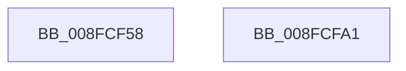

# PnpStartedDeviceNodeDependencyCheck

- RVA: `0x008FCF58`–`0x008FCFA2` (길이 `74` bytes)
- VA: `0x00000001408FCF58`
- 실행 섹션: `PAGE`
- PDB 이름 있음: `예`; PDB Function 태그: `아니요`
- unwind 정보 RVA: `0x0005CF00`
- 디코드: `19`개 명령, `74/74` bytes 표시
- 미해석 바이트: `0` (있으면 어셈블리에 `.byte`로 보존)

> 이 문서는 커널 이미지의 기계어와 PDB 기호를 분석해 생성했습니다. 4번과 5번은 함수 원형과 자료형을 바이너리 사용 방식에서 추정한 C 해석이며 원본 소스 복구 결과는 아닙니다.

## 1. Dependencies

- 직접 호출 지점: **4**; 고유 호출 대상: **3**
- 직접 호출자로 확인된 함수: **3**
- RIP 상대 이미지 참조: **2**

### Outgoing calls
- `0x008FCF7B` → [ExAcquireResourceSharedLite](../../text/21/ExAcquireResourceSharedLite_function_00211BC0.md) (function, `0x00211BC0`)
- `0x008FCF89` → [ExAcquireResourceSharedLite](../../text/21/ExAcquireResourceSharedLite_function_00211BC0.md) (function, `0x00211BC0`)
- `0x008FCF91` → [PipAttemptDependentsStart](../A9/PipAttemptDependentsStart_function_00A9C888.md) (function, `0x00A9C888`)
- `0x008FCF96` → [PnpReleaseDependencyRelationsLock](../A0/PnpReleaseDependencyRelationsLock_function_00A06E14.md) (function, `0x00A06E14`)

### Direct callers
- [PnpCancelRemoveLockedDeviceNode](../72/PnpCancelRemoveLockedDeviceNode_function_0072CFE0.md) at `0x0072D025`
- [PipProcessRestartPhase2](../74/PipProcessRestartPhase2_function_007408B8.md) at `0x00740973`
- [PipProcessStartPhase3](PipProcessStartPhase3_function_008FBAF8.md) at `0x008FBBD4`

### Static image references
- `0x008FCF6C` → RVA `0x00F8C560` (`.data`; read)
- `0x008FCF82` → RVA `0x00F8CEA0` (`.data`; read)

## 2. Other-region calls and transfers

- 다른 실행 섹션으로 향하는 call: **2**
  - `0x008FCF7B` → [ExAcquireResourceSharedLite](../../text/21/ExAcquireResourceSharedLite_function_00211BC0.md) (`PAGE` → `.text`)
  - `0x008FCF89` → [ExAcquireResourceSharedLite](../../text/21/ExAcquireResourceSharedLite_function_00211BC0.md) (`PAGE` → `.text`)
- 별도 외부 분기/꼬리 이동을 확인하지 못했습니다.

## 3. Assembly (complete function range)

```asm
008FCF58  40 53                           push rbx
008FCF5A  48 83 EC 20                     sub rsp, 0x20
008FCF5E  65 48 8B 04 25 88 01 00 00      mov rax, qword ptr gs:[0x188]
008FCF67  48 8B D9                        mov rbx, rcx
008FCF6A  B2 01                           mov dl, 1
008FCF6C  48 8D 0D ED F5 68 00            lea rcx, [rip + 0x68f5ed]
008FCF73  66 FF 88 E4 01 00 00            dec word ptr [rax + 0x1e4]
008FCF7A  90                              nop
008FCF7B  E8 40 4C 91 FF                  call 0x140211bc0
008FCF80  B2 01                           mov dl, 1
008FCF82  48 8D 0D 17 FF 68 00            lea rcx, [rip + 0x68ff17]
008FCF89  E8 32 4C 91 FF                  call 0x140211bc0
008FCF8E  48 8B CB                        mov rcx, rbx
008FCF91  E8 F2 F8 19 00                  call 0x140a9c888
008FCF96  E8 79 9E 10 00                  call 0x140a06e14
008FCF9B  48 83 C4 20                     add rsp, 0x20
008FCF9F  5B                              pop rbx
008FCFA0  C3                              ret
008FCFA1  CC                              int3
```

## 4. C-style interpretation (structured pseudocode)

```c
__int64 __fastcall PnpStartedDeviceNodeDependencyCheck(__int64 a1)
{
    __int64 result;
    __int64 v_rsp;

    v_rsp = (v_rsp) - (32);
    result = ExAcquireResourceSharedLite(v_rip + 6878701, 1, a3, a4);
    result = ExAcquireResourceSharedLite(v_rip + 6881047, 1, a3, a4);
    result = PipAttemptDependentsStart(a1, 1, a3, a4);
    result = PnpReleaseDependencyRelationsLock(a1, 1, a3, a4);
    v_rsp = (v_rsp) + (32);
    return result;
}
```

## 5. (Beta) C Style

```c
int64_t PnpStartedDeviceNodeDependencyCheck(int64_t Arg1)
{
    int64_t result;
    int64_t local_rsp;

    local_rsp = (local_rsp) - (32);
    result = ExAcquireResourceSharedLite(v_rip + 6878701, 1, a3, a4);
    result = ExAcquireResourceSharedLite(v_rip + 6881047, 1, a3, a4);
    result = PipAttemptDependentsStart(Arg1, 1, a3, a4);
    result = PnpReleaseDependencyRelationsLock(Arg1, 1, a3, a4);
    local_rsp = (local_rsp) + (32);
    return result;
}
```

## 6. Execution-region graph

[열기: 2D/3D 그래프와 함수 탐색 컨트롤 패널](../../../control-panel.html?section=page&rva=0x008FCF58&view=graph)

- 2D 그래프는 위에서 아래로 흐르고, 3D 그래프는 빈 공간을 드래그해 회전합니다. Shift+드래그는 이동, 휠은 확대·축소, 함수 노드 선택은 대상 보고서 이동입니다.

### Static fallback


