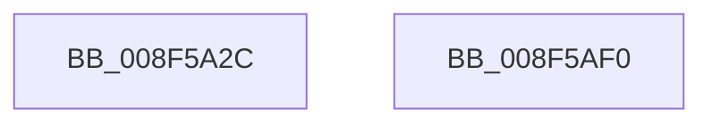

# PnpStringFromGuid

- RVA: `0x008F5A2C`–`0x008F5AF1` (길이 `197` bytes)
- VA: `0x00000001408F5A2C`
- 실행 섹션: `PAGE`
- PDB 이름 있음: `예`; PDB Function 태그: `아니요`
- unwind 정보 RVA: `0x0008781C`
- 디코드: `48`개 명령, `197/197` bytes 표시
- 미해석 바이트: `0` (있으면 어셈블리에 `.byte`로 보존)

> 이 문서는 커널 이미지의 기계어와 PDB 기호를 분석해 생성했습니다. 4번과 5번은 함수 원형과 자료형을 바이너리 사용 방식에서 추정한 C 해석이며 원본 소스 복구 결과는 아닙니다.

## 1. Dependencies

- 직접 호출 지점: **1**; 고유 호출 대상: **1**
- 직접 호출자로 확인된 함수: **16**
- RIP 상대 이미지 참조: **1**

### Outgoing calls
- `0x008F5ACE` → [RtlStringCchPrintfExW](../../text/42/RtlStringCchPrintfExW_function_0042B390.md) (function, `0x0042B390`)

### Direct callers
- [PiPnpRtlGatherInterfaceDeleteInfo](../72/PiPnpRtlGatherInterfaceDeleteInfo_function_0072FD48.md) at `0x0072FE50`
- [PiPnpRtlGatherInterfaceDeleteInfo](../72/PiPnpRtlGatherInterfaceDeleteInfo_function_0072FD48.md) at `0x0072FF79`
- [PiDmListInitEnumCallback](../73/PiDmListInitEnumCallback_function_007302E0.md) at `0x007303F4`
- [PiDqObjectManagerEnumerateAndRegisterQuery](../8D/PiDqObjectManagerEnumerateAndRegisterQuery_function_008DCF74.md) at `0x008DD187`
- [IopGetDeviceInterfaces](IopGetDeviceInterfaces_function_008F0120.md) at `0x008F01E3`
- [IoGetDeviceInterfaceAlias](IoGetDeviceInterfaceAlias_function_008F5570.md) at `0x008F56E6`
- [PnpDeviceRaisePropertyChangeEventWorker](PnpDeviceRaisePropertyChangeEventWorker_function_008F80E0.md) at `0x008F8456`
- [PiDmCacheDataEncode](PiDmCacheDataEncode_function_008FB79C.md) at `0x008FB899`
- [PiSwPdoPnPDispatch](../94/PiSwPdoPnPDispatch_function_0094DDF0.md) at `0x0094E1F8`
- [IopRegisterDeviceInterface](../95/IopRegisterDeviceInterface_function_009501B0.md) at `0x00950242`
- [IopRegisterDeviceInterface](../95/IopRegisterDeviceInterface_function_009501B0.md) at `0x009503F9`
- [CmBuildDevicePanelId](../A0/CmBuildDevicePanelId_function_00A0B008.md) at `0x00A0B032`
- [_CmSetDeviceMappedPropertyFromRegProp](../A0/_CmSetDeviceMappedPropertyFromRegProp_function_00A0B2E8.md) at `0x00A0B3A8`
- [PiDcHandleDeviceEvent](../A5/PiDcHandleDeviceEvent_function_00A503B8.md) at `0x00A504EB`
- [PiDcHandleInterfaceEvent](../A5/PiDcHandleInterfaceEvent_function_00A50588.md) at `0x00A50652`
- [PiPnpRtlGatherInstallerClassChangeInfo](../AD/PiPnpRtlGatherInstallerClassChangeInfo_function_00AD26FC.md) at `0x00AD2818`
- [sub_00B41876](../B4/Unknown_function_00B41876.md) at `0x00B418F1`
- [PipCreateComputerId](../../init/C3/PipCreateComputerId_function_00C305F4.md) at `0x00C3071C`

### Static image references
- `0x008F5ABA` → RVA `0x00AFDD40` (` ?? ::NNGAKEGL::`string'`; read)

## 2. Other-region calls and transfers

- 다른 실행 섹션으로 향하는 call: **1**
  - `0x008F5ACE` → [RtlStringCchPrintfExW](../../text/42/RtlStringCchPrintfExW_function_0042B390.md) (`PAGE` → `.text`)
- 별도 외부 분기/꼬리 이동을 확인하지 못했습니다.

## 3. Assembly (complete function range)

```asm
008F5A2C  48 89 5C 24 08                  mov qword ptr [rsp + 8], rbx
008F5A31  48 89 6C 24 10                  mov qword ptr [rsp + 0x10], rbp
008F5A36  48 89 74 24 18                  mov qword ptr [rsp + 0x18], rsi
008F5A3B  57                              push rdi
008F5A3C  41 56                           push r14
008F5A3E  41 57                           push r15
008F5A40  48 81 EC 90 00 00 00            sub rsp, 0x90
008F5A47  0F B6 41 0F                     movzx eax, byte ptr [rcx + 0xf]
008F5A4B  4C 8B FA                        mov r15, rdx
008F5A4E  44 0F B6 41 0E                  movzx r8d, byte ptr [rcx + 0xe]
008F5A53  44 0F B6 49 0D                  movzx r9d, byte ptr [rcx + 0xd]
008F5A58  44 0F B6 51 0C                  movzx r10d, byte ptr [rcx + 0xc]
008F5A5D  44 0F B6 59 0B                  movzx r11d, byte ptr [rcx + 0xb]
008F5A62  0F B6 59 0A                     movzx ebx, byte ptr [rcx + 0xa]
008F5A66  0F B6 79 09                     movzx edi, byte ptr [rcx + 9]
008F5A6A  0F B6 71 08                     movzx esi, byte ptr [rcx + 8]
008F5A6E  0F B7 69 06                     movzx ebp, word ptr [rcx + 6]
008F5A72  44 0F B7 71 04                  movzx r14d, word ptr [rcx + 4]
008F5A77  89 84 24 80 00 00 00            mov dword ptr [rsp + 0x80], eax
008F5A7E  8B 01                           mov eax, dword ptr [rcx]
008F5A80  49 8B CF                        mov rcx, r15
008F5A83  44 89 44 24 78                  mov dword ptr [rsp + 0x78], r8d
008F5A88  45 33 C0                        xor r8d, r8d
008F5A8B  44 89 4C 24 70                  mov dword ptr [rsp + 0x70], r9d
008F5A90  45 33 C9                        xor r9d, r9d
008F5A93  44 89 54 24 68                  mov dword ptr [rsp + 0x68], r10d
008F5A98  44 89 5C 24 60                  mov dword ptr [rsp + 0x60], r11d
008F5A9D  89 5C 24 58                     mov dword ptr [rsp + 0x58], ebx
008F5AA1  89 7C 24 50                     mov dword ptr [rsp + 0x50], edi
008F5AA5  41 8D 51 27                     lea edx, [r9 + 0x27]
008F5AA9  89 74 24 48                     mov dword ptr [rsp + 0x48], esi
008F5AAD  89 6C 24 40                     mov dword ptr [rsp + 0x40], ebp
008F5AB1  44 89 74 24 38                  mov dword ptr [rsp + 0x38], r14d
008F5AB6  89 44 24 30                     mov dword ptr [rsp + 0x30], eax
008F5ABA  48 8D 05 7F 82 20 00            lea rax, [rip + 0x20827f]
008F5AC1  48 89 44 24 28                  mov qword ptr [rsp + 0x28], rax
008F5AC6  C7 44 24 20 00 08 00 00         mov dword ptr [rsp + 0x20], 0x800
008F5ACE  E8 BD 58 B3 FF                  call 0x14042b390
008F5AD3  4C 8D 9C 24 90 00 00 00         lea r11, [rsp + 0x90]
008F5ADB  49 8B 5B 20                     mov rbx, qword ptr [r11 + 0x20]
008F5ADF  49 8B 6B 28                     mov rbp, qword ptr [r11 + 0x28]
008F5AE3  49 8B 73 30                     mov rsi, qword ptr [r11 + 0x30]
008F5AE7  49 8B E3                        mov rsp, r11
008F5AEA  41 5F                           pop r15
008F5AEC  41 5E                           pop r14
008F5AEE  5F                              pop rdi
008F5AEF  C3                              ret
008F5AF0  CC                              int3
```

## 4. C-style interpretation (structured pseudocode)

```c
__int64 __fastcall PnpStringFromGuid(__int64 a1, __int64 a2)
{
    __int64 result;
    __int64 v_rsp;
    unsigned __int64 v_stack_m18;
    unsigned int v_stack_m28;
    unsigned int v_stack_m30;
    unsigned int v_stack_m38;
    unsigned int v_stack_m40;
    unsigned int v_stack_m48;
    unsigned int v_stack_m50;
    unsigned int v_stack_m58;
    unsigned int v_stack_m60;
    unsigned int v_stack_m68;
    unsigned int v_stack_m70;
    unsigned int v_stack_m78;
    unsigned __int64 v_stack_m80;
    unsigned int v_stack_m88;
    unsigned __int64 v_stack_p10;
    unsigned __int64 v_stack_p18;
    unsigned __int64 v_stack_p8;

    v_stack_p8 = v_rbx;
    v_stack_p10 = v_rbp;
    v_stack_p18 = v_rsi;
    v_rsp = (v_rsp) - (144);
    v_stack_m28 = (unsigned int)(*(unsigned __int8 *)(a1 + 15));
    v_stack_m30 = (unsigned int)(*(unsigned __int8 *)(a1 + 14));
    a3 = 0;
    v_stack_m38 = (unsigned int)(*(unsigned __int8 *)(a1 + 13));
    a4 = 0;
    v_stack_m40 = (unsigned int)(*(unsigned __int8 *)(a1 + 12));
    v_stack_m48 = (unsigned int)(*(unsigned __int8 *)(a1 + 11));
    v_stack_m50 = (unsigned int)(*(unsigned __int8 *)(a1 + 10));
    v_stack_m58 = (unsigned int)(*(unsigned __int8 *)(a1 + 9));
    v_stack_m60 = (unsigned int)(*(unsigned __int8 *)(a1 + 8));
    v_stack_m68 = (unsigned int)(*(unsigned __int16 *)(a1 + 6));
    v_stack_m70 = (unsigned int)(*(unsigned __int16 *)(a1 + 4));
    v_stack_m78 = (unsigned int)((unsigned int)(*(unsigned int *)(a1)));
    v_stack_m80 = v_rip + 2130559;
    v_stack_m88 = 0x800ULL;
    result = RtlStringCchPrintfExW(a2, a4 + 39, a3, a4);
    return result;
}
```

## 5. (Beta) C Style

```c
int64_t PnpStringFromGuid(void *Arg1, int64_t Arg2)
{
    uint8_t *arg1 = (uint8_t *)Arg1;

    int64_t result;
    int64_t local_rsp;
    uint64_t v_stack_m18;
    uint32_t v_stack_m28;
    uint32_t v_stack_m30;
    uint32_t v_stack_m38;
    uint32_t v_stack_m40;
    uint32_t v_stack_m48;
    uint32_t v_stack_m50;
    uint32_t v_stack_m58;
    uint32_t v_stack_m60;
    uint32_t v_stack_m68;
    uint32_t v_stack_m70;
    uint32_t v_stack_m78;
    uint64_t v_stack_m80;
    uint32_t v_stack_m88;
    uint64_t v_stack_p10;
    uint64_t v_stack_p18;
    uint64_t v_stack_p8;

    v_stack_p8 = local_rbx;
    v_stack_p10 = local_rbp;
    v_stack_p18 = local_rsi;
    local_rsp = (local_rsp) - (144);
    v_stack_m28 = (uint32_t)(*(uint8_t *)(arg1 + 0xF));
    v_stack_m30 = (uint32_t)(*(uint8_t *)(arg1 + 0xE));
    a3 = 0;
    v_stack_m38 = (uint32_t)(*(uint8_t *)(arg1 + 0xD));
    a4 = 0;
    v_stack_m40 = (uint32_t)(*(uint8_t *)(arg1 + 0xC));
    v_stack_m48 = (uint32_t)(*(uint8_t *)(arg1 + 0xB));
    v_stack_m50 = (uint32_t)(*(uint8_t *)(arg1 + 0xA));
    v_stack_m58 = (uint32_t)(*(uint8_t *)(arg1 + 0x9));
    v_stack_m60 = (uint32_t)(*(uint8_t *)(arg1 + 0x8));
    v_stack_m68 = (uint32_t)(*(uint16_t *)(arg1 + 0x6));
    v_stack_m70 = (uint32_t)(*(uint16_t *)(arg1 + 0x4));
    v_stack_m78 = (uint32_t)((uint32_t)(*(uint32_t *)(arg1)));
    v_stack_m80 = v_rip + 2130559;
    v_stack_m88 = 0x800ULL;
    result = RtlStringCchPrintfExW(Arg2, a4 + 39, a3, a4);
    return result;
}
```

### 관측된 메모리 오프셋

구조체 형식이 확인되지 않은 접근은 인자 기준의 오프셋으로만 기록했습니다.

| 기준 인자 | 오프셋 표현 | 폭 (bit) | 접근 |
|---|---:|---:|---|
| `Arg1` | `+ 0x0` | `32` | `R` |
| `Arg1` | `+ 0x4` | `16` | `R` |
| `Arg1` | `+ 0x6` | `16` | `R` |
| `Arg1` | `+ 0x8` | `8` | `R` |
| `Arg1` | `+ 0x9` | `8` | `R` |
| `Arg1` | `+ 0xA` | `8` | `R` |
| `Arg1` | `+ 0xB` | `8` | `R` |
| `Arg1` | `+ 0xC` | `8` | `R` |
| `Arg1` | `+ 0xD` | `8` | `R` |
| `Arg1` | `+ 0xE` | `8` | `R` |
| `Arg1` | `+ 0xF` | `8` | `R` |

## 6. Execution-region graph

[열기: 2D/3D 그래프와 함수 탐색 컨트롤 패널](../../../control-panel.html?section=page&rva=0x008F5A2C&view=graph)

- 2D 그래프는 위에서 아래로 흐르고, 3D 그래프는 빈 공간을 드래그해 회전합니다. Shift+드래그는 이동, 휠은 확대·축소, 함수 노드 선택은 대상 보고서 이동입니다.

### Static fallback


