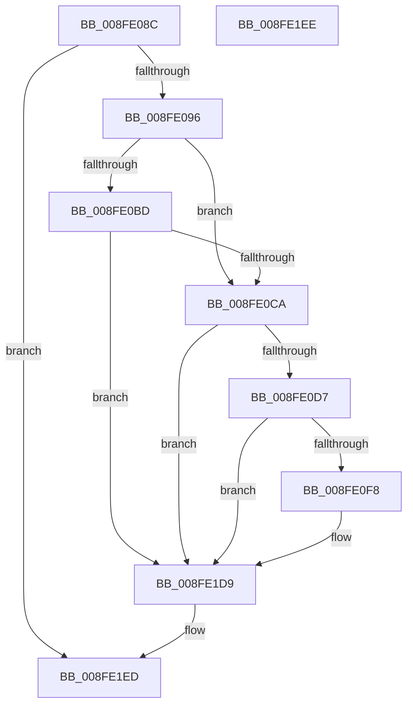

# PnpTraceSetDevNodeProblem

- RVA: `0x008FE08C`–`0x008FE1EF` (길이 `355` bytes)
- VA: `0x00000001408FE08C`
- 실행 섹션: `PAGE`
- PDB 이름 있음: `예`; PDB Function 태그: `아니요`
- unwind 정보 RVA: `0x000881D0`
- 디코드: `74`개 명령, `355/355` bytes 표시
- 미해석 바이트: `0` (있으면 어셈블리에 `.byte`로 보존)

> 이 문서는 커널 이미지의 기계어와 PDB 기호를 분석해 생성했습니다. 4번과 5번은 함수 원형과 자료형을 바이너리 사용 방식에서 추정한 C 해석이며 원본 소스 복구 결과는 아닙니다.

## 1. Dependencies

- 직접 호출 지점: **3**; 고유 호출 대상: **3**
- 직접 호출자로 확인된 함수: **1**
- RIP 상대 이미지 참조: **3**

### Outgoing calls
- `0x008FE0E8` → [tlgKeywordOn](../../text/42/tlgKeywordOn_function_0042EAA0.md) (function, `0x0042EAA0`)
- `0x008FE1D4` → [tlgWriteAgg](../../text/2F/tlgWriteAgg_function_002F0F7C.md) (function, `0x002F0F7C`)
- `0x008FE1E0` → [_security_check_cookie](../../text/6A/_security_check_cookie_function_006AC640.md) (function, `0x006AC640`)

### Direct callers
- [PipSetDevNodeProblem](PipSetDevNodeProblem_function_008FDE0C.md) at `0x008FDF26`

### Static image references
- `0x008FE0A3` → RVA `0x00E0A740` (`.data`; read)
- `0x008FE0CA` → RVA `0x00E06F58` (`.data`; read)
- `0x008FE11C` → RVA `0x000473DA` (`.rdata`; read)

## 2. Other-region calls and transfers

- 다른 실행 섹션으로 향하는 call: **3**
  - `0x008FE0E8` → [tlgKeywordOn](../../text/42/tlgKeywordOn_function_0042EAA0.md) (`PAGE` → `.text`)
  - `0x008FE1D4` → [tlgWriteAgg](../../text/2F/tlgWriteAgg_function_002F0F7C.md) (`PAGE` → `.text`)
  - `0x008FE1E0` → [_security_check_cookie](../../text/6A/_security_check_cookie_function_006AC640.md) (`PAGE` → `.text`)
- 별도 외부 분기/꼬리 이동을 확인하지 못했습니다.

## 3. Assembly (complete function range)

```asm
008FE08C  41 83 F9 01                     cmp r9d, 1
008FE090  0F 84 57 01 00 00               je 0x1408fe1ed
008FE096  55                              push rbp
008FE097  48 8D 6C 24 F0                  lea rbp, [rsp - 0x10]
008FE09C  48 81 EC 10 01 00 00            sub rsp, 0x110
008FE0A3  48 8B 05 96 C6 50 00            mov rax, qword ptr [rip + 0x50c696]
008FE0AA  48 33 C4                        xor rax, rsp
008FE0AD  48 89 45 00                     mov qword ptr [rbp], rax
008FE0B1  4C 8B D2                        mov r10, rdx
008FE0B4  4C 8B D9                        mov r11, rcx
008FE0B7  41 83 F9 18                     cmp r9d, 0x18
008FE0BB  75 0D                           jne 0x1408fe0ca
008FE0BD  41 81 F8 16 03 00 00            cmp r8d, 0x316
008FE0C4  0F 84 0F 01 00 00               je 0x1408fe1d9
008FE0CA  83 3D 87 8E 50 00 05            cmp dword ptr [rip + 0x508e87], 5
008FE0D1  0F 86 02 01 00 00               jbe 0x1408fe1d9
008FE0D7  48 BA 00 00 00 00 00 80 00 00   movabs rdx, 0x800000000000
008FE0E1  48 8D 0D 70 8E 50 00            lea rcx, [rip + 0x508e70]
008FE0E8  E8 B3 09 B3 FF                  call 0x14042eaa0
008FE0ED  45 33 C0                        xor r8d, r8d
008FE0F0  84 C0                           test al, al
008FE0F2  0F 84 E1 00 00 00               je 0x1408fe1d9
008FE0F8  48 8D 44 24 40                  lea rax, [rsp + 0x40]
008FE0FD  44 89 4C 24 30                  mov dword ptr [rsp + 0x30], r9d
008FE102  48 89 44 24 70                  mov qword ptr [rsp + 0x70], rax
008FE107  45 8D 48 0B                     lea r9d, [r8 + 0xb]
008FE10B  48 8D 45 98                     lea rax, [rbp - 0x68]
008FE10F  48 C7 44 24 40 01 00 00 00      mov qword ptr [rsp + 0x40], 1
008FE118  48 89 45 80                     mov qword ptr [rbp - 0x80], rax
008FE11C  48 8D 15 B7 92 74 FF            lea rdx, [rip - 0x8b6d49]
008FE123  49 8B 43 08                     mov rax, qword ptr [r11 + 8]
008FE127  48 8D 0D 2A 8E 50 00            lea rcx, [rip + 0x508e2a]
008FE12E  48 89 45 90                     mov qword ptr [rbp - 0x70], rax
008FE132  41 0F B7 03                     movzx eax, word ptr [r11]
008FE136  89 45 98                        mov dword ptr [rbp - 0x68], eax
008FE139  48 8D 45 B8                     lea rax, [rbp - 0x48]
008FE13D  48 89 45 A0                     mov qword ptr [rbp - 0x60], rax
008FE141  49 8B 42 08                     mov rax, qword ptr [r10 + 8]
008FE145  48 89 45 B0                     mov qword ptr [rbp - 0x50], rax
008FE149  41 0F B7 02                     movzx eax, word ptr [r10]
008FE14D  89 45 B8                        mov dword ptr [rbp - 0x48], eax
008FE150  48 8D 44 24 30                  lea rax, [rsp + 0x30]
008FE155  48 89 45 C0                     mov qword ptr [rbp - 0x40], rax
008FE159  8B 45 40                        mov eax, dword ptr [rbp + 0x40]
008FE15C  89 44 24 34                     mov dword ptr [rsp + 0x34], eax
008FE160  48 8D 44 24 34                  lea rax, [rsp + 0x34]
008FE165  48 89 45 D0                     mov qword ptr [rbp - 0x30], rax
008FE169  8B 45 48                        mov eax, dword ptr [rbp + 0x48]
008FE16C  89 44 24 38                     mov dword ptr [rsp + 0x38], eax
008FE170  48 8D 44 24 38                  lea rax, [rsp + 0x38]
008FE175  48 89 45 E0                     mov qword ptr [rbp - 0x20], rax
008FE179  8B 45 50                        mov eax, dword ptr [rbp + 0x50]
008FE17C  89 44 24 3C                     mov dword ptr [rsp + 0x3c], eax
008FE180  48 8D 44 24 3C                  lea rax, [rsp + 0x3c]
008FE185  48 89 45 F0                     mov qword ptr [rbp - 0x10], rax
008FE189  48 8D 44 24 50                  lea rax, [rsp + 0x50]
008FE18E  48 89 44 24 20                  mov qword ptr [rsp + 0x20], rax
008FE193  48 C7 44 24 78 08 00 00 00      mov qword ptr [rsp + 0x78], 8
008FE19C  48 C7 45 88 02 00 00 00         mov qword ptr [rbp - 0x78], 2
008FE1A4  44 89 45 9C                     mov dword ptr [rbp - 0x64], r8d
008FE1A8  48 C7 45 A8 02 00 00 00         mov qword ptr [rbp - 0x58], 2
008FE1B0  44 89 45 BC                     mov dword ptr [rbp - 0x44], r8d
008FE1B4  48 C7 45 C8 04 00 00 00         mov qword ptr [rbp - 0x38], 4
008FE1BC  48 C7 45 D8 04 00 00 00         mov qword ptr [rbp - 0x28], 4
008FE1C4  48 C7 45 E8 04 00 00 00         mov qword ptr [rbp - 0x18], 4
008FE1CC  48 C7 45 F8 04 00 00 00         mov qword ptr [rbp - 8], 4
008FE1D4  E8 A3 2D 9F FF                  call 0x1402f0f7c
008FE1D9  48 8B 4D 00                     mov rcx, qword ptr [rbp]
008FE1DD  48 33 CC                        xor rcx, rsp
008FE1E0  E8 5B E4 DA FF                  call 0x1406ac640
008FE1E5  48 81 C4 10 01 00 00            add rsp, 0x110
008FE1EC  5D                              pop rbp
008FE1ED  C3                              ret
008FE1EE  CC                              int3
```

## 4. C-style interpretation (structured pseudocode)

```c
__int64 __fastcall PnpTraceSetDevNodeProblem(__int64 a1, __int64 a2, int a3, int a4, unsigned int a5, unsigned int a6, unsigned int a7)
{
    __int64 result;
    __int64 v_rsp;
    unsigned __int64 v_stack_m18;
    unsigned __int64 v_stack_m20;
    unsigned __int64 v_stack_m28;
    unsigned __int64 v_stack_m30;
    unsigned __int64 v_stack_m38;
    unsigned __int64 v_stack_m40;
    unsigned __int64 v_stack_m48;
    unsigned __int64 v_stack_m50;
    unsigned __int64 v_stack_m58;
    unsigned int v_stack_m5C;
    unsigned __int64 v_stack_m60;
    unsigned __int64 v_stack_m68;
    unsigned __int64 v_stack_m70;
    unsigned __int64 v_stack_m78;
    unsigned int v_stack_m7C;
    unsigned __int64 v_stack_m80;
    unsigned __int64 v_stack_m88;
    unsigned __int64 v_stack_m90;
    unsigned __int64 v_stack_m98;
    unsigned __int64 v_stack_mA0;
    unsigned __int64 v_stack_mA8;
    unsigned __int64 v_stack_mC8;
    unsigned __int64 v_stack_mD8;
    unsigned int v_stack_mDC;
    unsigned int v_stack_mE0;
    unsigned int v_stack_mE4;
    unsigned int v_stack_mE8;
    unsigned __int64 v_stack_mF8;

    if (a4 == 1) goto loc_008FE1ED;
    v_rsp = (v_rsp) - (272);
    result = (*(unsigned __int64 *)(v_rip + 5293718)) ^ (v_rsp);
    v_stack_m18 = result;
    if (a4 != 24) goto loc_008FE0CA;
    if (a3 == 790) goto loc_008FE1D9;
loc_008FE0CA:
    if ((*(unsigned int *)(v_rip + 5279367)) <= 5) goto loc_008FE1D9;
    result = tlgKeywordOn(v_rip + 5279344, a2, a3, a4);
    a3 = 0;
    if ((unsigned __int8)(result) != 0) {
        result = v_stack_mD8;
        v_stack_mE8 = a4;
        v_stack_mA8 = result;
        a4 = a3 + 11;
        result = v_stack_m80;
        v_stack_mD8 = 1;
        v_stack_m98 = result;
        a2 = v_rip - 9137481;
        result = *(unsigned __int64 *)(a1 + 8);
        a1 = v_rip + 5279274;
        v_stack_m88 = result;
        result = *(unsigned __int16 *)(a1);
        v_stack_m80 = (unsigned int)(result);
        result = v_stack_m60;
        v_stack_m78 = result;
        result = *(unsigned __int64 *)(a2 + 8);
        v_stack_m68 = result;
        result = *(unsigned __int16 *)(a2);
        v_stack_m60 = (unsigned int)(result);
        result = v_stack_mE8;
        v_stack_m58 = result;
        result = a5;
        v_stack_mE4 = (unsigned int)(result);
        result = v_stack_mE4;
        v_stack_m48 = result;
        result = a6;
        v_stack_mE0 = (unsigned int)(result);
        result = v_stack_mE0;
        v_stack_m38 = result;
        result = a7;
        v_stack_mDC = (unsigned int)(result);
        result = v_stack_mDC;
        v_stack_m28 = result;
        result = v_stack_mC8;
        v_stack_mF8 = result;
        v_stack_mA0 = 8;
        v_stack_m90 = 2;
        v_stack_m7C = 0;
        v_stack_m70 = 2;
        v_stack_m5C = 0;
        v_stack_m50 = 4;
        v_stack_m40 = 4;
        v_stack_m30 = 4;
        v_stack_m20 = 4;
        result = tlgWriteAgg(a1, a2, a3, a4);
    }
    a1 = (v_stack_m18) ^ (v_rsp);
    result = _security_check_cookie(a1, a2, a3, a4);
    v_rsp = (v_rsp) + (272);
loc_008FE1ED:
    return result;
}
```

## 5. (Beta) C Style

```c
int64_t PnpTraceSetDevNodeProblem(int64_t Arg1, int64_t Arg2, int32_t Arg3, int32_t Arg4, uint32_t Arg5, uint32_t Arg6, uint32_t Arg7)
{
    int64_t result;
    int64_t local_rsp;
    uint64_t v_stack_m18;
    uint64_t v_stack_m20;
    uint64_t v_stack_m28;
    uint64_t v_stack_m30;
    uint64_t v_stack_m38;
    uint64_t v_stack_m40;
    uint64_t v_stack_m48;
    uint64_t v_stack_m50;
    uint64_t v_stack_m58;
    uint32_t v_stack_m5C;
    uint64_t v_stack_m60;
    uint64_t v_stack_m68;
    uint64_t v_stack_m70;
    uint64_t v_stack_m78;
    uint32_t v_stack_m7C;
    uint64_t v_stack_m80;
    uint64_t v_stack_m88;
    uint64_t v_stack_m90;
    uint64_t v_stack_m98;
    uint64_t v_stack_mA0;
    uint64_t v_stack_mA8;
    uint64_t v_stack_mC8;
    uint64_t v_stack_mD8;
    uint32_t v_stack_mDC;
    uint32_t v_stack_mE0;
    uint32_t v_stack_mE4;
    uint32_t v_stack_mE8;
    uint64_t v_stack_mF8;

    if (Arg4 == 1) goto loc_008FE1ED;
    local_rsp = (local_rsp) - (272);
    result = (*(uint64_t *)(v_rip + 0x50C696)) ^ (local_rsp);
    v_stack_m18 = result;
    if (Arg4 != 24) goto loc_008FE0CA;
    if (Arg3 == 790) goto loc_008FE1D9;
loc_008FE0CA:
    if ((*(uint32_t *)(v_rip + 0x508E87)) <= 5) goto loc_008FE1D9;
    result = tlgKeywordOn(v_rip + 5279344, Arg2, Arg3, Arg4);
    Arg3 = 0;
    if ((uint8_t)(result) != 0) {
        result = v_stack_mD8;
        v_stack_mE8 = Arg4;
        v_stack_mA8 = result;
        Arg4 = Arg3 + 11;
        result = v_stack_m80;
        v_stack_mD8 = 1;
        v_stack_m98 = result;
        Arg2 = v_rip - 9137481;
        result = *(uint64_t *)(Arg1 + 0x8);
        Arg1 = v_rip + 5279274;
        v_stack_m88 = result;
        result = *(uint16_t *)(Arg1);
        v_stack_m80 = (uint32_t)(result);
        result = v_stack_m60;
        v_stack_m78 = result;
        result = *(uint64_t *)(Arg2 + 0x8);
        v_stack_m68 = result;
        result = *(uint16_t *)(Arg2);
        v_stack_m60 = (uint32_t)(result);
        result = v_stack_mE8;
        v_stack_m58 = result;
        result = Arg5;
        v_stack_mE4 = (uint32_t)(result);
        result = v_stack_mE4;
        v_stack_m48 = result;
        result = Arg6;
        v_stack_mE0 = (uint32_t)(result);
        result = v_stack_mE0;
        v_stack_m38 = result;
        result = Arg7;
        v_stack_mDC = (uint32_t)(result);
        result = v_stack_mDC;
        v_stack_m28 = result;
        result = v_stack_mC8;
        v_stack_mF8 = result;
        v_stack_mA0 = 8;
        v_stack_m90 = 2;
        v_stack_m7C = 0;
        v_stack_m70 = 2;
        v_stack_m5C = 0;
        v_stack_m50 = 4;
        v_stack_m40 = 4;
        v_stack_m30 = 4;
        v_stack_m20 = 4;
        result = tlgWriteAgg(Arg1, Arg2, Arg3, Arg4);
    }
    Arg1 = (v_stack_m18) ^ (local_rsp);
    result = _security_check_cookie(Arg1, Arg2, Arg3, Arg4);
    local_rsp = (local_rsp) + (272);
loc_008FE1ED:
    return result;
}
```

## 6. Execution-region graph

[열기: 2D/3D 그래프와 함수 탐색 컨트롤 패널](../../../control-panel.html?section=page&rva=0x008FE08C&view=graph)

- 2D 그래프는 위에서 아래로 흐르고, 3D 그래프는 빈 공간을 드래그해 회전합니다. Shift+드래그는 이동, 휠은 확대·축소, 함수 노드 선택은 대상 보고서 이동입니다.

### Static fallback


