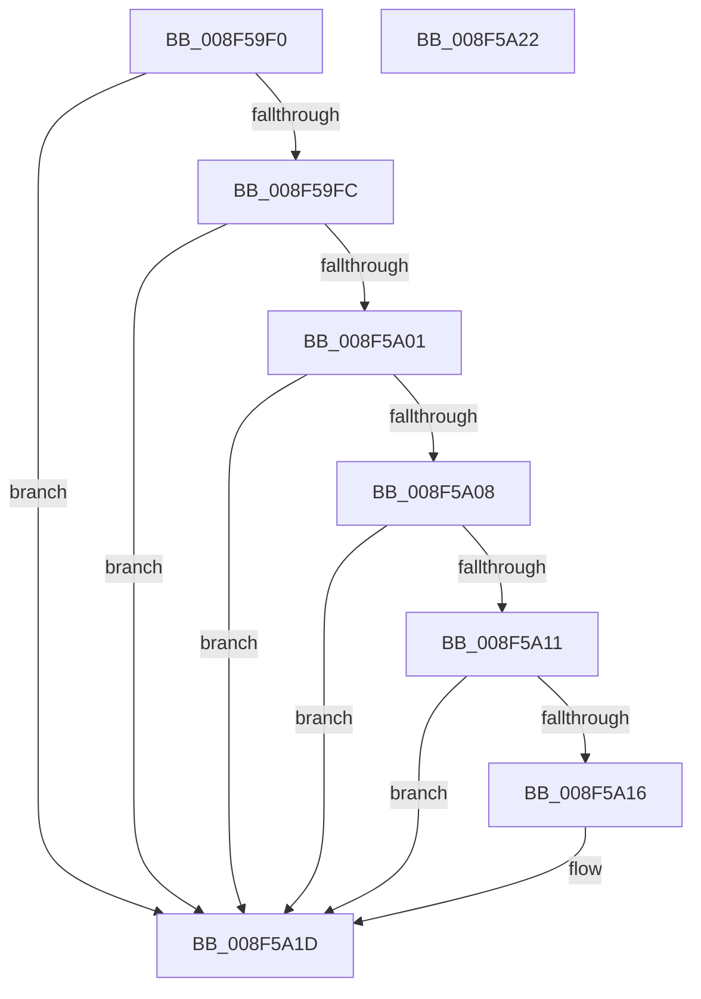

# PnpUnicodeStringToWstrFree

- RVA: `0x008F59F0`–`0x008F5A23` (길이 `51` bytes)
- VA: `0x00000001408F59F0`
- 실행 섹션: `PAGE`
- PDB 이름 있음: `예`; PDB Function 태그: `아니요`
- unwind 정보 RVA: `0x0005C788`
- 디코드: `18`개 명령, `51/51` bytes 표시
- 미해석 바이트: `0` (있으면 어셈블리에 `.byte`로 보존)

> 이 문서는 커널 이미지의 기계어와 PDB 기호를 분석해 생성했습니다. 4번과 5번은 함수 원형과 자료형을 바이너리 사용 방식에서 추정한 C 해석이며 원본 소스 복구 결과는 아닙니다.

## 1. Dependencies

- 직접 호출 지점: **1**; 고유 호출 대상: **1**
- 직접 호출자로 확인된 함수: **20**
- RIP 상대 이미지 참조: **0**

### Outgoing calls
- `0x008F5A18` → [ExFreePoolWithTag](../../poolcode/B8/ExFreePoolWithTag_function_00B82870.md) (function, `0x00B82870`)

### Direct callers
- [IoReportDetectedDevice](../72/IoReportDetectedDevice_function_00725CD0.md) at `0x007262DD`
- [IoReportDetectedDevice](../72/IoReportDetectedDevice_function_00725CD0.md) at `0x0072632C`
- [PipApplyFunctionToServiceInstances](../72/PipApplyFunctionToServiceInstances_function_0072BF40.md) at `0x0072C0EB`
- [PiInitializeDevice](../73/PiInitializeDevice_function_0073EC5C.md) at `0x0073EDD6`
- [PnpSetDeviceInterfacePropertyData](PnpSetDeviceInterfacePropertyData_function_008F5328.md) at `0x008F5491`
- [IoGetDeviceInterfaceAlias](IoGetDeviceInterfaceAlias_function_008F5570.md) at `0x008F5902`
- [PnpGetDeviceInterfacePropertyData](PnpGetDeviceInterfacePropertyData_function_008F6BD4.md) at `0x008F6D53`
- [IoRegisterDeviceInterface](../94/IoRegisterDeviceInterface_function_0094F9A0.md) at `0x0094FA97`
- [IopProcessSetInterfaceState](../95/IopProcessSetInterfaceState_function_00950964.md) at `0x00950B66`
- [IopBuildGlobalSymbolicLinkString](../95/IopBuildGlobalSymbolicLinkString_function_00951530.md) at `0x009516E9`
- [PnpDeleteDeviceInterfaces](../97/PnpDeleteDeviceInterfaces_function_0097A08C.md) at `0x0097A2E3`
- [PiDeviceRegistration](../A0/PiDeviceRegistration_function_00A07A60.md) at `0x00A07BB9`
- [PpForEachDeviceInstanceDriver](../A0/PpForEachDeviceInstanceDriver_function_00A07D2C.md) at `0x00A07F24`
- [PnpDisableDeviceInterfaces](../A0/PnpDisableDeviceInterfaces_function_00A0885C.md) at `0x00A08A34`
- [PnpIsDeviceInstanceEnabled](../A7/PnpIsDeviceInstanceEnabled_function_00A75A3C.md) at `0x00A75D4B`
- [PnpGetDeviceInstanceCsConfigFlags](../A7/PnpGetDeviceInstanceCsConfigFlags_function_00A75D5C.md) at `0x00A75E9D`
- [IoOpenDeviceInterfaceRegistryKey](../AC/IoOpenDeviceInterfaceRegistryKey_function_00AC5C60.md) at `0x00AC5D3D`
- [IopDeviceObjectFromSymbolicName](../AD/IopDeviceObjectFromSymbolicName_function_00AD63EC.md) at `0x00AD64B6`
- [sub_00B33DD8](../B3/Unknown_function_00B33DD8.md) at `0x00B33F7E`
- [sub_00B33DD8](../B3/Unknown_function_00B33DD8.md) at `0x00B33FAE`
- [IopInitializeBootDrivers](../../init/C2/IopInitializeBootDrivers_function_00C2E6F4.md) at `0x00C2F222`
- [PipInitComputerIds](../../init/C7/PipInitComputerIds_function_00C74734.md) at `0x00C74DA0`

### Static image references
- 디코드된 RIP-relative 메모리 참조가 없습니다.

## 2. Other-region calls and transfers

- 다른 실행 섹션으로 향하는 call: **1**
  - `0x008F5A18` → [ExFreePoolWithTag](../../poolcode/B8/ExFreePoolWithTag_function_00B82870.md) (`PAGE` → `POOLCODE`)
- 별도 외부 분기/꼬리 이동을 확인하지 못했습니다.

## 3. Assembly (complete function range)

```asm
008F59F0  48 83 EC 28                     sub rsp, 0x28
008F59F4  45 33 C0                        xor r8d, r8d
008F59F7  48 85 C9                        test rcx, rcx
008F59FA  74 21                           je 0x1408f5a1d
008F59FC  48 85 D2                        test rdx, rdx
008F59FF  74 1C                           je 0x1408f5a1d
008F5A01  66 44 39 42 02                  cmp word ptr [rdx + 2], r8w
008F5A06  74 15                           je 0x1408f5a1d
008F5A08  48 8B 42 08                     mov rax, qword ptr [rdx + 8]
008F5A0C  48 85 C0                        test rax, rax
008F5A0F  74 0C                           je 0x1408f5a1d
008F5A11  48 3B C1                        cmp rax, rcx
008F5A14  74 07                           je 0x1408f5a1d
008F5A16  33 D2                           xor edx, edx
008F5A18  E8 53 CE 28 00                  call 0x140b82870
008F5A1D  48 83 C4 28                     add rsp, 0x28
008F5A21  C3                              ret
008F5A22  CC                              int3
```

## 4. C-style interpretation (structured pseudocode)

```c
__int64 __fastcall PnpUnicodeStringToWstrFree(__int64 a1, __int64 a2, int a3)
{
    __int64 result;
    __int64 v_rsp;

    v_rsp = (v_rsp) - (40);
    a3 = 0;
    if (a1 == 0) goto loc_008F5A1D;
    if (a2 == 0) goto loc_008F5A1D;
    if ((*(unsigned __int16 *)(a2 + 2)) == 0) goto loc_008F5A1D;
    if (*(unsigned __int64 *)(a2 + 8) == 0) goto loc_008F5A1D;
    result = *(unsigned __int64 *)(a2 + 8);
    if ((*(unsigned __int64 *)(a2 + 8)) != a1) {
        a2 = 0;
        result = ExFreePoolWithTag(a1, a2, a3, a4);
    }
    v_rsp = (v_rsp) + (40);
    return result;
}
```

## 5. (Beta) C Style

```c
int64_t PnpUnicodeStringToWstrFree(int64_t Arg1, int64_t Arg2, int32_t Arg3)
{
    int64_t result;
    int64_t local_rsp;

    local_rsp = (local_rsp) - (40);
    Arg3 = 0;
    if (Arg1 == 0) goto loc_008F5A1D;
    if (Arg2 == 0) goto loc_008F5A1D;
    if ((*(uint16_t *)(Arg2 + 0x2)) == 0) goto loc_008F5A1D;
    if (*(uint64_t *)(Arg2 + 0x8) == 0) goto loc_008F5A1D;
    result = *(uint64_t *)(Arg2 + 0x8);
    if ((*(uint64_t *)(Arg2 + 0x8)) != Arg1) {
        Arg2 = 0;
        result = ExFreePoolWithTag(Arg1, Arg2, Arg3, a4);
    }
    local_rsp = (local_rsp) + (40);
    return result;
}
```

## 6. Execution-region graph

[열기: 2D/3D 그래프와 함수 탐색 컨트롤 패널](../../../control-panel.html?section=page&rva=0x008F59F0&view=graph)

- 2D 그래프는 위에서 아래로 흐르고, 3D 그래프는 빈 공간을 드래그해 회전합니다. Shift+드래그는 이동, 휠은 확대·축소, 함수 노드 선택은 대상 보고서 이동입니다.

### Static fallback


