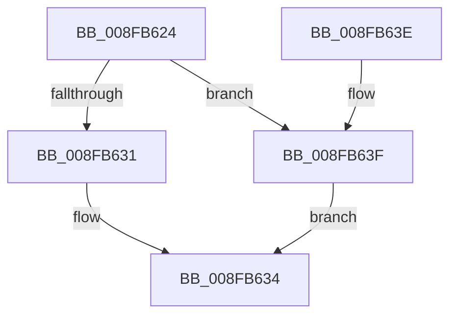

# PnpWatchdogTimerStart

- RVA: `0x008FB624`–`0x008FB64E` (길이 `42` bytes)
- VA: `0x00000001408FB624`
- 실행 섹션: `PAGE`
- PDB 이름 있음: `예`; PDB Function 태그: `아니요`
- unwind 정보 RVA: `0x0005D35C`
- 디코드: `11`개 명령, `42/42` bytes 표시
- 미해석 바이트: `0` (있으면 어셈블리에 `.byte`로 보존)

> 이 문서는 커널 이미지의 기계어와 PDB 기호를 분석해 생성했습니다. 4번과 5번은 함수 원형과 자료형을 바이너리 사용 방식에서 추정한 C 해석이며 원본 소스 복구 결과는 아닙니다.

## 1. Dependencies

- 직접 호출 지점: **1**; 고유 호출 대상: **1**
- 직접 호출자로 확인된 함수: **2**
- RIP 상대 이미지 참조: **0**

### Outgoing calls
- `0x008FB634` → [WdtpArmTimer](../../text/39/WdtpArmTimer_function_0039F230.md) (function, `0x0039F230`)

### Direct callers
- [PnpEnableWatchdog](PnpEnableWatchdog_function_008FB5C8.md) at `0x008FB604`
- [PiUEventNotifyUserMode](../95/PiUEventNotifyUserMode_function_00954CB4.md) at `0x0095520D`

### Static image references
- 디코드된 RIP-relative 메모리 참조가 없습니다.

## 2. Other-region calls and transfers

- 다른 실행 섹션으로 향하는 call: **1**
  - `0x008FB634` → [WdtpArmTimer](../../text/39/WdtpArmTimer_function_0039F230.md) (`PAGE` → `.text`)
- 별도 외부 분기/꼬리 이동을 확인하지 못했습니다.

## 3. Assembly (complete function range)

```asm
008FB624  48 83 EC 28                     sub rsp, 0x28
008FB628  80 B9 8C 00 00 00 00            cmp byte ptr [rcx + 0x8c], 0
008FB62F  75 0E                           jne 0x1408fb63f
008FB631  8B 51 20                        mov edx, dword ptr [rcx + 0x20]
008FB634  E8 F7 3B AA FF                  call 0x14039f230
008FB639  48 83 C4 28                     add rsp, 0x28
008FB63D  C3                              ret
008FB63E  CC                              int3
008FB63F  8B 91 84 00 00 00               mov edx, dword ptr [rcx + 0x84]
008FB645  C6 81 8C 00 00 00 00            mov byte ptr [rcx + 0x8c], 0
008FB64C  EB E6                           jmp 0x1408fb634
```

## 4. C-style interpretation (structured pseudocode)

```c
__int64 __fastcall PnpWatchdogTimerStart(__int64 a1)
{
    __int64 result;
    __int64 v_rsp;

    v_rsp = (v_rsp) - (40);
    if ((*(unsigned __int8 *)(a1 + 140)) != 0) goto loc_008FB63F;
loc_008FB634:
    result = WdtpArmTimer(a1, (unsigned int)(*(unsigned int *)(a1 + 32)), a3, a4);
    v_rsp = (v_rsp) + (40);
    return result;
loc_008FB63F:
    *(unsigned __int8 *)(a1 + 140) = 0;
    goto loc_008FB634;
}
```

## 5. (Beta) C Style

```c
int64_t PnpWatchdogTimerStart(void *Arg1)
{
    uint8_t *arg1 = (uint8_t *)Arg1;

    int64_t result;
    int64_t local_rsp;

    local_rsp = (local_rsp) - (40);
    if ((*(uint8_t *)(arg1 + 0x8C)) != 0) goto loc_008FB63F;
loc_008FB634:
    result = WdtpArmTimer(Arg1, (uint32_t)(*(uint32_t *)(arg1 + 0x20)), a3, a4);
    local_rsp = (local_rsp) + (40);
    return result;
loc_008FB63F:
    *(uint8_t *)(arg1 + 0x8C) = 0;
    goto loc_008FB634;
}
```

### 관측된 메모리 오프셋

구조체 형식이 확인되지 않은 접근은 인자 기준의 오프셋으로만 기록했습니다.

| 기준 인자 | 오프셋 표현 | 폭 (bit) | 접근 |
|---|---:|---:|---|
| `Arg1` | `+ 0x20` | `32` | `R` |
| `Arg1` | `+ 0x84` | `32` | `R` |
| `Arg1` | `+ 0x8C` | `8` | `R` |
| `Arg1` | `+ 0x8C` | `8` | `W` |

## 6. Execution-region graph

[열기: 2D/3D 그래프와 함수 탐색 컨트롤 패널](../../../control-panel.html?section=page&rva=0x008FB624&view=graph)

- 2D 그래프는 위에서 아래로 흐르고, 3D 그래프는 빈 공간을 드래그해 회전합니다. Shift+드래그는 이동, 휠은 확대·축소, 함수 노드 선택은 대상 보고서 이동입니다.

### Static fallback


