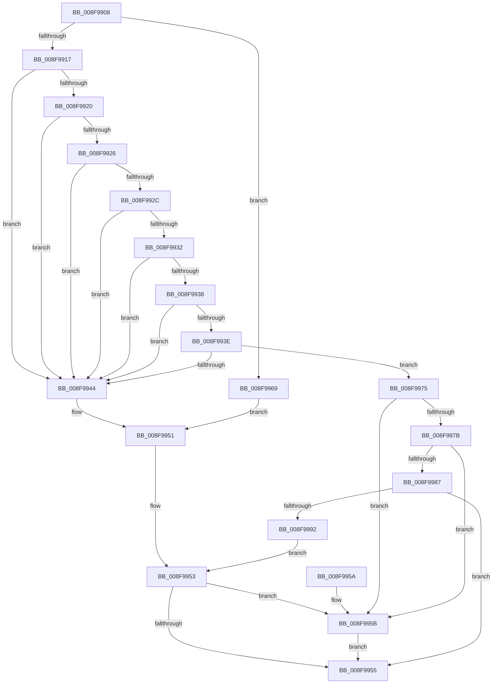

# PpDevCfgTraceDeviceStart

- RVA: `0x008F9908`–`0x008F9997` (길이 `143` bytes)
- VA: `0x00000001408F9908`
- 실행 섹션: `PAGE`
- PDB 이름 있음: `예`; PDB Function 태그: `아니요`
- unwind 정보 RVA: `0x00087C58`
- 디코드: `40`개 명령, `143/143` bytes 표시
- 미해석 바이트: `0` (있으면 어셈블리에 `.byte`로 보존)

> 이 문서는 커널 이미지의 기계어와 PDB 기호를 분석해 생성했습니다. 4번과 5번은 함수 원형과 자료형을 바이너리 사용 방식에서 추정한 C 해석이며 원본 소스 복구 결과는 아닙니다.

## 1. Dependencies

- 직접 호출 지점: **1**; 고유 호출 대상: **1**
- 직접 호출자로 확인된 함수: **2**
- RIP 상대 이미지 참조: **0**

### Outgoing calls
- `0x008F9962` → [PiDevCfgLogDeviceStarted](../AB/PiDevCfgLogDeviceStarted_function_00ABEC8C.md) (function, `0x00ABEC8C`)

### Direct callers
- [PipSetDevNodeState](../../text/47/PipSetDevNodeState_function_00470708.md) at `0x00470838`
- [PipProcessDevNodeTree](PipProcessDevNodeTree_function_008F9068.md) at `0x008F933A`

### Static image references
- 디코드된 RIP-relative 메모리 참조가 없습니다.

## 2. Other-region calls and transfers

- 다른 실행 섹션으로 향하는 call: **0**
- 별도 외부 분기/꼬리 이동을 확인하지 못했습니다.

## 3. Assembly (complete function range)

```asm
008F9908  48 83 EC 28                     sub rsp, 0x28
008F990C  44 8B 81 2C 01 00 00            mov r8d, dword ptr [rcx + 0x12c]
008F9913  84 D2                           test dl, dl
008F9915  75 52                           jne 0x1408f9969
008F9917  41 81 E8 03 03 00 00            sub r8d, 0x303
008F991E  74 24                           je 0x1408f9944
008F9920  41 83 E8 01                     sub r8d, 1
008F9924  74 1E                           je 0x1408f9944
008F9926  41 83 E8 01                     sub r8d, 1
008F992A  74 18                           je 0x1408f9944
008F992C  41 83 E8 01                     sub r8d, 1
008F9930  74 12                           je 0x1408f9944
008F9932  41 83 E8 01                     sub r8d, 1
008F9936  74 0C                           je 0x1408f9944
008F9938  41 83 E8 01                     sub r8d, 1
008F993C  74 06                           je 0x1408f9944
008F993E  41 83 E8 01                     sub r8d, 1
008F9942  75 31                           jne 0x1408f9975
008F9944  F7 81 8C 01 00 00 00 60 00 00   test dword ptr [rcx + 0x18c], 0x6000
008F994E  0F 95 C0                        setne al
008F9951  84 C0                           test al, al
008F9953  75 06                           jne 0x1408f995b
008F9955  48 83 C4 28                     add rsp, 0x28
008F9959  C3                              ret
008F995A  CC                              int3
008F995B  83 A1 C0 02 00 00 FE            and dword ptr [rcx + 0x2c0], 0xfffffffe
008F9962  E8 25 53 1C 00                  call 0x140abec8c
008F9967  EB EC                           jmp 0x1408f9955
008F9969  41 81 F8 0A 03 00 00            cmp r8d, 0x30a
008F9970  0F 94 C0                        sete al
008F9973  EB DC                           jmp 0x1408f9951
008F9975  41 83 F8 01                     cmp r8d, 1
008F9979  74 E0                           je 0x1408f995b
008F997B  F7 81 8C 01 00 00 00 20 00 00   test dword ptr [rcx + 0x18c], 0x2000
008F9985  74 D4                           je 0x1408f995b
008F9987  8B 81 94 01 00 00               mov eax, dword ptr [rcx + 0x194]
008F998D  83 F8 38                        cmp eax, 0x38
008F9990  74 C3                           je 0x1408f9955
008F9992  83 F8 15                        cmp eax, 0x15
008F9995  EB BC                           jmp 0x1408f9953
```

## 4. C-style interpretation (structured pseudocode)

```c
__int64 __fastcall PpDevCfgTraceDeviceStart(__int64 a1, unsigned __int8 a2)
{
    __int64 result;
    __int64 v_rsp;

    v_rsp = (v_rsp) - (40);
    if (a2 != 0) goto loc_008F9969;
    a3 = (unsigned int)(((unsigned int)(*(unsigned int *)(a1 + 300))) - (771));
    if (condition_is_equal) goto loc_008F9944;
    a3 = (unsigned int)((a3) - (1));
    if (condition_is_equal) goto loc_008F9944;
    a3 = (unsigned int)((a3) - (1));
    if (condition_is_equal) goto loc_008F9944;
    a3 = (unsigned int)((a3) - (1));
    if (condition_is_equal) goto loc_008F9944;
    a3 = (unsigned int)((a3) - (1));
    if (condition_is_equal) goto loc_008F9944;
    a3 = (unsigned int)((a3) - (1));
    if (condition_is_equal) goto loc_008F9944;
    a3 = (unsigned int)((a3) - (1));
    if (condition_is_not_equal) goto loc_008F9975;
loc_008F9944:
    result = (((*(unsigned int *)(a1 + 396)) & (0x6000ULL)) != 0) ? 1 : 0;
loc_008F9951:
loc_008F9953:
    if ((unsigned __int8)(result) != 0) goto loc_008F995B;
loc_008F9955:
    v_rsp = (v_rsp) + (40);
    return result;
loc_008F995B:
    result = PiDevCfgLogDeviceStarted(a1, a2, a3, a4);
    goto loc_008F9955;
loc_008F9969:
    result = (((unsigned int)(a3)) == 778) ? 1 : 0;
    goto loc_008F9951;
loc_008F9975:
    if (((unsigned int)(a3)) == 1) goto loc_008F995B;
    if (((*(unsigned int *)(a1 + 396)) & (0x2000ULL)) == 0) goto loc_008F995B;
    if (((unsigned int)((unsigned int)(*(unsigned int *)(a1 + 404)))) == 56) goto loc_008F9955;
    goto loc_008F9953;
}
```

## 5. (Beta) C Style

```c
int64_t PpDevCfgTraceDeviceStart(void *Arg1, uint8_t Arg2)
{
    uint8_t *arg1 = (uint8_t *)Arg1;

    int64_t result;
    int64_t local_rsp;

    local_rsp = (local_rsp) - (40);
    if (Arg2 != 0) goto loc_008F9969;
    a3 = (uint32_t)(((uint32_t)(*(uint32_t *)(arg1 + 0x12C))) - (771));
    if (condition_is_equal) goto loc_008F9944;
    a3 = (uint32_t)((a3) - (1));
    if (condition_is_equal) goto loc_008F9944;
    a3 = (uint32_t)((a3) - (1));
    if (condition_is_equal) goto loc_008F9944;
    a3 = (uint32_t)((a3) - (1));
    if (condition_is_equal) goto loc_008F9944;
    a3 = (uint32_t)((a3) - (1));
    if (condition_is_equal) goto loc_008F9944;
    a3 = (uint32_t)((a3) - (1));
    if (condition_is_equal) goto loc_008F9944;
    a3 = (uint32_t)((a3) - (1));
    if (condition_is_not_equal) goto loc_008F9975;
loc_008F9944:
    result = (((*(uint32_t *)(arg1 + 0x18C)) & (0x6000ULL)) != 0) ? 1 : 0;
loc_008F9951:
loc_008F9953:
    if ((uint8_t)(result) != 0) goto loc_008F995B;
loc_008F9955:
    local_rsp = (local_rsp) + (40);
    return result;
loc_008F995B:
    result = PiDevCfgLogDeviceStarted(Arg1, Arg2, a3, a4);
    goto loc_008F9955;
loc_008F9969:
    result = (((uint32_t)(a3)) == 778) ? 1 : 0;
    goto loc_008F9951;
loc_008F9975:
    if (((uint32_t)(a3)) == 1) goto loc_008F995B;
    if (((*(uint32_t *)(arg1 + 0x18C)) & (0x2000ULL)) == 0) goto loc_008F995B;
    if (((uint32_t)((uint32_t)(*(uint32_t *)(arg1 + 0x194)))) == 56) goto loc_008F9955;
    goto loc_008F9953;
}
```

### 관측된 메모리 오프셋

구조체 형식이 확인되지 않은 접근은 인자 기준의 오프셋으로만 기록했습니다.

| 기준 인자 | 오프셋 표현 | 폭 (bit) | 접근 |
|---|---:|---:|---|
| `Arg1` | `+ 0x12C` | `32` | `R` |
| `Arg1` | `+ 0x18C` | `32` | `R` |
| `Arg1` | `+ 0x194` | `32` | `R` |
| `Arg1` | `+ 0x2C0` | `32` | `R/W` |

## 6. Execution-region graph

[열기: 2D/3D 그래프와 함수 탐색 컨트롤 패널](../../../control-panel.html?section=page&rva=0x008F9908&view=graph)

- 2D 그래프는 위에서 아래로 흐르고, 3D 그래프는 빈 공간을 드래그해 회전합니다. Shift+드래그는 이동, 휠은 확대·축소, 함수 노드 선택은 대상 보고서 이동입니다.

### Static fallback


