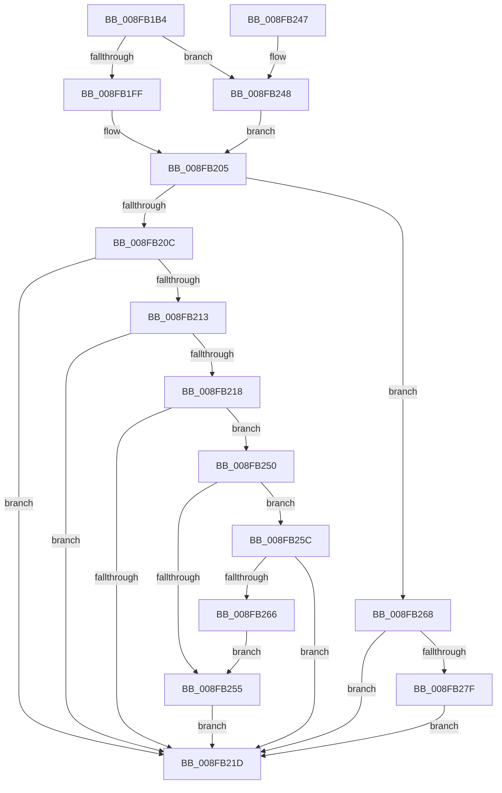

# PpHotSwapGetDevnodeRemovalPolicy

- RVA: `0x008FB1B4`–`0x008FB295` (길이 `225` bytes)
- VA: `0x00000001408FB1B4`
- 실행 섹션: `PAGE`
- PDB 이름 있음: `예`; PDB Function 태그: `아니요`
- unwind 정보 RVA: `0x00087DCC`
- 디코드: `64`개 명령, `225/225` bytes 표시
- 미해석 바이트: `0` (있으면 어셈블리에 `.byte`로 보존)

> 이 문서는 커널 이미지의 기계어와 PDB 기호를 분석해 생성했습니다. 4번과 5번은 함수 원형과 자료형을 바이너리 사용 방식에서 추정한 C 해석이며 원본 소스 복구 결과는 아닙니다.

## 1. Dependencies

- 직접 호출 지점: **4**; 고유 호출 대상: **4**
- 직접 호출자로 확인된 함수: **2**
- RIP 상대 이미지 참조: **1**

### Outgoing calls
- `0x008FB1F6` → [ExAcquireResourceSharedLite](../../text/21/ExAcquireResourceSharedLite_function_00211BC0.md) (function, `0x00211BC0`)
- `0x008FB224` → [ExReleaseResourceLite](../../text/25/ExReleaseResourceLite_function_0025FA10.md) (function, `0x0025FA10`)
- `0x008FB229` → [KeLeaveCriticalRegion](../../text/25/KeLeaveCriticalRegion_function_0025D8B0.md) (function, `0x0025D8B0`)
- `0x008FB270` → [PiHotSwapGetDetachableNode](../A9/PiHotSwapGetDetachableNode_function_00A98CA8.md) (function, `0x00A98CA8`)

### Direct callers
- [PiControlGetPropertyData](PiControlGetPropertyData_function_008FA330.md) at `0x008FA62F`
- [IoGetDeviceProperty](IoGetDeviceProperty_function_008FA720.md) at `0x008FA96E`

### Static image references
- `0x008FB1E1` → RVA `0x00F8C560` (`.data`; read)

## 2. Other-region calls and transfers

- 다른 실행 섹션으로 향하는 call: **3**
  - `0x008FB1F6` → [ExAcquireResourceSharedLite](../../text/21/ExAcquireResourceSharedLite_function_00211BC0.md) (`PAGE` → `.text`)
  - `0x008FB224` → [ExReleaseResourceLite](../../text/25/ExReleaseResourceLite_function_0025FA10.md) (`PAGE` → `.text`)
  - `0x008FB229` → [KeLeaveCriticalRegion](../../text/25/KeLeaveCriticalRegion_function_0025D8B0.md) (`PAGE` → `.text`)
- 별도 외부 분기/꼬리 이동을 확인하지 못했습니다.

## 3. Assembly (complete function range)

```asm
008FB1B4  48 8B C4                        mov rax, rsp
008FB1B7  48 89 58 08                     mov qword ptr [rax + 8], rbx
008FB1BB  48 89 70 10                     mov qword ptr [rax + 0x10], rsi
008FB1BF  48 89 78 20                     mov qword ptr [rax + 0x20], rdi
008FB1C3  41 56                           push r14
008FB1C5  48 83 EC 20                     sub rsp, 0x20
008FB1C9  48 83 60 18 00                  and qword ptr [rax + 0x18], 0
008FB1CE  8A DA                           mov bl, dl
008FB1D0  65 48 8B 04 25 88 01 00 00      mov rax, qword ptr gs:[0x188]
008FB1D9  48 8B F1                        mov rsi, rcx
008FB1DC  BF 01 00 00 00                  mov edi, 1
008FB1E1  48 8D 0D 78 13 69 00            lea rcx, [rip + 0x691378]
008FB1E8  40 8A D7                        mov dl, dil
008FB1EB  4D 8B F0                        mov r14, r8
008FB1EE  66 FF 88 E4 01 00 00            dec word ptr [rax + 0x1e4]
008FB1F5  90                              nop
008FB1F6  E8 C5 69 91 FF                  call 0x140211bc0
008FB1FB  84 DB                           test bl, bl
008FB1FD  74 49                           je 0x1408fb248
008FB1FF  8A 86 D2 01 00 00               mov al, byte ptr [rsi + 0x1d2]
008FB205  0F B6 C8                        movzx ecx, al
008FB208  84 C0                           test al, al
008FB20A  74 5C                           je 0x1408fb268
008FB20C  8B F9                           mov edi, ecx
008FB20E  83 E9 01                        sub ecx, 1
008FB211  74 0A                           je 0x1408fb21d
008FB213  83 E9 01                        sub ecx, 1
008FB216  74 05                           je 0x1408fb21d
008FB218  83 E9 01                        sub ecx, 1
008FB21B  75 33                           jne 0x1408fb250
008FB21D  48 8D 0D 3C 13 69 00            lea rcx, [rip + 0x69133c]
008FB224  E8 E7 47 96 FF                  call 0x14025fa10
008FB229  E8 82 26 96 FF                  call 0x14025d8b0
008FB22E  48 8B 5C 24 30                  mov rbx, qword ptr [rsp + 0x30]
008FB233  48 8B 74 24 38                  mov rsi, qword ptr [rsp + 0x38]
008FB238  41 89 3E                        mov dword ptr [r14], edi
008FB23B  48 8B 7C 24 48                  mov rdi, qword ptr [rsp + 0x48]
008FB240  48 83 C4 20                     add rsp, 0x20
008FB244  41 5E                           pop r14
008FB246  C3                              ret
008FB247  CC                              int3
008FB248  8A 86 D3 01 00 00               mov al, byte ptr [rsi + 0x1d3]
008FB24E  EB B5                           jmp 0x1408fb205
008FB250  83 E9 01                        sub ecx, 1
008FB253  75 07                           jne 0x1408fb25c
008FB255  BF 02 00 00 00                  mov edi, 2
008FB25A  EB C1                           jmp 0x1408fb21d
008FB25C  BF 03 00 00 00                  mov edi, 3
008FB261  83 F9 01                        cmp ecx, 1
008FB264  74 B7                           je 0x1408fb21d
008FB266  EB ED                           jmp 0x1408fb255
008FB268  48 8D 54 24 40                  lea rdx, [rsp + 0x40]
008FB26D  48 8B CE                        mov rcx, rsi
008FB270  E8 33 DA 19 00                  call 0x140a98ca8
008FB275  48 8B 44 24 40                  mov rax, qword ptr [rsp + 0x40]
008FB27A  48 85 C0                        test rax, rax
008FB27D  74 9E                           je 0x1408fb21d
008FB27F  8A 80 30 02 00 00               mov al, byte ptr [rax + 0x230]
008FB285  F6 D0                           not al
008FB287  0F B6 F8                        movzx edi, al
008FB28A  83 E7 08                        and edi, 8
008FB28D  83 CF 10                        or edi, 0x10
008FB290  C1 EF 03                        shr edi, 3
008FB293  EB 88                           jmp 0x1408fb21d
```

## 4. C-style interpretation (structured pseudocode)

```c
__int64 __fastcall PpHotSwapGetDevnodeRemovalPolicy(__int64 a1, unsigned __int8 a2, __int64 a3)
{
    __int64 result;
    __int64 v_rdi;
    __int64 v_rsp;
    unsigned __int64 v_stack_p10;
    unsigned __int64 v_stack_p20;
    unsigned __int64 v_stack_p40;
    unsigned __int64 v_stack_p8;

    *(unsigned __int64 *)(v_rsp + 8) = v_rbx;
    *(unsigned __int64 *)(v_rsp + 16) = v_rsi;
    *(unsigned __int64 *)(v_rsp + 32) = v_rdi;
    v_rsp = (v_rsp) - (32);
    result = ExAcquireResourceSharedLite(v_rip + 6886264, 1, a3, a4);
    if (a2 == 0) goto loc_008FB248;
loc_008FB205:
    if ((unsigned __int8)(*(unsigned __int8 *)(a1 + 466)) == 0) goto loc_008FB268;
    a1 = (unsigned int)(((unsigned __int8)(*(unsigned __int8 *)(a1 + 466))) - (1));
    if (condition_is_equal) goto loc_008FB21D;
    a1 = (unsigned int)((a1) - (1));
    if (condition_is_equal) goto loc_008FB21D;
    a1 = (unsigned int)((a1) - (1));
    if (condition_is_not_equal) goto loc_008FB250;
loc_008FB21D:
    result = ExReleaseResourceLite(v_rip + 6886204, 1, a3, a4);
    result = KeLeaveCriticalRegion(v_rip + 6886204, 1, a3, a4);
    *(unsigned int *)(a3) = (unsigned int)((unsigned int)((unsigned int)((unsigned __int8)(*(unsigned __int8 *)(a1 + 466)))));
    v_rsp = (v_rsp) + (32);
    return result;
loc_008FB248:
    goto loc_008FB205;
loc_008FB250:
    a1 = (unsigned int)((v_rip + 6886204) - (1));
    if (condition_is_not_equal) goto loc_008FB25C;
loc_008FB255:
    goto loc_008FB21D;
loc_008FB25C:
    if (((unsigned int)(a1)) == 1) goto loc_008FB21D;
    goto loc_008FB255;
loc_008FB268:
    result = PiHotSwapGetDetachableNode(v_stack_p10, v_stack_p40, a3, a4);
    if (v_stack_p40 == 0) goto loc_008FB21D;
    result = (unsigned __int8)(~(*(unsigned __int8 *)(v_stack_p40 + 560)));
    v_rdi = (unsigned int)(((unsigned __int8)(result)) & (8));
    v_rdi = (unsigned int)((v_rdi) | (16));
    v_rdi = (unsigned int)((v_rdi) >> (3));
    goto loc_008FB21D;
}
```

## 5. (Beta) C Style

```c
int64_t PpHotSwapGetDevnodeRemovalPolicy(void *Arg1, uint8_t Arg2, void *Arg3)
{
    uint8_t *arg1 = (uint8_t *)Arg1;
    uint8_t *arg3 = (uint8_t *)Arg3;

    int64_t result;
    int64_t local_rdi;
    int64_t local_rsp;
    uint64_t v_stack_p10;
    uint64_t v_stack_p20;
    uint64_t v_stack_p40;
    uint64_t v_stack_p8;

    *(uint64_t *)(local_rsp + 0x8) = local_rbx;
    *(uint64_t *)(local_rsp + 0x10) = local_rsi;
    *(uint64_t *)(local_rsp + 0x20) = local_rdi;
    local_rsp = (local_rsp) - (32);
    result = ExAcquireResourceSharedLite(v_rip + 6886264, 1, Arg3, a4);
    if (Arg2 == 0) goto loc_008FB248;
loc_008FB205:
    if ((uint8_t)(*(uint8_t *)(arg1 + 0x1D2)) == 0) goto loc_008FB268;
    Arg1 = (uint32_t)(((uint8_t)(*(uint8_t *)(arg1 + 0x1D2))) - (1));
    if (condition_is_equal) goto loc_008FB21D;
    Arg1 = (uint32_t)((Arg1) - (1));
    if (condition_is_equal) goto loc_008FB21D;
    Arg1 = (uint32_t)((Arg1) - (1));
    if (condition_is_not_equal) goto loc_008FB250;
loc_008FB21D:
    result = ExReleaseResourceLite(v_rip + 6886204, 1, Arg3, a4);
    result = KeLeaveCriticalRegion(v_rip + 6886204, 1, Arg3, a4);
    *(uint32_t *)(arg3) = (uint32_t)((uint32_t)((uint32_t)((uint8_t)(*(uint8_t *)(arg1 + 0x1D2)))));
    local_rsp = (local_rsp) + (32);
    return result;
loc_008FB248:
    goto loc_008FB205;
loc_008FB250:
    Arg1 = (uint32_t)((v_rip + 6886204) - (1));
    if (condition_is_not_equal) goto loc_008FB25C;
loc_008FB255:
    goto loc_008FB21D;
loc_008FB25C:
    if (((uint32_t)(Arg1)) == 1) goto loc_008FB21D;
    goto loc_008FB255;
loc_008FB268:
    result = PiHotSwapGetDetachableNode(v_stack_p10, v_stack_p40, Arg3, a4);
    if (v_stack_p40 == 0) goto loc_008FB21D;
    result = (uint8_t)(~(*(uint8_t *)(v_stack_p40 + 0x230)));
    local_rdi = (uint32_t)(((uint8_t)(result)) & (8));
    local_rdi = (uint32_t)((local_rdi) | (16));
    local_rdi = (uint32_t)((local_rdi) >> (3));
    goto loc_008FB21D;
}
```

### 관측된 메모리 오프셋

구조체 형식이 확인되지 않은 접근은 인자 기준의 오프셋으로만 기록했습니다.

| 기준 인자 | 오프셋 표현 | 폭 (bit) | 접근 |
|---|---:|---:|---|
| `Arg1` | `+ 0x1D2` | `8` | `R` |
| `Arg1` | `+ 0x1D3` | `8` | `R` |
| `Arg3` | `+ 0x0` | `32` | `W` |

## 6. Execution-region graph

[열기: 2D/3D 그래프와 함수 탐색 컨트롤 패널](../../../control-panel.html?section=page&rva=0x008FB1B4&view=graph)

- 2D 그래프는 위에서 아래로 흐르고, 3D 그래프는 빈 공간을 드래그해 회전합니다. Shift+드래그는 이동, 휠은 확대·축소, 함수 노드 선택은 대상 보고서 이동입니다.

### Static fallback


