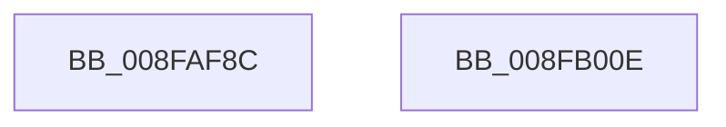

# PpIrpQueryCapabilities

- RVA: `0x008FAF8C`–`0x008FB00F` (길이 `131` bytes)
- VA: `0x00000001408FAF8C`
- 실행 섹션: `PAGE`
- PDB 이름 있음: `예`; PDB Function 태그: `아니요`
- unwind 정보 RVA: `0x00087D9C`
- 디코드: `33`개 명령, `131/131` bytes 표시
- 미해석 바이트: `0` (있으면 어셈블리에 `.byte`로 보존)

> 이 문서는 커널 이미지의 기계어와 PDB 기호를 분석해 생성했습니다. 4번과 5번은 함수 원형과 자료형을 바이너리 사용 방식에서 추정한 C 해석이며 원본 소스 복구 결과는 아닙니다.

## 1. Dependencies

- 직접 호출 지점: **3**; 고유 호출 대상: **2**
- 직접 호출자로 확인된 함수: **4**
- RIP 상대 이미지 참조: **0**

### Outgoing calls
- `0x008FAFAD` → [memset](../../text/6C/memset_function_006C6C40.md) (function, `0x006C6C40`)
- `0x008FAFCC` → [memset](../../text/6C/memset_function_006C6C40.md) (function, `0x006C6C40`)
- `0x008FAFF4` → [IopSynchronousCall](IopSynchronousCall_function_008FB018.md) (function, `0x008FB018`)

### Direct callers
- [IoGetDeviceProperty](IoGetDeviceProperty_function_008FA720.md) at `0x008FA990`
- [PnpQueryAndSaveDeviceNodeCapabilities](PnpQueryAndSaveDeviceNodeCapabilities_function_008FBCE8.md) at `0x008FBD19`
- [PiProcessNewDeviceNode](../A2/PiProcessNewDeviceNode_function_00A28F20.md) at `0x00A2906B`
- [PiControlGetDevicePowerData](../A7/PiControlGetDevicePowerData_function_00A7A808.md) at `0x00A7A86E`

### Static image references
- 디코드된 RIP-relative 메모리 참조가 없습니다.

## 2. Other-region calls and transfers

- 다른 실행 섹션으로 향하는 call: **2**
  - `0x008FAFAD` → [memset](../../text/6C/memset_function_006C6C40.md) (`PAGE` → `.text`)
  - `0x008FAFCC` → [memset](../../text/6C/memset_function_006C6C40.md) (`PAGE` → `.text`)
- 별도 외부 분기/꼬리 이동을 확인하지 못했습니다.

## 3. Assembly (complete function range)

```asm
008FAF8C  48 89 5C 24 08                  mov qword ptr [rsp + 8], rbx
008FAF91  48 89 74 24 10                  mov qword ptr [rsp + 0x10], rsi
008FAF96  57                              push rdi
008FAF97  48 81 EC 80 00 00 00            sub rsp, 0x80
008FAF9E  48 8B DA                        mov rbx, rdx
008FAFA1  48 8B F9                        mov rdi, rcx
008FAFA4  33 D2                           xor edx, edx
008FAFA6  48 8B CB                        mov rcx, rbx
008FAFA9  44 8D 42 40                     lea r8d, [rdx + 0x40]
008FAFAD  E8 8E BC DC FF                  call 0x1406c6c40
008FAFB2  83 C8 FF                        or eax, 0xffffffff
008FAFB5  C7 03 40 00 01 00               mov dword ptr [rbx], 0x10040
008FAFBB  33 D2                           xor edx, edx
008FAFBD  89 43 0C                        mov dword ptr [rbx + 0xc], eax
008FAFC0  48 8D 4C 24 30                  lea rcx, [rsp + 0x30]
008FAFC5  89 43 08                        mov dword ptr [rbx + 8], eax
008FAFC8  44 8D 42 48                     lea r8d, [rdx + 0x48]
008FAFCC  E8 6F BC DC FF                  call 0x1406c6c40
008FAFD1  48 83 64 24 20 00               and qword ptr [rsp + 0x20], 0
008FAFD7  48 8D 54 24 30                  lea rdx, [rsp + 0x30]
008FAFDC  45 33 C9                        xor r9d, r9d
008FAFDF  66 C7 44 24 30 1B 09            mov word ptr [rsp + 0x30], 0x91b
008FAFE6  41 B8 BB 00 00 C0               mov r8d, 0xc00000bb
008FAFEC  48 89 5C 24 38                  mov qword ptr [rsp + 0x38], rbx
008FAFF1  48 8B CF                        mov rcx, rdi
008FAFF4  E8 1F 00 00 00                  call 0x1408fb018
008FAFF9  4C 8D 9C 24 80 00 00 00         lea r11, [rsp + 0x80]
008FB001  49 8B 5B 10                     mov rbx, qword ptr [r11 + 0x10]
008FB005  49 8B 73 18                     mov rsi, qword ptr [r11 + 0x18]
008FB009  49 8B E3                        mov rsp, r11
008FB00C  5F                              pop rdi
008FB00D  C3                              ret
008FB00E  CC                              int3
```

## 4. C-style interpretation (structured pseudocode)

```c
__int64 __fastcall PpIrpQueryCapabilities(__int64 a1, __int64 a2, __int64 a3, int a4)
{
    __int64 result;
    __int64 v_rsp;
    unsigned __int64 v_stack_m50;
    unsigned __int64 v_stack_m58;
    unsigned __int64 v_stack_m68;
    unsigned __int64 v_stack_m8;
    unsigned __int64 v_stack_p10;
    unsigned __int64 v_stack_p8;

    v_stack_p8 = v_rbx;
    v_stack_p10 = v_rsi;
    v_rsp = (v_rsp) - (128);
    a2 = 0;
    result = memset(0, a2, a2 + 64, a4);
    result = (unsigned int)((result) | (0xFFFFFFFFULL));
    *(unsigned int *)(a2) = 0x10040ULL;
    a2 = 0;
    *(unsigned int *)(a2 + 12) = (unsigned int)(result);
    *(unsigned int *)(a2 + 8) = (unsigned int)(result);
    result = memset(v_stack_m58, a2, a2 + 72, a4);
    a4 = 0;
    v_stack_m58 = 0x91BULL;
    v_stack_m50 = 0;
    result = IopSynchronousCall(a1, v_stack_m58, (unsigned int)(0xC00000BBULL), a4);
    return result;
}
```

## 5. (Beta) C Style

```c
int64_t PpIrpQueryCapabilities(int64_t Arg1, void *Arg2, int64_t Arg3, int32_t Arg4)
{
    uint8_t *arg2 = (uint8_t *)Arg2;

    int64_t result;
    int64_t local_rsp;
    uint64_t v_stack_m50;
    uint64_t v_stack_m58;
    uint64_t v_stack_m68;
    uint64_t v_stack_m8;
    uint64_t v_stack_p10;
    uint64_t v_stack_p8;

    v_stack_p8 = local_rbx;
    v_stack_p10 = local_rsi;
    local_rsp = (local_rsp) - (128);
    Arg2 = 0;
    result = memset(0, Arg2, Arg2 + 64, Arg4);
    result = (uint32_t)((result) | (0xFFFFFFFFULL));
    *(uint32_t *)(arg2) = 0x10040ULL;
    Arg2 = 0;
    *(uint32_t *)(arg2 + 0xC) = (uint32_t)(result);
    *(uint32_t *)(arg2 + 0x8) = (uint32_t)(result);
    result = memset(v_stack_m58, Arg2, Arg2 + 72, Arg4);
    Arg4 = 0;
    v_stack_m58 = 0x91BULL;
    v_stack_m50 = 0;
    result = IopSynchronousCall(Arg1, v_stack_m58, (uint32_t)(0xC00000BBULL), Arg4);
    return result;
}
```

### 관측된 메모리 오프셋

구조체 형식이 확인되지 않은 접근은 인자 기준의 오프셋으로만 기록했습니다.

| 기준 인자 | 오프셋 표현 | 폭 (bit) | 접근 |
|---|---:|---:|---|
| `Arg2` | `+ 0x0` | `32` | `W` |
| `Arg2` | `+ 0x8` | `32` | `W` |
| `Arg2` | `+ 0xC` | `32` | `W` |

## 6. Execution-region graph

[열기: 2D/3D 그래프와 함수 탐색 컨트롤 패널](../../../control-panel.html?section=page&rva=0x008FAF8C&view=graph)

- 2D 그래프는 위에서 아래로 흐르고, 3D 그래프는 빈 공간을 드래그해 회전합니다. Shift+드래그는 이동, 휠은 확대·축소, 함수 노드 선택은 대상 보고서 이동입니다.

### Static fallback


