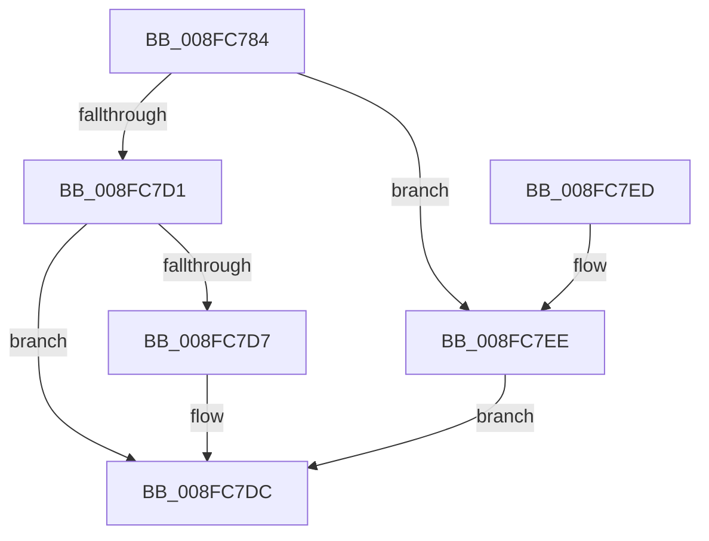

# PpIrpQueryResourceRequirements

- RVA: `0x008FC784`–`0x008FC7F4` (길이 `112` bytes)
- VA: `0x00000001408FC784`
- 실행 섹션: `PAGE`
- PDB 이름 있음: `예`; PDB Function 태그: `아니요`
- unwind 정보 RVA: `0x00087FC4`
- 디코드: `29`개 명령, `112/112` bytes 표시
- 미해석 바이트: `0` (있으면 어셈블리에 `.byte`로 보존)

> 이 문서는 커널 이미지의 기계어와 PDB 기호를 분석해 생성했습니다. 4번과 5번은 함수 원형과 자료형을 바이너리 사용 방식에서 추정한 C 해석이며 원본 소스 복구 결과는 아닙니다.

## 1. Dependencies

- 직접 호출 지점: **2**; 고유 호출 대상: **2**
- 직접 호출자로 확인된 함수: **2**
- RIP 상대 이미지 참조: **0**

### Outgoing calls
- `0x008FC7A6` → [memset](../../text/6C/memset_function_006C6C40.md) (function, `0x006C6C40`)
- `0x008FC7C8` → [IopSynchronousCall](IopSynchronousCall_function_008FB018.md) (function, `0x008FB018`)

### Direct callers
- [IopQueryDeviceResources](IopQueryDeviceResources_function_008FC344.md) at `0x008FC424`
- [PiQueryResourceRequirements](PiQueryResourceRequirements_function_008FE61C.md) at `0x008FE652`

### Static image references
- 디코드된 RIP-relative 메모리 참조가 없습니다.

## 2. Other-region calls and transfers

- 다른 실행 섹션으로 향하는 call: **1**
  - `0x008FC7A6` → [memset](../../text/6C/memset_function_006C6C40.md) (`PAGE` → `.text`)
- 별도 외부 분기/꼬리 이동을 확인하지 못했습니다.

## 3. Assembly (complete function range)

```asm
008FC784  48 89 5C 24 08                  mov qword ptr [rsp + 8], rbx
008FC789  57                              push rdi
008FC78A  48 81 EC 80 00 00 00            sub rsp, 0x80
008FC791  48 83 22 00                     and qword ptr [rdx], 0
008FC795  48 8B FA                        mov rdi, rdx
008FC798  33 D2                           xor edx, edx
008FC79A  48 8B D9                        mov rbx, rcx
008FC79D  48 8D 4C 24 30                  lea rcx, [rsp + 0x30]
008FC7A2  44 8D 42 48                     lea r8d, [rdx + 0x48]
008FC7A6  E8 95 A4 DC FF                  call 0x1406c6c40
008FC7AB  45 33 C9                        xor r9d, r9d
008FC7AE  66 C7 44 24 30 1B 0B            mov word ptr [rsp + 0x30], 0xb1b
008FC7B5  41 B8 BB 00 00 C0               mov r8d, 0xc00000bb
008FC7BB  48 89 7C 24 20                  mov qword ptr [rsp + 0x20], rdi
008FC7C0  48 8D 54 24 30                  lea rdx, [rsp + 0x30]
008FC7C5  48 8B CB                        mov rcx, rbx
008FC7C8  E8 4B E8 FF FF                  call 0x1408fb018
008FC7CD  85 C0                           test eax, eax
008FC7CF  78 1D                           js 0x1408fc7ee
008FC7D1  48 83 3F 00                     cmp qword ptr [rdi], 0
008FC7D5  75 05                           jne 0x1408fc7dc
008FC7D7  B8 BB 00 00 C0                  mov eax, 0xc00000bb
008FC7DC  48 8B 9C 24 90 00 00 00         mov rbx, qword ptr [rsp + 0x90]
008FC7E4  48 81 C4 80 00 00 00            add rsp, 0x80
008FC7EB  5F                              pop rdi
008FC7EC  C3                              ret
008FC7ED  CC                              int3
008FC7EE  48 83 27 00                     and qword ptr [rdi], 0
008FC7F2  EB E8                           jmp 0x1408fc7dc
```

## 4. C-style interpretation (structured pseudocode)

```c
__int64 __fastcall PpIrpQueryResourceRequirements(__int64 a1, __int64 a2, __int64 a3, int a4)
{
    __int64 result;
    __int64 v_rsp;
    unsigned __int64 v_stack_m58;
    unsigned __int64 v_stack_m68;
    unsigned __int64 v_stack_p8;

    v_stack_p8 = v_rbx;
    v_rsp = (v_rsp) - (128);
    a2 = 0;
    result = memset(v_stack_m58, a2, a2 + 72, a4);
    a4 = 0;
    v_stack_m58 = 0xB1BULL;
    v_stack_m68 = 0;
    result = IopSynchronousCall(a1, v_stack_m58, (unsigned int)(0xC00000BBULL), a4);
    if (sign_flag) goto loc_008FC7EE;
    if ((*(unsigned __int64 *)(a2)) == 0) {
        result = 0xC00000BBULL;
    }
    v_rsp = (v_rsp) + (128);
    return result;
loc_008FC7EE:
    goto loc_008FC7DC;
}
```

## 5. (Beta) C Style

```c
int64_t PpIrpQueryResourceRequirements(int64_t Arg1, void *Arg2, int64_t Arg3, int32_t Arg4)
{
    uint8_t *arg2 = (uint8_t *)Arg2;

    int64_t result;
    int64_t local_rsp;
    uint64_t v_stack_m58;
    uint64_t v_stack_m68;
    uint64_t v_stack_p8;

    v_stack_p8 = local_rbx;
    local_rsp = (local_rsp) - (128);
    Arg2 = 0;
    result = memset(v_stack_m58, Arg2, Arg2 + 72, Arg4);
    Arg4 = 0;
    v_stack_m58 = 0xB1BULL;
    v_stack_m68 = 0;
    result = IopSynchronousCall(Arg1, v_stack_m58, (uint32_t)(0xC00000BBULL), Arg4);
    if (sign_flag) goto loc_008FC7EE;
    if ((*(uint64_t *)(arg2)) == 0) {
        result = 0xC00000BBULL;
    }
    local_rsp = (local_rsp) + (128);
    return result;
loc_008FC7EE:
    goto loc_008FC7DC;
}
```

### 관측된 메모리 오프셋

구조체 형식이 확인되지 않은 접근은 인자 기준의 오프셋으로만 기록했습니다.

| 기준 인자 | 오프셋 표현 | 폭 (bit) | 접근 |
|---|---:|---:|---|
| `Arg2` | `+ 0x0` | `64` | `R` |
| `Arg2` | `+ 0x0` | `64` | `R/W` |

## 6. Execution-region graph

[열기: 2D/3D 그래프와 함수 탐색 컨트롤 패널](../../../control-panel.html?section=page&rva=0x008FC784&view=graph)

- 2D 그래프는 위에서 아래로 흐르고, 3D 그래프는 빈 공간을 드래그해 회전합니다. Shift+드래그는 이동, 휠은 확대·축소, 함수 노드 선택은 대상 보고서 이동입니다.

### Static fallback


