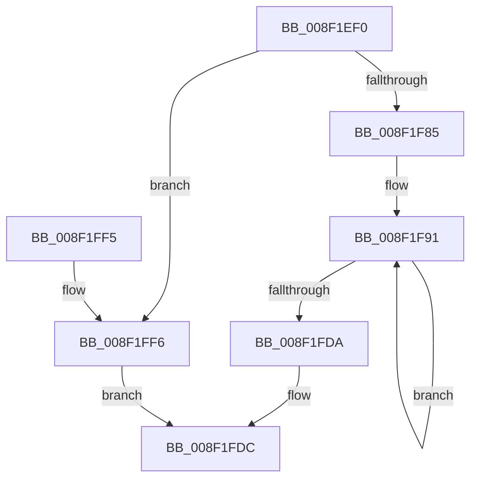

# RtlGUIDFromString

- RVA: `0x008F1EF0`–`0x008F1FFD` (길이 `269` bytes)
- VA: `0x00000001408F1EF0`
- 실행 섹션: `PAGE`
- PDB 이름 있음: `예`; PDB Function 태그: `아니요`
- unwind 정보 RVA: `0x0008733C`
- 디코드: `71`개 명령, `269/269` bytes 표시
- 미해석 바이트: `0` (있으면 어셈블리에 `.byte`로 보존)

> 이 문서는 커널 이미지의 기계어와 PDB 기호를 분석해 생성했습니다. 4번과 5번은 함수 원형과 자료형을 바이너리 사용 방식에서 추정한 C 해석이며 원본 소스 복구 결과는 아닙니다.

## 1. Dependencies

- 직접 호출 지점: **2**; 고유 호출 대상: **2**
- 직접 호출자로 확인된 함수: **53**
- RIP 상대 이미지 참조: **2**

### Outgoing calls
- `0x008F1F7B` → [ScanHexFormat](ScanHexFormat_function_008F29C0.md) (function, `0x008F29C0`)
- `0x008F1FE7` → [_security_check_cookie](../../text/6A/_security_check_cookie_function_006AC640.md) (function, `0x006AC640`)

### Direct callers
- [PiDevCfgParseInterfaceKeyName](../../text/4B/PiDevCfgParseInterfaceKeyName_function_004BB1CC.md) at `0x004BB20A`
- [PiDevCfgParsePropertyKeyName](../../text/5A/PiDevCfgParsePropertyKeyName_function_005A7E70.md) at `0x005A7ED2`
- [RtlQueryPackageClaimsEx](../../text/5E/RtlQueryPackageClaimsEx_function_005EDFE8.md) at `0x005EE1EE`
- [RtlRaiseCustomSystemEventTrigger](../../text/5E/RtlRaiseCustomSystemEventTrigger_function_005EE300.md) at `0x005EE373`
- [IoVolumeDeviceNameToGuid](../72/IoVolumeDeviceNameToGuid_function_00720EE0.md) at `0x00720F3C`
- [PipGetDriverKsrGuidRegistryValue](../72/PipGetDriverKsrGuidRegistryValue_function_007251C0.md) at `0x0072525B`
- [PiDcInitUpdateProperties](../73/PiDcInitUpdateProperties_function_00730B3C.md) at `0x00730CD0`
- [PiDevCfgConvertPropertyFromValue](../73/PiDevCfgConvertPropertyFromValue_function_00732530.md) at `0x0073264A`
- [PiDevCfgFindDeviceMigrationNode](../73/PiDevCfgFindDeviceMigrationNode_function_00732920.md) at `0x00732A71`
- [SddlpUuidFromString](../7A/SddlpUuidFromString_function_007A5300.md) at `0x007A53BD`
- [WdipSemLoadNextContextProvider](../7A/WdipSemLoadNextContextProvider_function_007AF820.md) at `0x007AF8FB`
- [WdipSemLoadNextEndEvent](../7A/WdipSemLoadNextEndEvent_function_007AFAD0.md) at `0x007AFC6C`
- [WdipSemLoadNextScenario](../7A/WdipSemLoadNextScenario_function_007AFDE0.md) at `0x007AFFE7`
- [WdipSemLoadScenarioTable](../7B/WdipSemLoadScenarioTable_function_007B02D8.md) at `0x007B0446`
- [WdipSemLoadLocalGroupPolicy](../7B/WdipSemLoadLocalGroupPolicy_function_007B11CC.md) at `0x007B12A8`
- [EtwStartAutoLogger](../7B/EtwStartAutoLogger_function_007BD2F8.md) at `0x007BE042`
- [EtwStartAutoLogger](../7B/EtwStartAutoLogger_function_007BD2F8.md) at `0x007BE148`
- [ExpParseSignatureName](../7C/ExpParseSignatureName_function_007CBA30.md) at `0x007CBADD`
- [BcdEnumerateObjects](../82/BcdEnumerateObjects_function_00823594.md) at `0x008237BA`
- [CmDevicePanelEnumSubkeyCallback](../82/CmDevicePanelEnumSubkeyCallback_function_0082E9B0.md) at `0x0082EA6D`
- [PiPnpRtlGetFilteredDeviceInterfaceList](../8D/PiPnpRtlGetFilteredDeviceInterfaceList_function_008DE9D0.md) at `0x008DEAC5`
- [sub_008E314B](../8E/Unknown_function_008E314B.md) at `0x008E3466`
- [sub_008E4C9A](../8E/Unknown_function_008E4C9A.md) at `0x008E4DC3`
- [sub_008F1D09](Unknown_function_008F1D09.md) at `0x008F1D60`
- [sub_008F246A](Unknown_function_008F246A.md) at `0x008F24B4`
- [CmGetDeviceInterfaceClassGuid](CmGetDeviceInterfaceClassGuid_function_008F3380.md) at `0x008F33F6`
- [sub_008F3634](Unknown_function_008F3634.md) at `0x008F36B2`
- [PnpIsValidGuidString](PnpIsValidGuidString_function_008F37F8.md) at `0x008F3849`
- [PiDmObjectUpdateCachedCmProperty](PiDmObjectUpdateCachedCmProperty_function_008FFCF0.md) at `0x008FFD9F`
- [IoVolumeDeviceToGuid](../95/IoVolumeDeviceToGuid_function_00952A90.md) at `0x00952AEC`
- [PnpGetGenericStorePropertyKeys](../99/PnpGetGenericStorePropertyKeys_function_00992378.md) at `0x009924D2`
- [PiDevCfgQueryDeviceMigrationNode](../9B/PiDevCfgQueryDeviceMigrationNode_function_009BD328.md) at `0x009BD5DF`
- [_CmGetDeviceMappedPropertyFromComposite](../9D/_CmGetDeviceMappedPropertyFromComposite_function_009D1684.md) at `0x009D298E`
- [sub_009D2CEA](../9D/Unknown_function_009D2CEA.md) at `0x009D2D81`
- [PiProcessNewDeviceNode](../A2/PiProcessNewDeviceNode_function_00A28F20.md) at `0x00A29CEE`
- [PiProcessNewDeviceNode](../A2/PiProcessNewDeviceNode_function_00A28F20.md) at `0x00A29DB2`
- [BiBuildIdentifierList](../A3/BiBuildIdentifierList_function_00A3E584.md) at `0x00A3E686`
- [BiGetObjectIdentifier](../A3/BiGetObjectIdentifier_function_00A3EEA0.md) at `0x00A3EEDC`
- [BiConvertRegistryDataToElement](../A3/BiConvertRegistryDataToElement_function_00A3F804.md) at `0x00A3F92C`
- [BiConvertRegistryDataToElement](../A3/BiConvertRegistryDataToElement_function_00A3F804.md) at `0x00A3F97B`
- [PipGenerateContainerID](../A8/PipGenerateContainerID_function_00A87694.md) at `0x00A87876`
- [PiDevCfgConfigureDeviceInterfaces](../A9/PiDevCfgConfigureDeviceInterfaces_function_00A90060.md) at `0x00A902ED`
- [EtwpEnableAutoLoggerProvider](../A9/EtwpEnableAutoLoggerProvider_function_00A92B00.md) at `0x00A9300C`
- [PiDevCfgResolveVariableDeviceProperty](../AA/PiDevCfgResolveVariableDeviceProperty_function_00AA63A0.md) at `0x00AA6480`
- [PiCreateDriverSwDeviceCallback](../AB/PiCreateDriverSwDeviceCallback_function_00ABB420.md) at `0x00ABB6AF`
- [CmSplitDevicePanelId](../AC/CmSplitDevicePanelId_function_00ACEA18.md) at `0x00ACEADB`
- [BiBindEfiEntryToBcdObject](../AD/BiBindEfiEntryToBcdObject_function_00AD502C.md) at `0x00AD50C8`
- [sub_00B1DC0E](../B1/Unknown_function_00B1DC0E.md) at `0x00B1DCDE`
- [sub_00B1F622](../B1/Unknown_function_00B1F622.md) at `0x00B1F906`
- [sub_00B3A7EA](../B3/Unknown_function_00B3A7EA.md) at `0x00B3A870`
- [PopProcessWakeSourceWork](../../pagelk/B7/PopProcessWakeSourceWork_function_00B7C488.md) at `0x00B7C5D3`
- [EmpInfParseGetGuidFromName](../../init/C2/EmpInfParseGetGuidFromName_function_00C263B4.md) at `0x00C26431`
- [EmpParseEntryTypes](../../init/C2/EmpParseEntryTypes_function_00C267B4.md) at `0x00C2688E`
- [IopInitializePlugPlayServices](../../init/C2/IopInitializePlugPlayServices_function_00C2F298.md) at `0x00C2FD97`
- [PipResetDevice](../../init/C3/PipResetDevice_function_00C31F90.md) at `0x00C3204E`
- [VhdAutoAttachVirtualDisks](../../init/C6/VhdAutoAttachVirtualDisks_function_00C6D934.md) at `0x00C6DA18`

### Static image references
- `0x008F1EFB` → RVA `0x00E0A740` (`.data`; read)
- `0x008F1F6D` → RVA `0x00B4D0B0` (`GuidFormat`; read)

## 2. Other-region calls and transfers

- 다른 실행 섹션으로 향하는 call: **1**
  - `0x008F1FE7` → [_security_check_cookie](../../text/6A/_security_check_cookie_function_006AC640.md) (`PAGE` → `.text`)
- 별도 외부 분기/꼬리 이동을 확인하지 못했습니다.

## 3. Assembly (complete function range)

```asm
008F1EF0  4C 8B DC                        mov r11, rsp
008F1EF3  53                              push rbx
008F1EF4  48 81 EC 90 00 00 00            sub rsp, 0x90
008F1EFB  48 8B 05 3E 88 51 00            mov rax, qword ptr [rip + 0x51883e]
008F1F02  48 33 C4                        xor rax, rsp
008F1F05  48 89 84 24 80 00 00 00         mov qword ptr [rsp + 0x80], rax
008F1F0D  4C 8D 42 04                     lea r8, [rdx + 4]
008F1F11  48 8B DA                        mov rbx, rdx
008F1F14  48 8D 42 06                     lea rax, [rdx + 6]
008F1F18  0F 57 C0                        xorps xmm0, xmm0
008F1F1B  0F B7 11                        movzx edx, word ptr [rcx]
008F1F1E  4D 8D 4B E6                     lea r9, [r11 - 0x1a]
008F1F22  48 8B 49 08                     mov rcx, qword ptr [rcx + 8]
008F1F26  4D 89 4B D0                     mov qword ptr [r11 - 0x30], r9
008F1F2A  4D 8D 4B E4                     lea r9, [r11 - 0x1c]
008F1F2E  4D 89 4B C8                     mov qword ptr [r11 - 0x38], r9
008F1F32  4D 8D 4B E2                     lea r9, [r11 - 0x1e]
008F1F36  4D 89 4B C0                     mov qword ptr [r11 - 0x40], r9
008F1F3A  4D 8D 4B E0                     lea r9, [r11 - 0x20]
008F1F3E  4D 89 4B B8                     mov qword ptr [r11 - 0x48], r9
008F1F42  4D 8D 4B DE                     lea r9, [r11 - 0x22]
008F1F46  4D 89 4B B0                     mov qword ptr [r11 - 0x50], r9
008F1F4A  4D 8D 4B DC                     lea r9, [r11 - 0x24]
008F1F4E  4D 89 4B A8                     mov qword ptr [r11 - 0x58], r9
008F1F52  4D 8D 4B DA                     lea r9, [r11 - 0x26]
008F1F56  4D 89 4B A0                     mov qword ptr [r11 - 0x60], r9
008F1F5A  4D 8D 4B D8                     lea r9, [r11 - 0x28]
008F1F5E  4D 89 4B 98                     mov qword ptr [r11 - 0x68], r9
008F1F62  4C 8B CB                        mov r9, rbx
008F1F65  49 89 43 90                     mov qword ptr [r11 - 0x70], rax
008F1F69  4D 89 43 88                     mov qword ptr [r11 - 0x78], r8
008F1F6D  4C 8D 05 3C B1 25 00            lea r8, [rip + 0x25b13c]
008F1F74  D1 EA                           shr edx, 1
008F1F76  0F 11 44 24 70                  movups xmmword ptr [rsp + 0x70], xmm0
008F1F7B  E8 40 0A 00 00                  call 0x1408f29c0
008F1F80  83 F8 FF                        cmp eax, -1
008F1F83  74 71                           je 0x1408f1ff6
008F1F85  45 33 C0                        xor r8d, r8d
008F1F88  48 8D 53 09                     lea rdx, [rbx + 9]
008F1F8C  48 8D 44 24 72                  lea rax, [rsp + 0x72]
008F1F91  0F B6 48 FE                     movzx ecx, byte ptr [rax - 2]
008F1F95  41 83 C0 08                     add r8d, 8
008F1F99  88 4A FF                        mov byte ptr [rdx - 1], cl
008F1F9C  48 8D 52 08                     lea rdx, [rdx + 8]
008F1FA0  0F B6 08                        movzx ecx, byte ptr [rax]
008F1FA3  48 8D 40 10                     lea rax, [rax + 0x10]
008F1FA7  88 4A F8                        mov byte ptr [rdx - 8], cl
008F1FAA  0F B6 48 F2                     movzx ecx, byte ptr [rax - 0xe]
008F1FAE  88 4A F9                        mov byte ptr [rdx - 7], cl
008F1FB1  0F B6 48 F4                     movzx ecx, byte ptr [rax - 0xc]
008F1FB5  88 4A FA                        mov byte ptr [rdx - 6], cl
008F1FB8  0F B6 48 F6                     movzx ecx, byte ptr [rax - 0xa]
008F1FBC  88 4A FB                        mov byte ptr [rdx - 5], cl
008F1FBF  0F B6 48 F8                     movzx ecx, byte ptr [rax - 8]
008F1FC3  88 4A FC                        mov byte ptr [rdx - 4], cl
008F1FC6  0F B6 48 FA                     movzx ecx, byte ptr [rax - 6]
008F1FCA  88 4A FD                        mov byte ptr [rdx - 3], cl
008F1FCD  0F B6 48 FC                     movzx ecx, byte ptr [rax - 4]
008F1FD1  88 4A FE                        mov byte ptr [rdx - 2], cl
008F1FD4  41 83 F8 08                     cmp r8d, 8
008F1FD8  72 B7                           jb 0x1408f1f91
008F1FDA  33 C0                           xor eax, eax
008F1FDC  48 8B 8C 24 80 00 00 00         mov rcx, qword ptr [rsp + 0x80]
008F1FE4  48 33 CC                        xor rcx, rsp
008F1FE7  E8 54 A6 DB FF                  call 0x1406ac640
008F1FEC  48 81 C4 90 00 00 00            add rsp, 0x90
008F1FF3  5B                              pop rbx
008F1FF4  C3                              ret
008F1FF5  CC                              int3
008F1FF6  B8 0D 00 00 C0                  mov eax, 0xc000000d
008F1FFB  EB DF                           jmp 0x1408f1fdc
```

## 4. C-style interpretation (structured pseudocode)

```c
__int64 __fastcall RtlGUIDFromString(__int64 a1, __int64 a2)
{
    __int64 result;
    __int64 v_rsp;
    unsigned __int64 v_stack_m18;
    unsigned __int64 v_stack_m26;
    unsigned __int64 v_stack_m28;

    v_rsp = (v_rsp) - (144);
    result = (*(unsigned __int64 *)(v_rip + 5343294)) ^ (v_rsp);
    v_stack_m18 = result;
    *(unsigned __int64 *)(v_rsp - 48) = v_rsp - 26;
    *(unsigned __int64 *)(v_rsp - 56) = v_rsp - 28;
    *(unsigned __int64 *)(v_rsp - 64) = v_rsp - 30;
    *(unsigned __int64 *)(v_rsp - 72) = v_rsp - 32;
    *(unsigned __int64 *)(v_rsp - 80) = v_rsp - 34;
    *(unsigned __int64 *)(v_rsp - 88) = v_rsp - 36;
    *(unsigned __int64 *)(v_rsp - 96) = v_rsp - 38;
    *(unsigned __int64 *)(v_rsp - 104) = v_rsp - 40;
    *(unsigned __int64 *)(v_rsp - 112) = a2 + 6;
    *(unsigned __int64 *)(v_rsp - 120) = a2 + 4;
    a2 = (unsigned int)((*(unsigned __int16 *)(a1)) >> (1));
    v_stack_m28 = v_xmm0;
    result = ScanHexFormat(*(unsigned __int64 *)(a1 + 8), a2, v_rip + 2470204, a2);
    if (((unsigned int)(result)) == -1) goto loc_008F1FF6;
    a3 = 0;
loc_008F1F91:
    a3 = (unsigned int)((a3) + (8));
    *(unsigned __int8 *)(a2 + 9 - 1) = (unsigned __int8)(*(unsigned __int8 *)(v_stack_m26 - 2));
    *(unsigned __int8 *)(a2 + 9 + 8 - 8) = (unsigned __int8)(*(unsigned __int8 *)(v_stack_m26));
    *(unsigned __int8 *)(a2 + 9 + 8 - 7) = (unsigned __int8)(*(unsigned __int8 *)(v_stack_m26 + 16 - 14));
    *(unsigned __int8 *)(a2 + 9 + 8 - 6) = (unsigned __int8)(*(unsigned __int8 *)(v_stack_m26 + 16 - 12));
    *(unsigned __int8 *)(a2 + 9 + 8 - 5) = (unsigned __int8)(*(unsigned __int8 *)(v_stack_m26 + 16 - 10));
    *(unsigned __int8 *)(a2 + 9 + 8 - 4) = (unsigned __int8)(*(unsigned __int8 *)(v_stack_m26 + 16 - 8));
    *(unsigned __int8 *)(a2 + 9 + 8 - 3) = (unsigned __int8)(*(unsigned __int8 *)(v_stack_m26 + 16 - 6));
    *(unsigned __int8 *)(a2 + 9 + 8 - 2) = (unsigned __int8)(*(unsigned __int8 *)(v_stack_m26 + 16 - 4));
    if (((unsigned int)(a3)) < 8) goto loc_008F1F91;
    result = 0;
loc_008F1FDC:
    a1 = (v_stack_m18) ^ (v_rsp);
    result = _security_check_cookie(a1, a2 + 9 + 8, a3, a2);
    v_rsp = (v_rsp) + (144);
    return result;
loc_008F1FF6:
    goto loc_008F1FDC;
}
```

## 5. (Beta) C Style

```c
int64_t RtlGUIDFromString(void *Arg1, void *Arg2)
{
    uint8_t *arg1 = (uint8_t *)Arg1;
    uint8_t *arg2 = (uint8_t *)Arg2;

    int64_t result;
    int64_t local_rsp;
    uint64_t v_stack_m18;
    uint64_t v_stack_m26;
    uint64_t v_stack_m28;

    local_rsp = (local_rsp) - (144);
    result = (*(uint64_t *)(v_rip + 0x51883E)) ^ (local_rsp);
    v_stack_m18 = result;
    *(uint64_t *)(local_rsp - 0x30) = local_rsp - 26;
    *(uint64_t *)(local_rsp - 0x38) = local_rsp - 28;
    *(uint64_t *)(local_rsp - 0x40) = local_rsp - 30;
    *(uint64_t *)(local_rsp - 0x48) = local_rsp - 32;
    *(uint64_t *)(local_rsp - 0x50) = local_rsp - 34;
    *(uint64_t *)(local_rsp - 0x58) = local_rsp - 36;
    *(uint64_t *)(local_rsp - 0x60) = local_rsp - 38;
    *(uint64_t *)(local_rsp - 0x68) = local_rsp - 40;
    *(void **)(local_rsp - 0x70) = Arg2 + 6;
    *(void **)(local_rsp - 0x78) = Arg2 + 4;
    Arg2 = (uint32_t)((*(uint16_t *)(arg1)) >> (1));
    v_stack_m28 = v_xmm0;
    result = ScanHexFormat(*(uint64_t *)(arg1 + 0x8), Arg2, v_rip + 2470204, Arg2);
    if (((uint32_t)(result)) == -1) goto loc_008F1FF6;
    a3 = 0;
loc_008F1F91:
    a3 = (uint32_t)((a3) + (8));
    *(uint8_t *)(arg2 + 0x9 - 0x1) = (uint8_t)(*(uint8_t *)(v_stack_m26 - 0x2));
    *(uint8_t *)(arg2 + 0x9 + 0x8 - 0x8) = (uint8_t)(*(uint8_t *)(v_stack_m26));
    *(uint8_t *)(arg2 + 0x9 + 0x8 - 0x7) = (uint8_t)(*(uint8_t *)(v_stack_m26 + 0x10 - 0xE));
    *(uint8_t *)(arg2 + 0x9 + 0x8 - 0x6) = (uint8_t)(*(uint8_t *)(v_stack_m26 + 0x10 - 0xC));
    *(uint8_t *)(arg2 + 0x9 + 0x8 - 0x5) = (uint8_t)(*(uint8_t *)(v_stack_m26 + 0x10 - 0xA));
    *(uint8_t *)(arg2 + 0x9 + 0x8 - 0x4) = (uint8_t)(*(uint8_t *)(v_stack_m26 + 0x10 - 0x8));
    *(uint8_t *)(arg2 + 0x9 + 0x8 - 0x3) = (uint8_t)(*(uint8_t *)(v_stack_m26 + 0x10 - 0x6));
    *(uint8_t *)(arg2 + 0x9 + 0x8 - 0x2) = (uint8_t)(*(uint8_t *)(v_stack_m26 + 0x10 - 0x4));
    if (((uint32_t)(a3)) < 8) goto loc_008F1F91;
    result = 0;
loc_008F1FDC:
    Arg1 = (v_stack_m18) ^ (local_rsp);
    result = _security_check_cookie(Arg1, Arg2 + 9 + 8, a3, Arg2);
    local_rsp = (local_rsp) + (144);
    return result;
loc_008F1FF6:
    goto loc_008F1FDC;
}
```

### 관측된 메모리 오프셋

구조체 형식이 확인되지 않은 접근은 인자 기준의 오프셋으로만 기록했습니다.

| 기준 인자 | 오프셋 표현 | 폭 (bit) | 접근 |
|---|---:|---:|---|
| `Arg1` | `+ 0x0` | `16` | `R` |
| `Arg1` | `+ 0x8` | `64` | `R` |
| `Arg2` | `- 0x8` | `8` | `W` |
| `Arg2` | `- 0x7` | `8` | `W` |
| `Arg2` | `- 0x6` | `8` | `W` |
| `Arg2` | `- 0x5` | `8` | `W` |
| `Arg2` | `- 0x4` | `8` | `W` |
| `Arg2` | `- 0x3` | `8` | `W` |
| `Arg2` | `- 0x2` | `8` | `W` |
| `Arg2` | `- 0x1` | `8` | `W` |
| `Arg2` | `+ 0x4` | `64` | `R` |
| `Arg2` | `+ 0x6` | `64` | `R` |
| `Arg2` | `+ 0x8` | `64` | `R` |
| `Arg2` | `+ 0x9` | `64` | `R` |

## 6. Execution-region graph

[열기: 2D/3D 그래프와 함수 탐색 컨트롤 패널](../../../control-panel.html?section=page&rva=0x008F1EF0&view=graph)

- 2D 그래프는 위에서 아래로 흐르고, 3D 그래프는 빈 공간을 드래그해 회전합니다. Shift+드래그는 이동, 휠은 확대·축소, 함수 노드 선택은 대상 보고서 이동입니다.

### Static fallback


