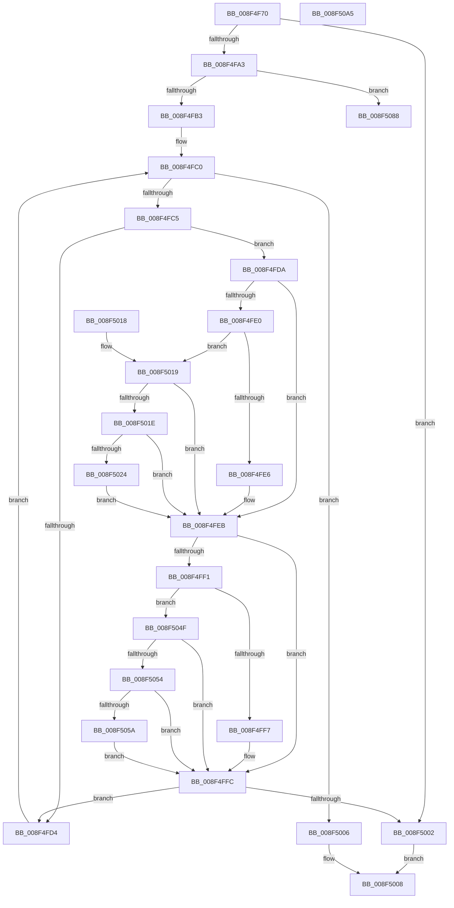

# RtlPrefixUnicodeString

- RVA: `0x008F4F70`–`0x008F50A6` (길이 `310` bytes)
- VA: `0x00000001408F4F70`
- 실행 섹션: `PAGE`
- PDB 이름 있음: `예`; PDB Function 태그: `아니요`
- unwind 정보 RVA: `0x00087778`
- 디코드: `93`개 명령, `310/310` bytes 표시
- 미해석 바이트: `0` (있으면 어셈블리에 `.byte`로 보존)

> 이 문서는 커널 이미지의 기계어와 PDB 기호를 분석해 생성했습니다. 4번과 5번은 함수 원형과 자료형을 바이너리 사용 방식에서 추정한 C 해석이며 원본 소스 복구 결과는 아닙니다.

## 1. Dependencies

- 직접 호출 지점: **2**; 고유 호출 대상: **2**
- 직접 호출자로 확인된 함수: **37**
- RIP 상대 이미지 참조: **0**

### Outgoing calls
- `0x008F4F86` → [PsGetCurrentServerSiloGlobals](../../text/2F/PsGetCurrentServerSiloGlobals_function_002FE1F0.md) (function, `0x002FE1F0`)
- `0x008F508B` → [memcmp](../../text/6C/memcmp_function_006C6B10.md) (function, `0x006C6B10`)

### Direct callers
- [SepPotentialGlobalTableAttribute](../../text/3A/SepPotentialGlobalTableAttribute_function_003A8828.md) at `0x003A8895`
- [RtlDeriveCapabilitySidsFromName](../../text/47/RtlDeriveCapabilitySidsFromName_function_00474DC0.md) at `0x00474EFF`
- [PopFxBuildDripsBlockingDeviceList](../../text/49/PopFxBuildDripsBlockingDeviceList_function_0049B5B0.md) at `0x0049B84D`
- [PopFxBuildDripsBlockingDeviceList](../../text/49/PopFxBuildDripsBlockingDeviceList_function_0049B5B0.md) at `0x0049B866`
- [IoConfigureCrashDump](../../text/59/IoConfigureCrashDump_function_00591CB4.md) at `0x00591D72`
- [IopValidateJunctionTarget](../71/IopValidateJunctionTarget_function_0071C808.md) at `0x0071CA57`
- [IopValidateJunctionTarget](../71/IopValidateJunctionTarget_function_0071C808.md) at `0x0071CA73`
- [PiCreateRegistryPath](../72/PiCreateRegistryPath_function_00728B58.md) at `0x00728BD9`
- [PiOpenDirectoryWithRoot](../72/PiOpenDirectoryWithRoot_function_00729198.md) at `0x00729210`
- [PiDevCfgMakeServiceBootStart](../73/PiDevCfgMakeServiceBootStart_function_00733BC8.md) at `0x00733D0A`
- [PiDevCfgMakeServiceBootStart](../73/PiDevCfgMakeServiceBootStart_function_00733BC8.md) at `0x00733D69`
- [PiDrvDbQuerySystemPathWin32](../74/PiDrvDbQuerySystemPathWin32_function_007421F4.md) at `0x00742359`
- [PiDrvDbQuerySystemPathWin32](../74/PiDrvDbQuerySystemPathWin32_function_007421F4.md) at `0x007423B7`
- [PiDrvDbResolveKeyFilePaths](../74/PiDrvDbResolveKeyFilePaths_function_0074326C.md) at `0x00743302`
- [PspQueryAndCheckCpuPartitionName](../78/PspQueryAndCheckCpuPartitionName_function_0078445C.md) at `0x007844E2`
- [CmpIsFileInSystemConfig](../7F/CmpIsFileInSystemConfig_function_007F1F80.md) at `0x007F2143`
- [CmDeleteCommonClassRegKeyWorker](../82/CmDeleteCommonClassRegKeyWorker_function_008298F8.md) at `0x00829A10`
- [CmDeleteCommonClassRegKeyWorker](../82/CmDeleteCommonClassRegKeyWorker_function_008298F8.md) at `0x00829A43`
- [CmDeleteCommonClassRegKeyWorker](../82/CmDeleteCommonClassRegKeyWorker_function_008298F8.md) at `0x00829A66`
- [CmDeleteCommonClassRegKeyWorker](../82/CmDeleteCommonClassRegKeyWorker_function_008298F8.md) at `0x00829A89`
- [CmDeleteDeviceInterfaceRegKeyWorker](../82/CmDeleteDeviceInterfaceRegKeyWorker_function_00829E1C.md) at `0x00829F50`
- [CmDeleteDeviceInterfaceRegKeyWorker](../82/CmDeleteDeviceInterfaceRegKeyWorker_function_00829E1C.md) at `0x00829F83`
- [CmDeleteDeviceInterfaceRegKeyWorker](../82/CmDeleteDeviceInterfaceRegKeyWorker_function_00829E1C.md) at `0x00829FA6`
- [CmDeleteDeviceContainerRegKeyWorker](../82/CmDeleteDeviceContainerRegKeyWorker_function_0082B15C.md) at `0x0082B280`
- [CmDeleteDeviceContainerRegKeyWorker](../82/CmDeleteDeviceContainerRegKeyWorker_function_0082B15C.md) at `0x0082B2B3`
- [CmDeleteDevicePanelRegKeyWorker](../82/CmDeleteDevicePanelRegKeyWorker_function_0082E554.md) at `0x0082E66F`
- [CmDeleteDevicePanelRegKeyWorker](../82/CmDeleteDevicePanelRegKeyWorker_function_0082E554.md) at `0x0082E6A2`
- [CmpDoParseKey](../85/CmpDoParseKey_function_0085F750.md) at `0x0085FC8C`
- [PiPnpRtlEnumeratorFilterCallback](../8E/PiPnpRtlEnumeratorFilterCallback_function_008E52F0.md) at `0x008E53F7`
- [sub_008EE966](../8E/Unknown_function_008EE966.md) at `0x008EEC21`
- [_CmOpenCommonClassRegKeyWorker](_CmOpenCommonClassRegKeyWorker_function_008F0A1C.md) at `0x008F0CB7`
- [_CmOpenDeviceInterfaceRegKeyWorker](_CmOpenDeviceInterfaceRegKeyWorker_function_008F2B48.md) at `0x008F30E5`
- [CmOpenDeviceContainerRegKeyWorker](CmOpenDeviceContainerRegKeyWorker_function_008F4904.md) at `0x008F4A05`
- [CmOpenDeviceContainerRegKeyWorker](CmOpenDeviceContainerRegKeyWorker_function_008F4904.md) at `0x008F4A38`
- [SepValidateReferencedCachedHandles](SepValidateReferencedCachedHandles_function_008F4BB0.md) at `0x008F4D28`
- [AuthzBasepIsCompareRelevantAttribute](AuthzBasepIsCompareRelevantAttribute_function_008F6B54.md) at `0x008F6B6D`
- [IopBuildFullDriverPath](../99/IopBuildFullDriverPath_function_009998E4.md) at `0x00999A14`
- [IopQueryRegistryKeySystemPath](../99/IopQueryRegistryKeySystemPath_function_0099A1CC.md) at `0x0099A2DF`
- [PiNormalizeDeviceText](../99/PiNormalizeDeviceText_function_0099A43C.md) at `0x0099A4CE`
- [PiNormalizeDeviceText](../99/PiNormalizeDeviceText_function_0099A43C.md) at `0x0099A683`
- [ExWnfHiveUnloaded](../9A/ExWnfHiveUnloaded_function_009AF900.md) at `0x009AF952`
- [SepIsMinTCB](../A1/SepIsMinTCB_function_00A13120.md) at `0x00A131CE`
- [SepIsMinTCB](../A1/SepIsMinTCB_function_00A13120.md) at `0x00A131E5`
- [SepIsMinTCB](../A1/SepIsMinTCB_function_00A13120.md) at `0x00A13202`
- [SepIsMinTCB](../A1/SepIsMinTCB_function_00A13120.md) at `0x00A133E3`
- [SepIsSystemAppTCB](../A1/SepIsSystemAppTCB_function_00A13434.md) at `0x00A134A8`
- [SepIsSystemAppTCB](../A1/SepIsSystemAppTCB_function_00A13434.md) at `0x00A134D8`
- [RtlpProcessIFEOKeyFilter](../A3/RtlpProcessIFEOKeyFilter_function_00A3BA78.md) at `0x00A3BBC9`
- [ObpIsUnsecureName](../A7/ObpIsUnsecureName_function_00A714C0.md) at `0x00A7150E`
- [_CmDeleteDeviceRegKeyWorker](../A9/_CmDeleteDeviceRegKeyWorker_function_00A9200C.md) at `0x00A92144`
- [_CmDeleteDeviceRegKeyWorker](../A9/_CmDeleteDeviceRegKeyWorker_function_00A9200C.md) at `0x00A92177`
- [_CmDeleteDeviceRegKeyWorker](../A9/_CmDeleteDeviceRegKeyWorker_function_00A9200C.md) at `0x00A92192`
- [_CmOpenDevicePanelRegKeyWorker](../A9/_CmOpenDevicePanelRegKeyWorker_function_00A98434.md) at `0x00A98523`
- [_CmOpenDevicePanelRegKeyWorker](../A9/_CmOpenDevicePanelRegKeyWorker_function_00A98434.md) at `0x00A98556`
- [PiCreateDriverSwDeviceCallback](../AB/PiCreateDriverSwDeviceCallback_function_00ABB420.md) at `0x00ABB778`
- [PiCreateDriverSwDeviceCallback](../AB/PiCreateDriverSwDeviceCallback_function_00ABB420.md) at `0x00ABB7BA`
- [PopDirectedDripsDiagSanitizeHardwareId](../AC/PopDirectedDripsDiagSanitizeHardwareId_function_00AC3058.md) at `0x00AC30B9`
- [sub_00B257D0](../B2/Unknown_function_00B257D0.md) at `0x00B25870`

### Static image references
- 디코드된 RIP-relative 메모리 참조가 없습니다.

## 2. Other-region calls and transfers

- 다른 실행 섹션으로 향하는 call: **2**
  - `0x008F4F86` → [PsGetCurrentServerSiloGlobals](../../text/2F/PsGetCurrentServerSiloGlobals_function_002FE1F0.md) (`PAGE` → `.text`)
  - `0x008F508B` → [memcmp](../../text/6C/memcmp_function_006C6B10.md) (`PAGE` → `.text`)
- 별도 외부 분기/꼬리 이동을 확인하지 못했습니다.

## 3. Assembly (complete function range)

```asm
008F4F70  48 89 5C 24 08                  mov qword ptr [rsp + 8], rbx
008F4F75  48 89 74 24 10                  mov qword ptr [rsp + 0x10], rsi
008F4F7A  57                              push rdi
008F4F7B  48 83 EC 20                     sub rsp, 0x20
008F4F7F  45 0F B6 D0                     movzx r10d, r8b
008F4F83  4C 8B C9                        mov r9, rcx
008F4F86  E8 65 92 A0 FF                  call 0x1402fe1f0
008F4F8B  49 8B 49 08                     mov rcx, qword ptr [r9 + 8]
008F4F8F  48 8B 5A 08                     mov rbx, qword ptr [rdx + 8]
008F4F93  48 8B B8 B0 04 00 00            mov rdi, qword ptr [rax + 0x4b0]
008F4F9A  41 0F B7 01                     movzx eax, word ptr [r9]
008F4F9E  66 39 02                        cmp word ptr [rdx], ax
008F4FA1  72 5F                           jb 0x1408f5002
008F4FA3  4C 8D 1C 08                     lea r11, [rax + rcx]
008F4FA7  44 8B C0                        mov r8d, eax
008F4FAA  45 84 D2                        test r10b, r10b
008F4FAD  0F 84 D5 00 00 00               je 0x1408f5088
008F4FB3  48 2B D9                        sub rbx, rcx
008F4FB6  BE C0 00 00 00                  mov esi, 0xc0
008F4FBB  0F 1F 44 00 00                  nop dword ptr [rax + rax]
008F4FC0  49 3B CB                        cmp rcx, r11
008F4FC3  73 41                           jae 0x1408f5006
008F4FC5  44 0F B7 09                     movzx r9d, word ptr [rcx]
008F4FC9  44 0F B7 14 0B                  movzx r10d, word ptr [rbx + rcx]
008F4FCE  66 45 3B CA                     cmp r9w, r10w
008F4FD2  75 06                           jne 0x1408f4fda
008F4FD4  48 83 C1 02                     add rcx, 2
008F4FD8  EB E6                           jmp 0x1408f4fc0
008F4FDA  41 83 F9 61                     cmp r9d, 0x61
008F4FDE  72 0B                           jb 0x1408f4feb
008F4FE0  41 83 F9 7A                     cmp r9d, 0x7a
008F4FE4  77 33                           ja 0x1408f5019
008F4FE6  66 41 83 E9 20                  sub r9w, 0x20
008F4FEB  41 83 FA 61                     cmp r10d, 0x61
008F4FEF  72 0B                           jb 0x1408f4ffc
008F4FF1  41 83 FA 7A                     cmp r10d, 0x7a
008F4FF5  77 58                           ja 0x1408f504f
008F4FF7  66 41 83 EA 20                  sub r10w, 0x20
008F4FFC  66 45 3B CA                     cmp r9w, r10w
008F5000  74 D2                           je 0x1408f4fd4
008F5002  32 C0                           xor al, al
008F5004  EB 02                           jmp 0x1408f5008
008F5006  B0 01                           mov al, 1
008F5008  48 8B 5C 24 30                  mov rbx, qword ptr [rsp + 0x30]
008F500D  48 8B 74 24 38                  mov rsi, qword ptr [rsp + 0x38]
008F5012  48 83 C4 20                     add rsp, 0x20
008F5016  5F                              pop rdi
008F5017  C3                              ret
008F5018  CC                              int3
008F5019  48 85 FF                        test rdi, rdi
008F501C  74 CD                           je 0x1408f4feb
008F501E  66 44 3B CE                     cmp r9w, si
008F5022  72 C7                           jb 0x1408f4feb
008F5024  49 8B C1                        mov rax, r9
008F5027  45 8B C1                        mov r8d, r9d
008F502A  48 C1 E8 08                     shr rax, 8
008F502E  41 83 E0 0F                     and r8d, 0xf
008F5032  0F B7 14 47                     movzx edx, word ptr [rdi + rax*2]
008F5036  41 8B C1                        mov eax, r9d
008F5039  C1 E8 04                        shr eax, 4
008F503C  83 E0 0F                        and eax, 0xf
008F503F  03 D0                           add edx, eax
008F5041  0F B7 14 57                     movzx edx, word ptr [rdi + rdx*2]
008F5045  41 03 D0                        add edx, r8d
008F5048  66 44 03 0C 57                  add r9w, word ptr [rdi + rdx*2]
008F504D  EB 9C                           jmp 0x1408f4feb
008F504F  48 85 FF                        test rdi, rdi
008F5052  74 A8                           je 0x1408f4ffc
008F5054  66 44 3B D6                     cmp r10w, si
008F5058  72 A2                           jb 0x1408f4ffc
008F505A  49 8B C2                        mov rax, r10
008F505D  45 8B C2                        mov r8d, r10d
008F5060  48 C1 E8 08                     shr rax, 8
008F5064  41 83 E0 0F                     and r8d, 0xf
008F5068  0F B7 14 47                     movzx edx, word ptr [rdi + rax*2]
008F506C  41 8B C2                        mov eax, r10d
008F506F  C1 E8 04                        shr eax, 4
008F5072  83 E0 0F                        and eax, 0xf
008F5075  03 D0                           add edx, eax
008F5077  0F B7 14 57                     movzx edx, word ptr [rdi + rdx*2]
008F507B  41 03 D0                        add edx, r8d
008F507E  66 44 03 14 57                  add r10w, word ptr [rdi + rdx*2]
008F5083  E9 74 FF FF FF                  jmp 0x1408f4ffc
008F5088  48 8B D3                        mov rdx, rbx
008F508B  E8 80 1A DD FF                  call 0x1406c6b10
008F5090  48 8B 5C 24 30                  mov rbx, qword ptr [rsp + 0x30]
008F5095  85 C0                           test eax, eax
008F5097  48 8B 74 24 38                  mov rsi, qword ptr [rsp + 0x38]
008F509C  0F 94 C0                        sete al
008F509F  48 83 C4 20                     add rsp, 0x20
008F50A3  5F                              pop rdi
008F50A4  C3                              ret
008F50A5  CC                              int3
```

## 4. C-style interpretation (structured pseudocode)

```c
__int64 __fastcall RtlPrefixUnicodeString(__int64 a1, __int64 a2, unsigned __int8 a3)
{
    __int64 result;
    __int64 v_r10;
    __int64 v_rbx;
    __int64 v_rsp;
    unsigned __int64 v_stack_p10;
    unsigned __int64 v_stack_p30;
    unsigned __int64 v_stack_p38;
    unsigned __int64 v_stack_p8;

    v_stack_p8 = v_rbx;
    v_stack_p10 = v_rsi;
    v_rsp = (v_rsp) - (32);
    result = PsGetCurrentServerSiloGlobals(a1, a2, a3, a1);
    if ((*(unsigned __int16 *)(a2)) < ((unsigned __int16)(*(unsigned __int16 *)(a1)))) goto loc_008F5002;
    if (a3 == 0) goto loc_008F5088;
    v_rbx = (*(unsigned __int64 *)(a2 + 8)) - (*(unsigned __int64 *)(a1 + 8));
loc_008F4FC0:
    if ((*(unsigned __int64 *)(a1 + 8)) >= (*(unsigned __int16 *)(a1) + *(unsigned __int64 *)(a1 + 8) * 1)) goto loc_008F5006;
    if (((unsigned __int16)(*(unsigned __int16 *)(*(unsigned __int64 *)(a1 + 8)))) != ((unsigned __int16)(*(unsigned __int16 *)(v_rbx + *(unsigned __int64 *)(a1 + 8) * 1)))) goto loc_008F4FDA;
loc_008F4FD4:
    a1 = (*(unsigned __int64 *)(a1 + 8)) + (2);
    goto loc_008F4FC0;
loc_008F4FDA:
    if (((unsigned int)(*(unsigned __int16 *)(*(unsigned __int64 *)(a1 + 8)))) < 97) goto loc_008F4FEB;
    if (((unsigned int)(*(unsigned __int16 *)(*(unsigned __int64 *)(a1 + 8)))) > 122) goto loc_008F5019;
    a4 = (unsigned __int16)((*(unsigned __int16 *)(*(unsigned __int64 *)(a1 + 8))) - (32));
loc_008F4FEB:
    if (((unsigned int)(*(unsigned __int16 *)(v_rbx + *(unsigned __int64 *)(a1 + 8) * 1))) < 97) goto loc_008F4FFC;
    if (((unsigned int)(*(unsigned __int16 *)(v_rbx + *(unsigned __int64 *)(a1 + 8) * 1))) > 122) goto loc_008F504F;
    v_r10 = (unsigned __int16)((*(unsigned __int16 *)(v_rbx + *(unsigned __int64 *)(a1 + 8) * 1)) - (32));
loc_008F4FFC:
    if (((unsigned __int16)(a4)) == ((unsigned __int16)(v_r10))) goto loc_008F4FD4;
loc_008F5002:
    result = 0;
    goto loc_008F5008;
loc_008F5006:
loc_008F5008:
    v_rsp = (v_rsp) + (32);
    return 1;
loc_008F5019:
    if (*(unsigned __int64 *)(result + 1200) == 0) goto loc_008F4FEB;
    if (((unsigned __int16)(a4)) < ((unsigned __int16)(v_stack_p10))) goto loc_008F4FEB;
    result = (a4) >> (8);
    a3 = (unsigned int)(((unsigned int)((unsigned int)(a4))) & (15));
    result = (unsigned int)(((unsigned int)((unsigned int)(a4))) >> (4));
    result = (unsigned int)((result) & (15));
    a2 = (unsigned int)((*(unsigned __int16 *)(*(unsigned __int64 *)(result + 1200) + result * 2)) + ((unsigned int)(result)));
    a2 = (unsigned int)((*(unsigned __int16 *)(*(unsigned __int64 *)(result + 1200) + a2 * 2)) + (a3));
    a4 = (unsigned __int16)((a4) + (*(unsigned __int16 *)(*(unsigned __int64 *)(result + 1200) + a2 * 2)));
    goto loc_008F4FEB;
loc_008F504F:
    if (*(unsigned __int64 *)(result + 1200) == 0) goto loc_008F4FFC;
    if (((unsigned __int16)(v_r10)) < ((unsigned __int16)(v_stack_p10))) goto loc_008F4FFC;
    result = (v_r10) >> (8);
    a3 = (unsigned int)(((unsigned int)((unsigned int)(v_r10))) & (15));
    result = (unsigned int)(((unsigned int)((unsigned int)(v_r10))) >> (4));
    result = (unsigned int)((result) & (15));
    a2 = (unsigned int)((*(unsigned __int16 *)(*(unsigned __int64 *)(result + 1200) + result * 2)) + ((unsigned int)(result)));
    a2 = (unsigned int)((*(unsigned __int16 *)(*(unsigned __int64 *)(result + 1200) + a2 * 2)) + (a3));
    v_r10 = (unsigned __int16)((v_r10) + (*(unsigned __int16 *)(*(unsigned __int64 *)(result + 1200) + a2 * 2)));
    goto loc_008F4FFC;
loc_008F5088:
    result = memcmp(a1, v_stack_p8, a3, a4);
    result = ((unsigned int)(result) == 0) ? 1 : 0;
    v_rsp = (v_rsp) + (32);
    return result;
}
```

## 5. (Beta) C Style

```c
int64_t RtlPrefixUnicodeString(int64_t Arg1, int64_t Arg2, uint8_t Arg3)
{
    int64_t result;
    int64_t local_r10;
    int64_t local_rbx;
    int64_t local_rsp;
    uint64_t v_stack_p10;
    uint64_t v_stack_p30;
    uint64_t v_stack_p38;
    uint64_t v_stack_p8;

    v_stack_p8 = local_rbx;
    v_stack_p10 = local_rsi;
    local_rsp = (local_rsp) - (32);
    result = PsGetCurrentServerSiloGlobals(Arg1, Arg2, Arg3, Arg1);
    if ((*(uint16_t *)(Arg2)) < ((uint16_t)(*(uint16_t *)(Arg1)))) goto loc_008F5002;
    if (Arg3 == 0) goto loc_008F5088;
    local_rbx = (*(uint64_t *)(Arg2 + 0x8)) - (*(uint64_t *)(Arg1 + 0x8));
loc_008F4FC0:
    if ((*(uint64_t *)(Arg1 + 0x8)) >= (*(uint16_t *)(Arg1) + *(uint64_t *)(Arg1 + 0x8) * 1)) goto loc_008F5006;
    if (((uint16_t)(*(uint16_t *)(*(uint64_t *)(Arg1 + 0x8)))) != ((uint16_t)(*(uint16_t *)(local_rbx + *(uint64_t *)(Arg1 + 0x8) * 1)))) goto loc_008F4FDA;
loc_008F4FD4:
    Arg1 = (*(uint64_t *)(Arg1 + 0x8)) + (2);
    goto loc_008F4FC0;
loc_008F4FDA:
    if (((uint32_t)(*(uint16_t *)(*(uint64_t *)(Arg1 + 0x8)))) < 97) goto loc_008F4FEB;
    if (((uint32_t)(*(uint16_t *)(*(uint64_t *)(Arg1 + 0x8)))) > 122) goto loc_008F5019;
    a4 = (uint16_t)((*(uint16_t *)(*(uint64_t *)(Arg1 + 0x8))) - (32));
loc_008F4FEB:
    if (((uint32_t)(*(uint16_t *)(local_rbx + *(uint64_t *)(Arg1 + 0x8) * 1))) < 97) goto loc_008F4FFC;
    if (((uint32_t)(*(uint16_t *)(local_rbx + *(uint64_t *)(Arg1 + 0x8) * 1))) > 122) goto loc_008F504F;
    local_r10 = (uint16_t)((*(uint16_t *)(local_rbx + *(uint64_t *)(Arg1 + 0x8) * 1)) - (32));
loc_008F4FFC:
    if (((uint16_t)(a4)) == ((uint16_t)(local_r10))) goto loc_008F4FD4;
loc_008F5002:
    result = 0;
    goto loc_008F5008;
loc_008F5006:
loc_008F5008:
    local_rsp = (local_rsp) + (32);
    return 1;
loc_008F5019:
    if (*(uint64_t *)(result + 0x4B0) == 0) goto loc_008F4FEB;
    if (((uint16_t)(a4)) < ((uint16_t)(v_stack_p10))) goto loc_008F4FEB;
    result = (a4) >> (8);
    Arg3 = (uint32_t)(((uint32_t)((uint32_t)(a4))) & (15));
    result = (uint32_t)(((uint32_t)((uint32_t)(a4))) >> (4));
    result = (uint32_t)((result) & (15));
    Arg2 = (uint32_t)((*(uint16_t *)(*(uint64_t *)(result + 0x4B0) + result * 2)) + ((uint32_t)(result)));
    Arg2 = (uint32_t)((*(uint16_t *)(*(uint64_t *)(result + 0x4B0) + Arg2 * 2)) + (Arg3));
    a4 = (uint16_t)((a4) + (*(uint16_t *)(*(uint64_t *)(result + 0x4B0) + Arg2 * 2)));
    goto loc_008F4FEB;
loc_008F504F:
    if (*(uint64_t *)(result + 0x4B0) == 0) goto loc_008F4FFC;
    if (((uint16_t)(local_r10)) < ((uint16_t)(v_stack_p10))) goto loc_008F4FFC;
    result = (local_r10) >> (8);
    Arg3 = (uint32_t)(((uint32_t)((uint32_t)(local_r10))) & (15));
    result = (uint32_t)(((uint32_t)((uint32_t)(local_r10))) >> (4));
    result = (uint32_t)((result) & (15));
    Arg2 = (uint32_t)((*(uint16_t *)(*(uint64_t *)(result + 0x4B0) + result * 2)) + ((uint32_t)(result)));
    Arg2 = (uint32_t)((*(uint16_t *)(*(uint64_t *)(result + 0x4B0) + Arg2 * 2)) + (Arg3));
    local_r10 = (uint16_t)((local_r10) + (*(uint16_t *)(*(uint64_t *)(result + 0x4B0) + Arg2 * 2)));
    goto loc_008F4FFC;
loc_008F5088:
    result = memcmp(Arg1, v_stack_p8, Arg3, a4);
    result = ((uint32_t)(result) == 0) ? 1 : 0;
    local_rsp = (local_rsp) + (32);
    return result;
}
```

## 6. Execution-region graph

[열기: 2D/3D 그래프와 함수 탐색 컨트롤 패널](../../../control-panel.html?section=page&rva=0x008F4F70&view=graph)

- 2D 그래프는 위에서 아래로 흐르고, 3D 그래프는 빈 공간을 드래그해 회전합니다. Shift+드래그는 이동, 휠은 확대·축소, 함수 노드 선택은 대상 보고서 이동입니다.

### Static fallback


