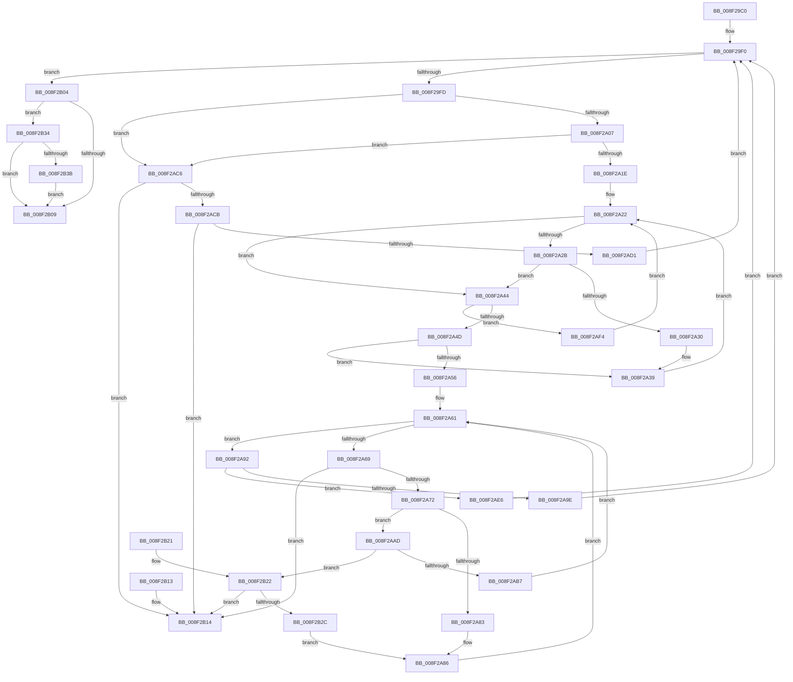

# ScanHexFormat

- RVA: `0x008F29C0`–`0x008F2B42` (길이 `386` bytes)
- VA: `0x00000001408F29C0`
- 실행 섹션: `PAGE`
- PDB 이름 있음: `예`; PDB Function 태그: `예`
- unwind 정보 RVA: `0x0008756C`
- 디코드: `119`개 명령, `386/386` bytes 표시
- 미해석 바이트: `0` (있으면 어셈블리에 `.byte`로 보존)

> 이 문서는 커널 이미지의 기계어와 PDB 기호를 분석해 생성했습니다. 4번과 5번은 함수 원형과 자료형을 바이너리 사용 방식에서 추정한 C 해석이며 원본 소스 복구 결과는 아닙니다.

## 1. Dependencies

- 직접 호출 지점: **0**; 고유 호출 대상: **0**
- 직접 호출자로 확인된 함수: **5**
- RIP 상대 이미지 참조: **0**

### Outgoing calls
- 직접 디코드된 call 명령이 없습니다.

### Direct callers
- [CmGetDeviceInterfaceSubkeyPath](CmGetDeviceInterfaceSubkeyPath_function_008F1010.md) at `0x008F124D`
- [CmGetDeviceInterfaceSubkeyPath](CmGetDeviceInterfaceSubkeyPath_function_008F1010.md) at `0x008F13F7`
- [PiDmCacheDataDecode](PiDmCacheDataDecode_function_008F17A0.md) at `0x008F192E`
- [CmValidateDeviceInterfaceName](CmValidateDeviceInterfaceName_function_008F1A40.md) at `0x008F1C39`
- [RtlGUIDFromString](RtlGUIDFromString_function_008F1EF0.md) at `0x008F1F7B`
- [sub_008F229E](Unknown_function_008F229E.md) at `0x008F234C`

### Static image references
- 디코드된 RIP-relative 메모리 참조가 없습니다.

## 2. Other-region calls and transfers

- 다른 실행 섹션으로 향하는 call: **0**
- 별도 외부 분기/꼬리 이동을 확인하지 못했습니다.

## 3. Assembly (complete function range)

```asm
008F29C0  4C 89 44 24 18                  mov qword ptr [rsp + 0x18], r8
008F29C5  4C 89 4C 24 20                  mov qword ptr [rsp + 0x20], r9
008F29CA  53                              push rbx
008F29CB  56                              push rsi
008F29CC  57                              push rdi
008F29CD  48 83 EC 10                     sub rsp, 0x10
008F29D1  4C 8D 5C 24 48                  lea r11, [rsp + 0x48]
008F29D6  48 C7 04 24 00 00 00 00         mov qword ptr [rsp], 0
008F29DE  33 FF                           xor edi, edi
008F29E0  44 8B CA                        mov r9d, edx
008F29E3  49 83 C3 F8                     add r11, -8
008F29E7  4C 8B D1                        mov r10, rcx
008F29EA  BE DF FF 00 00                  mov esi, 0xffdf
008F29EF  90                              nop
008F29F0  41 0F B7 00                     movzx eax, word ptr [r8]
008F29F4  66 85 C0                        test ax, ax
008F29F7  0F 84 07 01 00 00               je 0x1408f2b04
008F29FD  66 83 F8 25                     cmp ax, 0x25
008F2A01  0F 85 BF 00 00 00               jne 0x1408f2ac6
008F2A07  49 83 C0 02                     add r8, 2
008F2A0B  4C 89 44 24 40                  mov qword ptr [rsp + 0x40], r8
008F2A10  41 0F B7 00                     movzx eax, word ptr [r8]
008F2A14  66 83 F8 25                     cmp ax, 0x25
008F2A18  0F 84 A8 00 00 00               je 0x1408f2ac6
008F2A1E  33 DB                           xor ebx, ebx
008F2A20  33 C9                           xor ecx, ecx
008F2A22  41 0F B7 00                     movzx eax, word ptr [r8]
008F2A26  83 F8 39                        cmp eax, 0x39
008F2A29  77 19                           ja 0x1408f2a44
008F2A2B  83 F8 30                        cmp eax, 0x30
008F2A2E  72 14                           jb 0x1408f2a44
008F2A30  8D 0C 89                        lea ecx, [rcx + rcx*4]
008F2A33  8D 49 E8                        lea ecx, [rcx - 0x18]
008F2A36  8D 0C 48                        lea ecx, [rax + rcx*2]
008F2A39  49 83 C0 02                     add r8, 2
008F2A3D  4C 89 44 24 40                  mov qword ptr [rsp + 0x40], r8
008F2A42  EB DE                           jmp 0x1408f2a22
008F2A44  83 F8 6C                        cmp eax, 0x6c
008F2A47  0F 84 A7 00 00 00               je 0x1408f2af4
008F2A4D  66 83 E8 58                     sub ax, 0x58
008F2A51  66 85 C6                        test si, ax
008F2A54  75 E3                           jne 0x1408f2a39
008F2A56  49 83 C0 02                     add r8, 2
008F2A5A  4C 89 44 24 40                  mov qword ptr [rsp + 0x40], r8
008F2A5F  33 D2                           xor edx, edx
008F2A61  8B C1                           mov eax, ecx
008F2A63  FF C9                           dec ecx
008F2A65  85 C0                           test eax, eax
008F2A67  74 29                           je 0x1408f2a92
008F2A69  45 85 C9                        test r9d, r9d
008F2A6C  0F 84 A2 00 00 00               je 0x1408f2b14
008F2A72  45 0F B7 02                     movzx r8d, word ptr [r10]
008F2A76  C1 E2 04                        shl edx, 4
008F2A79  41 8D 40 D0                     lea eax, [r8 - 0x30]
008F2A7D  66 83 F8 09                     cmp ax, 9
008F2A81  77 2A                           ja 0x1408f2aad
008F2A83  83 C2 D0                        add edx, -0x30
008F2A86  41 03 D0                        add edx, r8d
008F2A89  49 83 C2 02                     add r10, 2
008F2A8D  41 FF C9                        dec r9d
008F2A90  EB CF                           jmp 0x1408f2a61
008F2A92  49 8B 43 08                     mov rax, qword ptr [r11 + 8]
008F2A96  49 83 C3 08                     add r11, 8
008F2A9A  85 DB                           test ebx, ebx
008F2A9C  75 48                           jne 0x1408f2ae6
008F2A9E  66 89 10                        mov word ptr [rax], dx
008F2AA1  FF C7                           inc edi
008F2AA3  4C 8B 44 24 40                  mov r8, qword ptr [rsp + 0x40]
008F2AA8  E9 43 FF FF FF                  jmp 0x1408f29f0
008F2AAD  41 8D 40 9F                     lea eax, [r8 - 0x61]
008F2AB1  66 83 F8 05                     cmp ax, 5
008F2AB5  77 6B                           ja 0x1408f2b22
008F2AB7  83 C2 A9                        add edx, -0x57
008F2ABA  49 83 C2 02                     add r10, 2
008F2ABE  41 03 D0                        add edx, r8d
008F2AC1  41 FF C9                        dec r9d
008F2AC4  EB 9B                           jmp 0x1408f2a61
008F2AC6  45 85 C9                        test r9d, r9d
008F2AC9  74 49                           je 0x1408f2b14
008F2ACB  66 41 39 02                     cmp word ptr [r10], ax
008F2ACF  75 43                           jne 0x1408f2b14
008F2AD1  49 83 C2 02                     add r10, 2
008F2AD5  41 FF C9                        dec r9d
008F2AD8  49 83 C0 02                     add r8, 2
008F2ADC  4C 89 44 24 40                  mov qword ptr [rsp + 0x40], r8
008F2AE1  E9 0A FF FF FF                  jmp 0x1408f29f0
008F2AE6  89 10                           mov dword ptr [rax], edx
008F2AE8  FF C7                           inc edi
008F2AEA  4C 8B 44 24 40                  mov r8, qword ptr [rsp + 0x40]
008F2AEF  E9 FC FE FF FF                  jmp 0x1408f29f0
008F2AF4  FF C3                           inc ebx
008F2AF6  49 83 C0 02                     add r8, 2
008F2AFA  4C 89 44 24 40                  mov qword ptr [rsp + 0x40], r8
008F2AFF  E9 1E FF FF FF                  jmp 0x1408f2a22
008F2B04  45 85 C9                        test r9d, r9d
008F2B07  75 2B                           jne 0x1408f2b34
008F2B09  8B C7                           mov eax, edi
008F2B0B  48 83 C4 10                     add rsp, 0x10
008F2B0F  5F                              pop rdi
008F2B10  5E                              pop rsi
008F2B11  5B                              pop rbx
008F2B12  C3                              ret
008F2B13  CC                              int3
008F2B14  B8 FF FF FF FF                  mov eax, 0xffffffff
008F2B19  48 83 C4 10                     add rsp, 0x10
008F2B1D  5F                              pop rdi
008F2B1E  5E                              pop rsi
008F2B1F  5B                              pop rbx
008F2B20  C3                              ret
008F2B21  CC                              int3
008F2B22  41 8D 40 BF                     lea eax, [r8 - 0x41]
008F2B26  66 83 F8 05                     cmp ax, 5
008F2B2A  77 E8                           ja 0x1408f2b14
008F2B2C  83 C2 C9                        add edx, -0x37
008F2B2F  E9 52 FF FF FF                  jmp 0x1408f2a86
008F2B34  66 41 83 3A 00                  cmp word ptr [r10], 0
008F2B39  74 CE                           je 0x1408f2b09
008F2B3B  BF FF FF FF FF                  mov edi, 0xffffffff
008F2B40  EB C7                           jmp 0x1408f2b09
```

## 4. C-style interpretation (structured pseudocode)

```c
__int64 __fastcall ScanHexFormat(__int64 a1, int a2, __int64 a3, __int64 a4)
{
    __int64 result;
    __int64 v_r10;
    __int64 v_r11;
    __int64 v_rbx;
    __int64 v_rdi;
    __int64 v_rsp;
    unsigned __int64 v_stack_m28;
    unsigned __int64 v_stack_p18;
    unsigned __int64 v_stack_p20;

    v_stack_p18 = a3;
    v_stack_p20 = a4;
    v_rsp = (v_rsp) - (16);
    v_stack_m28 = 0;
    v_rdi = 0;
    v_r11 = (v_stack_p20) + (-8);
loc_008F29F0:
    if ((unsigned __int16)(*(unsigned __int16 *)(a3)) == 0) goto loc_008F2B04;
    if (((unsigned __int16)(*(unsigned __int16 *)(a3))) != 37) goto loc_008F2AC6;
    a3 = (a3) + (2);
    v_stack_p18 = a3;
    if (((unsigned __int16)(*(unsigned __int16 *)(a3))) == 37) goto loc_008F2AC6;
    v_rbx = 0;
    a1 = 0;
loc_008F2A22:
    if (((unsigned int)(*(unsigned __int16 *)(a3))) > 57) goto loc_008F2A44;
    if (((unsigned int)(*(unsigned __int16 *)(a3))) < 48) goto loc_008F2A44;
loc_008F2A39:
    a3 = (a3) + (2);
    v_stack_p18 = a3;
    goto loc_008F2A22;
loc_008F2A44:
    if (((unsigned int)(*(unsigned __int16 *)(a3))) == 108) goto loc_008F2AF4;
    result = (unsigned __int16)((*(unsigned __int16 *)(a3)) - (88));
    if ((((unsigned __int16)((unsigned int)(0xFFDFULL))) & ((unsigned __int16)(result))) != 0) goto loc_008F2A39;
    a3 = (a3) + (2);
    v_stack_p18 = a3;
    a2 = 0;
loc_008F2A61:
    a1 = (unsigned int)((*(unsigned __int16 *)(a3) + a1 + a1 * 4 - 24 * 2) - 1);
    if ((unsigned int)((unsigned int)((unsigned int)(*(unsigned __int16 *)(a3) + a1 + a1 * 4 - 24 * 2))) == 0) goto loc_008F2A92;
    if ((unsigned int)((unsigned int)(a2)) == 0) goto loc_008F2B14;
    a2 = (unsigned int)((a2) << (4));
    if (((unsigned __int16)(*(unsigned __int16 *)(a1) - 48)) > 9) goto loc_008F2AAD;
    a2 = (unsigned int)((a2) + (-48));
loc_008F2A86:
    a2 = (unsigned int)((a2) + ((unsigned int)(*(unsigned __int16 *)(a1))));
    v_r10 = (a1) + (2);
    a4 = (unsigned int)(((unsigned int)(a2)) - 1);
    goto loc_008F2A61;
loc_008F2A92:
    v_r11 = (v_r11) + (8);
    if (0 != 0) goto loc_008F2AE6;
    *(unsigned __int16 *)(*(unsigned __int64 *)(v_r11 + 8)) = (unsigned __int16)(a2);
    v_rdi = (unsigned int)((v_rdi) + 1);
    goto loc_008F29F0;
loc_008F2AAD:
    if (((unsigned __int16)(v_stack_p18 - 97)) > 5) goto loc_008F2B22;
    a2 = (unsigned int)((a2) + (-87));
    v_r10 = (v_r10) + (2);
    a2 = (unsigned int)((a2) + ((unsigned int)(v_stack_p18)));
    a4 = (unsigned int)((a4) - 1);
    goto loc_008F2A61;
loc_008F2AC6:
    if ((unsigned int)(a4) == 0) goto loc_008F2B14;
    if ((*(unsigned __int16 *)(v_r10)) != ((unsigned __int16)(v_stack_p18 - 97))) goto loc_008F2B14;
    v_r10 = (v_r10) + (2);
    a4 = (unsigned int)((a4) - 1);
    a3 = (v_stack_p18) + (2);
    v_stack_p18 = a3;
    goto loc_008F29F0;
loc_008F2AE6:
    *(unsigned int *)(v_stack_p18 - 97) = a2;
    v_rdi = (unsigned int)((v_rdi) + 1);
    goto loc_008F29F0;
loc_008F2AF4:
    v_rbx = (unsigned int)((v_rbx) + 1);
    a3 = (v_stack_p18) + (2);
    v_stack_p18 = a3;
    goto loc_008F2A22;
loc_008F2B04:
    if ((unsigned int)(a4) != 0) goto loc_008F2B34;
loc_008F2B09:
    v_rsp = (v_rsp) + (16);
    return (unsigned int)((unsigned int)(v_rdi));
loc_008F2B14:
    v_rsp = (v_rsp) + (16);
    return (unsigned int)(0xFFFFFFFFULL);
loc_008F2B22:
    if (((unsigned __int16)(a3 - 65)) > 5) goto loc_008F2B14;
    a2 = (unsigned int)((a2) + (-55));
    goto loc_008F2A86;
loc_008F2B34:
    if ((*(unsigned __int16 *)(v_r10)) == 0) goto loc_008F2B09;
    goto loc_008F2B09;
}
```

## 5. (Beta) C Style

```c
int64_t ScanHexFormat(void *Arg1, int32_t Arg2, int64_t Arg3, int64_t Arg4)
{
    uint8_t *arg1 = (uint8_t *)Arg1;

    int64_t result;
    int64_t local_r10;
    int64_t local_r11;
    int64_t local_rbx;
    int64_t local_rdi;
    int64_t local_rsp;
    uint64_t v_stack_m28;
    uint64_t v_stack_p18;
    uint64_t v_stack_p20;

    v_stack_p18 = Arg3;
    v_stack_p20 = Arg4;
    local_rsp = (local_rsp) - (16);
    v_stack_m28 = 0;
    local_rdi = 0;
    local_r11 = (v_stack_p20) + (-8);
loc_008F29F0:
    if ((uint16_t)(*(uint16_t *)(Arg3)) == 0) goto loc_008F2B04;
    if (((uint16_t)(*(uint16_t *)(Arg3))) != 37) goto loc_008F2AC6;
    Arg3 = (Arg3) + (2);
    v_stack_p18 = Arg3;
    if (((uint16_t)(*(uint16_t *)(Arg3))) == 37) goto loc_008F2AC6;
    local_rbx = 0;
    Arg1 = 0;
loc_008F2A22:
    if (((uint32_t)(*(uint16_t *)(Arg3))) > 57) goto loc_008F2A44;
    if (((uint32_t)(*(uint16_t *)(Arg3))) < 48) goto loc_008F2A44;
loc_008F2A39:
    Arg3 = (Arg3) + (2);
    v_stack_p18 = Arg3;
    goto loc_008F2A22;
loc_008F2A44:
    if (((uint32_t)(*(uint16_t *)(Arg3))) == 108) goto loc_008F2AF4;
    result = (uint16_t)((*(uint16_t *)(Arg3)) - (88));
    if ((((uint16_t)((uint32_t)(0xFFDFULL))) & ((uint16_t)(result))) != 0) goto loc_008F2A39;
    Arg3 = (Arg3) + (2);
    v_stack_p18 = Arg3;
    Arg2 = 0;
loc_008F2A61:
    Arg1 = (uint32_t)((*(uint16_t *)(Arg3) + Arg1 + Arg1 * 4 - 24 * 2) - 1);
    if ((uint32_t)((uint32_t)((uint32_t)(*(uint16_t *)(Arg3) + Arg1 + Arg1 * 4 - 24 * 2))) == 0) goto loc_008F2A92;
    if ((uint32_t)((uint32_t)(Arg2)) == 0) goto loc_008F2B14;
    Arg2 = (uint32_t)((Arg2) << (4));
    if (((uint16_t)(*(uint16_t *)(arg1) - 48)) > 9) goto loc_008F2AAD;
    Arg2 = (uint32_t)((Arg2) + (-48));
loc_008F2A86:
    Arg2 = (uint32_t)((Arg2) + ((uint32_t)(*(uint16_t *)(arg1))));
    local_r10 = (Arg1) + (2);
    Arg4 = (uint32_t)(((uint32_t)(Arg2)) - 1);
    goto loc_008F2A61;
loc_008F2A92:
    local_r11 = (local_r11) + (8);
    if (0 != 0) goto loc_008F2AE6;
    *(uint16_t *)(*(uint64_t *)(local_r11 + 0x8)) = (uint16_t)(Arg2);
    local_rdi = (uint32_t)((local_rdi) + 1);
    goto loc_008F29F0;
loc_008F2AAD:
    if (((uint16_t)(v_stack_p18 - 97)) > 5) goto loc_008F2B22;
    Arg2 = (uint32_t)((Arg2) + (-87));
    local_r10 = (local_r10) + (2);
    Arg2 = (uint32_t)((Arg2) + ((uint32_t)(v_stack_p18)));
    Arg4 = (uint32_t)((Arg4) - 1);
    goto loc_008F2A61;
loc_008F2AC6:
    if ((uint32_t)(Arg4) == 0) goto loc_008F2B14;
    if ((*(uint16_t *)(local_r10)) != ((uint16_t)(v_stack_p18 - 97))) goto loc_008F2B14;
    local_r10 = (local_r10) + (2);
    Arg4 = (uint32_t)((Arg4) - 1);
    Arg3 = (v_stack_p18) + (2);
    v_stack_p18 = Arg3;
    goto loc_008F29F0;
loc_008F2AE6:
    *(uint32_t *)(v_stack_p18 - 0x61) = Arg2;
    local_rdi = (uint32_t)((local_rdi) + 1);
    goto loc_008F29F0;
loc_008F2AF4:
    local_rbx = (uint32_t)((local_rbx) + 1);
    Arg3 = (v_stack_p18) + (2);
    v_stack_p18 = Arg3;
    goto loc_008F2A22;
loc_008F2B04:
    if ((uint32_t)(Arg4) != 0) goto loc_008F2B34;
loc_008F2B09:
    local_rsp = (local_rsp) + (16);
    return (uint32_t)((uint32_t)(local_rdi));
loc_008F2B14:
    local_rsp = (local_rsp) + (16);
    return (uint32_t)(0xFFFFFFFFULL);
loc_008F2B22:
    if (((uint16_t)(Arg3 - 65)) > 5) goto loc_008F2B14;
    Arg2 = (uint32_t)((Arg2) + (-55));
    goto loc_008F2A86;
loc_008F2B34:
    if ((*(uint16_t *)(local_r10)) == 0) goto loc_008F2B09;
    goto loc_008F2B09;
}
```

### 관측된 메모리 오프셋

구조체 형식이 확인되지 않은 접근은 인자 기준의 오프셋으로만 기록했습니다.

| 기준 인자 | 오프셋 표현 | 폭 (bit) | 접근 |
|---|---:|---:|---|
| `Arg1` | `+ 0x0` | `16` | `R` |

## 6. Execution-region graph

[열기: 2D/3D 그래프와 함수 탐색 컨트롤 패널](../../../control-panel.html?section=page&rva=0x008F29C0&view=graph)

- 2D 그래프는 위에서 아래로 흐르고, 3D 그래프는 빈 공간을 드래그해 회전합니다. Shift+드래그는 이동, 휠은 확대·축소, 함수 노드 선택은 대상 보고서 이동입니다.

### Static fallback


