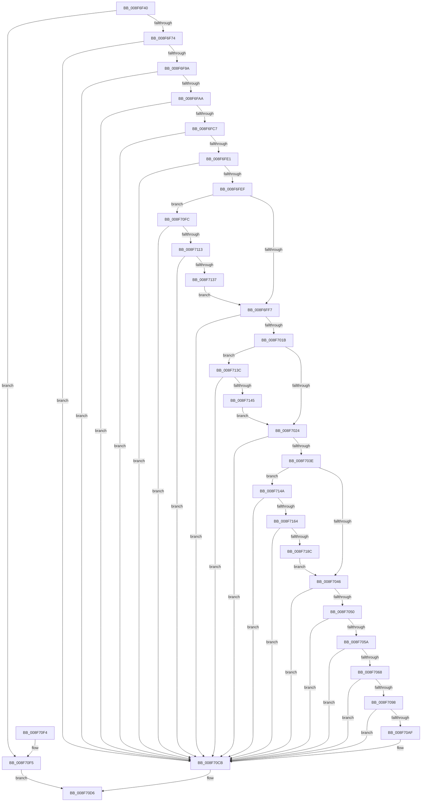

# SeCompareTokens

- RVA: `0x008F6F40`–`0x008F7191` (길이 `593` bytes)
- VA: `0x00000001408F6F40`
- 실행 섹션: `PAGE`
- PDB 이름 있음: `예`; PDB Function 태그: `아니요`
- unwind 정보 RVA: `0x00087A08`
- 디코드: `150`개 명령, `593/593` bytes 표시
- 미해석 바이트: `0` (있으면 어셈블리에 `.byte`로 보존)

> 이 문서는 커널 이미지의 기계어와 PDB 기호를 분석해 생성했습니다. 4번과 5번은 함수 원형과 자료형을 바이너리 사용 방식에서 추정한 C 해석이며 원본 소스 복구 결과는 아닙니다.

## 1. Dependencies

- 직접 호출 지점: **16**; 고유 호출 대상: **9**
- 직접 호출자로 확인된 함수: **2**
- RIP 상대 이미지 참조: **0**

### Outgoing calls
- `0x008F6F74` → [SepAcquireOrderedReadLocks](../../text/21/SepAcquireOrderedReadLocks_function_00213BA0.md) (function, `0x00213BA0`)
- `0x008F6F8D` → [RtlEqualSid](../../text/40/RtlEqualSid_function_00400AD0.md) (function, `0x00400AD0`)
- `0x008F6FB7` → [SeQueryInformationToken](../8B/SeQueryInformationToken_function_008B5090.md) (function, `0x008B5090`)
- `0x008F6FD1` → [SeQueryInformationToken](../8B/SeQueryInformationToken_function_008B5090.md) (function, `0x008B5090`)
- `0x008F7027` → [SeTokenIsRestricted](../../text/43/SeTokenIsRestricted_function_00438CE0.md) (function, `0x00438CE0`)
- `0x008F7031` → [SeTokenIsRestricted](../../text/43/SeTokenIsRestricted_function_00438CE0.md) (function, `0x00438CE0`)
- `0x008F708F` → [SepCompareSidAndAttributeArrays](SepCompareSidAndAttributeArrays_function_008F7284.md) (function, `0x008F7284`)
- `0x008F70A6` → [SepCompareClaimAttributes](SepCompareClaimAttributes_function_008F7198.md) (function, `0x008F7198`)
- `0x008F70BD` → [AuthzBasepCompareLegacySecurityAttributesInformation](AuthzBasepCompareLegacySecurityAttributesInformation_function_008F7374.md) (function, `0x008F7374`)
- `0x008F70D1` → [SepReleaseOrderedReadLocks](../../text/45/SepReleaseOrderedReadLocks_function_0045C4C8.md) (function, `0x0045C4C8`)
- `0x008F710A` → [RtlEqualSid](../../text/40/RtlEqualSid_function_00400AD0.md) (function, `0x00400AD0`)
- `0x008F712E` → [SepCompareSidAndAttributeArrays](SepCompareSidAndAttributeArrays_function_008F7284.md) (function, `0x008F7284`)
- `0x008F713C` → [RtlEqualSid](../../text/40/RtlEqualSid_function_00400AD0.md) (function, `0x00400AD0`)
- `0x008F714D` → [SeTokenIsWriteRestricted](../../text/46/SeTokenIsWriteRestricted_function_00463380.md) (function, `0x00463380`)
- `0x008F7157` → [SeTokenIsWriteRestricted](../../text/46/SeTokenIsWriteRestricted_function_00463380.md) (function, `0x00463380`)
- `0x008F717F` → [SepCompareSidAndAttributeArrays](SepCompareSidAndAttributeArrays_function_008F7284.md) (function, `0x008F7284`)

### Direct callers
- [EtwTiLogImpersonateClient](../8C/EtwTiLogImpersonateClient_function_008CC9D0.md) at `0x008CCB1D`
- [NtCompareTokens](NtCompareTokens_function_008F8F20.md) at `0x008F9000`

### Static image references
- 디코드된 RIP-relative 메모리 참조가 없습니다.

## 2. Other-region calls and transfers

- 다른 실행 섹션으로 향하는 call: **9**
  - `0x008F6F74` → [SepAcquireOrderedReadLocks](../../text/21/SepAcquireOrderedReadLocks_function_00213BA0.md) (`PAGE` → `.text`)
  - `0x008F6F8D` → [RtlEqualSid](../../text/40/RtlEqualSid_function_00400AD0.md) (`PAGE` → `.text`)
  - `0x008F7027` → [SeTokenIsRestricted](../../text/43/SeTokenIsRestricted_function_00438CE0.md) (`PAGE` → `.text`)
  - `0x008F7031` → [SeTokenIsRestricted](../../text/43/SeTokenIsRestricted_function_00438CE0.md) (`PAGE` → `.text`)
  - `0x008F70D1` → [SepReleaseOrderedReadLocks](../../text/45/SepReleaseOrderedReadLocks_function_0045C4C8.md) (`PAGE` → `.text`)
  - `0x008F710A` → [RtlEqualSid](../../text/40/RtlEqualSid_function_00400AD0.md) (`PAGE` → `.text`)
  - `0x008F713C` → [RtlEqualSid](../../text/40/RtlEqualSid_function_00400AD0.md) (`PAGE` → `.text`)
  - `0x008F714D` → [SeTokenIsWriteRestricted](../../text/46/SeTokenIsWriteRestricted_function_00463380.md) (`PAGE` → `.text`)
  - `0x008F7157` → [SeTokenIsWriteRestricted](../../text/46/SeTokenIsWriteRestricted_function_00463380.md) (`PAGE` → `.text`)
- 별도 외부 분기/꼬리 이동을 확인하지 못했습니다.

## 3. Assembly (complete function range)

```asm
008F6F40  48 8B C4                        mov rax, rsp
008F6F43  48 89 58 18                     mov qword ptr [rax + 0x18], rbx
008F6F47  48 89 68 20                     mov qword ptr [rax + 0x20], rbp
008F6F4B  56                              push rsi
008F6F4C  57                              push rdi
008F6F4D  41 54                           push r12
008F6F4F  41 56                           push r14
008F6F51  41 57                           push r15
008F6F53  48 83 EC 20                     sub rsp, 0x20
008F6F57  33 FF                           xor edi, edi
008F6F59  4D 8B E0                        mov r12, r8
008F6F5C  89 78 08                        mov dword ptr [rax + 8], edi
008F6F5F  48 8B F2                        mov rsi, rdx
008F6F62  89 78 10                        mov dword ptr [rax + 0x10], edi
008F6F65  48 8B E9                        mov rbp, rcx
008F6F68  44 8B F7                        mov r14d, edi
008F6F6B  48 3B CA                        cmp rcx, rdx
008F6F6E  0F 84 81 01 00 00               je 0x1408f70f5
008F6F74  E8 27 CC 91 FF                  call 0x140213ba0
008F6F79  48 8B 9E 98 00 00 00            mov rbx, qword ptr [rsi + 0x98]
008F6F80  4C 8B BD 98 00 00 00            mov r15, qword ptr [rbp + 0x98]
008F6F87  48 8B 13                        mov rdx, qword ptr [rbx]
008F6F8A  49 8B 0F                        mov rcx, qword ptr [r15]
008F6F8D  E8 3E 9B B0 FF                  call 0x140400ad0
008F6F92  84 C0                           test al, al
008F6F94  0F 84 31 01 00 00               je 0x1408f70cb
008F6F9A  41 8B 4F 08                     mov ecx, dword ptr [r15 + 8]
008F6F9E  33 4B 08                        xor ecx, dword ptr [rbx + 8]
008F6FA1  F6 C1 14                        test cl, 0x14
008F6FA4  0F 85 21 01 00 00               jne 0x1408f70cb
008F6FAA  8D 5F 1D                        lea ebx, [rdi + 0x1d]
008F6FAD  48 8B CD                        mov rcx, rbp
008F6FB0  8B D3                           mov edx, ebx
008F6FB2  4C 8D 44 24 50                  lea r8, [rsp + 0x50]
008F6FB7  E8 D4 E0 FB FF                  call 0x1408b5090
008F6FBC  44 8B F0                        mov r14d, eax
008F6FBF  85 C0                           test eax, eax
008F6FC1  0F 88 04 01 00 00               js 0x1408f70cb
008F6FC7  4C 8D 44 24 58                  lea r8, [rsp + 0x58]
008F6FCC  8B D3                           mov edx, ebx
008F6FCE  48 8B CE                        mov rcx, rsi
008F6FD1  E8 BA E0 FB FF                  call 0x1408b5090
008F6FD6  44 8B F0                        mov r14d, eax
008F6FD9  85 C0                           test eax, eax
008F6FDB  0F 88 EA 00 00 00               js 0x1408f70cb
008F6FE1  8B 44 24 50                     mov eax, dword ptr [rsp + 0x50]
008F6FE5  3B 44 24 58                     cmp eax, dword ptr [rsp + 0x58]
008F6FE9  0F 85 DC 00 00 00               jne 0x1408f70cb
008F6FEF  85 C0                           test eax, eax
008F6FF1  0F 85 05 01 00 00               jne 0x1408f70fc
008F6FF7  48 8B 96 50 04 00 00            mov rdx, qword ptr [rsi + 0x450]
008F6FFE  48 8B 8D 50 04 00 00            mov rcx, qword ptr [rbp + 0x450]
008F7005  48 85 D2                        test rdx, rdx
008F7008  41 0F 95 C0                     setne r8b
008F700C  48 85 C9                        test rcx, rcx
008F700F  0F 95 C0                        setne al
008F7012  41 3A C0                        cmp al, r8b
008F7015  0F 85 B0 00 00 00               jne 0x1408f70cb
008F701B  48 85 C9                        test rcx, rcx
008F701E  0F 85 18 01 00 00               jne 0x1408f713c
008F7024  48 8B CD                        mov rcx, rbp
008F7027  E8 B4 1C B4 FF                  call 0x140438ce0
008F702C  48 8B CE                        mov rcx, rsi
008F702F  8A D8                           mov bl, al
008F7031  E8 AA 1C B4 FF                  call 0x140438ce0
008F7036  3A D8                           cmp bl, al
008F7038  0F 85 8D 00 00 00               jne 0x1408f70cb
008F703E  84 DB                           test bl, bl
008F7040  0F 85 04 01 00 00               jne 0x1408f714a
008F7046  48 8B 46 48                     mov rax, qword ptr [rsi + 0x48]
008F704A  48 39 45 48                     cmp qword ptr [rbp + 0x48], rax
008F704E  75 7B                           jne 0x1408f70cb
008F7050  48 8B 46 40                     mov rax, qword ptr [rsi + 0x40]
008F7054  48 39 45 40                     cmp qword ptr [rbp + 0x40], rax
008F7058  75 71                           jne 0x1408f70cb
008F705A  8B 86 D4 00 00 00               mov eax, dword ptr [rsi + 0xd4]
008F7060  39 85 D4 00 00 00               cmp dword ptr [rbp + 0xd4], eax
008F7066  75 63                           jne 0x1408f70cb
008F7068  44 8B 4E 7C                     mov r9d, dword ptr [rsi + 0x7c]
008F706C  BB 01 00 00 00                  mov ebx, 1
008F7071  8B 55 7C                        mov edx, dword ptr [rbp + 0x7c]
008F7074  44 2B CB                        sub r9d, ebx
008F7077  4C 8B 86 98 00 00 00            mov r8, qword ptr [rsi + 0x98]
008F707E  2B D3                           sub edx, ebx
008F7080  48 8B 8D 98 00 00 00            mov rcx, qword ptr [rbp + 0x98]
008F7087  49 83 C0 10                     add r8, 0x10
008F708B  48 83 C1 10                     add rcx, 0x10
008F708F  E8 F0 01 00 00                  call 0x1408f7284
008F7094  84 C0                           test al, al
008F7096  74 33                           je 0x1408f70cb
008F7098  48 8B 96 48 04 00 00            mov rdx, qword ptr [rsi + 0x448]
008F709F  48 8B 8D 48 04 00 00            mov rcx, qword ptr [rbp + 0x448]
008F70A6  E8 ED 00 00 00                  call 0x1408f7198
008F70AB  84 C0                           test al, al
008F70AD  74 1C                           je 0x1408f70cb
008F70AF  48 8B 96 08 03 00 00            mov rdx, qword ptr [rsi + 0x308]
008F70B6  48 8B 8D 08 03 00 00            mov rcx, qword ptr [rbp + 0x308]
008F70BD  E8 B2 02 00 00                  call 0x1408f7374
008F70C2  84 C0                           test al, al
008F70C4  40 0F B6 FF                     movzx edi, dil
008F70C8  0F 45 FB                        cmovne edi, ebx
008F70CB  48 8B D6                        mov rdx, rsi
008F70CE  48 8B CD                        mov rcx, rbp
008F70D1  E8 F2 53 B6 FF                  call 0x14045c4c8
008F70D6  48 8B 5C 24 60                  mov rbx, qword ptr [rsp + 0x60]
008F70DB  41 8B C6                        mov eax, r14d
008F70DE  48 8B 6C 24 68                  mov rbp, qword ptr [rsp + 0x68]
008F70E3  41 88 3C 24                     mov byte ptr [r12], dil
008F70E7  48 83 C4 20                     add rsp, 0x20
008F70EB  41 5F                           pop r15
008F70ED  41 5E                           pop r14
008F70EF  41 5C                           pop r12
008F70F1  5F                              pop rdi
008F70F2  5E                              pop rsi
008F70F3  C3                              ret
008F70F4  CC                              int3
008F70F5  BF 01 00 00 00                  mov edi, 1
008F70FA  EB DA                           jmp 0x1408f70d6
008F70FC  48 8B 96 10 03 00 00            mov rdx, qword ptr [rsi + 0x310]
008F7103  48 8B 8D 10 03 00 00            mov rcx, qword ptr [rbp + 0x310]
008F710A  E8 C1 99 B0 FF                  call 0x140400ad0
008F710F  84 C0                           test al, al
008F7111  74 B8                           je 0x1408f70cb
008F7113  44 8B 8E 20 03 00 00            mov r9d, dword ptr [rsi + 0x320]
008F711A  4C 8B 86 18 03 00 00            mov r8, qword ptr [rsi + 0x318]
008F7121  8B 95 20 03 00 00               mov edx, dword ptr [rbp + 0x320]
008F7127  48 8B 8D 18 03 00 00            mov rcx, qword ptr [rbp + 0x318]
008F712E  E8 51 01 00 00                  call 0x1408f7284
008F7133  84 C0                           test al, al
008F7135  74 94                           je 0x1408f70cb
008F7137  E9 BB FE FF FF                  jmp 0x1408f6ff7
008F713C  E8 8F 99 B0 FF                  call 0x140400ad0
008F7141  84 C0                           test al, al
008F7143  74 86                           je 0x1408f70cb
008F7145  E9 DA FE FF FF                  jmp 0x1408f7024
008F714A  48 8B CE                        mov rcx, rsi
008F714D  E8 2E C2 B6 FF                  call 0x140463380
008F7152  48 8B CD                        mov rcx, rbp
008F7155  8A D8                           mov bl, al
008F7157  E8 24 C2 B6 FF                  call 0x140463380
008F715C  3A C3                           cmp al, bl
008F715E  0F 85 67 FF FF FF               jne 0x1408f70cb
008F7164  44 8B 8E 80 00 00 00            mov r9d, dword ptr [rsi + 0x80]
008F716B  4C 8B 86 A0 00 00 00            mov r8, qword ptr [rsi + 0xa0]
008F7172  8B 95 80 00 00 00               mov edx, dword ptr [rbp + 0x80]
008F7178  48 8B 8D A0 00 00 00            mov rcx, qword ptr [rbp + 0xa0]
008F717F  E8 00 01 00 00                  call 0x1408f7284
008F7184  84 C0                           test al, al
008F7186  0F 84 3F FF FF FF               je 0x1408f70cb
008F718C  E9 B5 FE FF FF                  jmp 0x1408f7046
```

## 4. C-style interpretation (structured pseudocode)

```c
__int64 __fastcall SeCompareTokens(__int64 a1, __int64 a2, __int64 a3)
{
    __int64 result;
    __int64 v_rdi;
    __int64 v_rsp;
    unsigned __int64 v_stack_p10;
    unsigned __int64 v_stack_p18;
    unsigned __int64 v_stack_p20;
    unsigned __int64 v_stack_p8;

    *(unsigned __int64 *)(v_rsp + 24) = v_rbx;
    *(unsigned __int64 *)(v_rsp + 32) = v_rbp;
    v_rsp = (v_rsp) - (32);
    v_rdi = 0;
    *(unsigned int *)(v_rsp + 8) = 0;
    *(unsigned int *)(v_rsp + 16) = 0;
    if (a1 == a2) goto loc_008F70F5;
    result = SepAcquireOrderedReadLocks(a1, a2, a3, a4);
    result = RtlEqualSid(*(unsigned __int64 *)(*(unsigned __int64 *)(a1 + 152)), *(unsigned __int64 *)(*(unsigned __int64 *)(a2 + 152)), a3, a4);
    if ((unsigned __int8)(result) == 0) goto loc_008F70CB;
    a1 = (unsigned int)(((unsigned int)(*(unsigned int *)(*(unsigned __int64 *)(a1 + 152) + 8))) ^ (*(unsigned int *)(*(unsigned __int64 *)(a2 + 152) + 8)));
    if ((((unsigned __int8)(a1)) & (20)) != 0) goto loc_008F70CB;
    result = SeQueryInformationToken(a1, (unsigned int)((unsigned int)(v_rdi + 29)), v_stack_p8, a4);
    if (sign_flag) goto loc_008F70CB;
    result = SeQueryInformationToken(a2, (unsigned int)((unsigned int)(v_rdi + 29)), v_stack_p10, a4);
    if (sign_flag) goto loc_008F70CB;
    if (((unsigned int)((unsigned int)(v_stack_p8))) != v_stack_p10) goto loc_008F70CB;
    if ((unsigned int)((unsigned int)(v_stack_p8)) != 0) goto loc_008F70FC;
loc_008F6FF7:
    a3 = (*(unsigned __int64 *)(a2 + 1104) != 0) ? 1 : 0;
    result = (*(unsigned __int64 *)(a1 + 1104) != 0) ? 1 : 0;
    if (((unsigned __int8)(result)) != ((unsigned __int8)(a3))) goto loc_008F70CB;
    if (*(unsigned __int64 *)(a1 + 1104) != 0) goto loc_008F713C;
loc_008F7024:
    result = SeTokenIsRestricted(a1, *(unsigned __int64 *)(a2 + 1104), a3, a4);
    result = SeTokenIsRestricted(a2, *(unsigned __int64 *)(a2 + 1104), a3, a4);
    if (((unsigned __int8)((unsigned __int8)(result))) != ((unsigned __int8)(result))) goto loc_008F70CB;
    if ((unsigned __int8)((unsigned __int8)(result)) != 0) goto loc_008F714A;
loc_008F7046:
    if ((*(unsigned __int64 *)(a1 + 72)) != (*(unsigned __int64 *)(a2 + 72))) goto loc_008F70CB;
    if ((*(unsigned __int64 *)(a1 + 64)) != (*(unsigned __int64 *)(a2 + 64))) goto loc_008F70CB;
    if ((*(unsigned int *)(a1 + 212)) != ((unsigned int)((unsigned int)(*(unsigned int *)(a2 + 212))))) goto loc_008F70CB;
    a4 = (unsigned int)(((unsigned int)(*(unsigned int *)(a2 + 124))) - (1));
    a2 = (unsigned int)(((unsigned int)(*(unsigned int *)(a1 + 124))) - (1));
    a3 = (*(unsigned __int64 *)(a2 + 152)) + (16);
    a1 = (*(unsigned __int64 *)(a1 + 152)) + (16);
    result = SepCompareSidAndAttributeArrays(a1, a2, a3, a4);
    if ((unsigned __int8)(result) == 0) goto loc_008F70CB;
    result = SepCompareClaimAttributes(*(unsigned __int64 *)(a1 + 1096), *(unsigned __int64 *)(a2 + 1096), a3, a4);
    if ((unsigned __int8)(result) != 0) {
        a2 = *(unsigned __int64 *)(a2 + 776);
        a1 = *(unsigned __int64 *)(a1 + 776);
        result = AuthzBasepCompareLegacySecurityAttributesInformation(a1, a2, a3, a4);
        v_rdi = 0;
        if ((unsigned __int8)(result) != 0) { v_rdi = 1; }
    }
    result = SepReleaseOrderedReadLocks(a1, a2, a3, a4);
loc_008F70D6:
    *(unsigned __int8 *)(a3) = (unsigned __int8)(v_rdi);
    v_rsp = (v_rsp) + (32);
    return (unsigned int)((unsigned int)((unsigned int)((unsigned int)(result))));
loc_008F70F5:
    goto loc_008F70D6;
loc_008F70FC:
    result = RtlEqualSid(*(unsigned __int64 *)(v_stack_p20 + 784), *(unsigned __int64 *)(a2 + 784), a3, a4);
    if ((unsigned __int8)(result) == 0) goto loc_008F70CB;
    result = SepCompareSidAndAttributeArrays(*(unsigned __int64 *)(v_stack_p20 + 792), (unsigned int)(*(unsigned int *)(v_stack_p20 + 800)), *(unsigned __int64 *)(a2 + 792), (unsigned int)(*(unsigned int *)(a2 + 800)));
    if ((unsigned __int8)(result) == 0) goto loc_008F70CB;
    goto loc_008F6FF7;
loc_008F713C:
    result = RtlEqualSid(*(unsigned __int64 *)(v_stack_p20 + 792), (unsigned int)(*(unsigned int *)(v_stack_p20 + 800)), *(unsigned __int64 *)(a2 + 792), (unsigned int)(*(unsigned int *)(a2 + 800)));
    if ((unsigned __int8)(result) == 0) goto loc_008F70CB;
    goto loc_008F7024;
loc_008F714A:
    result = SeTokenIsWriteRestricted(a2, (unsigned int)(*(unsigned int *)(v_stack_p20 + 800)), *(unsigned __int64 *)(a2 + 792), (unsigned int)(*(unsigned int *)(a2 + 800)));
    result = SeTokenIsWriteRestricted(v_stack_p20, (unsigned int)(*(unsigned int *)(v_stack_p20 + 800)), *(unsigned __int64 *)(a2 + 792), (unsigned int)(*(unsigned int *)(a2 + 800)));
    if (((unsigned __int8)(result)) != ((unsigned __int8)((unsigned __int8)(result)))) goto loc_008F70CB;
    result = SepCompareSidAndAttributeArrays(*(unsigned __int64 *)(v_stack_p20 + 160), (unsigned int)(*(unsigned int *)(v_stack_p20 + 128)), *(unsigned __int64 *)(a2 + 160), (unsigned int)(*(unsigned int *)(a2 + 128)));
    if ((unsigned __int8)(result) == 0) goto loc_008F70CB;
    goto loc_008F7046;
}
```

## 5. (Beta) C Style

```c
int64_t SeCompareTokens(void *Arg1, void *Arg2, void *Arg3)
{
    uint8_t *arg1 = (uint8_t *)Arg1;
    uint8_t *arg2 = (uint8_t *)Arg2;
    uint8_t *arg3 = (uint8_t *)Arg3;

    int64_t result;
    int64_t local_rdi;
    int64_t local_rsp;
    uint64_t v_stack_p10;
    uint64_t v_stack_p18;
    uint64_t v_stack_p20;
    uint64_t v_stack_p8;

    *(uint64_t *)(local_rsp + 0x18) = local_rbx;
    *(uint64_t *)(local_rsp + 0x20) = local_rbp;
    local_rsp = (local_rsp) - (32);
    local_rdi = 0;
    *(uint32_t *)(local_rsp + 0x8) = 0;
    *(uint32_t *)(local_rsp + 0x10) = 0;
    if (Arg1 == Arg2) goto loc_008F70F5;
    result = SepAcquireOrderedReadLocks(Arg1, Arg2, Arg3, a4);
    result = RtlEqualSid(*(uint64_t *)(*(uint64_t *)(arg1 + 0x98)), *(uint64_t *)(*(uint64_t *)(arg2 + 0x98)), Arg3, a4);
    if ((uint8_t)(result) == 0) goto loc_008F70CB;
    Arg1 = (uint32_t)(((uint32_t)(*(uint32_t *)(*(uint64_t *)(arg1 + 0x98) + 0x8))) ^ (*(uint32_t *)(*(uint64_t *)(arg2 + 0x98) + 0x8)));
    if ((((uint8_t)(Arg1)) & (20)) != 0) goto loc_008F70CB;
    result = SeQueryInformationToken(Arg1, (uint32_t)((uint32_t)(local_rdi + 29)), v_stack_p8, a4);
    if (sign_flag) goto loc_008F70CB;
    result = SeQueryInformationToken(Arg2, (uint32_t)((uint32_t)(local_rdi + 29)), v_stack_p10, a4);
    if (sign_flag) goto loc_008F70CB;
    if (((uint32_t)((uint32_t)(v_stack_p8))) != v_stack_p10) goto loc_008F70CB;
    if ((uint32_t)((uint32_t)(v_stack_p8)) != 0) goto loc_008F70FC;
loc_008F6FF7:
    Arg3 = (*(uint64_t *)(arg2 + 0x450) != 0) ? 1 : 0;
    result = (*(uint64_t *)(arg1 + 0x450) != 0) ? 1 : 0;
    if (((uint8_t)(result)) != ((uint8_t)(Arg3))) goto loc_008F70CB;
    if (*(uint64_t *)(arg1 + 0x450) != 0) goto loc_008F713C;
loc_008F7024:
    result = SeTokenIsRestricted(Arg1, *(uint64_t *)(arg2 + 0x450), Arg3, a4);
    result = SeTokenIsRestricted(Arg2, *(uint64_t *)(arg2 + 0x450), Arg3, a4);
    if (((uint8_t)((uint8_t)(result))) != ((uint8_t)(result))) goto loc_008F70CB;
    if ((uint8_t)((uint8_t)(result)) != 0) goto loc_008F714A;
loc_008F7046:
    if ((*(uint64_t *)(arg1 + 0x48)) != (*(uint64_t *)(arg2 + 0x48))) goto loc_008F70CB;
    if ((*(uint64_t *)(arg1 + 0x40)) != (*(uint64_t *)(arg2 + 0x40))) goto loc_008F70CB;
    if ((*(uint32_t *)(arg1 + 0xD4)) != ((uint32_t)((uint32_t)(*(uint32_t *)(arg2 + 0xD4))))) goto loc_008F70CB;
    a4 = (uint32_t)(((uint32_t)(*(uint32_t *)(arg2 + 0x7C))) - (1));
    Arg2 = (uint32_t)(((uint32_t)(*(uint32_t *)(arg1 + 0x7C))) - (1));
    Arg3 = (*(uint64_t *)(arg2 + 0x98)) + (16);
    Arg1 = (*(uint64_t *)(arg1 + 0x98)) + (16);
    result = SepCompareSidAndAttributeArrays(Arg1, Arg2, Arg3, a4);
    if ((uint8_t)(result) == 0) goto loc_008F70CB;
    result = SepCompareClaimAttributes(*(uint64_t *)(arg1 + 0x448), *(uint64_t *)(arg2 + 0x448), Arg3, a4);
    if ((uint8_t)(result) != 0) {
        Arg2 = *(uint64_t *)(arg2 + 0x308);
        Arg1 = *(uint64_t *)(arg1 + 0x308);
        result = AuthzBasepCompareLegacySecurityAttributesInformation(Arg1, Arg2, Arg3, a4);
        local_rdi = 0;
        if ((uint8_t)(result) != 0) { local_rdi = 1; }
    }
    result = SepReleaseOrderedReadLocks(Arg1, Arg2, Arg3, a4);
loc_008F70D6:
    *(uint8_t *)(arg3) = (uint8_t)(local_rdi);
    local_rsp = (local_rsp) + (32);
    return (uint32_t)((uint32_t)((uint32_t)((uint32_t)(result))));
loc_008F70F5:
    goto loc_008F70D6;
loc_008F70FC:
    result = RtlEqualSid(*(uint64_t *)(v_stack_p20 + 0x310), *(uint64_t *)(arg2 + 0x310), Arg3, a4);
    if ((uint8_t)(result) == 0) goto loc_008F70CB;
    result = SepCompareSidAndAttributeArrays(*(uint64_t *)(v_stack_p20 + 0x318), (uint32_t)(*(uint32_t *)(v_stack_p20 + 0x320)), *(uint64_t *)(arg2 + 0x318), (uint32_t)(*(uint32_t *)(arg2 + 0x320)));
    if ((uint8_t)(result) == 0) goto loc_008F70CB;
    goto loc_008F6FF7;
loc_008F713C:
    result = RtlEqualSid(*(uint64_t *)(v_stack_p20 + 0x318), (uint32_t)(*(uint32_t *)(v_stack_p20 + 0x320)), *(uint64_t *)(arg2 + 0x318), (uint32_t)(*(uint32_t *)(arg2 + 0x320)));
    if ((uint8_t)(result) == 0) goto loc_008F70CB;
    goto loc_008F7024;
loc_008F714A:
    result = SeTokenIsWriteRestricted(Arg2, (uint32_t)(*(uint32_t *)(v_stack_p20 + 0x320)), *(uint64_t *)(arg2 + 0x318), (uint32_t)(*(uint32_t *)(arg2 + 0x320)));
    result = SeTokenIsWriteRestricted(v_stack_p20, (uint32_t)(*(uint32_t *)(v_stack_p20 + 0x320)), *(uint64_t *)(arg2 + 0x318), (uint32_t)(*(uint32_t *)(arg2 + 0x320)));
    if (((uint8_t)(result)) != ((uint8_t)((uint8_t)(result)))) goto loc_008F70CB;
    result = SepCompareSidAndAttributeArrays(*(uint64_t *)(v_stack_p20 + 0xA0), (uint32_t)(*(uint32_t *)(v_stack_p20 + 0x80)), *(uint64_t *)(arg2 + 0xA0), (uint32_t)(*(uint32_t *)(arg2 + 0x80)));
    if ((uint8_t)(result) == 0) goto loc_008F70CB;
    goto loc_008F7046;
}
```

### 관측된 메모리 오프셋

구조체 형식이 확인되지 않은 접근은 인자 기준의 오프셋으로만 기록했습니다.

| 기준 인자 | 오프셋 표현 | 폭 (bit) | 접근 |
|---|---:|---:|---|
| `Arg1` | `+ 0x40` | `64` | `R` |
| `Arg1` | `+ 0x48` | `64` | `R` |
| `Arg1` | `+ 0x7C` | `32` | `R` |
| `Arg1` | `+ 0x80` | `32` | `R` |
| `Arg1` | `+ 0x98` | `64` | `R` |
| `Arg1` | `+ 0xA0` | `64` | `R` |
| `Arg1` | `+ 0xD4` | `32` | `R` |
| `Arg1` | `+ 0x308` | `64` | `R` |
| `Arg1` | `+ 0x310` | `64` | `R` |
| `Arg1` | `+ 0x318` | `64` | `R` |
| `Arg1` | `+ 0x320` | `32` | `R` |
| `Arg1` | `+ 0x448` | `64` | `R` |
| `Arg1` | `+ 0x450` | `64` | `R` |
| `Arg2` | `+ 0x40` | `64` | `R` |
| `Arg2` | `+ 0x48` | `64` | `R` |
| `Arg2` | `+ 0x7C` | `32` | `R` |
| `Arg2` | `+ 0x80` | `32` | `R` |
| `Arg2` | `+ 0x98` | `64` | `R` |
| `Arg2` | `+ 0xA0` | `64` | `R` |
| `Arg2` | `+ 0xD4` | `32` | `R` |
| `Arg2` | `+ 0x308` | `64` | `R` |
| `Arg2` | `+ 0x310` | `64` | `R` |
| `Arg2` | `+ 0x318` | `64` | `R` |
| `Arg2` | `+ 0x320` | `32` | `R` |
| `Arg2` | `+ 0x448` | `64` | `R` |
| `Arg2` | `+ 0x450` | `64` | `R` |
| `Arg3` | `+ 0x0` | `8` | `W` |

## 6. Execution-region graph

[열기: 2D/3D 그래프와 함수 탐색 컨트롤 패널](../../../control-panel.html?section=page&rva=0x008F6F40&view=graph)

- 2D 그래프는 위에서 아래로 흐르고, 3D 그래프는 빈 공간을 드래그해 회전합니다. Shift+드래그는 이동, 휠은 확대·축소, 함수 노드 선택은 대상 보고서 이동입니다.

### Static fallback


