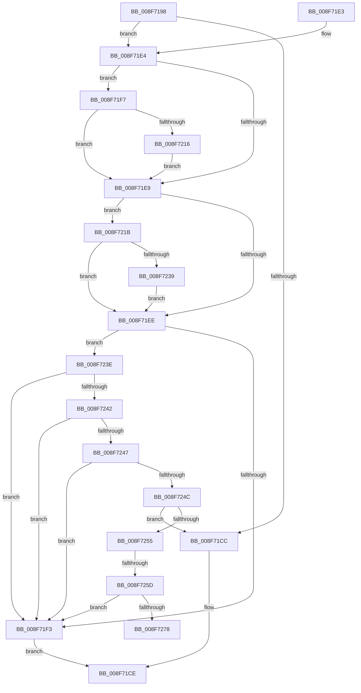

# SepCompareClaimAttributes

- RVA: `0x008F7198`–`0x008F727D` (길이 `229` bytes)
- VA: `0x00000001408F7198`
- 실행 섹션: `PAGE`
- PDB 이름 있음: `예`; PDB Function 태그: `예`
- unwind 정보 RVA: `0x00087A24`
- 디코드: `67`개 명령, `229/229` bytes 표시
- 미해석 바이트: `0` (있으면 어셈블리에 `.byte`로 보존)

> 이 문서는 커널 이미지의 기계어와 PDB 기호를 분석해 생성했습니다. 4번과 5번은 함수 원형과 자료형을 바이너리 사용 방식에서 추정한 C 해석이며 원본 소스 복구 결과는 아닙니다.

## 1. Dependencies

- 직접 호출 지점: **1**; 고유 호출 대상: **1**
- 직접 호출자로 확인된 함수: **2**
- RIP 상대 이미지 참조: **0**

### Outgoing calls
- `0x008F726B` → [AuthzBasepCompareSecurityAttributesInformation](../82/AuthzBasepCompareSecurityAttributesInformation_function_00821D94.md) (function, `0x00821D94`)

### Direct callers
- [SeCompareTokens](SeCompareTokens_function_008F6F40.md) at `0x008F70A6`
- [sub_00B3F52A](../B3/Unknown_function_00B3F52A.md) at `0x00B3F5E9`

### Static image references
- 디코드된 RIP-relative 메모리 참조가 없습니다.

## 2. Other-region calls and transfers

- 다른 실행 섹션으로 향하는 call: **0**
- call이 아닌 외부 분기/꼬리 이동: **2**
  - `0x008F7257` → [sub_00B1F008](../B1/Unknown_function_00B1F008.md) (`tail-transfer`)
  - `0x008F7278` → [sub_00B1F008](../B1/Unknown_function_00B1F008.md) (`tail-transfer`)

## 3. Assembly (complete function range)

```asm
008F7198  48 89 5C 24 08                  mov qword ptr [rsp + 8], rbx
008F719D  48 89 6C 24 10                  mov qword ptr [rsp + 0x10], rbp
008F71A2  48 89 74 24 18                  mov qword ptr [rsp + 0x18], rsi
008F71A7  57                              push rdi
008F71A8  48 83 EC 20                     sub rsp, 0x20
008F71AC  48 8B DA                        mov rbx, rdx
008F71AF  48 8B F9                        mov rdi, rcx
008F71B2  32 C9                           xor cl, cl
008F71B4  32 D2                           xor dl, dl
008F71B6  45 32 C0                        xor r8b, r8b
008F71B9  45 32 C9                        xor r9b, r9b
008F71BC  32 C0                           xor al, al
008F71BE  40 32 F6                        xor sil, sil
008F71C1  40 32 ED                        xor bpl, bpl
008F71C4  45 32 D2                        xor r10b, r10b
008F71C7  48 3B FB                        cmp rdi, rbx
008F71CA  75 18                           jne 0x1408f71e4
008F71CC  B0 01                           mov al, 1
008F71CE  48 8B 5C 24 30                  mov rbx, qword ptr [rsp + 0x30]
008F71D3  48 8B 6C 24 38                  mov rbp, qword ptr [rsp + 0x38]
008F71D8  48 8B 74 24 40                  mov rsi, qword ptr [rsp + 0x40]
008F71DD  48 83 C4 20                     add rsp, 0x20
008F71E1  5F                              pop rdi
008F71E2  C3                              ret
008F71E3  CC                              int3
008F71E4  48 85 FF                        test rdi, rdi
008F71E7  75 0E                           jne 0x1408f71f7
008F71E9  48 85 DB                        test rbx, rbx
008F71EC  75 2D                           jne 0x1408f721b
008F71EE  45 3A C1                        cmp r8b, r9b
008F71F1  74 4B                           je 0x1408f723e
008F71F3  32 C0                           xor al, al
008F71F5  EB D7                           jmp 0x1408f71ce
008F71F7  48 83 BF 40 02 00 00 00         cmp qword ptr [rdi + 0x240], 0
008F71FF  41 B0 01                        mov r8b, 1
008F7202  0F 95 C0                        setne al
008F7205  48 83 BF 48 02 00 00 00         cmp qword ptr [rdi + 0x248], 0
008F720D  40 0F 95 C6                     setne sil
008F7211  83 3F 00                        cmp dword ptr [rdi], 0
008F7214  74 D3                           je 0x1408f71e9
008F7216  41 8A E8                        mov bpl, r8b
008F7219  EB CE                           jmp 0x1408f71e9
008F721B  48 83 BB 40 02 00 00 00         cmp qword ptr [rbx + 0x240], 0
008F7223  41 B1 01                        mov r9b, 1
008F7226  0F 95 C1                        setne cl
008F7229  48 83 BB 48 02 00 00 00         cmp qword ptr [rbx + 0x248], 0
008F7231  0F 95 C2                        setne dl
008F7234  83 3B 00                        cmp dword ptr [rbx], 0
008F7237  74 B5                           je 0x1408f71ee
008F7239  45 8A D1                        mov r10b, r9b
008F723C  EB B0                           jmp 0x1408f71ee
008F723E  3A C1                           cmp al, cl
008F7240  75 B1                           jne 0x1408f71f3
008F7242  40 3A F2                        cmp sil, dl
008F7245  75 AC                           jne 0x1408f71f3
008F7247  41 3A EA                        cmp bpl, r10b
008F724A  75 A7                           jne 0x1408f71f3
008F724C  45 84 C0                        test r8b, r8b
008F724F  0F 84 77 FF FF FF               je 0x1408f71cc
008F7255  84 C0                           test al, al
008F7257  0F 84 AB 7D 22 00               je 0x140b1f008
008F725D  48 8B 93 40 02 00 00            mov rdx, qword ptr [rbx + 0x240]
008F7264  48 8B 8F 40 02 00 00            mov rcx, qword ptr [rdi + 0x240]
008F726B  E8 24 AB F2 FF                  call 0x140821d94
008F7270  84 C0                           test al, al
008F7272  0F 84 7B FF FF FF               je 0x1408f71f3
008F7278  E9 8B 7D 22 00                  jmp 0x140b1f008
```

## 4. C-style interpretation (structured pseudocode)

```c
__int64 __fastcall SepCompareClaimAttributes(__int64 a1, __int64 a2, unsigned __int8 a3, unsigned __int8 a4)
{
    __int64 result;
    __int64 v_r10;
    __int64 v_rbp;
    __int64 v_rsi;
    __int64 v_rsp;
    unsigned __int64 v_stack_p10;
    unsigned __int64 v_stack_p18;
    unsigned __int64 v_stack_p8;

    v_stack_p8 = v_rbx;
    v_stack_p10 = v_rbp;
    v_stack_p18 = v_rsi;
    v_rsp = (v_rsp) - (32);
    a1 = 0;
    a2 = 0;
    a3 = 0;
    a4 = 0;
    result = 0;
    v_rsi = 0;
    v_rbp = 0;
    v_r10 = 0;
    if (0 != 0) goto loc_008F71E4;
loc_008F71CC:
loc_008F71CE:
    v_rsp = (v_rsp) + (32);
    return 1;
loc_008F71E4:
    if (0 != 0) goto loc_008F71F7;
loc_008F71E9:
    if (v_stack_p8 != 0) goto loc_008F721B;
loc_008F71EE:
    if (0 == 0) goto loc_008F723E;
loc_008F71F3:
    result = 0;
    goto loc_008F71CE;
loc_008F71F7:
    result = ((*(unsigned __int64 *)(a1 + 576)) != 0) ? 1 : 0;
    v_rsi = ((*(unsigned __int64 *)(a1 + 584)) != 0) ? 1 : 0;
    if ((*(unsigned int *)(a1)) == 0) goto loc_008F71E9;
    goto loc_008F71E9;
loc_008F721B:
    a1 = ((*(unsigned __int64 *)(v_stack_p8 + 576)) != 0) ? 1 : 0;
    a2 = ((*(unsigned __int64 *)(v_stack_p8 + 584)) != 0) ? 1 : 0;
    if ((*(unsigned int *)(v_stack_p8)) == 0) goto loc_008F71EE;
    goto loc_008F71EE;
loc_008F723E:
    if (((unsigned __int8)(result)) != ((unsigned __int8)(a1))) goto loc_008F71F3;
    if (((unsigned __int8)(v_rsi)) != ((unsigned __int8)(a2))) goto loc_008F71F3;
    if (1 != 1) goto loc_008F71F3;
    if (1 == 0) goto loc_008F71CC;
    result = AuthzBasepCompareSecurityAttributesInformation(*(unsigned __int64 *)(a1 + 576), *(unsigned __int64 *)(v_stack_p8 + 576), 1, 1);
    if ((unsigned __int8)(result) == 0) goto loc_008F71F3;
}
```

## 5. (Beta) C Style

```c
int64_t SepCompareClaimAttributes(int64_t Arg1, int64_t Arg2, uint8_t Arg3, uint8_t Arg4)
{
    int64_t result;
    int64_t local_r10;
    int64_t local_rbp;
    int64_t local_rsi;
    int64_t local_rsp;
    uint64_t v_stack_p10;
    uint64_t v_stack_p18;
    uint64_t v_stack_p8;

    v_stack_p8 = local_rbx;
    v_stack_p10 = local_rbp;
    v_stack_p18 = local_rsi;
    local_rsp = (local_rsp) - (32);
    Arg1 = 0;
    Arg2 = 0;
    Arg3 = 0;
    Arg4 = 0;
    result = 0;
    local_rsi = 0;
    local_rbp = 0;
    local_r10 = 0;
    if (0 != 0) goto loc_008F71E4;
loc_008F71CC:
loc_008F71CE:
    local_rsp = (local_rsp) + (32);
    return 1;
loc_008F71E4:
    if (0 != 0) goto loc_008F71F7;
loc_008F71E9:
    if (v_stack_p8 != 0) goto loc_008F721B;
loc_008F71EE:
    if (0 == 0) goto loc_008F723E;
loc_008F71F3:
    result = 0;
    goto loc_008F71CE;
loc_008F71F7:
    result = ((*(uint64_t *)(Arg1 + 0x240)) != 0) ? 1 : 0;
    local_rsi = ((*(uint64_t *)(Arg1 + 0x248)) != 0) ? 1 : 0;
    if ((*(uint32_t *)(Arg1)) == 0) goto loc_008F71E9;
    goto loc_008F71E9;
loc_008F721B:
    Arg1 = ((*(uint64_t *)(v_stack_p8 + 0x240)) != 0) ? 1 : 0;
    Arg2 = ((*(uint64_t *)(v_stack_p8 + 0x248)) != 0) ? 1 : 0;
    if ((*(uint32_t *)(v_stack_p8)) == 0) goto loc_008F71EE;
    goto loc_008F71EE;
loc_008F723E:
    if (((uint8_t)(result)) != ((uint8_t)(Arg1))) goto loc_008F71F3;
    if (((uint8_t)(local_rsi)) != ((uint8_t)(Arg2))) goto loc_008F71F3;
    if (1 != 1) goto loc_008F71F3;
    if (1 == 0) goto loc_008F71CC;
    result = AuthzBasepCompareSecurityAttributesInformation(*(uint64_t *)(Arg1 + 0x240), *(uint64_t *)(v_stack_p8 + 0x240), 1, 1);
    if ((uint8_t)(result) == 0) goto loc_008F71F3;
}
```

## 6. Execution-region graph

[열기: 2D/3D 그래프와 함수 탐색 컨트롤 패널](../../../control-panel.html?section=page&rva=0x008F7198&view=graph)

- 2D 그래프는 위에서 아래로 흐르고, 3D 그래프는 빈 공간을 드래그해 회전합니다. Shift+드래그는 이동, 휠은 확대·축소, 함수 노드 선택은 대상 보고서 이동입니다.

### Static fallback


