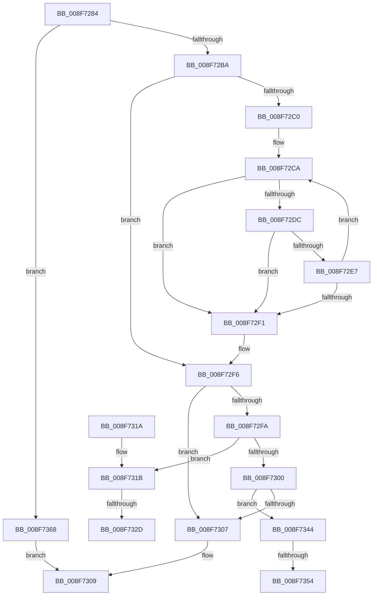

# SepCompareSidAndAttributeArrays

- RVA: `0x008F7284`–`0x008F736C` (길이 `232` bytes)
- VA: `0x00000001408F7284`
- 실행 섹션: `PAGE`
- PDB 이름 있음: `예`; PDB Function 태그: `예`
- unwind 정보 RVA: `0x00087A4C`
- 디코드: `83`개 명령, `232/232` bytes 표시
- 미해석 바이트: `0` (있으면 어셈블리에 `.byte`로 보존)

> 이 문서는 커널 이미지의 기계어와 PDB 기호를 분석해 생성했습니다. 4번과 5번은 함수 원형과 자료형을 바이너리 사용 방식에서 추정한 C 해석이며 원본 소스 복구 결과는 아닙니다.

## 1. Dependencies

- 직접 호출 지점: **1**; 고유 호출 대상: **1**
- 직접 호출자로 확인된 함수: **2**
- RIP 상대 이미지 참조: **0**

### Outgoing calls
- `0x008F72D3` → [RtlEqualSid](../../text/40/RtlEqualSid_function_00400AD0.md) (function, `0x00400AD0`)

### Direct callers
- [SeCompareTokens](SeCompareTokens_function_008F6F40.md) at `0x008F708F`
- [SeCompareTokens](SeCompareTokens_function_008F6F40.md) at `0x008F712E`
- [SeCompareTokens](SeCompareTokens_function_008F6F40.md) at `0x008F717F`
- [sub_00B1F008](../B1/Unknown_function_00B1F008.md) at `0x00B1F03E`

### Static image references
- 디코드된 RIP-relative 메모리 참조가 없습니다.

## 2. Other-region calls and transfers

- 다른 실행 섹션으로 향하는 call: **1**
  - `0x008F72D3` → [RtlEqualSid](../../text/40/RtlEqualSid_function_00400AD0.md) (`PAGE` → `.text`)
- call이 아닌 외부 분기/꼬리 이동: **4**
  - `0x008F7327` → [sub_00B1F050 + 0x34](../B1/Unknown_function_00B1F050.md) (`tail-transfer`)
  - `0x008F733F` → [sub_00B1F050](../B1/Unknown_function_00B1F050.md) (`tail-transfer`)
  - `0x008F734E` → [sub_00B1F050 + 0x80](../B1/Unknown_function_00B1F050.md) (`tail-transfer`)
  - `0x008F7363` → [sub_00B1F050 + 0x49](../B1/Unknown_function_00B1F050.md) (`tail-transfer`)

## 3. Assembly (complete function range)

```asm
008F7284  48 8B C4                        mov rax, rsp
008F7287  44 89 48 20                     mov dword ptr [rax + 0x20], r9d
008F728B  4C 89 40 18                     mov qword ptr [rax + 0x18], r8
008F728F  89 50 10                        mov dword ptr [rax + 0x10], edx
008F7292  48 89 48 08                     mov qword ptr [rax + 8], rcx
008F7296  53                              push rbx
008F7297  55                              push rbp
008F7298  56                              push rsi
008F7299  57                              push rdi
008F729A  41 54                           push r12
008F729C  41 55                           push r13
008F729E  41 56                           push r14
008F72A0  41 57                           push r15
008F72A2  48 83 EC 28                     sub rsp, 0x28
008F72A6  45 8B E1                        mov r12d, r9d
008F72A9  4D 8B E8                        mov r13, r8
008F72AC  8B FA                           mov edi, edx
008F72AE  48 8B C1                        mov rax, rcx
008F72B1  41 3B D1                        cmp edx, r9d
008F72B4  0F 85 AE 00 00 00               jne 0x1408f7368
008F72BA  33 DB                           xor ebx, ebx
008F72BC  85 D2                           test edx, edx
008F72BE  74 36                           je 0x1408f72f6
008F72C0  4C 8B F1                        mov r14, rcx
008F72C3  49 8D 70 08                     lea rsi, [r8 + 8]
008F72C7  4D 2B F0                        sub r14, r8
008F72CA  48 8B 56 F8                     mov rdx, qword ptr [rsi - 8]
008F72CE  49 8B 4C 36 F8                  mov rcx, qword ptr [r14 + rsi - 8]
008F72D3  E8 F8 97 B0 FF                  call 0x140400ad0
008F72D8  84 C0                           test al, al
008F72DA  74 15                           je 0x1408f72f1
008F72DC  41 8B 0C 36                     mov ecx, dword ptr [r14 + rsi]
008F72E0  33 0E                           xor ecx, dword ptr [rsi]
008F72E2  F6 C1 14                        test cl, 0x14
008F72E5  75 0A                           jne 0x1408f72f1
008F72E7  FF C3                           inc ebx
008F72E9  48 83 C6 10                     add rsi, 0x10
008F72ED  3B DF                           cmp ebx, edi
008F72EF  72 D9                           jb 0x1408f72ca
008F72F1  48 8B 44 24 70                  mov rax, qword ptr [rsp + 0x70]
008F72F6  3B DF                           cmp ebx, edi
008F72F8  74 0D                           je 0x1408f7307
008F72FA  8B EB                           mov ebp, ebx
008F72FC  3B EF                           cmp ebp, edi
008F72FE  72 1B                           jb 0x1408f731b
008F7300  8B F3                           mov esi, ebx
008F7302  41 3B F4                        cmp esi, r12d
008F7305  72 3D                           jb 0x1408f7344
008F7307  B0 01                           mov al, 1
008F7309  48 83 C4 28                     add rsp, 0x28
008F730D  41 5F                           pop r15
008F730F  41 5E                           pop r14
008F7311  41 5D                           pop r13
008F7313  41 5C                           pop r12
008F7315  5F                              pop rdi
008F7316  5E                              pop rsi
008F7317  5D                              pop rbp
008F7318  5B                              pop rbx
008F7319  C3                              ret
008F731A  CC                              int3
008F731B  44 8B FD                        mov r15d, ebp
008F731E  44 8B F3                        mov r14d, ebx
008F7321  4D 03 FF                        add r15, r15
008F7324  41 3B DC                        cmp ebx, r12d
008F7327  0F 83 57 7D 22 00               jae 0x140b1f084
008F732D  4A 8B 3C F8                     mov rdi, qword ptr [rax + r15*8]
008F7331  8B F3                           mov esi, ebx
008F7333  48 C1 E6 04                     shl rsi, 4
008F7337  49 03 F5                        add rsi, r13
008F733A  4C 8B 6C 24 70                  mov r13, qword ptr [rsp + 0x70]
008F733F  E9 0C 7D 22 00                  jmp 0x140b1f050
008F7344  44 8B FE                        mov r15d, esi
008F7347  8B EB                           mov ebp, ebx
008F7349  4D 03 FF                        add r15, r15
008F734C  3B DF                           cmp ebx, edi
008F734E  0F 83 7C 7D 22 00               jae 0x140b1f0d0
008F7354  4F 8B 64 FD 00                  mov r12, qword ptr [r13 + r15*8]
008F7359  44 8B F3                        mov r14d, ebx
008F735C  49 C1 E6 04                     shl r14, 4
008F7360  4C 03 F0                        add r14, rax
008F7363  E9 31 7D 22 00                  jmp 0x140b1f099
008F7368  32 C0                           xor al, al
008F736A  EB 9D                           jmp 0x1408f7309
```

## 4. C-style interpretation (structured pseudocode)

```c
__int64 __fastcall SepCompareSidAndAttributeArrays(__int64 a1, int a2, __int64 a3, int a4)
{
    __int64 result;
    __int64 v_r14;
    __int64 v_r15;
    __int64 v_rbx;
    __int64 v_rsi;
    __int64 v_rsp;
    unsigned __int64 v_stack_p70;
    unsigned __int64 v_stack_p8;

    *(unsigned int *)(v_rsp + 32) = a4;
    *(unsigned __int64 *)(v_rsp + 24) = a3;
    *(unsigned int *)(v_rsp + 16) = a2;
    *(unsigned __int64 *)(v_rsp + 8) = a1;
    v_rsp = (v_rsp) - (40);
    if (a2 != a4) goto loc_008F7368;
    v_rbx = 0;
    if (a2 == 0) goto loc_008F72F6;
    v_r14 = (a1) - (a3);
loc_008F72CA:
    result = RtlEqualSid(*(unsigned __int64 *)(v_r14 + a3 + 8 * 1 - 8), *(unsigned __int64 *)(a3 + 8 - 8), a3, a4);
    if ((unsigned __int8)(result) == 0) goto loc_008F72F1;
    a1 = (unsigned int)(((unsigned int)(*(unsigned int *)(v_r14 + a3 + 8 * 1))) ^ (*(unsigned int *)(a3 + 8)));
    if ((((unsigned __int8)(a1)) & (20)) != 0) goto loc_008F72F1;
    v_rbx = (unsigned int)((v_rbx) + 1);
    v_rsi = (a3 + 8) + (16);
    if (((unsigned int)(v_rbx)) < ((unsigned int)((unsigned int)(a2)))) goto loc_008F72CA;
loc_008F72F1:
loc_008F72F6:
    if (((unsigned int)(v_rbx)) == ((unsigned int)((unsigned int)(a2)))) goto loc_008F7307;
    if (((unsigned int)((unsigned int)((unsigned int)(v_rbx)))) < ((unsigned int)((unsigned int)(a2)))) goto loc_008F731B;
    if (((unsigned int)((unsigned int)((unsigned int)(v_rbx)))) < ((unsigned int)((unsigned int)(a4)))) goto loc_008F7344;
loc_008F7307:
loc_008F7309:
    v_rsp = (v_rsp) + (40);
    return 1;
loc_008F731B:
    v_r15 = ((unsigned int)((unsigned int)((unsigned int)((unsigned int)(v_rbx))))) + ((unsigned int)((unsigned int)((unsigned int)((unsigned int)(v_rbx)))));
    v_rsi = ((unsigned int)((unsigned int)(v_rbx))) << (4);
    v_rsi = (v_rsi) + (a3);
loc_008F7344:
    v_r15 = ((unsigned int)((unsigned int)(v_rsi))) + ((unsigned int)((unsigned int)(v_rsi)));
    v_r14 = ((unsigned int)((unsigned int)(v_rbx))) << (4);
    v_r14 = (v_r14) + (1);
loc_008F7368:
    result = 0;
    goto loc_008F7309;
}
```

## 5. (Beta) C Style

```c
int64_t SepCompareSidAndAttributeArrays(void *Arg1, int32_t Arg2, void *Arg3, int32_t Arg4)
{
    uint8_t *arg1 = (uint8_t *)Arg1;
    uint8_t *arg3 = (uint8_t *)Arg3;

    int64_t result;
    int64_t local_r14;
    int64_t local_r15;
    int64_t local_rbx;
    int64_t local_rsi;
    int64_t local_rsp;
    uint64_t v_stack_p70;
    uint64_t v_stack_p8;

    *(uint32_t *)(local_rsp + 0x20) = Arg4;
    *(void **)(local_rsp + 0x18) = Arg3;
    *(uint32_t *)(local_rsp + 0x10) = Arg2;
    *(void **)(local_rsp + 0x8) = Arg1;
    local_rsp = (local_rsp) - (40);
    if (Arg2 != Arg4) goto loc_008F7368;
    local_rbx = 0;
    if (Arg2 == 0) goto loc_008F72F6;
    local_r14 = (Arg1) - (Arg3);
loc_008F72CA:
    result = RtlEqualSid(*(uint64_t *)(local_r14 + arg3 + 0x8 * 1 - 0x8), *(uint64_t *)(arg3 + 0x8 - 0x8), Arg3, Arg4);
    if ((uint8_t)(result) == 0) goto loc_008F72F1;
    Arg1 = (uint32_t)(((uint32_t)(*(uint32_t *)(local_r14 + arg3 + 0x8 * 1))) ^ (*(uint32_t *)(arg3 + 0x8)));
    if ((((uint8_t)(Arg1)) & (20)) != 0) goto loc_008F72F1;
    local_rbx = (uint32_t)((local_rbx) + 1);
    local_rsi = (Arg3 + 8) + (16);
    if (((uint32_t)(local_rbx)) < ((uint32_t)((uint32_t)(Arg2)))) goto loc_008F72CA;
loc_008F72F1:
loc_008F72F6:
    if (((uint32_t)(local_rbx)) == ((uint32_t)((uint32_t)(Arg2)))) goto loc_008F7307;
    if (((uint32_t)((uint32_t)((uint32_t)(local_rbx)))) < ((uint32_t)((uint32_t)(Arg2)))) goto loc_008F731B;
    if (((uint32_t)((uint32_t)((uint32_t)(local_rbx)))) < ((uint32_t)((uint32_t)(Arg4)))) goto loc_008F7344;
loc_008F7307:
loc_008F7309:
    local_rsp = (local_rsp) + (40);
    return 1;
loc_008F731B:
    local_r15 = ((uint32_t)((uint32_t)((uint32_t)((uint32_t)(local_rbx))))) + ((uint32_t)((uint32_t)((uint32_t)((uint32_t)(local_rbx)))));
    local_rsi = ((uint32_t)((uint32_t)(local_rbx))) << (4);
    local_rsi = (local_rsi) + (Arg3);
loc_008F7344:
    local_r15 = ((uint32_t)((uint32_t)(local_rsi))) + ((uint32_t)((uint32_t)(local_rsi)));
    local_r14 = ((uint32_t)((uint32_t)(local_rbx))) << (4);
    local_r14 = (local_r14) + (1);
loc_008F7368:
    result = 0;
    goto loc_008F7309;
}
```

### 관측된 메모리 오프셋

구조체 형식이 확인되지 않은 접근은 인자 기준의 오프셋으로만 기록했습니다.

| 기준 인자 | 오프셋 표현 | 폭 (bit) | 접근 |
|---|---:|---:|---|
| `Arg1` | `- 0x8 + rsi*1` | `64` | `R` |
| `Arg1` | `+ 0x0 + rsi*1` | `32` | `R` |
| `Arg3` | `- 0x8` | `64` | `R` |
| `Arg3` | `+ 0x0` | `32` | `R` |
| `Arg3` | `+ 0x0 + r15*8` | `64` | `R` |
| `Arg3` | `+ 0x8` | `64` | `R` |

## 6. Execution-region graph

[열기: 2D/3D 그래프와 함수 탐색 컨트롤 패널](../../../control-panel.html?section=page&rva=0x008F7284&view=graph)

- 2D 그래프는 위에서 아래로 흐르고, 3D 그래프는 빈 공간을 드래그해 회전합니다. Shift+드래그는 이동, 휠은 확대·축소, 함수 노드 선택은 대상 보고서 이동입니다.

### Static fallback


