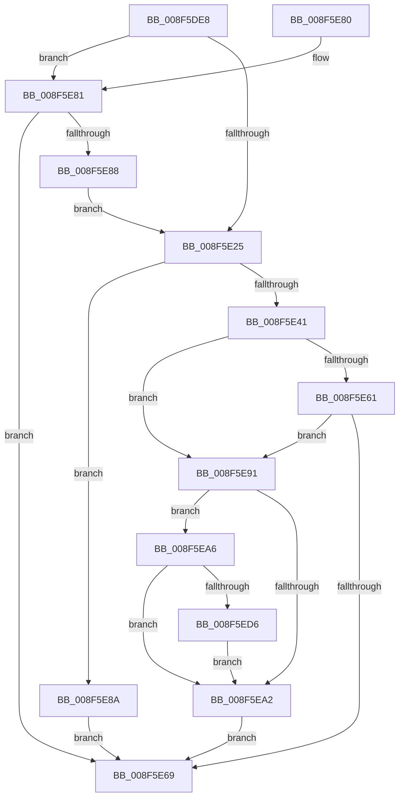

# SepQueryNameString

- RVA: `0x008F5DE8`–`0x008F5EE3` (길이 `251` bytes)
- VA: `0x00000001408F5DE8`
- 실행 섹션: `PAGE`
- PDB 이름 있음: `예`; PDB Function 태그: `아니요`
- unwind 정보 RVA: `0x0008789C`
- 디코드: `74`개 명령, `251/251` bytes 표시
- 미해석 바이트: `0` (있으면 어셈블리에 `.byte`로 보존)

> 이 문서는 커널 이미지의 기계어와 PDB 기호를 분석해 생성했습니다. 4번과 5번은 함수 원형과 자료형을 바이너리 사용 방식에서 추정한 C 해석이며 원본 소스 복구 결과는 아닙니다.

## 1. Dependencies

- 직접 호출 지점: **5**; 고유 호출 대상: **4**
- 직접 호출자로 확인된 함수: **7**
- RIP 상대 이미지 참조: **3**

### Outgoing calls
- `0x008F5E17` → [ObQueryNameStringMode](../8A/ObQueryNameStringMode_function_008A7ED0.md) (function, `0x008A7ED0`)
- `0x008F5E34` → [ExAllocatePool2](../../poolcode/B8/ExAllocatePool2_function_00B820F0.md) (function, `0x00B820F0`)
- `0x008F5E56` → [ObQueryNameStringMode](../8A/ObQueryNameStringMode_function_008A7ED0.md) (function, `0x008A7ED0`)
- `0x008F5E96` → [ExFreePoolWithTag](../../poolcode/B8/ExFreePoolWithTag_function_00B82870.md) (function, `0x00B82870`)
- `0x008F5EDC` → [PsGetAllocatedFullProcessImageNameEx](../91/PsGetAllocatedFullProcessImageNameEx_function_0091D6F0.md) (function, `0x0091D6F0`)

### Direct callers
- [SeAdtRegistryValueChangedAuditAlarm](../79/SeAdtRegistryValueChangedAuditAlarm_function_0079DDD4.md) at `0x0079DF9F`
- [SepAdtObjectReferenceAuditAlarm](../79/SepAdtObjectReferenceAuditAlarm_function_0079F27C.md) at `0x0079F33E`
- [sub_0086E7EE](../86/Unknown_function_0086E7EE.md) at `0x0086E8D2`
- [SepValidateReferencedCachedHandles](SepValidateReferencedCachedHandles_function_008F4BB0.md) at `0x008F4CE9`
- [SeOperationAuditAlarm](../91/SeOperationAuditAlarm_function_0091EA78.md) at `0x0091ECA8`
- [SeSecurityDescriptorChangedAuditAlarm](../91/SeSecurityDescriptorChangedAuditAlarm_function_0091FC5C.md) at `0x00920035`
- [sub_00B29542](../B2/Unknown_function_00B29542.md) at `0x00B2959C`

### Static image references
- `0x008F5EAE` → RVA `0x00FC7800` (`ALMOSTRO`; read)
- `0x008F5EBF` → RVA `0x00FC6E4C` (`ALMOSTRO`; read)
- `0x008F5EC9` → RVA `0x00FC6A98` (`ALMOSTRO`; read)

## 2. Other-region calls and transfers

- 다른 실행 섹션으로 향하는 call: **2**
  - `0x008F5E34` → [ExAllocatePool2](../../poolcode/B8/ExAllocatePool2_function_00B820F0.md) (`PAGE` → `POOLCODE`)
  - `0x008F5E96` → [ExFreePoolWithTag](../../poolcode/B8/ExFreePoolWithTag_function_00B82870.md) (`PAGE` → `POOLCODE`)
- 별도 외부 분기/꼬리 이동을 확인하지 못했습니다.

## 3. Assembly (complete function range)

```asm
008F5DE8  48 8B C4                        mov rax, rsp
008F5DEB  48 89 58 08                     mov qword ptr [rax + 8], rbx
008F5DEF  48 89 68 18                     mov qword ptr [rax + 0x18], rbp
008F5DF3  48 89 70 20                     mov qword ptr [rax + 0x20], rsi
008F5DF7  57                              push rdi
008F5DF8  48 83 EC 30                     sub rsp, 0x30
008F5DFC  33 ED                           xor ebp, ebp
008F5DFE  4C 8D 48 10                     lea r9, [rax + 0x10]
008F5E02  48 89 2A                        mov qword ptr [rdx], rbp
008F5E05  48 8B FA                        mov rdi, rdx
008F5E08  33 D2                           xor edx, edx
008F5E0A  89 68 10                        mov dword ptr [rax + 0x10], ebp
008F5E0D  45 33 C0                        xor r8d, r8d
008F5E10  40 88 68 E8                     mov byte ptr [rax - 0x18], bpl
008F5E14  48 8B F1                        mov rsi, rcx
008F5E17  E8 B4 20 FB FF                  call 0x1408a7ed0
008F5E1C  8B D8                           mov ebx, eax
008F5E1E  3D 04 00 00 C0                  cmp eax, 0xc0000004
008F5E23  75 5C                           jne 0x1408f5e81
008F5E25  8B 54 24 48                     mov edx, dword ptr [rsp + 0x48]
008F5E29  B9 00 01 00 00                  mov ecx, 0x100
008F5E2E  41 B8 53 65 4F 6E               mov r8d, 0x6e4f6553
008F5E34  E8 B7 C2 28 00                  call 0x140b820f0
008F5E39  48 89 07                        mov qword ptr [rdi], rax
008F5E3C  48 85 C0                        test rax, rax
008F5E3F  74 49                           je 0x1408f5e8a
008F5E41  44 8B 44 24 48                  mov r8d, dword ptr [rsp + 0x48]
008F5E46  4C 8D 4C 24 48                  lea r9, [rsp + 0x48]
008F5E4B  48 8B D0                        mov rdx, rax
008F5E4E  40 88 6C 24 20                  mov byte ptr [rsp + 0x20], bpl
008F5E53  48 8B CE                        mov rcx, rsi
008F5E56  E8 75 20 FB FF                  call 0x1408a7ed0
008F5E5B  8B D8                           mov ebx, eax
008F5E5D  85 C0                           test eax, eax
008F5E5F  78 30                           js 0x1408f5e91
008F5E61  48 8B 07                        mov rax, qword ptr [rdi]
008F5E64  66 39 28                        cmp word ptr [rax], bp
008F5E67  74 28                           je 0x1408f5e91
008F5E69  48 8B 6C 24 50                  mov rbp, qword ptr [rsp + 0x50]
008F5E6E  8B C3                           mov eax, ebx
008F5E70  48 8B 5C 24 40                  mov rbx, qword ptr [rsp + 0x40]
008F5E75  48 8B 74 24 58                  mov rsi, qword ptr [rsp + 0x58]
008F5E7A  48 83 C4 30                     add rsp, 0x30
008F5E7E  5F                              pop rdi
008F5E7F  C3                              ret
008F5E80  CC                              int3
008F5E81  3D 23 00 00 C0                  cmp eax, 0xc0000023
008F5E86  75 E1                           jne 0x1408f5e69
008F5E88  EB 9B                           jmp 0x1408f5e25
008F5E8A  BB 9A 00 00 C0                  mov ebx, 0xc000009a
008F5E8F  EB D8                           jmp 0x1408f5e69
008F5E91  48 8B 0F                        mov rcx, qword ptr [rdi]
008F5E94  33 D2                           xor edx, edx
008F5E96  E8 D5 C9 28 00                  call 0x140b82870
008F5E9B  48 89 2F                        mov qword ptr [rdi], rbp
008F5E9E  85 DB                           test ebx, ebx
008F5EA0  79 04                           jns 0x1408f5ea6
008F5EA2  8B DD                           mov ebx, ebp
008F5EA4  EB C3                           jmp 0x1408f5e69
008F5EA6  48 8D 46 D0                     lea rax, [rsi - 0x30]
008F5EAA  48 C1 E8 08                     shr rax, 8
008F5EAE  48 8D 0D 4B 19 6D 00            lea rcx, [rip + 0x6d194b]
008F5EB5  0F B6 D0                        movzx edx, al
008F5EB8  0F B6 46 E8                     movzx eax, byte ptr [rsi - 0x18]
008F5EBC  48 33 D0                        xor rdx, rax
008F5EBF  0F B6 05 86 0F 6D 00            movzx eax, byte ptr [rip + 0x6d0f86]
008F5EC6  48 33 D0                        xor rdx, rax
008F5EC9  48 8B 05 C8 0B 6D 00            mov rax, qword ptr [rip + 0x6d0bc8]
008F5ED0  48 39 04 D1                     cmp qword ptr [rcx + rdx*8], rax
008F5ED4  75 CC                           jne 0x1408f5ea2
008F5ED6  48 8B D7                        mov rdx, rdi
008F5ED9  48 8B CE                        mov rcx, rsi
008F5EDC  E8 0F 78 02 00                  call 0x14091d6f0
008F5EE1  EB BF                           jmp 0x1408f5ea2
```

## 4. C-style interpretation (structured pseudocode)

```c
__int64 __fastcall SepQueryNameString(__int64 a1, __int64 a2, int a3)
{
    __int64 result;
    __int64 v_rbp;
    __int64 v_rsp;
    unsigned __int8 v_stack_m18;
    unsigned int v_stack_p10;
    unsigned __int64 v_stack_p18;
    unsigned __int64 v_stack_p20;
    unsigned __int64 v_stack_p8;

    *(unsigned __int64 *)(v_rsp + 8) = v_rbx;
    *(unsigned __int64 *)(v_rsp + 24) = v_rbp;
    *(unsigned __int64 *)(v_rsp + 32) = v_rsi;
    v_rsp = (v_rsp) - (48);
    v_rbp = 0;
    *(unsigned __int64 *)(a2) = 0;
    a2 = 0;
    *(unsigned int *)(v_rsp + 16) = 0;
    a3 = 0;
    *(unsigned __int8 *)(v_rsp - 24) = 0;
    result = ObQueryNameStringMode(a1, a2, a3, v_rsp + 16);
    if (((unsigned int)(result)) != 0xC0000004ULL) goto loc_008F5E81;
loc_008F5E25:
    result = ExAllocatePool2(256, (unsigned int)(v_stack_p10), (unsigned int)(0x6E4F6553ULL), v_rsp + 16);
    *(unsigned __int64 *)(a2) = result;
    if (result == 0) goto loc_008F5E8A;
    v_stack_m18 = 0;
    result = ObQueryNameStringMode(a1, result, (unsigned int)(v_stack_p10), v_stack_p10);
    if (sign_flag) goto loc_008F5E91;
    if ((*(unsigned __int16 *)(*(unsigned __int64 *)(a2))) == 0) goto loc_008F5E91;
loc_008F5E69:
    v_rsp = (v_rsp) + (48);
    return (unsigned int)((unsigned int)((unsigned int)((unsigned int)(result))));
loc_008F5E81:
    if (((unsigned int)((unsigned int)((unsigned int)((unsigned int)((unsigned int)(result)))))) != 0xC0000023ULL) goto loc_008F5E69;
    goto loc_008F5E25;
loc_008F5E8A:
    goto loc_008F5E69;
loc_008F5E91:
    a2 = 0;
    result = ExFreePoolWithTag(*(unsigned __int64 *)(a2), a2, (unsigned int)(v_stack_p10), v_stack_p10);
    *(unsigned __int64 *)(a2) = v_stack_p18;
    if (!sign_flag) goto loc_008F5EA6;
loc_008F5EA2:
    goto loc_008F5E69;
loc_008F5EA6:
    result = (v_stack_p20 - 48) >> (8);
    a2 = ((unsigned __int8)(result)) ^ (*(unsigned __int8 *)(v_stack_p20 - 24));
    a2 = (a2) ^ (*(unsigned __int8 *)(v_rip + 7147398));
    if ((*(unsigned __int64 *)(v_rip + 7149899 + a2 * 8)) != (*(unsigned __int64 *)(v_rip + 7146440))) goto loc_008F5EA2;
    result = PsGetAllocatedFullProcessImageNameEx(v_stack_p20, a2, (unsigned int)(v_stack_p10), v_stack_p10);
    goto loc_008F5EA2;
}
```

## 5. (Beta) C Style

```c
int64_t SepQueryNameString(void *Arg1, void *Arg2, int32_t Arg3)
{
    uint8_t *arg1 = (uint8_t *)Arg1;
    uint8_t *arg2 = (uint8_t *)Arg2;

    int64_t result;
    int64_t local_rbp;
    int64_t local_rsp;
    uint8_t v_stack_m18;
    uint32_t v_stack_p10;
    uint64_t v_stack_p18;
    uint64_t v_stack_p20;
    uint64_t v_stack_p8;

    *(uint64_t *)(local_rsp + 0x8) = local_rbx;
    *(uint64_t *)(local_rsp + 0x18) = local_rbp;
    *(uint64_t *)(local_rsp + 0x20) = local_rsi;
    local_rsp = (local_rsp) - (48);
    local_rbp = 0;
    *(uint64_t *)(arg2) = 0;
    Arg2 = 0;
    *(uint32_t *)(local_rsp + 0x10) = 0;
    Arg3 = 0;
    *(uint8_t *)(local_rsp - 0x18) = 0;
    result = ObQueryNameStringMode(Arg1, Arg2, Arg3, local_rsp + 16);
    if (((uint32_t)(result)) != 0xC0000004ULL) goto loc_008F5E81;
loc_008F5E25:
    result = ExAllocatePool2(256, (uint32_t)(v_stack_p10), (uint32_t)(0x6E4F6553ULL), local_rsp + 16);
    *(uint64_t *)(arg2) = result;
    if (result == 0) goto loc_008F5E8A;
    v_stack_m18 = 0;
    result = ObQueryNameStringMode(Arg1, result, (uint32_t)(v_stack_p10), v_stack_p10);
    if (sign_flag) goto loc_008F5E91;
    if ((*(uint16_t *)(*(uint64_t *)(arg2))) == 0) goto loc_008F5E91;
loc_008F5E69:
    local_rsp = (local_rsp) + (48);
    return (uint32_t)((uint32_t)((uint32_t)((uint32_t)(result))));
loc_008F5E81:
    if (((uint32_t)((uint32_t)((uint32_t)((uint32_t)((uint32_t)(result)))))) != 0xC0000023ULL) goto loc_008F5E69;
    goto loc_008F5E25;
loc_008F5E8A:
    goto loc_008F5E69;
loc_008F5E91:
    Arg2 = 0;
    result = ExFreePoolWithTag(*(uint64_t *)(arg2), Arg2, (uint32_t)(v_stack_p10), v_stack_p10);
    *(uint64_t *)(arg2) = v_stack_p18;
    if (!sign_flag) goto loc_008F5EA6;
loc_008F5EA2:
    goto loc_008F5E69;
loc_008F5EA6:
    result = (v_stack_p20 - 48) >> (8);
    Arg2 = ((uint8_t)(result)) ^ (*(uint8_t *)(v_stack_p20 - 0x18));
    Arg2 = (Arg2) ^ (*(uint8_t *)(v_rip + 0x6D0F86));
    if ((*(uint64_t *)(v_rip + 0x6D194B + arg2 * 8)) != (*(uint64_t *)(v_rip + 0x6D0BC8))) goto loc_008F5EA2;
    result = PsGetAllocatedFullProcessImageNameEx(v_stack_p20, Arg2, (uint32_t)(v_stack_p10), v_stack_p10);
    goto loc_008F5EA2;
}
```

### 관측된 메모리 오프셋

구조체 형식이 확인되지 않은 접근은 인자 기준의 오프셋으로만 기록했습니다.

| 기준 인자 | 오프셋 표현 | 폭 (bit) | 접근 |
|---|---:|---:|---|
| `Arg1` | `- 0x30` | `64` | `R` |
| `Arg1` | `- 0x18` | `8` | `R` |
| `Arg2` | `+ 0x0` | `64` | `R` |
| `Arg2` | `+ 0x0` | `64` | `W` |

## 6. Execution-region graph

[열기: 2D/3D 그래프와 함수 탐색 컨트롤 패널](../../../control-panel.html?section=page&rva=0x008F5DE8&view=graph)

- 2D 그래프는 위에서 아래로 흐르고, 3D 그래프는 빈 공간을 드래그해 회전합니다. Shift+드래그는 이동, 휠은 확대·축소, 함수 노드 선택은 대상 보고서 이동입니다.

### Static fallback


