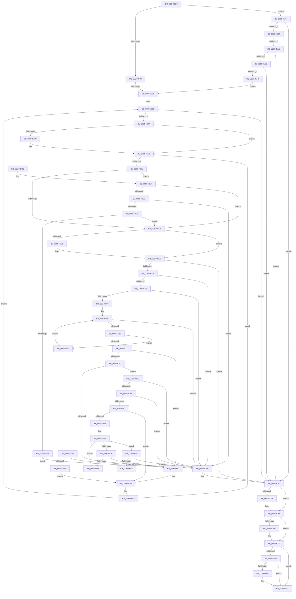

# SepValidateReferencedCachedHandles

- RVA: `0x008F4BB0`–`0x008F4F5F` (길이 `943` bytes)
- VA: `0x00000001408F4BB0`
- 실행 섹션: `PAGE`
- PDB 이름 있음: `예`; PDB Function 태그: `예`
- unwind 정보 RVA: `0x00087740`
- 디코드: `241`개 명령, `943/943` bytes 표시
- 미해석 바이트: `0` (있으면 어셈블리에 `.byte`로 보존)

> 이 문서는 커널 이미지의 기계어와 PDB 기호를 분석해 생성했습니다. 4번과 5번은 함수 원형과 자료형을 바이너리 사용 방식에서 추정한 C 해석이며 원본 소스 복구 결과는 아닙니다.

## 1. Dependencies

- 직접 호출 지점: **17**; 고유 호출 대상: **12**
- 직접 호출자로 확인된 함수: **1**
- RIP 상대 이미지 참조: **9**

### Outgoing calls
- `0x008F4C4F` → [ObfDereferenceObject](../../text/2F/ObfDereferenceObject_function_002F9350.md) (function, `0x002F9350`)
- `0x008F4C7A` → [ObReferenceObjectByHandle](../86/ObReferenceObjectByHandle_function_00868DB0.md) (function, `0x00868DB0`)
- `0x008F4CD7` → [ExFreePoolWithTag](../../poolcode/B8/ExFreePoolWithTag_function_00B82870.md) (function, `0x00B82870`)
- `0x008F4CE9` → [SepQueryNameString](SepQueryNameString_function_008F5DE8.md) (function, `0x008F5DE8`)
- `0x008F4D28` → [RtlPrefixUnicodeString](RtlPrefixUnicodeString_function_008F4F70.md) (function, `0x008F4F70`)
- `0x008F4D61` → [ExFreePoolWithTag](../../poolcode/B8/ExFreePoolWithTag_function_00B82870.md) (function, `0x00B82870`)
- `0x008F4D6E` → [ObfDereferenceObject](../../text/2F/ObfDereferenceObject_function_002F9350.md) (function, `0x002F9350`)
- `0x008F4D82` → [ExFreePool](../../poolcode/B8/ExFreePool_function_00B82850.md) (function, `0x00B82850`)
- `0x008F4D93` → [_security_check_cookie](../../text/6A/_security_check_cookie_function_006AC640.md) (function, `0x006AC640`)
- `0x008F4E17` → [RtlEqualUnicodeString](../93/RtlEqualUnicodeString_function_00932A20.md) (function, `0x00932A20`)
- `0x008F4E46` → [RtlEqualUnicodeString](../93/RtlEqualUnicodeString_function_00932A20.md) (function, `0x00932A20`)
- `0x008F4E88` → [RtlGetAppContainerSidType](../A7/RtlGetAppContainerSidType_function_00A72160.md) (function, `0x00A72160`)
- `0x008F4EB6` → [RtlConvertSidToUnicodeString](../92/RtlConvertSidToUnicodeString_function_00927B30.md) (function, `0x00927B30`)
- `0x008F4EE5` → [RtlStringCchPrintfW](../../text/48/RtlStringCchPrintfW_function_00482D5C.md) (function, `0x00482D5C`)
- `0x008F4EFC` → [RtlInitUnicodeString](../../text/42/RtlInitUnicodeString_function_0042A780.md) (function, `0x0042A780`)
- `0x008F4F10` → [RtlInitUnicodeString](../../text/42/RtlInitUnicodeString_function_0042A780.md) (function, `0x0042A780`)
- `0x008F4F3C` → [ExFreePoolWithTag](../../poolcode/B8/ExFreePoolWithTag_function_00B82870.md) (function, `0x00B82870`)

### Direct callers
- [SepSetTokenCachedHandles](../9A/SepSetTokenCachedHandles_function_009A939C.md) at `0x009A9423`

### Static image references
- `0x008F4BCF` → RVA `0x00E0A740` (`.data`; read)
- `0x008F4CA3` → RVA `0x00FC6E4C` (`ALMOSTRO`; read)
- `0x008F4CAD` → RVA `0x00000000` (`image boundary/outside`; read)
- `0x008F4CBC` → RVA `0x00F0F650` (`.data`; read)
- `0x008F4DB4` → RVA `0x00F0F658` (`.data`; read)
- `0x008F4DC1` → RVA `0x00FC6AE0` (`ALMOSTRO`; read)
- `0x008F4E2E` → RVA `0x00001BF0` (`.rdata`; read)
- `0x008F4ED2` → RVA `0x00B06150` (` ?? ::NNGAKEGL::`string'`; read)
- `0x008F4F01` → RVA `0x000115E8` (`.rdata`; read)

## 2. Other-region calls and transfers

- 다른 실행 섹션으로 향하는 call: **10**
  - `0x008F4C4F` → [ObfDereferenceObject](../../text/2F/ObfDereferenceObject_function_002F9350.md) (`PAGE` → `.text`)
  - `0x008F4CD7` → [ExFreePoolWithTag](../../poolcode/B8/ExFreePoolWithTag_function_00B82870.md) (`PAGE` → `POOLCODE`)
  - `0x008F4D61` → [ExFreePoolWithTag](../../poolcode/B8/ExFreePoolWithTag_function_00B82870.md) (`PAGE` → `POOLCODE`)
  - `0x008F4D6E` → [ObfDereferenceObject](../../text/2F/ObfDereferenceObject_function_002F9350.md) (`PAGE` → `.text`)
  - `0x008F4D82` → [ExFreePool](../../poolcode/B8/ExFreePool_function_00B82850.md) (`PAGE` → `POOLCODE`)
  - `0x008F4D93` → [_security_check_cookie](../../text/6A/_security_check_cookie_function_006AC640.md) (`PAGE` → `.text`)
  - `0x008F4EE5` → [RtlStringCchPrintfW](../../text/48/RtlStringCchPrintfW_function_00482D5C.md) (`PAGE` → `.text`)
  - `0x008F4EFC` → [RtlInitUnicodeString](../../text/42/RtlInitUnicodeString_function_0042A780.md) (`PAGE` → `.text`)
  - `0x008F4F10` → [RtlInitUnicodeString](../../text/42/RtlInitUnicodeString_function_0042A780.md) (`PAGE` → `.text`)
  - `0x008F4F3C` → [ExFreePoolWithTag](../../poolcode/B8/ExFreePoolWithTag_function_00B82870.md) (`PAGE` → `POOLCODE`)
- call이 아닌 외부 분기/꼬리 이동: **3**
  - `0x008F4C33` → [sub_00B1E93A](../B1/Unknown_function_00B1E93A.md) (`tail-transfer`)
  - `0x008F4EA6` → [sub_00B1E93A + 0x75](../B1/Unknown_function_00B1E93A.md) (`tail-transfer`)
  - `0x008F4F5A` → [sub_00B1E93A + 0x103](../B1/Unknown_function_00B1E93A.md) (`tail-transfer`)

## 3. Assembly (complete function range)

```asm
008F4BB0  48 89 5C 24 18                  mov qword ptr [rsp + 0x18], rbx
008F4BB5  55                              push rbp
008F4BB6  56                              push rsi
008F4BB7  57                              push rdi
008F4BB8  41 54                           push r12
008F4BBA  41 55                           push r13
008F4BBC  41 56                           push r14
008F4BBE  41 57                           push r15
008F4BC0  48 8D AC 24 20 FC FF FF         lea rbp, [rsp - 0x3e0]
008F4BC8  48 81 EC E0 04 00 00            sub rsp, 0x4e0
008F4BCF  48 8B 05 6A 5B 51 00            mov rax, qword ptr [rip + 0x515b6a]
008F4BD6  48 33 C4                        xor rax, rsp
008F4BD9  48 89 85 D0 03 00 00            mov qword ptr [rbp + 0x3d0], rax
008F4BE0  33 DB                           xor ebx, ebx
008F4BE2  48 89 54 24 70                  mov qword ptr [rsp + 0x70], rdx
008F4BE7  4C 8B FA                        mov r15, rdx
008F4BEA  4C 89 4C 24 60                  mov qword ptr [rsp + 0x60], r9
008F4BEF  4C 8B E9                        mov r13, rcx
008F4BF2  44 89 44 24 58                  mov dword ptr [rsp + 0x58], r8d
008F4BF7  0F 57 C0                        xorps xmm0, xmm0
008F4BFA  89 5C 24 44                     mov dword ptr [rsp + 0x44], ebx
008F4BFE  49 8B F1                        mov rsi, r9
008F4C01  88 5C 24 40                     mov byte ptr [rsp + 0x40], bl
008F4C05  41 8B 0F                        mov ecx, dword ptr [r15]
008F4C08  8B FB                           mov edi, ebx
008F4C0A  89 5C 24 5C                     mov dword ptr [rsp + 0x5c], ebx
008F4C0E  8B D3                           mov edx, ebx
008F4C10  48 89 5C 24 68                  mov qword ptr [rsp + 0x68], rbx
008F4C15  44 8B F3                        mov r14d, ebx
008F4C18  48 89 5C 24 50                  mov qword ptr [rsp + 0x50], rbx
008F4C1D  44 8B E3                        mov r12d, ebx
008F4C20  89 5C 24 48                     mov dword ptr [rsp + 0x48], ebx
008F4C24  0F 11 45 90                     movups xmmword ptr [rbp - 0x70], xmm0
008F4C28  85 C9                           test ecx, ecx
008F4C2A  0F 84 4F 02 00 00               je 0x1408f4e7f
008F4C30  83 F9 01                        cmp ecx, 1
008F4C33  0F 84 01 9D 22 00               je 0x140b1e93a
008F4C39  4C 8B 6C 24 50                  mov r13, qword ptr [rsp + 0x50]
008F4C3E  41 3B D0                        cmp edx, r8d
008F4C41  0F 83 0C 01 00 00               jae 0x1408f4d53
008F4C47  4D 85 F6                        test r14, r14
008F4C4A  74 0C                           je 0x1408f4c58
008F4C4C  49 8B CE                        mov rcx, r14
008F4C4F  E8 FC 46 A0 FF                  call 0x1402f9350
008F4C54  8B 54 24 44                     mov edx, dword ptr [rsp + 0x44]
008F4C58  8B C2                           mov eax, edx
008F4C5A  45 33 C9                        xor r9d, r9d
008F4C5D  48 89 5C 24 28                  mov qword ptr [rsp + 0x28], rbx
008F4C62  45 33 C0                        xor r8d, r8d
008F4C65  33 D2                           xor edx, edx
008F4C67  48 89 5C 24 50                  mov qword ptr [rsp + 0x50], rbx
008F4C6C  48 8B 0C C6                     mov rcx, qword ptr [rsi + rax*8]
008F4C70  48 8D 44 24 50                  lea rax, [rsp + 0x50]
008F4C75  48 89 44 24 20                  mov qword ptr [rsp + 0x20], rax
008F4C7A  E8 31 41 F7 FF                  call 0x140868db0
008F4C7F  4C 8B 74 24 50                  mov r14, qword ptr [rsp + 0x50]
008F4C84  8B F8                           mov edi, eax
008F4C86  85 C0                           test eax, eax
008F4C88  0F 88 CC 01 00 00               js 0x1408f4e5a
008F4C8E  49 8D 5E D0                     lea rbx, [r14 - 0x30]
008F4C92  48 8B C3                        mov rax, rbx
008F4C95  48 C1 E8 08                     shr rax, 8
008F4C99  0F B6 C8                        movzx ecx, al
008F4C9C  0F B6 43 18                     movzx eax, byte ptr [rbx + 0x18]
008F4CA0  48 33 C8                        xor rcx, rax
008F4CA3  0F B6 05 A2 21 6D 00            movzx eax, byte ptr [rip + 0x6d21a2]
008F4CAA  48 33 C8                        xor rcx, rax
008F4CAD  48 8D 05 4C B3 70 FF            lea rax, [rip - 0x8f4cb4]
008F4CB4  48 8B 84 C8 00 78 FC 00         mov rax, qword ptr [rax + rcx*8 + 0xfc7800]
008F4CBC  48 3B 05 8D A9 61 00            cmp rax, qword ptr [rip + 0x61a98d]
008F4CC3  0F 85 EB 00 00 00               jne 0x1408f4db4
008F4CC9  48 8B 4C 24 68                  mov rcx, qword ptr [rsp + 0x68]
008F4CCE  33 F6                           xor esi, esi
008F4CD0  48 85 C9                        test rcx, rcx
008F4CD3  74 0C                           je 0x1408f4ce1
008F4CD5  33 D2                           xor edx, edx
008F4CD7  E8 94 DB 28 00                  call 0x140b82870
008F4CDC  48 89 74 24 68                  mov qword ptr [rsp + 0x68], rsi
008F4CE1  48 8D 54 24 68                  lea rdx, [rsp + 0x68]
008F4CE6  49 8B CE                        mov rcx, r14
008F4CE9  E8 FA 10 00 00                  call 0x1408f5de8
008F4CEE  8B F8                           mov edi, eax
008F4CF0  85 C0                           test eax, eax
008F4CF2  78 5F                           js 0x1408f4d53
008F4CF4  48 8B 4C 24 68                  mov rcx, qword ptr [rsp + 0x68]
008F4CF9  48 85 C9                        test rcx, rcx
008F4CFC  74 50                           je 0x1408f4d4e
008F4CFE  66 39 71 02                     cmp word ptr [rcx + 2], si
008F4D02  74 4A                           je 0x1408f4d4e
008F4D04  0F 10 01                        movups xmm0, xmmword ptr [rcx]
008F4D07  33 C9                           xor ecx, ecx
008F4D09  F3 0F 7F 45 80                  movdqu xmmword ptr [rbp - 0x80], xmm0
008F4D0E  41 3B F4                        cmp esi, r12d
008F4D11  73 3B                           jae 0x1408f4d4e
008F4D13  8B C6                           mov eax, esi
008F4D15  48 8D 4D A0                     lea rcx, [rbp - 0x60]
008F4D19  41 B0 01                        mov r8b, 1
008F4D1C  48 8D 55 80                     lea rdx, [rbp - 0x80]
008F4D20  4C 8D 24 40                     lea r12, [rax + rax*2]
008F4D24  4A 8D 0C E1                     lea rcx, [rcx + r12*8]
008F4D28  E8 43 02 00 00                  call 0x1408f4f70
008F4D2D  33 C9                           xor ecx, ecx
008F4D2F  84 C0                           test al, al
008F4D31  0F 84 3C 01 00 00               je 0x1408f4e73
008F4D37  42 38 4C E5 B0                  cmp byte ptr [rbp + r12*8 - 0x50], cl
008F4D3C  0F 84 11 01 00 00               je 0x1408f4e53
008F4D42  0F B6 43 1A                     movzx eax, byte ptr [rbx + 0x1a]
008F4D46  A8 02                           test al, 2
008F4D48  0F 85 8F 00 00 00               jne 0x1408f4ddd
008F4D4E  BF 0D 00 00 C0                  mov edi, 0xc000000d
008F4D53  48 8B 4C 24 68                  mov rcx, qword ptr [rsp + 0x68]
008F4D58  33 DB                           xor ebx, ebx
008F4D5A  48 85 C9                        test rcx, rcx
008F4D5D  74 07                           je 0x1408f4d66
008F4D5F  33 D2                           xor edx, edx
008F4D61  E8 0A DB 28 00                  call 0x140b82870
008F4D66  4D 85 F6                        test r14, r14
008F4D69  74 08                           je 0x1408f4d73
008F4D6B  49 8B CE                        mov rcx, r14
008F4D6E  E8 DD 45 A0 FF                  call 0x1402f9350
008F4D73  38 5C 24 40                     cmp byte ptr [rsp + 0x40], bl
008F4D77  74 0E                           je 0x1408f4d87
008F4D79  48 8B 4D 98                     mov rcx, qword ptr [rbp - 0x68]
008F4D7D  48 85 C9                        test rcx, rcx
008F4D80  74 05                           je 0x1408f4d87
008F4D82  E8 C9 DA 28 00                  call 0x140b82850
008F4D87  8B C7                           mov eax, edi
008F4D89  48 8B 8D D0 03 00 00            mov rcx, qword ptr [rbp + 0x3d0]
008F4D90  48 33 CC                        xor rcx, rsp
008F4D93  E8 A8 78 DB FF                  call 0x1406ac640
008F4D98  48 8B 9C 24 30 05 00 00         mov rbx, qword ptr [rsp + 0x530]
008F4DA0  48 81 C4 E0 04 00 00            add rsp, 0x4e0
008F4DA7  41 5F                           pop r15
008F4DA9  41 5E                           pop r14
008F4DAB  41 5D                           pop r13
008F4DAD  41 5C                           pop r12
008F4DAF  5F                              pop rdi
008F4DB0  5E                              pop rsi
008F4DB1  5D                              pop rbp
008F4DB2  C3                              ret
008F4DB3  CC                              int3
008F4DB4  48 3B 05 9D A8 61 00            cmp rax, qword ptr [rip + 0x61a89d]
008F4DBB  0F 84 08 FF FF FF               je 0x1408f4cc9
008F4DC1  48 3B 05 18 1D 6D 00            cmp rax, qword ptr [rip + 0x6d1d18]
008F4DC8  75 84                           jne 0x1408f4d4e
008F4DCA  49 8B 46 08                     mov rax, qword ptr [r14 + 8]
008F4DCE  83 78 48 11                     cmp dword ptr [rax + 0x48], 0x11
008F4DD2  0F 84 F1 FE FF FF               je 0x1408f4cc9
008F4DD8  E9 71 FF FF FF                  jmp 0x1408f4d4e
008F4DDD  83 E0 03                        and eax, 3
008F4DE0  48 8D 15 19 B2 70 FF            lea rdx, [rip - 0x8f4de7]
008F4DE7  0F B6 84 10 80 FF F0 00         movzx eax, byte ptr [rax + rdx + 0xf0ff80]
008F4DEF  48 2B D8                        sub rbx, rax
008F4DF2  0F 84 56 FF FF FF               je 0x1408f4d4e
008F4DF8  66 39 4B 0A                     cmp word ptr [rbx + 0xa], cx
008F4DFC  0F 84 4C FF FF FF               je 0x1408f4d4e
008F4E02  0F 10 43 08                     movups xmm0, xmmword ptr [rbx + 8]
008F4E06  41 B0 01                        mov r8b, 1
008F4E09  48 8D 4C 24 70                  lea rcx, [rsp + 0x70]
008F4E0E  49 8B D5                        mov rdx, r13
008F4E11  F3 0F 7F 44 24 70               movdqu xmmword ptr [rsp + 0x70], xmm0
008F4E17  E8 04 DC 03 00                  call 0x140932a20
008F4E1C  33 DB                           xor ebx, ebx
008F4E1E  84 C0                           test al, al
008F4E20  75 33                           jne 0x1408f4e55
008F4E22  40 8A F3                        mov sil, bl
008F4E25  83 FB 05                        cmp ebx, 5
008F4E28  0F 83 21 01 00 00               jae 0x1408f4f4f
008F4E2E  48 8D 05 BB CD 70 FF            lea rax, [rip - 0x8f3245]
008F4E35  8B D3                           mov edx, ebx
008F4E37  48 C1 E2 04                     shl rdx, 4
008F4E3B  48 8D 4C 24 70                  lea rcx, [rsp + 0x70]
008F4E40  48 03 D0                        add rdx, rax
008F4E43  41 B0 01                        mov r8b, 1
008F4E46  E8 D5 DB 03 00                  call 0x140932a20
008F4E4B  84 C0                           test al, al
008F4E4D  75 04                           jne 0x1408f4e53
008F4E4F  FF C3                           inc ebx
008F4E51  EB D2                           jmp 0x1408f4e25
008F4E53  33 DB                           xor ebx, ebx
008F4E55  48 8B 74 24 60                  mov rsi, qword ptr [rsp + 0x60]
008F4E5A  8B 54 24 44                     mov edx, dword ptr [rsp + 0x44]
008F4E5E  44 8B 64 24 48                  mov r12d, dword ptr [rsp + 0x48]
008F4E63  FF C2                           inc edx
008F4E65  44 8B 44 24 58                  mov r8d, dword ptr [rsp + 0x58]
008F4E6A  89 54 24 44                     mov dword ptr [rsp + 0x44], edx
008F4E6E  E9 CB FD FF FF                  jmp 0x1408f4c3e
008F4E73  44 8B 64 24 48                  mov r12d, dword ptr [rsp + 0x48]
008F4E78  FF C6                           inc esi
008F4E7A  E9 8F FE FF FF                  jmp 0x1408f4d0e
008F4E7F  49 8B 4F 08                     mov rcx, qword ptr [r15 + 8]
008F4E83  48 8D 54 24 5C                  lea rdx, [rsp + 0x5c]
008F4E88  E8 D3 D2 17 00                  call 0x140a72160
008F4E8D  8B F8                           mov edi, eax
008F4E8F  85 C0                           test eax, eax
008F4E91  0F 88 BC FE FF FF               js 0x1408f4d53
008F4E97  83 7C 24 5C 02                  cmp dword ptr [rsp + 0x5c], 2
008F4E9C  4D 8B 67 08                     mov r12, qword ptr [r15 + 8]
008F4EA0  41 BF 00 01 00 00               mov r15d, 0x100
008F4EA6  0F 85 03 9B 22 00               jne 0x140b1e9af
008F4EAC  41 B0 01                        mov r8b, 1
008F4EAF  48 8D 4D 90                     lea rcx, [rbp - 0x70]
008F4EB3  49 8B D4                        mov rdx, r12
008F4EB6  E8 75 2C 03 00                  call 0x140927b30
008F4EBB  8B F8                           mov edi, eax
008F4EBD  85 C0                           test eax, eax
008F4EBF  0F 88 8E FE FF FF               js 0x1408f4d53
008F4EC5  C6 44 24 40 01                  mov byte ptr [rsp + 0x40], 1
008F4ECA  45 8B 4D 78                     mov r9d, dword ptr [r13 + 0x78]
008F4ECE  48 8D 45 90                     lea rax, [rbp - 0x70]
008F4ED2  4C 8D 05 77 12 21 00            lea r8, [rip + 0x211277]
008F4ED9  48 89 44 24 50                  mov qword ptr [rsp + 0x50], rax
008F4EDE  49 8B D7                        mov rdx, r15
008F4EE1  48 8D 4D D0                     lea rcx, [rbp - 0x30]
008F4EE5  E8 72 DE B8 FF                  call 0x140482d5c
008F4EEA  8B F8                           mov edi, eax
008F4EEC  85 C0                           test eax, eax
008F4EEE  0F 88 5F FE FF FF               js 0x1408f4d53
008F4EF4  48 8D 55 D0                     lea rdx, [rbp - 0x30]
008F4EF8  48 8D 4D A0                     lea rcx, [rbp - 0x60]
008F4EFC  E8 7F 58 B3 FF                  call 0x14042a780
008F4F01  48 8D 15 E0 C6 71 FF            lea rdx, [rip - 0x8e3920]
008F4F08  C6 45 B0 01                     mov byte ptr [rbp - 0x50], 1
008F4F0C  48 8D 4D B8                     lea rcx, [rbp - 0x48]
008F4F10  E8 6B 58 B3 FF                  call 0x14042a780
008F4F15  4C 8B 7C 24 70                  mov r15, qword ptr [rsp + 0x70]
008F4F1A  41 8B D6                        mov edx, r14d
008F4F1D  88 5D C8                        mov byte ptr [rbp - 0x38], bl
008F4F20  41 BC 02 00 00 00               mov r12d, 2
008F4F26  44 89 64 24 48                  mov dword ptr [rsp + 0x48], r12d
008F4F2B  44 8B 44 24 58                  mov r8d, dword ptr [rsp + 0x58]
008F4F30  E9 04 FD FF FF                  jmp 0x1408f4c39
008F4F35  48 8B 4C 24 50                  mov rcx, qword ptr [rsp + 0x50]
008F4F3A  33 D2                           xor edx, edx
008F4F3C  E8 2F D9 28 00                  call 0x140b82870
008F4F41  40 84 F6                        test sil, sil
008F4F44  0F 84 04 FE FF FF               je 0x1408f4d4e
008F4F4A  E9 06 FF FF FF                  jmp 0x1408f4e55
008F4F4F  83 7C 24 5C 01                  cmp dword ptr [rsp + 0x5c], 1
008F4F54  0F 85 F4 FD FF FF               jne 0x1408f4d4e
008F4F5A  E9 DE 9A 22 00                  jmp 0x140b1ea3d
```

## 4. C-style interpretation (structured pseudocode)

```c
__int64 __fastcall SepValidateReferencedCachedHandles(__int64 a1, __int64 a2, int a3, __int64 a4)
{
    __int64 result;
    __int64 v_rbx;
    __int64 v_rsi;
    __int64 v_rsp;
    unsigned __int64 v_stack_m418;
    unsigned __int64 v_stack_m448;
    unsigned __int8 v_stack_m450;
    unsigned __int64 v_stack_m460;
    unsigned __int8 v_stack_m468;
    unsigned __int64 v_stack_m478;
    unsigned __int64 v_stack_m48;
    unsigned __int64 v_stack_m480;
    unsigned __int64 v_stack_m488;
    unsigned __int64 v_stack_m498;
    unsigned __int64 v_stack_m4A8;
    unsigned __int64 v_stack_m4B0;
    unsigned __int64 v_stack_m4B8;
    unsigned int v_stack_m4BC;
    unsigned int v_stack_m4C0;
    unsigned __int64 v_stack_m4C8;
    unsigned int v_stack_m4D0;
    unsigned int v_stack_m4D4;
    unsigned __int8 v_stack_m4D8;
    unsigned __int64 v_stack_m4F0;
    unsigned __int64 v_stack_m4F8;
    unsigned __int64 v_stack_p18;
    unsigned __int8 v_stack_p40;
    unsigned int v_stack_p44;
    unsigned int v_stack_p48;
    unsigned __int64 v_stack_p50;
    unsigned int v_stack_p58;
    unsigned __int64 v_stack_p5C;
    unsigned __int64 v_stack_p60;
    unsigned __int64 v_stack_p70;

    v_stack_p18 = v_rbx;
    v_rsp = (v_rsp) - (0x4E0ULL);
    result = (*(unsigned __int64 *)(v_rip + 5331818)) ^ (v_rsp);
    v_stack_m48 = result;
    v_rbx = 0;
    v_stack_m4A8 = a2;
    v_stack_m4B8 = a4;
    v_stack_m4C0 = a3;
    v_stack_m4D4 = 0;
    v_stack_m4D8 = 0;
    v_stack_m4BC = 0;
    v_stack_m4B0 = 0;
    v_stack_m4C8 = 0;
    v_stack_m4D0 = 0;
    v_stack_m488 = v_xmm0;
    if ((unsigned int)((unsigned int)(*(unsigned int *)(a2))) == 0) goto loc_008F4E7F;
loc_008F4C39:
loc_008F4C3E:
    if (0 >= a3) goto loc_008F4D53;
    if (0 != 0) {
        a1 = 0;
        result = ObfDereferenceObject(a1, 0, a3, a4);
        a2 = v_stack_m4D4;
    }
    a4 = 0;
    v_stack_m4F0 = 0;
    a3 = 0;
    a2 = 0;
    v_stack_m4C8 = 0;
    v_stack_m4F8 = v_stack_m4C8;
    result = ObReferenceObjectByHandle(*(unsigned __int64 *)(a4 + (unsigned int)((unsigned int)(a2)) * 8), a2, a3, a4);
    if (sign_flag) goto loc_008F4E5A;
    result = (v_stack_m4C8 - 48) >> (8);
    a1 = ((unsigned __int8)(result)) ^ (*(unsigned __int8 *)(v_stack_m4C8 - 48 + 24));
    a1 = (a1) ^ (*(unsigned __int8 *)(v_rip + 7152034));
    if ((*(unsigned __int64 *)(v_rip - 9391284 + a1 * 8 + 16545792)) != (*(unsigned __int64 *)(v_rip + 6400397))) goto loc_008F4DB4;
loc_008F4CC9:
    v_rsi = 0;
    result = *(unsigned __int64 *)(v_rip - 9391284 + a1 * 8 + 16545792);
    if (v_stack_m4B0 != 0) {
        a2 = 0;
        result = ExFreePoolWithTag(v_stack_m4B0, a2, a3, a4);
        v_stack_m4B0 = 0;
    }
    result = SepQueryNameString(v_stack_m4C8, v_stack_m4B0, a3, a4);
    if (sign_flag) goto loc_008F4D53;
    if (v_stack_m4B0 == 0) goto loc_008F4D4E;
    if ((*(unsigned __int16 *)(v_stack_m4B0 + 2)) == 0) goto loc_008F4D4E;
    a1 = 0;
    v_stack_m498 = v_xmm0;
loc_008F4D0E:
    if (0 >= 0) goto loc_008F4D4E;
    result = RtlPrefixUnicodeString(v_stack_m478 + 0 + 0 * 2 * 8, v_stack_m498, 1, a4);
    a1 = 0;
    if ((unsigned __int8)(result) == 0) goto loc_008F4E73;
    if ((*(unsigned __int8 *)(v_stack_m418 + 0 + 0 * 2 * 8 - 80)) == 0) goto loc_008F4E53;
    if ((((unsigned __int8)(*(unsigned __int8 *)(v_stack_m4C8 - 48 + 26))) & (2)) != 0) goto loc_008F4DDD;
loc_008F4D4E:
loc_008F4D53:
    v_rbx = 0;
    result = *(unsigned __int8 *)(v_stack_m4C8 - 48 + 26);
    if (v_stack_m4B0 != 0) {
        a2 = 0;
        result = ExFreePoolWithTag(v_stack_m4B0, a2, 1, a4);
    }
    if (v_stack_m4C8 != 0) {
        a1 = v_stack_m4C8;
        result = ObfDereferenceObject(a1, a2, 1, a4);
    }
    if (v_stack_m4D8 == 0) goto loc_008F4D87;
    if (v_stack_m480 != 0) {
        result = ExFreePool(v_stack_m480, a2, 1, a4);
    }
    a1 = (v_stack_m48) ^ (v_rsp);
    result = _security_check_cookie(a1, a2, 1, a4);
    v_rsp = (v_rsp) + (0x4E0ULL);
    return result;
loc_008F4DB4:
    if (result == (*(unsigned __int64 *)(v_rip + 6400157))) goto loc_008F4CC9;
    if (result != (*(unsigned __int64 *)(v_rip + 7150872))) goto loc_008F4D4E;
    if ((*(unsigned int *)(*(unsigned __int64 *)(v_stack_m4C8 + 8) + 72)) == 17) goto loc_008F4CC9;
    goto loc_008F4D4E;
loc_008F4DDD:
    result = (unsigned int)((*(unsigned __int64 *)(v_stack_m4C8 + 8)) & (3));
    v_rbx = (v_stack_p18) - (*(unsigned __int8 *)(result + v_rip - 9391591 * 1 + 15794048));
    if (condition_is_equal) goto loc_008F4D4E;
    if ((*(unsigned __int16 *)(v_rbx + 10)) == ((unsigned __int16)(a1))) goto loc_008F4D4E;
    v_stack_p70 = v_xmm0;
    result = RtlEqualUnicodeString(v_stack_p70, v_stack_m4C8, 1, a4);
    v_rbx = 0;
    if ((unsigned __int8)(result) != 0) goto loc_008F4E55;
loc_008F4E25:
    if (0 >= 5) goto loc_008F4F4F;
    a2 = (0) << (4);
    a2 = (a2) + (v_rip - 9384517);
    result = RtlEqualUnicodeString(v_stack_p70, a2, 1, a4);
    if ((unsigned __int8)(result) != 0) goto loc_008F4E53;
    v_rbx = (unsigned int)((v_rbx) + 1);
    goto loc_008F4E25;
loc_008F4E53:
    v_rbx = 0;
loc_008F4E55:
loc_008F4E5A:
    a2 = (unsigned int)(((unsigned int)(v_stack_p44)) + 1);
    v_stack_p44 = (unsigned int)(a2);
    goto loc_008F4C3E;
loc_008F4E73:
    v_rsi = (unsigned int)((v_stack_p60) + 1);
    goto loc_008F4D0E;
loc_008F4E7F:
    result = RtlGetAppContainerSidType(*(unsigned __int64 *)(a2 + 8), v_stack_p5C, (unsigned int)(v_stack_p58), a4);
    if (sign_flag) goto loc_008F4D53;
    result = RtlConvertSidToUnicodeString(v_stack_m488, *(unsigned __int64 *)(a2 + 8), 1, a4);
    if (sign_flag) goto loc_008F4D53;
    v_stack_p40 = 1;
    v_stack_p50 = v_stack_m488;
    result = RtlStringCchPrintfW(v_stack_m448, 256, v_rip + 2167415, (unsigned int)(*(unsigned int *)(v_stack_m4C8 + 120)));
    if (sign_flag) goto loc_008F4D53;
    result = RtlInitUnicodeString(v_stack_m478, v_stack_m448, v_rip + 2167415, (unsigned int)(*(unsigned int *)(v_stack_m4C8 + 120)));
    v_stack_m468 = 1;
    result = RtlInitUnicodeString(v_stack_m460, v_rip - 9320736, v_rip + 2167415, (unsigned int)(*(unsigned int *)(v_stack_m4C8 + 120)));
    v_stack_m450 = 0;
    v_stack_p48 = 2;
    goto loc_008F4C39;
loc_008F4F4F:
    if (v_stack_p5C != 1) goto loc_008F4D4E;
}
```

## 5. (Beta) C Style

```c
int64_t SepValidateReferencedCachedHandles(void *Arg1, void *Arg2, int32_t Arg3, int64_t Arg4)
{
    uint8_t *arg1 = (uint8_t *)Arg1;
    uint8_t *arg2 = (uint8_t *)Arg2;

    int64_t result;
    int64_t local_rbx;
    int64_t local_rsi;
    int64_t local_rsp;
    uint64_t v_stack_m418;
    uint64_t v_stack_m448;
    uint8_t v_stack_m450;
    uint64_t v_stack_m460;
    uint8_t v_stack_m468;
    uint64_t v_stack_m478;
    uint64_t v_stack_m48;
    uint64_t v_stack_m480;
    uint64_t v_stack_m488;
    uint64_t v_stack_m498;
    uint64_t v_stack_m4A8;
    uint64_t v_stack_m4B0;
    uint64_t v_stack_m4B8;
    uint32_t v_stack_m4BC;
    uint32_t v_stack_m4C0;
    uint64_t v_stack_m4C8;
    uint32_t v_stack_m4D0;
    uint32_t v_stack_m4D4;
    uint8_t v_stack_m4D8;
    uint64_t v_stack_m4F0;
    uint64_t v_stack_m4F8;
    uint64_t v_stack_p18;
    uint8_t v_stack_p40;
    uint32_t v_stack_p44;
    uint32_t v_stack_p48;
    uint64_t v_stack_p50;
    uint32_t v_stack_p58;
    uint64_t v_stack_p5C;
    uint64_t v_stack_p60;
    uint64_t v_stack_p70;

    v_stack_p18 = local_rbx;
    local_rsp = (local_rsp) - (0x4E0ULL);
    result = (*(uint64_t *)(v_rip + 0x515B6A)) ^ (local_rsp);
    v_stack_m48 = result;
    local_rbx = 0;
    v_stack_m4A8 = Arg2;
    v_stack_m4B8 = Arg4;
    v_stack_m4C0 = Arg3;
    v_stack_m4D4 = 0;
    v_stack_m4D8 = 0;
    v_stack_m4BC = 0;
    v_stack_m4B0 = 0;
    v_stack_m4C8 = 0;
    v_stack_m4D0 = 0;
    v_stack_m488 = v_xmm0;
    if ((uint32_t)((uint32_t)(*(uint32_t *)(arg2))) == 0) goto loc_008F4E7F;
loc_008F4C39:
loc_008F4C3E:
    if (0 >= Arg3) goto loc_008F4D53;
    if (0 != 0) {
        Arg1 = 0;
        result = ObfDereferenceObject(Arg1, 0, Arg3, Arg4);
        Arg2 = v_stack_m4D4;
    }
    Arg4 = 0;
    v_stack_m4F0 = 0;
    Arg3 = 0;
    Arg2 = 0;
    v_stack_m4C8 = 0;
    v_stack_m4F8 = v_stack_m4C8;
    result = ObReferenceObjectByHandle(*(uint64_t *)(Arg4 + (uint32_t)((uint32_t)(arg2)) * 8), Arg2, Arg3, Arg4);
    if (sign_flag) goto loc_008F4E5A;
    result = (v_stack_m4C8 - 48) >> (8);
    Arg1 = ((uint8_t)(result)) ^ (*(uint8_t *)(v_stack_m4C8 - 0x30 + 0x18));
    Arg1 = (Arg1) ^ (*(uint8_t *)(v_rip + 0x6D21A2));
    if ((*(uint64_t *)(v_rip - 0x8F4CB4 + arg1 * 8 + 0xFC7800)) != (*(uint64_t *)(v_rip + 0x61A98D))) goto loc_008F4DB4;
loc_008F4CC9:
    local_rsi = 0;
    result = *(uint64_t *)(v_rip - 0x8F4CB4 + arg1 * 8 + 0xFC7800);
    if (v_stack_m4B0 != 0) {
        Arg2 = 0;
        result = ExFreePoolWithTag(v_stack_m4B0, Arg2, Arg3, Arg4);
        v_stack_m4B0 = 0;
    }
    result = SepQueryNameString(v_stack_m4C8, v_stack_m4B0, Arg3, Arg4);
    if (sign_flag) goto loc_008F4D53;
    if (v_stack_m4B0 == 0) goto loc_008F4D4E;
    if ((*(uint16_t *)(v_stack_m4B0 + 0x2)) == 0) goto loc_008F4D4E;
    Arg1 = 0;
    v_stack_m498 = v_xmm0;
loc_008F4D0E:
    if (0 >= 0) goto loc_008F4D4E;
    result = RtlPrefixUnicodeString(v_stack_m478 + 0 + 0 * 2 * 8, v_stack_m498, 1, Arg4);
    Arg1 = 0;
    if ((uint8_t)(result) == 0) goto loc_008F4E73;
    if ((*(uint8_t *)(v_stack_m418 + 0x0 + 0x0 * 2 * 8 - 0x50)) == 0) goto loc_008F4E53;
    if ((((uint8_t)(*(uint8_t *)(v_stack_m4C8 - 0x30 + 0x1A))) & (2)) != 0) goto loc_008F4DDD;
loc_008F4D4E:
loc_008F4D53:
    local_rbx = 0;
    result = *(uint8_t *)(v_stack_m4C8 - 0x30 + 0x1A);
    if (v_stack_m4B0 != 0) {
        Arg2 = 0;
        result = ExFreePoolWithTag(v_stack_m4B0, Arg2, 1, Arg4);
    }
    if (v_stack_m4C8 != 0) {
        Arg1 = v_stack_m4C8;
        result = ObfDereferenceObject(Arg1, Arg2, 1, Arg4);
    }
    if (v_stack_m4D8 == 0) goto loc_008F4D87;
    if (v_stack_m480 != 0) {
        result = ExFreePool(v_stack_m480, Arg2, 1, Arg4);
    }
    Arg1 = (v_stack_m48) ^ (local_rsp);
    result = _security_check_cookie(Arg1, Arg2, 1, Arg4);
    local_rsp = (local_rsp) + (0x4E0ULL);
    return result;
loc_008F4DB4:
    if (result == (*(uint64_t *)(v_rip + 0x61A89D))) goto loc_008F4CC9;
    if (result != (*(uint64_t *)(v_rip + 0x6D1D18))) goto loc_008F4D4E;
    if ((*(uint32_t *)(*(uint64_t *)(v_stack_m4C8 + 0x8) + 0x48)) == 17) goto loc_008F4CC9;
    goto loc_008F4D4E;
loc_008F4DDD:
    result = (uint32_t)((*(uint64_t *)(v_stack_m4C8 + 0x8)) & (3));
    local_rbx = (v_stack_p18) - (*(uint8_t *)(result + v_rip - 0x8F4DE7 * 1 + 0xF0FF80));
    if (condition_is_equal) goto loc_008F4D4E;
    if ((*(uint16_t *)(local_rbx + 0xA)) == ((uint16_t)(Arg1))) goto loc_008F4D4E;
    v_stack_p70 = v_xmm0;
    result = RtlEqualUnicodeString(v_stack_p70, v_stack_m4C8, 1, Arg4);
    local_rbx = 0;
    if ((uint8_t)(result) != 0) goto loc_008F4E55;
loc_008F4E25:
    if (0 >= 5) goto loc_008F4F4F;
    Arg2 = (0) << (4);
    Arg2 = (Arg2) + (v_rip - 9384517);
    result = RtlEqualUnicodeString(v_stack_p70, Arg2, 1, Arg4);
    if ((uint8_t)(result) != 0) goto loc_008F4E53;
    local_rbx = (uint32_t)((local_rbx) + 1);
    goto loc_008F4E25;
loc_008F4E53:
    local_rbx = 0;
loc_008F4E55:
loc_008F4E5A:
    Arg2 = (uint32_t)(((uint32_t)(v_stack_p44)) + 1);
    v_stack_p44 = (uint32_t)(Arg2);
    goto loc_008F4C3E;
loc_008F4E73:
    local_rsi = (uint32_t)((v_stack_p60) + 1);
    goto loc_008F4D0E;
loc_008F4E7F:
    result = RtlGetAppContainerSidType(*(uint64_t *)(arg2 + 0x8), v_stack_p5C, (uint32_t)(v_stack_p58), Arg4);
    if (sign_flag) goto loc_008F4D53;
    result = RtlConvertSidToUnicodeString(v_stack_m488, *(uint64_t *)(arg2 + 0x8), 1, Arg4);
    if (sign_flag) goto loc_008F4D53;
    v_stack_p40 = 1;
    v_stack_p50 = v_stack_m488;
    result = RtlStringCchPrintfW(v_stack_m448, 256, v_rip + 2167415, (uint32_t)(*(uint32_t *)(v_stack_m4C8 + 0x78)));
    if (sign_flag) goto loc_008F4D53;
    result = RtlInitUnicodeString(v_stack_m478, v_stack_m448, v_rip + 2167415, (uint32_t)(*(uint32_t *)(v_stack_m4C8 + 0x78)));
    v_stack_m468 = 1;
    result = RtlInitUnicodeString(v_stack_m460, v_rip - 9320736, v_rip + 2167415, (uint32_t)(*(uint32_t *)(v_stack_m4C8 + 0x78)));
    v_stack_m450 = 0;
    v_stack_p48 = 2;
    goto loc_008F4C39;
loc_008F4F4F:
    if (v_stack_p5C != 1) goto loc_008F4D4E;
}
```

### 관측된 메모리 오프셋

구조체 형식이 확인되지 않은 접근은 인자 기준의 오프셋으로만 기록했습니다.

| 기준 인자 | 오프셋 표현 | 폭 (bit) | 접근 |
|---|---:|---:|---|
| `Arg1` | `+ 0x78` | `32` | `R` |
| `Arg2` | `+ 0x0` | `32` | `R` |
| `Arg2` | `+ 0x8` | `64` | `R` |

## 6. Execution-region graph

[열기: 2D/3D 그래프와 함수 탐색 컨트롤 패널](../../../control-panel.html?section=page&rva=0x008F4BB0&view=graph)

- 2D 그래프는 위에서 아래로 흐르고, 3D 그래프는 빈 공간을 드래그해 회전합니다. Shift+드래그는 이동, 휠은 확대·축소, 함수 노드 선택은 대상 보고서 이동입니다.

### Static fallback


