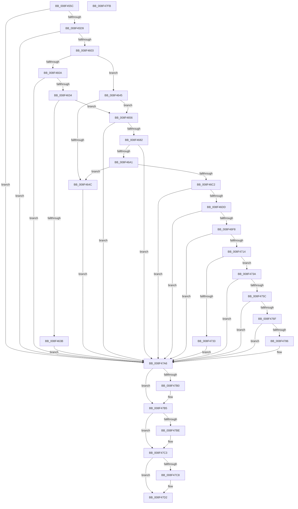

# SysCtxRegOpenCurrentUserKey

- RVA: `0x008F455C`–`0x008F47FC` (길이 `672` bytes)
- VA: `0x00000001408F455C`
- 실행 섹션: `PAGE`
- PDB 이름 있음: `예`; PDB Function 태그: `아니요`
- unwind 정보 RVA: `0x000876E8`
- 디코드: `182`개 명령, `672/672` bytes 표시
- 미해석 바이트: `0` (있으면 어셈블리에 `.byte`로 보존)

> 이 문서는 커널 이미지의 기계어와 PDB 기호를 분석해 생성했습니다. 4번과 5번은 함수 원형과 자료형을 바이너리 사용 방식에서 추정한 C 해석이며 원본 소스 복구 결과는 아닙니다.

## 1. Dependencies

- 직접 호출 지점: **19**; 고유 호출 대상: **15**
- 직접 호출자로 확인된 함수: **5**
- RIP 상대 이미지 참조: **2**

### Outgoing calls
- `0x008F45CA` → [SysCtxOpenEffectiveToken](../AC/SysCtxOpenEffectiveToken_function_00ACEED8.md) (function, `0x00ACEED8`)
- `0x008F45F4` → [ZwQueryInformationToken](../../text/6A/ZwQueryInformationToken_function_006AD4F0.md) (function, `0x006AD4F0`)
- `0x008F4625` → [ZwQueryInformationToken](../../text/6A/ZwQueryInformationToken_function_006AD4F0.md) (function, `0x006AD4F0`)
- `0x008F4673` → [ZwQueryInformationToken](../../text/6A/ZwQueryInformationToken_function_006AD4F0.md) (function, `0x006AD4F0`)
- `0x008F4692` → [RtlInitializeSid](../9E/RtlInitializeSid_function_009EB720.md) (function, `0x009EB720`)
- `0x008F46A7` → [RtlSubAuthoritySid](../../text/45/RtlSubAuthoritySid_function_00456D10.md) (function, `0x00456D10`)
- `0x008F46B9` → [RtlEqualSid](../../text/40/RtlEqualSid_function_00400AD0.md) (function, `0x00400AD0`)
- `0x008F46CC` → [RtlConvertSidToUnicodeString](../92/RtlConvertSidToUnicodeString_function_00927B30.md) (function, `0x00927B30`)
- `0x008F46E9` → [RtlUShortAdd](../../text/47/RtlUShortAdd_function_00474F70.md) (function, `0x00474F70`)
- `0x008F4705` → [RtlUShortAdd](../../text/47/RtlUShortAdd_function_00474F70.md) (function, `0x00474F70`)
- `0x008F4726` → [ExAllocatePool2](../../poolcode/B8/ExAllocatePool2_function_00B820F0.md) (function, `0x00B820F0`)
- `0x008F4751` → [RtlAppendUnicodeStringToString](../../text/40/RtlAppendUnicodeStringToString_function_0040FA50.md) (function, `0x0040FA50`)
- `0x008F4764` → [RtlAppendUnicodeStringToString](../../text/40/RtlAppendUnicodeStringToString_function_0040FA50.md) (function, `0x0040FA50`)
- `0x008F477B` → [SysCtxGetCachedContextBaseKey](../A3/SysCtxGetCachedContextBaseKey_function_00A376A0.md) (function, `0x00A376A0`)
- `0x008F479F` → [SysCtxRegOpenKey](../8E/SysCtxRegOpenKey_function_008ED810.md) (function, `0x008ED810`)
- `0x008F47B0` → [ZwClose](../../text/6A/ZwClose_function_006AD2B0.md) (function, `0x006AD2B0`)
- `0x008F47BE` → [ExFreePool](../../poolcode/B8/ExFreePool_function_00B82850.md) (function, `0x00B82850`)
- `0x008F47CD` → [ExFreePoolWithTag](../../poolcode/B8/ExFreePoolWithTag_function_00B82870.md) (function, `0x00B82870`)
- `0x008F47DB` → [_security_check_cookie](../../text/6A/_security_check_cookie_function_006AC640.md) (function, `0x006AC640`)

### Direct callers
- [sub_008EE966](../8E/Unknown_function_008EE966.md) at `0x008EED78`
- [_CmOpenCommonClassRegKeyWorker](_CmOpenCommonClassRegKeyWorker_function_008F0A1C.md) at `0x008F0EB4`
- [_CmOpenDeviceInterfaceRegKeyWorker](_CmOpenDeviceInterfaceRegKeyWorker_function_008F2B48.md) at `0x008F2FC4`
- [CmOpenDeviceContainerRegKeyWorker](CmOpenDeviceContainerRegKeyWorker_function_008F4904.md) at `0x008F4B0E`
- [PnpCtxRegOpenCurrentUserKey](../AB/PnpCtxRegOpenCurrentUserKey_function_00AB5E40.md) at `0x00AB5E56`

### Static image references
- `0x008F4578` → RVA `0x00E0A740` (`.data`; read)
- `0x008F473A` → RVA `0x0000C5A8` (`.rdata`; read)

## 2. Other-region calls and transfers

- 다른 실행 섹션으로 향하는 call: **14**
  - `0x008F45F4` → [ZwQueryInformationToken](../../text/6A/ZwQueryInformationToken_function_006AD4F0.md) (`PAGE` → `.text`)
  - `0x008F4625` → [ZwQueryInformationToken](../../text/6A/ZwQueryInformationToken_function_006AD4F0.md) (`PAGE` → `.text`)
  - `0x008F4673` → [ZwQueryInformationToken](../../text/6A/ZwQueryInformationToken_function_006AD4F0.md) (`PAGE` → `.text`)
  - `0x008F46A7` → [RtlSubAuthoritySid](../../text/45/RtlSubAuthoritySid_function_00456D10.md) (`PAGE` → `.text`)
  - `0x008F46B9` → [RtlEqualSid](../../text/40/RtlEqualSid_function_00400AD0.md) (`PAGE` → `.text`)
  - `0x008F46E9` → [RtlUShortAdd](../../text/47/RtlUShortAdd_function_00474F70.md) (`PAGE` → `.text`)
  - `0x008F4705` → [RtlUShortAdd](../../text/47/RtlUShortAdd_function_00474F70.md) (`PAGE` → `.text`)
  - `0x008F4726` → [ExAllocatePool2](../../poolcode/B8/ExAllocatePool2_function_00B820F0.md) (`PAGE` → `POOLCODE`)
  - `0x008F4751` → [RtlAppendUnicodeStringToString](../../text/40/RtlAppendUnicodeStringToString_function_0040FA50.md) (`PAGE` → `.text`)
  - `0x008F4764` → [RtlAppendUnicodeStringToString](../../text/40/RtlAppendUnicodeStringToString_function_0040FA50.md) (`PAGE` → `.text`)
  - `0x008F47B0` → [ZwClose](../../text/6A/ZwClose_function_006AD2B0.md) (`PAGE` → `.text`)
  - `0x008F47BE` → [ExFreePool](../../poolcode/B8/ExFreePool_function_00B82850.md) (`PAGE` → `POOLCODE`)
  - `0x008F47CD` → [ExFreePoolWithTag](../../poolcode/B8/ExFreePoolWithTag_function_00B82870.md) (`PAGE` → `POOLCODE`)
  - `0x008F47DB` → [_security_check_cookie](../../text/6A/_security_check_cookie_function_006AC640.md) (`PAGE` → `.text`)
- 별도 외부 분기/꼬리 이동을 확인하지 못했습니다.

## 3. Assembly (complete function range)

```asm
008F455C  48 89 5C 24 18                  mov qword ptr [rsp + 0x18], rbx
008F4561  55                              push rbp
008F4562  56                              push rsi
008F4563  57                              push rdi
008F4564  41 54                           push r12
008F4566  41 55                           push r13
008F4568  41 56                           push r14
008F456A  41 57                           push r15
008F456C  48 8D 6C 24 D9                  lea rbp, [rsp - 0x27]
008F4571  48 81 EC F0 00 00 00            sub rsp, 0xf0
008F4578  48 8B 05 C1 61 51 00            mov rax, qword ptr [rip + 0x5161c1]
008F457F  48 33 C4                        xor rax, rsp
008F4582  48 89 45 17                     mov qword ptr [rbp + 0x17], rax
008F4586  33 F6                           xor esi, esi
008F4588  66 C7 44 24 38 00 05            mov word ptr [rsp + 0x38], 0x500
008F458F  44 8B E2                        mov r12d, edx
008F4592  48 89 74 24 48                  mov qword ptr [rsp + 0x48], rsi
008F4597  0F 57 C0                        xorps xmm0, xmm0
008F459A  89 74 24 3C                     mov dword ptr [rsp + 0x3c], esi
008F459E  48 8D 54 24 48                  lea rdx, [rsp + 0x48]
008F45A3  89 74 24 44                     mov dword ptr [rsp + 0x44], esi
008F45A7  89 74 24 40                     mov dword ptr [rsp + 0x40], esi
008F45AB  8B FE                           mov edi, esi
008F45AD  89 74 24 34                     mov dword ptr [rsp + 0x34], esi
008F45B1  4D 8B E9                        mov r13, r9
008F45B4  0F 11 45 9F                     movups xmmword ptr [rbp - 0x61], xmm0
008F45B8  48 89 75 97                     mov qword ptr [rbp - 0x69], rsi
008F45BC  45 8B F8                        mov r15d, r8d
008F45BF  89 75 8B                        mov dword ptr [rbp - 0x75], esi
008F45C2  4C 8B F1                        mov r14, rcx
008F45C5  66 89 74 24 30                  mov word ptr [rsp + 0x30], si
008F45CA  E8 09 A9 1D 00                  call 0x140aceed8
008F45CF  8B D8                           mov ebx, eax
008F45D1  85 C0                           test eax, eax
008F45D3  0F 88 CD 01 00 00               js 0x1408f47a6
008F45D9  48 8B 4C 24 48                  mov rcx, qword ptr [rsp + 0x48]
008F45DE  48 8D 44 24 40                  lea rax, [rsp + 0x40]
008F45E3  44 8D 4E 04                     lea r9d, [rsi + 4]
008F45E7  48 89 44 24 20                  mov qword ptr [rsp + 0x20], rax
008F45EC  4C 8D 44 24 3C                  lea r8, [rsp + 0x3c]
008F45F1  8D 56 08                        lea edx, [rsi + 8]
008F45F4  E8 F7 8E DB FF                  call 0x1406ad4f0
008F45F9  8B D8                           mov ebx, eax
008F45FB  85 C0                           test eax, eax
008F45FD  0F 88 A3 01 00 00               js 0x1408f47a6
008F4603  83 7C 24 3C 02                  cmp dword ptr [rsp + 0x3c], 2
008F4608  75 3B                           jne 0x1408f4645
008F460A  48 8B 4C 24 48                  mov rcx, qword ptr [rsp + 0x48]
008F460F  48 8D 44 24 40                  lea rax, [rsp + 0x40]
008F4614  44 8D 4E 04                     lea r9d, [rsi + 4]
008F4618  48 89 44 24 20                  mov qword ptr [rsp + 0x20], rax
008F461D  4C 8D 44 24 44                  lea r8, [rsp + 0x44]
008F4622  8D 56 09                        lea edx, [rsi + 9]
008F4625  E8 C6 8E DB FF                  call 0x1406ad4f0
008F462A  8B D8                           mov ebx, eax
008F462C  85 C0                           test eax, eax
008F462E  0F 88 72 01 00 00               js 0x1408f47a6
008F4634  83 7C 24 44 02                  cmp dword ptr [rsp + 0x44], 2
008F4639  7D 1B                           jge 0x1408f4656
008F463B  BB 22 00 00 C0                  mov ebx, 0xc0000022
008F4640  E9 61 01 00 00                  jmp 0x1408f47a6
008F4645  83 7C 24 3C 01                  cmp dword ptr [rsp + 0x3c], 1
008F464A  74 0A                           je 0x1408f4656
008F464C  BB BB 00 00 C0                  mov ebx, 0xc00000bb
008F4651  E9 50 01 00 00                  jmp 0x1408f47a6
008F4656  48 8B 4C 24 48                  mov rcx, qword ptr [rsp + 0x48]
008F465B  48 8D 44 24 40                  lea rax, [rsp + 0x40]
008F4660  41 B9 54 00 00 00               mov r9d, 0x54
008F4666  48 89 44 24 20                  mov qword ptr [rsp + 0x20], rax
008F466B  4C 8D 45 BF                     lea r8, [rbp - 0x41]
008F466F  41 8D 51 AD                     lea edx, [r9 - 0x53]
008F4673  E8 78 8E DB FF                  call 0x1406ad4f0
008F4678  8B D8                           mov ebx, eax
008F467A  85 C0                           test eax, eax
008F467C  0F 88 24 01 00 00               js 0x1408f47a6
008F4682  48 8B 75 BF                     mov rsi, qword ptr [rbp - 0x41]
008F4686  48 8D 54 24 34                  lea rdx, [rsp + 0x34]
008F468B  41 B0 01                        mov r8b, 1
008F468E  48 8D 4D AF                     lea rcx, [rbp - 0x51]
008F4692  E8 89 70 0F 00                  call 0x1409eb720
008F4697  8B D8                           mov ebx, eax
008F4699  85 C0                           test eax, eax
008F469B  0F 88 05 01 00 00               js 0x1408f47a6
008F46A1  33 D2                           xor edx, edx
008F46A3  48 8D 4D AF                     lea rcx, [rbp - 0x51]
008F46A7  E8 64 26 B6 FF                  call 0x140456d10
008F46AC  48 8B D6                        mov rdx, rsi
008F46AF  48 8D 4D AF                     lea rcx, [rbp - 0x51]
008F46B3  C7 00 12 00 00 00               mov dword ptr [rax], 0x12
008F46B9  E8 12 C4 B0 FF                  call 0x140400ad0
008F46BE  84 C0                           test al, al
008F46C0  75 8A                           jne 0x1408f464c
008F46C2  41 B0 01                        mov r8b, 1
008F46C5  48 8D 4D 9F                     lea rcx, [rbp - 0x61]
008F46C9  48 8B D6                        mov rdx, rsi
008F46CC  E8 5F 34 03 00                  call 0x140927b30
008F46D1  33 F6                           xor esi, esi
008F46D3  8B D8                           mov ebx, eax
008F46D5  85 C0                           test eax, eax
008F46D7  0F 88 C9 00 00 00               js 0x1408f47a6
008F46DD  0F B7 4D 9F                     movzx ecx, word ptr [rbp - 0x61]
008F46E1  8D 56 1E                        lea edx, [rsi + 0x1e]
008F46E4  4C 8D 44 24 30                  lea r8, [rsp + 0x30]
008F46E9  E8 82 08 B8 FF                  call 0x140474f70
008F46EE  8B D8                           mov ebx, eax
008F46F0  85 C0                           test eax, eax
008F46F2  0F 88 AE 00 00 00               js 0x1408f47a6
008F46F8  0F B7 4C 24 30                  movzx ecx, word ptr [rsp + 0x30]
008F46FD  8D 56 02                        lea edx, [rsi + 2]
008F4700  4C 8D 44 24 30                  lea r8, [rsp + 0x30]
008F4705  E8 66 08 B8 FF                  call 0x140474f70
008F470A  8B D8                           mov ebx, eax
008F470C  85 C0                           test eax, eax
008F470E  0F 88 92 00 00 00               js 0x1408f47a6
008F4714  0F B7 5C 24 30                  movzx ebx, word ptr [rsp + 0x30]
008F4719  B9 00 01 00 00                  mov ecx, 0x100
008F471E  8B D3                           mov edx, ebx
008F4720  41 B8 50 4E 50 53               mov r8d, 0x53504e50
008F4726  E8 C5 D9 28 00                  call 0x140b820f0
008F472B  48 8B F8                        mov rdi, rax
008F472E  48 85 C0                        test rax, rax
008F4731  75 07                           jne 0x1408f473a
008F4733  BB 17 00 00 C0                  mov ebx, 0xc0000017
008F4738  EB 6C                           jmp 0x1408f47a6
008F473A  48 8D 15 67 7E 71 FF            lea rdx, [rip - 0x8e8199]
008F4741  66 89 75 87                     mov word ptr [rbp - 0x79], si
008F4745  48 8D 4D 87                     lea rcx, [rbp - 0x79]
008F4749  66 89 5D 89                     mov word ptr [rbp - 0x77], bx
008F474D  48 89 45 8F                     mov qword ptr [rbp - 0x71], rax
008F4751  E8 FA B2 B1 FF                  call 0x14040fa50
008F4756  8B D8                           mov ebx, eax
008F4758  85 C0                           test eax, eax
008F475A  78 4A                           js 0x1408f47a6
008F475C  48 8D 55 9F                     lea rdx, [rbp - 0x61]
008F4760  48 8D 4D 87                     lea rcx, [rbp - 0x79]
008F4764  E8 E7 B2 B1 FF                  call 0x14040fa50
008F4769  8B D8                           mov ebx, eax
008F476B  85 C0                           test eax, eax
008F476D  78 37                           js 0x1408f47a6
008F476F  4C 8D 45 97                     lea r8, [rbp - 0x69]
008F4773  BA 03 00 00 00                  mov edx, 3
008F4778  49 8B CE                        mov rcx, r14
008F477B  E8 20 2F 14 00                  call 0x140a376a0
008F4780  8B D8                           mov ebx, eax
008F4782  85 C0                           test eax, eax
008F4784  78 20                           js 0x1408f47a6
008F4786  4C 8B 45 8F                     mov r8, qword ptr [rbp - 0x71]
008F478A  45 8B CC                        mov r9d, r12d
008F478D  48 8B 55 97                     mov rdx, qword ptr [rbp - 0x69]
008F4791  49 83 C0 1E                     add r8, 0x1e
008F4795  4C 89 6C 24 28                  mov qword ptr [rsp + 0x28], r13
008F479A  44 89 7C 24 20                  mov dword ptr [rsp + 0x20], r15d
008F479F  E8 6C 90 FF FF                  call 0x1408ed810
008F47A4  8B D8                           mov ebx, eax
008F47A6  48 8B 4C 24 48                  mov rcx, qword ptr [rsp + 0x48]
008F47AB  48 85 C9                        test rcx, rcx
008F47AE  74 05                           je 0x1408f47b5
008F47B0  E8 FB 8A DB FF                  call 0x1406ad2b0
008F47B5  48 8B 4D A7                     mov rcx, qword ptr [rbp - 0x59]
008F47B9  48 85 C9                        test rcx, rcx
008F47BC  74 05                           je 0x1408f47c3
008F47BE  E8 8D E0 28 00                  call 0x140b82850
008F47C3  48 85 FF                        test rdi, rdi
008F47C6  74 0A                           je 0x1408f47d2
008F47C8  33 D2                           xor edx, edx
008F47CA  48 8B CF                        mov rcx, rdi
008F47CD  E8 9E E0 28 00                  call 0x140b82870
008F47D2  8B C3                           mov eax, ebx
008F47D4  48 8B 4D 17                     mov rcx, qword ptr [rbp + 0x17]
008F47D8  48 33 CC                        xor rcx, rsp
008F47DB  E8 60 7E DB FF                  call 0x1406ac640
008F47E0  48 8B 9C 24 40 01 00 00         mov rbx, qword ptr [rsp + 0x140]
008F47E8  48 81 C4 F0 00 00 00            add rsp, 0xf0
008F47EF  41 5F                           pop r15
008F47F1  41 5E                           pop r14
008F47F3  41 5D                           pop r13
008F47F5  41 5C                           pop r12
008F47F7  5F                              pop rdi
008F47F8  5E                              pop rsi
008F47F9  5D                              pop rbp
008F47FA  C3                              ret
008F47FB  CC                              int3
```

## 4. C-style interpretation (structured pseudocode)

```c
__int64 __fastcall SysCtxRegOpenCurrentUserKey(__int64 a1, int a2, int a3, __int64 a4)
{
    __int64 result;
    __int64 v_rbx;
    __int64 v_rsi;
    __int64 v_rsp;
    unsigned __int64 v_stack_m100;
    unsigned __int64 v_stack_m108;
    unsigned __int64 v_stack_m48;
    unsigned __int64 v_stack_m5F;
    unsigned __int64 v_stack_mA0;
    unsigned __int64 v_stack_mB0;
    unsigned __int64 v_stack_mB8;
    unsigned __int64 v_stack_mC0;
    unsigned __int64 v_stack_mC8;
    unsigned __int64 v_stack_mD0;
    unsigned int v_stack_mD4;
    unsigned __int16 v_stack_mD6;
    unsigned __int16 v_stack_mD8;
    unsigned __int64 v_stack_mE0;
    unsigned int v_stack_mE4;
    unsigned int v_stack_mE8;
    unsigned int v_stack_mEC;
    unsigned __int16 v_stack_mF0;
    unsigned int v_stack_mF4;
    unsigned __int16 v_stack_mF8;
    unsigned __int64 v_stack_p18;

    v_stack_p18 = v_rbx;
    v_rsp = (v_rsp) - (240);
    result = (*(unsigned __int64 *)(v_rip + 5333441)) ^ (v_rsp);
    v_stack_m48 = result;
    v_rsi = 0;
    v_stack_mF0 = 0x500ULL;
    v_stack_mE0 = 0;
    v_stack_mEC = 0;
    v_stack_mE4 = 0;
    v_stack_mE8 = 0;
    v_stack_mF4 = 0;
    v_stack_mC0 = v_xmm0;
    v_stack_mC8 = 0;
    v_stack_mD4 = 0;
    v_stack_mF8 = 0;
    result = SysCtxOpenEffectiveToken(a1, v_stack_mE0, a3, a4);
    if (sign_flag) goto loc_008F47A6;
    v_stack_m108 = v_stack_mE8;
    result = ZwQueryInformationToken(v_stack_mE0, v_rsi + 8, v_stack_mEC, v_rsi + 4);
    if (sign_flag) goto loc_008F47A6;
    if (v_stack_mEC != 2) goto loc_008F4645;
    v_stack_m108 = v_stack_mE8;
    result = ZwQueryInformationToken(v_stack_mE0, v_rsi + 9, v_stack_mE4, v_rsi + 4);
    if (sign_flag) goto loc_008F47A6;
    if (v_stack_mE4 >= 2) goto loc_008F4656;
    goto loc_008F47A6;
loc_008F4645:
    if (v_stack_mEC == 1) goto loc_008F4656;
loc_008F464C:
    goto loc_008F47A6;
loc_008F4656:
    v_stack_m108 = v_stack_mE8;
    result = ZwQueryInformationToken(v_stack_mE0, 84 - 83, v_stack_mA0, 84);
    if (sign_flag) goto loc_008F47A6;
    result = RtlInitializeSid(v_stack_mB0, v_stack_mF4, 1, 84);
    if (sign_flag) goto loc_008F47A6;
    a2 = 0;
    result = RtlSubAuthoritySid(v_stack_mB0, a2, 1, 84);
    *(unsigned int *)(result) = 18;
    result = RtlEqualSid(v_stack_mB0, v_stack_mA0, 1, 84);
    if ((unsigned __int8)(result) != 0) goto loc_008F464C;
    result = RtlConvertSidToUnicodeString(v_stack_mC0, v_stack_mA0, 1, 84);
    v_rsi = 0;
    if (sign_flag) goto loc_008F47A6;
    result = RtlUShortAdd(v_stack_mC0, v_rsi + 30, v_stack_mF8, 84);
    if (sign_flag) goto loc_008F47A6;
    result = RtlUShortAdd(v_stack_mF8, v_rsi + 2, v_stack_mF8, 84);
    if (sign_flag) goto loc_008F47A6;
    result = ExAllocatePool2(256, (unsigned int)((unsigned int)(v_stack_mF8)), (unsigned int)(0x53504E50ULL), 84);
    if (result != 0) goto loc_008F473A;
    goto loc_008F47A6;
loc_008F473A:
    v_stack_mD8 = 0;
    v_stack_mD6 = (unsigned __int16)((unsigned int)(0xC0000017ULL));
    v_stack_mD0 = result;
    result = RtlAppendUnicodeStringToString(v_stack_mD8, v_rip - 9339289, (unsigned int)(0x53504E50ULL), 84);
    if (sign_flag) goto loc_008F47A6;
    result = RtlAppendUnicodeStringToString(v_stack_mD8, v_stack_mC0, (unsigned int)(0x53504E50ULL), 84);
    if (sign_flag) goto loc_008F47A6;
    result = SysCtxGetCachedContextBaseKey(a1, 3, v_stack_mC8, 84);
    v_rbx = (unsigned int)((unsigned int)(result));
    if (!(sign_flag)) {
        a3 = v_stack_mD0;
        a4 = (unsigned int)((unsigned int)(a2));
        a2 = v_stack_mC8;
        a3 = (a3) + (30);
        v_stack_m100 = a4;
        v_stack_m108 = (unsigned int)((unsigned int)(a3));
        result = SysCtxRegOpenKey(a1, a2, a3, a4);
        v_rbx = (unsigned int)(result);
    }
    if (v_stack_mE0 != 0) {
        result = ZwClose(v_stack_mE0, a2, a3, a4);
    }
    if (v_stack_mB8 != 0) {
        result = ExFreePool(v_stack_mB8, a2, a3, a4);
    }
    if (result != 0) {
        a2 = 0;
        a1 = result;
        result = ExFreePoolWithTag(a1, a2, a3, a4);
    }
    a1 = (v_stack_m48) ^ (v_rsp);
    result = _security_check_cookie(a1, a2, a3, a4);
    v_rsp = (v_rsp) + (240);
    return result;
}
```

## 5. (Beta) C Style

```c
int64_t SysCtxRegOpenCurrentUserKey(int64_t Arg1, int32_t Arg2, int32_t Arg3, int64_t Arg4)
{
    int64_t result;
    int64_t local_rbx;
    int64_t local_rsi;
    int64_t local_rsp;
    uint64_t v_stack_m100;
    uint64_t v_stack_m108;
    uint64_t v_stack_m48;
    uint64_t v_stack_m5F;
    uint64_t v_stack_mA0;
    uint64_t v_stack_mB0;
    uint64_t v_stack_mB8;
    uint64_t v_stack_mC0;
    uint64_t v_stack_mC8;
    uint64_t v_stack_mD0;
    uint32_t v_stack_mD4;
    uint16_t v_stack_mD6;
    uint16_t v_stack_mD8;
    uint64_t v_stack_mE0;
    uint32_t v_stack_mE4;
    uint32_t v_stack_mE8;
    uint32_t v_stack_mEC;
    uint16_t v_stack_mF0;
    uint32_t v_stack_mF4;
    uint16_t v_stack_mF8;
    uint64_t v_stack_p18;

    v_stack_p18 = local_rbx;
    local_rsp = (local_rsp) - (240);
    result = (*(uint64_t *)(v_rip + 0x5161C1)) ^ (local_rsp);
    v_stack_m48 = result;
    local_rsi = 0;
    v_stack_mF0 = 0x500ULL;
    v_stack_mE0 = 0;
    v_stack_mEC = 0;
    v_stack_mE4 = 0;
    v_stack_mE8 = 0;
    v_stack_mF4 = 0;
    v_stack_mC0 = v_xmm0;
    v_stack_mC8 = 0;
    v_stack_mD4 = 0;
    v_stack_mF8 = 0;
    result = SysCtxOpenEffectiveToken(Arg1, v_stack_mE0, Arg3, Arg4);
    if (sign_flag) goto loc_008F47A6;
    v_stack_m108 = v_stack_mE8;
    result = ZwQueryInformationToken(v_stack_mE0, local_rsi + 8, v_stack_mEC, local_rsi + 4);
    if (sign_flag) goto loc_008F47A6;
    if (v_stack_mEC != 2) goto loc_008F4645;
    v_stack_m108 = v_stack_mE8;
    result = ZwQueryInformationToken(v_stack_mE0, local_rsi + 9, v_stack_mE4, local_rsi + 4);
    if (sign_flag) goto loc_008F47A6;
    if (v_stack_mE4 >= 2) goto loc_008F4656;
    goto loc_008F47A6;
loc_008F4645:
    if (v_stack_mEC == 1) goto loc_008F4656;
loc_008F464C:
    goto loc_008F47A6;
loc_008F4656:
    v_stack_m108 = v_stack_mE8;
    result = ZwQueryInformationToken(v_stack_mE0, 84 - 83, v_stack_mA0, 84);
    if (sign_flag) goto loc_008F47A6;
    result = RtlInitializeSid(v_stack_mB0, v_stack_mF4, 1, 84);
    if (sign_flag) goto loc_008F47A6;
    Arg2 = 0;
    result = RtlSubAuthoritySid(v_stack_mB0, Arg2, 1, 84);
    *(uint32_t *)(result) = 18;
    result = RtlEqualSid(v_stack_mB0, v_stack_mA0, 1, 84);
    if ((uint8_t)(result) != 0) goto loc_008F464C;
    result = RtlConvertSidToUnicodeString(v_stack_mC0, v_stack_mA0, 1, 84);
    local_rsi = 0;
    if (sign_flag) goto loc_008F47A6;
    result = RtlUShortAdd(v_stack_mC0, local_rsi + 30, v_stack_mF8, 84);
    if (sign_flag) goto loc_008F47A6;
    result = RtlUShortAdd(v_stack_mF8, local_rsi + 2, v_stack_mF8, 84);
    if (sign_flag) goto loc_008F47A6;
    result = ExAllocatePool2(256, (uint32_t)((uint32_t)(v_stack_mF8)), (uint32_t)(0x53504E50ULL), 84);
    if (result != 0) goto loc_008F473A;
    goto loc_008F47A6;
loc_008F473A:
    v_stack_mD8 = 0;
    v_stack_mD6 = (uint16_t)((uint32_t)(0xC0000017ULL));
    v_stack_mD0 = result;
    result = RtlAppendUnicodeStringToString(v_stack_mD8, v_rip - 9339289, (uint32_t)(0x53504E50ULL), 84);
    if (sign_flag) goto loc_008F47A6;
    result = RtlAppendUnicodeStringToString(v_stack_mD8, v_stack_mC0, (uint32_t)(0x53504E50ULL), 84);
    if (sign_flag) goto loc_008F47A6;
    result = SysCtxGetCachedContextBaseKey(Arg1, 3, v_stack_mC8, 84);
    local_rbx = (uint32_t)((uint32_t)(result));
    if (!(sign_flag)) {
        Arg3 = v_stack_mD0;
        Arg4 = (uint32_t)((uint32_t)(Arg2));
        Arg2 = v_stack_mC8;
        Arg3 = (Arg3) + (30);
        v_stack_m100 = Arg4;
        v_stack_m108 = (uint32_t)((uint32_t)(Arg3));
        result = SysCtxRegOpenKey(Arg1, Arg2, Arg3, Arg4);
        local_rbx = (uint32_t)(result);
    }
    if (v_stack_mE0 != 0) {
        result = ZwClose(v_stack_mE0, Arg2, Arg3, Arg4);
    }
    if (v_stack_mB8 != 0) {
        result = ExFreePool(v_stack_mB8, Arg2, Arg3, Arg4);
    }
    if (result != 0) {
        Arg2 = 0;
        Arg1 = result;
        result = ExFreePoolWithTag(Arg1, Arg2, Arg3, Arg4);
    }
    Arg1 = (v_stack_m48) ^ (local_rsp);
    result = _security_check_cookie(Arg1, Arg2, Arg3, Arg4);
    local_rsp = (local_rsp) + (240);
    return result;
}
```

## 6. Execution-region graph

[열기: 2D/3D 그래프와 함수 탐색 컨트롤 패널](../../../control-panel.html?section=page&rva=0x008F455C&view=graph)

- 2D 그래프는 위에서 아래로 흐르고, 3D 그래프는 빈 공간을 드래그해 회전합니다. Shift+드래그는 이동, 휠은 확대·축소, 함수 노드 선택은 대상 보고서 이동입니다.

### Static fallback


