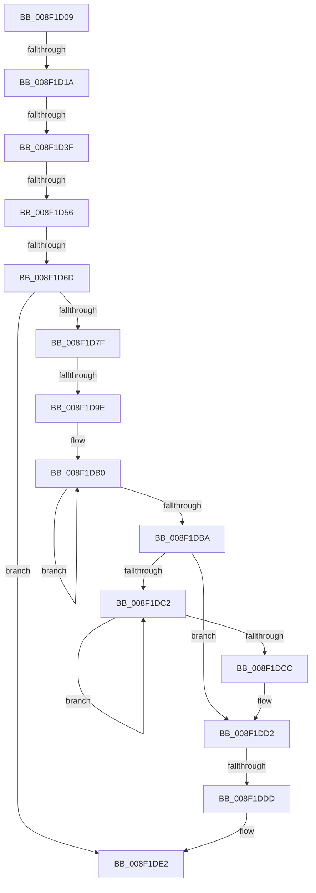

# sub_008F1D09

- RVA: `0x008F1D09`–`0x008F1DEA` (길이 `225` bytes)
- VA: `0x00000001408F1D09`
- 실행 섹션: `PAGE`
- PDB 이름 있음: `아니요`; PDB Function 태그: `아니요`
- unwind 정보 RVA: `0x000872C8`
- 디코드: `54`개 명령, `225/225` bytes 표시
- 미해석 바이트: `0` (있으면 어셈블리에 `.byte`로 보존)

> 이 문서는 커널 이미지의 기계어와 PDB 기호를 분석해 생성했습니다. 4번과 5번은 함수 원형과 자료형을 바이너리 사용 방식에서 추정한 C 해석이며 원본 소스 복구 결과는 아닙니다.

## 1. Dependencies

- 직접 호출 지점: **2**; 고유 호출 대상: **2**
- 직접 호출자로 확인된 함수: **0**
- RIP 상대 이미지 참조: **2**

### Outgoing calls
- `0x008F1D32` → [RtlInitUnicodeStringEx](../../text/46/RtlInitUnicodeStringEx_function_00463960.md) (function, `0x00463960`)
- `0x008F1D60` → [RtlGUIDFromString](RtlGUIDFromString_function_008F1EF0.md) (function, `0x008F1EF0`)

### Direct callers
- 이 함수 시작 RVA로 연결되는 직접 call은 확인되지 않았습니다. 간접 호출은 완전히 역산할 수 없습니다.

### Static image references
- `0x008F1D82` → RVA `0x00B0D400` (` ?? ::NNGAKEGL::`string'`; read)
- `0x008F1D89` → RVA `0x00B0D6B0` (` ?? ::NNGAKEGL::`string'`; read)

## 2. Other-region calls and transfers

- 다른 실행 섹션으로 향하는 call: **1**
  - `0x008F1D32` → [RtlInitUnicodeStringEx](../../text/46/RtlInitUnicodeStringEx_function_00463960.md) (`PAGE` → `.text`)
- call이 아닌 외부 분기/꼬리 이동: **6**
  - `0x008F1D14` → [sub_008F1E09 + 0x51](Unknown_function_008F1E09.md) (`tail-transfer`)
  - `0x008F1D39` → [sub_008F1E09 + 0x6D](Unknown_function_008F1E09.md) (`tail-transfer`)
  - `0x008F1D50` → [sub_008F1E09 + 0x88](Unknown_function_008F1E09.md) (`tail-transfer`)
  - `0x008F1D67` → [sub_008F1E09 + 0x66](Unknown_function_008F1E09.md) (`tail-transfer`)
  - `0x008F1D98` → [sub_008F1EA2](Unknown_function_008F1EA2.md) (`tail-transfer`)
  - `0x008F1DDB` → [sub_008F1E09](Unknown_function_008F1E09.md) (`tail-transfer`)

## 3. Assembly (complete function range)

```asm
008F1D09  48 89 B4 24 B0 00 00 00         mov qword ptr [rsp + 0xb0], rsi
008F1D11  83 F8 20                        cmp eax, 0x20
008F1D14  0F 85 40 01 00 00               jne 0x1408f1e5a
008F1D1A  0F 57 C0                        xorps xmm0, xmm0
008F1D1D  48 8D 4C 24 50                  lea rcx, [rsp + 0x50]
008F1D22  0F 57 C9                        xorps xmm1, xmm1
008F1D25  8D 70 E2                        lea esi, [rax - 0x1e]
008F1D28  0F 11 44 24 50                  movups xmmword ptr [rsp + 0x50], xmm0
008F1D2D  0F 11 4C 24 60                  movups xmmword ptr [rsp + 0x60], xmm1
008F1D32  E8 29 1C B7 FF                  call 0x140463960
008F1D37  85 C0                           test eax, eax
008F1D39  0F 88 37 01 00 00               js 0x1408f1e76
008F1D3F  0F B7 44 24 52                  movzx eax, word ptr [rsp + 0x52]
008F1D44  B9 FE FF 00 00                  mov ecx, 0xfffe
008F1D49  66 23 C1                        and ax, cx
008F1D4C  66 83 F8 4E                     cmp ax, 0x4e
008F1D50  0F 85 3B 01 00 00               jne 0x1408f1e91
008F1D56  48 8D 54 24 60                  lea rdx, [rsp + 0x60]
008F1D5B  48 8D 4C 24 50                  lea rcx, [rsp + 0x50]
008F1D60  E8 8B 01 00 00                  call 0x1408f1ef0
008F1D65  85 C0                           test eax, eax
008F1D67  0F 89 02 01 00 00               jns 0x1408f1e6f
008F1D6D  32 C0                           xor al, al
008F1D6F  33 C9                           xor ecx, ecx
008F1D71  BA 33 00 00 C0                  mov edx, 0xc0000033
008F1D76  84 C0                           test al, al
008F1D78  0F 44 CA                        cmove ecx, edx
008F1D7B  85 C9                           test ecx, ecx
008F1D7D  78 63                           js 0x1408f1de2
008F1D7F  83 FE 02                        cmp esi, 2
008F1D82  48 8D 05 77 B6 21 00            lea rax, [rip + 0x21b677]
008F1D89  48 8D 15 20 B9 21 00            lea rdx, [rip + 0x21b920]
008F1D90  48 0F 45 D0                     cmovne rdx, rax
008F1D94  0F BA E7 09                     bt edi, 9
008F1D98  0F 82 04 01 00 00               jb 0x1408f1ea2
008F1D9E  48 C7 C1 FF FF FF FF            mov rcx, 0xffffffffffffffff
008F1DA5  48 8B C1                        mov rax, rcx
008F1DA8  0F 1F 84 00 00 00 00 00         nop dword ptr [rax + rax]
008F1DB0  48 FF C0                        inc rax
008F1DB3  66 83 3C 42 00                  cmp word ptr [rdx + rax*2], 0
008F1DB8  75 F6                           jne 0x1408f1db0
008F1DBA  48 FF C0                        inc rax
008F1DBD  48 85 DB                        test rbx, rbx
008F1DC0  74 10                           je 0x1408f1dd2
008F1DC2  48 FF C1                        inc rcx
008F1DC5  66 83 3C 4B 00                  cmp word ptr [rbx + rcx*2], 0
008F1DCA  75 F6                           jne 0x1408f1dc2
008F1DCC  48 FF C0                        inc rax
008F1DCF  48 03 C1                        add rax, rcx
008F1DD2  41 B8 FF FF FF FF               mov r8d, 0xffffffff
008F1DD8  49 3B C0                        cmp rax, r8
008F1DDB  76 2C                           jbe 0x1408f1e09
008F1DDD  B9 95 00 00 C0                  mov ecx, 0xc0000095
008F1DE2  48 8B B4 24 B0 00 00 00         mov rsi, qword ptr [rsp + 0xb0]
```

## 4. C-style interpretation (structured pseudocode)

```c
__int64 __fastcall sub_008F1D09(__int64 a1, __int64 a2, __int64 a3, __int64 a4, __int64 a5, __int64 a6, __int64 a7, __int64 a8, __int64 a9, __int64 a10, __int64 a11, __int64 a12, __int64 a13, __int64 a14, __int64 a15, __int64 a16, __int64 a17, __int64 a18, __int64 a19, __int64 a20, __int64 a21, __int64 a22)
{
    __int64 result;
    unsigned __int16 v_stack_p52;
    unsigned __int64 v_stack_pB0;

    v_stack_pB0 = v_rsi;
    a10 = v_xmm0;
    a12 = v_xmm1;
    result = RtlInitUnicodeStringEx(a10, a2, a3, a4);
    result = (unsigned __int16)((v_stack_p52) & ((unsigned __int16)((unsigned int)(0xFFFEULL))));
    result = RtlGUIDFromString(a10, a12, a3, a4);
    result = 0;
    a1 = 0;
    if (0 == 0) { a1 = (unsigned int)((unsigned int)(0xC0000033ULL)); }
    if (sign_flag) goto loc_008F1DE2;
    a2 = v_rip + 2210080;
    if (((unsigned int)(result - 30)) != 2) { a2 = v_rip + 2209399; }
loc_008F1DB0:
    result = (-1) + 1;
    if ((*(unsigned __int16 *)(a2 + result * 2)) != 0) goto loc_008F1DB0;
    result = (result) + 1;
    if (v_rbx == 0) goto loc_008F1DD2;
loc_008F1DC2:
    a1 = (-1) + 1;
    if ((*(unsigned __int16 *)(v_rbx + a1 * 2)) != 0) goto loc_008F1DC2;
    result = (result) + 1;
    result = (result) + (a1);
loc_008F1DD2:
loc_008F1DE2:
    return result;
}
```

## 5. (Beta) C Style

```c
int64_t sub_008F1D09(int64_t Arg1, int64_t Arg2, int64_t Arg3, int64_t Arg4, uint64_t Arg5, uint64_t Arg6, uint64_t Arg7, uint64_t Arg8, uint64_t Arg9, int64_t Arg10, uint64_t Arg11, int64_t Arg12, uint64_t Arg13, uint64_t Arg14, uint64_t Arg15, uint64_t Arg16, uint64_t Arg17, uint64_t Arg18, uint64_t Arg19, uint64_t Arg20, uint64_t Arg21, int64_t Arg22)
{
    int64_t result;
    uint16_t v_stack_p52;
    uint64_t v_stack_pB0;

    v_stack_pB0 = local_rsi;
    Arg10 = v_xmm0;
    Arg12 = v_xmm1;
    result = RtlInitUnicodeStringEx(Arg10, Arg2, Arg3, Arg4);
    result = (uint16_t)((v_stack_p52) & ((uint16_t)((uint32_t)(0xFFFEULL))));
    result = RtlGUIDFromString(Arg10, Arg12, Arg3, Arg4);
    result = 0;
    Arg1 = 0;
    if (0 == 0) { Arg1 = (uint32_t)((uint32_t)(0xC0000033ULL)); }
    if (sign_flag) goto loc_008F1DE2;
    Arg2 = v_rip + 2210080;
    if (((uint32_t)(result - 30)) != 2) { Arg2 = v_rip + 2209399; }
loc_008F1DB0:
    result = (-1) + 1;
    if ((*(uint16_t *)(Arg2 + result * 2)) != 0) goto loc_008F1DB0;
    result = (result) + 1;
    if (local_rbx == 0) goto loc_008F1DD2;
loc_008F1DC2:
    Arg1 = (-1) + 1;
    if ((*(uint16_t *)(local_rbx + Arg1 * 2)) != 0) goto loc_008F1DC2;
    result = (result) + 1;
    result = (result) + (Arg1);
loc_008F1DD2:
loc_008F1DE2:
    return result;
}
```

## 6. Execution-region graph

[열기: 2D/3D 그래프와 함수 탐색 컨트롤 패널](../../../control-panel.html?section=page&rva=0x008F1D09&view=graph)

- 2D 그래프는 위에서 아래로 흐르고, 3D 그래프는 빈 공간을 드래그해 회전합니다. Shift+드래그는 이동, 휠은 확대·축소, 함수 노드 선택은 대상 보고서 이동입니다.

### Static fallback


