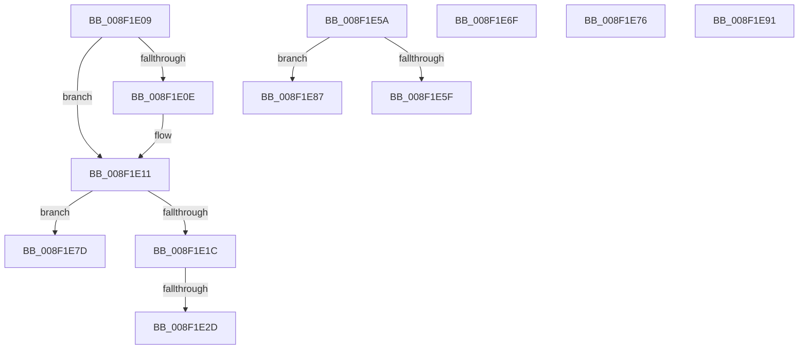

# sub_008F1E09

- RVA: `0x008F1E09`–`0x008F1E98` (길이 `143` bytes)
- VA: `0x00000001408F1E09`
- 실행 섹션: `PAGE`
- PDB 이름 있음: `아니요`; PDB Function 태그: `아니요`
- unwind 정보 RVA: `0x000872F0`
- 디코드: `37`개 명령, `143/143` bytes 표시
- 미해석 바이트: `0` (있으면 어셈블리에 `.byte`로 보존)

> 이 문서는 커널 이미지의 기계어와 PDB 기호를 분석해 생성했습니다. 4번과 5번은 함수 원형과 자료형을 바이너리 사용 방식에서 추정한 C 해석이며 원본 소스 복구 결과는 아닙니다.

## 1. Dependencies

- 직접 호출 지점: **2**; 고유 호출 대상: **2**
- 직접 호출자로 확인된 함수: **0**
- RIP 상대 이미지 참조: **1**

### Outgoing calls
- `0x008F1E51` → [RtlStringCchPrintfExW](../../text/42/RtlStringCchPrintfExW_function_0042B390.md) (function, `0x0042B390`)
- `0x008F1E65` → [PnpIsValidGuidString](PnpIsValidGuidString_function_008F37F8.md) (function, `0x008F37F8`)

### Direct callers
- 이 함수 시작 RVA로 연결되는 직접 call은 확인되지 않았습니다. 간접 호출은 완전히 역산할 수 없습니다.

### Static image references
- `0x008F1E37` → RVA `0x00AFD430` (` ?? ::NNGAKEGL::`string'`; read)

## 2. Other-region calls and transfers

- 다른 실행 섹션으로 향하는 call: **1**
  - `0x008F1E51` → [RtlStringCchPrintfExW](../../text/42/RtlStringCchPrintfExW_function_0042B390.md) (`PAGE` → `.text`)
- call이 아닌 외부 분기/꼬리 이동: **8**
  - `0x008F1E27` → [sub_008F1EA2 + 0x17](Unknown_function_008F1EA2.md) (`tail-transfer`)
  - `0x008F1E58` → [sub_008F1D09 + 0xD9](Unknown_function_008F1D09.md) (`tail-transfer`)
  - `0x008F1E6A` → [sub_008F1D09 + 0x66](Unknown_function_008F1D09.md) (`tail-transfer`)
  - `0x008F1E71` → [sub_008F1D09 + 0x66](Unknown_function_008F1D09.md) (`tail-transfer`)
  - `0x008F1E78` → [sub_008F1D09 + 0x66](Unknown_function_008F1D09.md) (`tail-transfer`)
  - `0x008F1E82` → [sub_008F1D09 + 0xD9](Unknown_function_008F1D09.md) (`tail-transfer`)
  - `0x008F1E8C` → [sub_008F1D09 + 0xD9](Unknown_function_008F1D09.md) (`tail-transfer`)
  - `0x008F1E93` → [sub_008F1D09 + 0x66](Unknown_function_008F1D09.md) (`tail-transfer`)

## 3. Assembly (complete function range)

```asm
008F1E09  4D 85 F6                        test r14, r14
008F1E0C  74 03                           je 0x1408f1e11
008F1E0E  41 89 06                        mov dword ptr [r14], eax
008F1E11  8B 8C 24 E0 00 00 00            mov ecx, dword ptr [rsp + 0xe0]
008F1E18  3B C1                           cmp eax, ecx
008F1E1A  77 61                           ja 0x1408f1e7d
008F1E1C  45 33 C9                        xor r9d, r9d
008F1E1F  45 33 C0                        xor r8d, r8d
008F1E22  8B C1                           mov eax, ecx
008F1E24  48 85 DB                        test rbx, rbx
008F1E27  0F 84 8C 00 00 00               je 0x1408f1eb9
008F1E2D  48 89 5C 24 38                  mov qword ptr [rsp + 0x38], rbx
008F1E32  48 89 54 24 30                  mov qword ptr [rsp + 0x30], rdx
008F1E37  48 8D 0D F2 B5 20 00            lea rcx, [rip + 0x20b5f2]
008F1E3E  48 89 4C 24 28                  mov qword ptr [rsp + 0x28], rcx
008F1E43  48 8B D0                        mov rdx, rax
008F1E46  49 8B CF                        mov rcx, r15
008F1E49  C7 44 24 20 00 08 00 00         mov dword ptr [rsp + 0x20], 0x800
008F1E51  E8 3A 95 B3 FF                  call 0x14042b390
008F1E56  8B C8                           mov ecx, eax
008F1E58  EB 88                           jmp 0x1408f1de2
008F1E5A  83 F8 40                        cmp eax, 0x40
008F1E5D  75 28                           jne 0x1408f1e87
008F1E5F  48 8B CB                        mov rcx, rbx
008F1E62  8D 70 C4                        lea esi, [rax - 0x3c]
008F1E65  E8 8E 19 00 00                  call 0x1408f37f8
008F1E6A  E9 00 FF FF FF                  jmp 0x1408f1d6f
008F1E6F  B0 01                           mov al, 1
008F1E71  E9 F9 FE FF FF                  jmp 0x1408f1d6f
008F1E76  32 C0                           xor al, al
008F1E78  E9 F2 FE FF FF                  jmp 0x1408f1d6f
008F1E7D  B9 23 00 00 C0                  mov ecx, 0xc0000023
008F1E82  E9 5B FF FF FF                  jmp 0x1408f1de2
008F1E87  B9 0D 00 00 C0                  mov ecx, 0xc000000d
008F1E8C  E9 51 FF FF FF                  jmp 0x1408f1de2
008F1E91  32 C0                           xor al, al
008F1E93  E9 D7 FE FF FF                  jmp 0x1408f1d6f
```

## 4. C-style interpretation (structured pseudocode)

```c
__int64 __fastcall sub_008F1E09(__int64 a1, __int64 a2, int a3, int a4, __int64 a5, __int64 a6, __int64 a7, __int64 a8, __int64 a9, __int64 a10, __int64 a11, __int64 a12, __int64 a13, __int64 a14, __int64 a15, __int64 a16, __int64 a17, __int64 a18, __int64 a19, __int64 a20, __int64 a21, __int64 a22, __int64 a23, __int64 a24, __int64 a25, __int64 a26, __int64 a27, unsigned int a28)
{
    __int64 result;
    unsigned int v_stack_p20;
    unsigned __int64 v_stack_p28;
    unsigned __int64 v_stack_p30;
    unsigned __int64 v_stack_p38;

    if (v_r14 != 0) {
        *(unsigned int *)(v_r14) = (unsigned int)(result);
    }
    if (((unsigned int)(result)) > ((unsigned int)((unsigned int)(a28)))) goto loc_008F1E7D;
    a4 = 0;
    a3 = 0;
    v_stack_p38 = v_rbx;
    v_stack_p30 = a2;
    v_stack_p28 = v_rip + 2143730;
    v_stack_p20 = 0x800ULL;
    result = RtlStringCchPrintfExW(v_r15, (unsigned int)((unsigned int)((unsigned int)(a28))), a3, a4);
loc_008F1E7D:
}
```

## 5. (Beta) C Style

```c
int64_t sub_008F1E09(int64_t Arg1, int64_t Arg2, int32_t Arg3, int32_t Arg4, uint64_t Arg5, uint64_t Arg6, uint64_t Arg7, uint64_t Arg8, uint64_t Arg9, uint64_t Arg10, uint64_t Arg11, uint64_t Arg12, uint64_t Arg13, uint64_t Arg14, uint64_t Arg15, uint64_t Arg16, uint64_t Arg17, uint64_t Arg18, uint64_t Arg19, uint64_t Arg20, uint64_t Arg21, uint64_t Arg22, uint64_t Arg23, uint64_t Arg24, uint64_t Arg25, uint64_t Arg26, uint64_t Arg27, uint32_t Arg28)
{
    int64_t result;
    uint32_t v_stack_p20;
    uint64_t v_stack_p28;
    uint64_t v_stack_p30;
    uint64_t v_stack_p38;

    if (local_r14 != 0) {
        *(uint32_t *)(local_r14) = (uint32_t)(result);
    }
    if (((uint32_t)(result)) > ((uint32_t)((uint32_t)(Arg28)))) goto loc_008F1E7D;
    Arg4 = 0;
    Arg3 = 0;
    v_stack_p38 = local_rbx;
    v_stack_p30 = Arg2;
    v_stack_p28 = v_rip + 2143730;
    v_stack_p20 = 0x800ULL;
    result = RtlStringCchPrintfExW(local_r15, (uint32_t)((uint32_t)((uint32_t)(Arg28))), Arg3, Arg4);
loc_008F1E7D:
}
```

## 6. Execution-region graph

[열기: 2D/3D 그래프와 함수 탐색 컨트롤 패널](../../../control-panel.html?section=page&rva=0x008F1E09&view=graph)

- 2D 그래프는 위에서 아래로 흐르고, 3D 그래프는 빈 공간을 드래그해 회전합니다. Shift+드래그는 이동, 휠은 확대·축소, 함수 노드 선택은 대상 보고서 이동입니다.

### Static fallback


