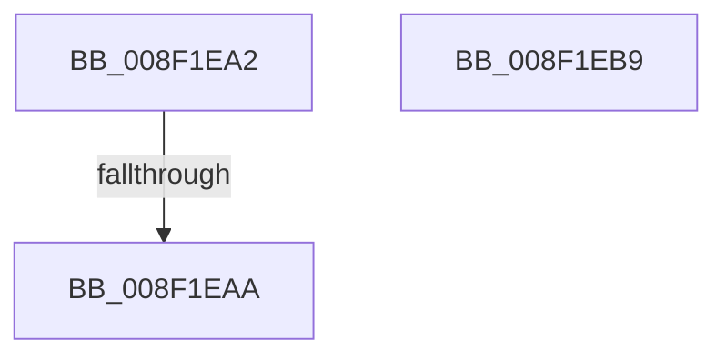

# sub_008F1EA2

- RVA: `0x008F1EA2`–`0x008F1EE3` (길이 `65` bytes)
- VA: `0x00000001408F1EA2`
- 실행 섹션: `PAGE`
- PDB 이름 있음: `아니요`; PDB Function 태그: `아니요`
- unwind 정보 RVA: `0x00087314`
- 디코드: `14`개 명령, `65/65` bytes 표시
- 미해석 바이트: `0` (있으면 어셈블리에 `.byte`로 보존)

> 이 문서는 커널 이미지의 기계어와 PDB 기호를 분석해 생성했습니다. 4번과 5번은 함수 원형과 자료형을 바이너리 사용 방식에서 추정한 C 해석이며 원본 소스 복구 결과는 아닙니다.

## 1. Dependencies

- 직접 호출 지점: **1**; 고유 호출 대상: **1**
- 직접 호출자로 확인된 함수: **0**
- RIP 상대 이미지 참조: **1**

### Outgoing calls
- `0x008F1ED8` → [RtlStringCchPrintfExW](../../text/42/RtlStringCchPrintfExW_function_0042B390.md) (function, `0x0042B390`)

### Direct callers
- 이 함수 시작 RVA로 연결되는 직접 call은 확인되지 않았습니다. 간접 호출은 완전히 역산할 수 없습니다.

### Static image references
- `0x008F1EBE` → RVA `0x00B03E60` (` ?? ::NNGAKEGL::`string'`; read)

## 2. Other-region calls and transfers

- 다른 실행 섹션으로 향하는 call: **1**
  - `0x008F1ED8` → [RtlStringCchPrintfExW](../../text/42/RtlStringCchPrintfExW_function_0042B390.md) (`PAGE` → `.text`)
- call이 아닌 외부 분기/꼬리 이동: **3**
  - `0x008F1EA4` → [sub_00B1E6D4 + 0x89](../B1/Unknown_function_00B1E6D4.md) (`tail-transfer`)
  - `0x008F1EB4` → [sub_00B1E6D4](../B1/Unknown_function_00B1E6D4.md) (`tail-transfer`)
  - `0x008F1EDE` → [sub_00B1E6D4 + 0x15E](../B1/Unknown_function_00B1E6D4.md) (`tail-transfer`)

## 3. Assembly (complete function range)

```asm
008F1EA2  85 ED                           test ebp, ebp
008F1EA4  0F 85 B3 C8 22 00               jne 0x140b1e75d
008F1EAA  48 C7 C1 FF FF FF FF            mov rcx, 0xffffffffffffffff
008F1EB1  48 8B C1                        mov rax, rcx
008F1EB4  E9 1B C8 22 00                  jmp 0x140b1e6d4
008F1EB9  48 89 54 24 30                  mov qword ptr [rsp + 0x30], rdx
008F1EBE  48 8D 0D 9B 1F 21 00            lea rcx, [rip + 0x211f9b]
008F1EC5  48 89 4C 24 28                  mov qword ptr [rsp + 0x28], rcx
008F1ECA  48 8B D0                        mov rdx, rax
008F1ECD  49 8B CF                        mov rcx, r15
008F1ED0  C7 44 24 20 00 08 00 00         mov dword ptr [rsp + 0x20], 0x800
008F1ED8  E8 B3 94 B3 FF                  call 0x14042b390
008F1EDD  90                              nop
008F1EDE  E9 4F C9 22 00                  jmp 0x140b1e832
```

## 4. C-style interpretation (structured pseudocode)

```c
__int64 __fastcall sub_008F1EA2(__int64 a1, __int64 a2)
{
    unsigned int v_stack_p20;
    unsigned __int64 v_stack_p28;
    unsigned __int64 v_stack_p30;
}
```

## 5. (Beta) C Style

```c
int64_t sub_008F1EA2(int64_t Arg1, int64_t Arg2)
{
    uint32_t v_stack_p20;
    uint64_t v_stack_p28;
    uint64_t v_stack_p30;
}
```

## 6. Execution-region graph

[열기: 2D/3D 그래프와 함수 탐색 컨트롤 패널](../../../control-panel.html?section=page&rva=0x008F1EA2&view=graph)

- 2D 그래프는 위에서 아래로 흐르고, 3D 그래프는 빈 공간을 드래그해 회전합니다. Shift+드래그는 이동, 휠은 확대·축소, 함수 노드 선택은 대상 보고서 이동입니다.

### Static fallback


