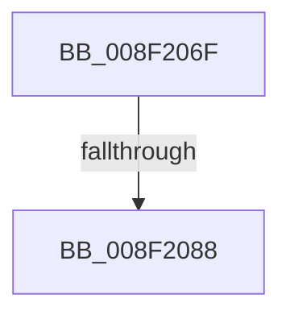

# sub_008F206F

- RVA: `0x008F206F`–`0x008F208B` (길이 `28` bytes)
- VA: `0x00000001408F206F`
- 실행 섹션: `PAGE`
- PDB 이름 있음: `아니요`; PDB Function 태그: `아니요`
- unwind 정보 RVA: `0x00087368`
- 디코드: `6`개 명령, `28/28` bytes 표시
- 미해석 바이트: `0` (있으면 어셈블리에 `.byte`로 보존)

> 이 문서는 커널 이미지의 기계어와 PDB 기호를 분석해 생성했습니다. 4번과 5번은 함수 원형과 자료형을 바이너리 사용 방식에서 추정한 C 해석이며 원본 소스 복구 결과는 아닙니다.

## 1. Dependencies

- 직접 호출 지점: **0**; 고유 호출 대상: **0**
- 직접 호출자로 확인된 함수: **0**
- RIP 상대 이미지 참조: **0**

### Outgoing calls
- 직접 디코드된 call 명령이 없습니다.

### Direct callers
- 이 함수 시작 RVA로 연결되는 직접 call은 확인되지 않았습니다. 간접 호출은 완전히 역산할 수 없습니다.

### Static image references
- 디코드된 RIP-relative 메모리 참조가 없습니다.

## 2. Other-region calls and transfers

- 다른 실행 섹션으로 향하는 call: **0**
- call이 아닌 외부 분기/꼬리 이동: **1**
  - `0x008F2082` → [sub_008F285D](Unknown_function_008F285D.md) (`tail-transfer`)

## 3. Assembly (complete function range)

```asm
008F206F  4C 89 B4 24 C8 01 00 00         mov qword ptr [rsp + 0x1c8], r14
008F2077  89 4D 84                        mov dword ptr [rbp - 0x7c], ecx
008F207A  8D 41 D0                        lea eax, [rcx - 0x30]
008F207D  A9 FD FF FF FF                  test eax, 0xfffffffd
008F2082  0F 85 D5 07 00 00               jne 0x1408f285d
008F2088  41 B6 01                        mov r14b, 1
```

## 4. C-style interpretation (structured pseudocode)

```c
__int64 __fastcall sub_008F206F(__int64 a1)
{
    unsigned __int64 v_stack_p1C8;

    v_stack_p1C8 = v_r14;
    *(unsigned int *)(v_rbp - 124) = (unsigned int)(a1);
    return a1 - 48;
}
```

## 5. (Beta) C Style

```c
void *sub_008F206F(void *Arg1)
{
    uint8_t *arg1 = (uint8_t *)Arg1;

    uint64_t v_stack_p1C8;

    v_stack_p1C8 = local_r14;
    *(uint32_t *)(local_rbp - 0x7C) = (uint32_t)(Arg1);
    return Arg1 - 48;
}
```

### 관측된 메모리 오프셋

구조체 형식이 확인되지 않은 접근은 인자 기준의 오프셋으로만 기록했습니다.

| 기준 인자 | 오프셋 표현 | 폭 (bit) | 접근 |
|---|---:|---:|---|
| `Arg1` | `- 0x30` | `32` | `R` |

## 6. Execution-region graph

[열기: 2D/3D 그래프와 함수 탐색 컨트롤 패널](../../../control-panel.html?section=page&rva=0x008F206F&view=graph)

- 2D 그래프는 위에서 아래로 흐르고, 3D 그래프는 빈 공간을 드래그해 회전합니다. Shift+드래그는 이동, 휠은 확대·축소, 함수 노드 선택은 대상 보고서 이동입니다.

### Static fallback


