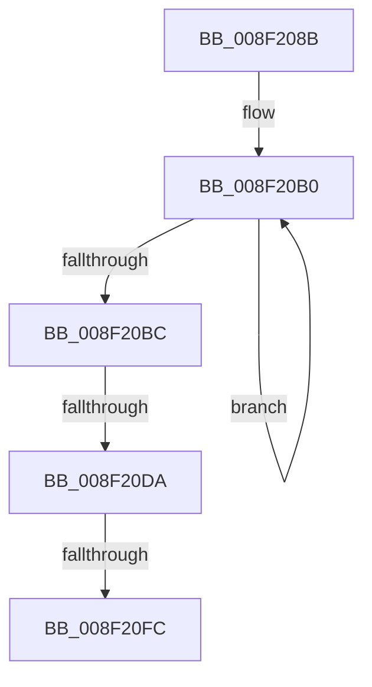

# sub_008F208B

- RVA: `0x008F208B`–`0x008F210A` (길이 `127` bytes)
- VA: `0x00000001408F208B`
- 실행 섹션: `PAGE`
- PDB 이름 있음: `아니요`; PDB Function 태그: `아니요`
- unwind 정보 RVA: `0x0008737C`
- 디코드: `27`개 명령, `127/127` bytes 표시
- 미해석 바이트: `0` (있으면 어셈블리에 `.byte`로 보존)

> 이 문서는 커널 이미지의 기계어와 PDB 기호를 분석해 생성했습니다. 4번과 5번은 함수 원형과 자료형을 바이너리 사용 방식에서 추정한 C 해석이며 원본 소스 복구 결과는 아닙니다.

## 1. Dependencies

- 직접 호출 지점: **1**; 고유 호출 대상: **1**
- 직접 호출자로 확인된 함수: **0**
- RIP 상대 이미지 참조: **0**

### Outgoing calls
- `0x008F20E9` → [ExAllocatePool2](../../poolcode/B8/ExAllocatePool2_function_00B820F0.md) (function, `0x00B820F0`)

### Direct callers
- 이 함수 시작 RVA로 연결되는 직접 call은 확인되지 않았습니다. 간접 호출은 완전히 역산할 수 없습니다.

### Static image references
- 디코드된 RIP-relative 메모리 참조가 없습니다.

## 2. Other-region calls and transfers

- 다른 실행 섹션으로 향하는 call: **1**
  - `0x008F20E9` → [ExAllocatePool2](../../poolcode/B8/ExAllocatePool2_function_00B820F0.md) (`PAGE` → `POOLCODE`)
- call이 아닌 외부 분기/꼬리 이동: **2**
  - `0x008F20D4` → [sub_008F21B8](Unknown_function_008F21B8.md) (`tail-transfer`)
  - `0x008F20F6` → [sub_008F292C](Unknown_function_008F292C.md) (`tail-transfer`)

## 3. Assembly (complete function range)

```asm
008F208B  48 89 B4 24 E0 01 00 00         mov qword ptr [rsp + 0x1e0], rsi
008F2093  4C 89 A4 24 D0 01 00 00         mov qword ptr [rsp + 0x1d0], r12
008F209B  49 C7 C4 FF FF FF FF            mov r12, 0xffffffffffffffff
008F20A2  49 8B C4                        mov rax, r12
008F20A5  44 88 74 24 78                  mov byte ptr [rsp + 0x78], r14b
008F20AA  66 0F 1F 44 00 00               nop word ptr [rax + rax]
008F20B0  66 83 7C 42 02 00               cmp word ptr [rdx + rax*2 + 2], 0
008F20B6  48 8D 40 01                     lea rax, [rax + 1]
008F20BA  75 F4                           jne 0x1408f20b0
008F20BC  48 8D 04 45 06 00 00 00         lea rax, [rax*2 + 6]
008F20C4  48 89 9C 24 00 02 00 00         mov qword ptr [rsp + 0x200], rbx
008F20CC  BE FF FF FF FF                  mov esi, 0xffffffff
008F20D1  48 3B C6                        cmp rax, rsi
008F20D4  0F 87 DE 00 00 00               ja 0x1408f21b8
008F20DA  8B D0                           mov edx, eax
008F20DC  B9 00 01 00 00                  mov ecx, 0x100
008F20E1  41 B8 50 4E 50 52               mov r8d, 0x52504e50
008F20E7  8B D8                           mov ebx, eax
008F20E9  E8 02 00 29 00                  call 0x140b820f0
008F20EE  48 89 44 24 70                  mov qword ptr [rsp + 0x70], rax
008F20F3  48 85 C0                        test rax, rax
008F20F6  0F 84 30 08 00 00               je 0x1408f292c
008F20FC  33 C0                           xor eax, eax
008F20FE  D1 EB                           shr ebx, 1
008F2100  0F 57 C0                        xorps xmm0, xmm0
008F2103  48 89 5D 98                     mov qword ptr [rbp - 0x68], rbx
008F2107  0F 57 C9                        xorps xmm1, xmm1
```

## 4. C-style interpretation (structured pseudocode)

```c
__int64 __fastcall sub_008F208B(__int64 a1, __int64 a2)
{
    __int64 result;
    __int64 v_rbx;
    unsigned __int64 v_stack_p1D0;
    unsigned __int64 v_stack_p1E0;
    unsigned __int64 v_stack_p200;
    unsigned __int64 v_stack_p70;
    unsigned __int8 v_stack_p78;

    v_stack_p1E0 = v_rsi;
    v_stack_p1D0 = v_r12;
    v_stack_p78 = (unsigned __int8)(v_r14);
loc_008F20B0:
    if ((*(unsigned __int16 *)(a2 + -1 * 2 + 2)) != 0) goto loc_008F20B0;
    v_stack_p200 = v_rbx;
    result = ExAllocatePool2(256, (unsigned int)((unsigned int)(-1 + 1 * 2 + 6)), (unsigned int)(0x52504E50ULL), a4);
    v_stack_p70 = result;
    result = 0;
    v_rbx = (unsigned int)(((unsigned int)((unsigned int)(-1 + 1 * 2 + 6))) >> (1));
    *(unsigned __int64 *)(v_rbp - 104) = v_rbx;
    return result;
}
```

## 5. (Beta) C Style

```c
int64_t sub_008F208B(int64_t Arg1, void *Arg2)
{
    uint8_t *arg2 = (uint8_t *)Arg2;

    int64_t result;
    int64_t local_rbx;
    uint64_t v_stack_p1D0;
    uint64_t v_stack_p1E0;
    uint64_t v_stack_p200;
    uint64_t v_stack_p70;
    uint8_t v_stack_p78;

    v_stack_p1E0 = local_rsi;
    v_stack_p1D0 = local_r12;
    v_stack_p78 = (uint8_t)(local_r14);
loc_008F20B0:
    if ((*(uint16_t *)(arg2 + - 0x1 * 2 + 0x2)) != 0) goto loc_008F20B0;
    v_stack_p200 = local_rbx;
    result = ExAllocatePool2(256, (uint32_t)((uint32_t)(-1 + 1 * 2 + 6)), (uint32_t)(0x52504E50ULL), a4);
    v_stack_p70 = result;
    result = 0;
    local_rbx = (uint32_t)(((uint32_t)((uint32_t)(-1 + 1 * 2 + 6))) >> (1));
    *(uint64_t *)(local_rbp - 0x68) = local_rbx;
    return result;
}
```

### 관측된 메모리 오프셋

구조체 형식이 확인되지 않은 접근은 인자 기준의 오프셋으로만 기록했습니다.

| 기준 인자 | 오프셋 표현 | 폭 (bit) | 접근 |
|---|---:|---:|---|
| `Arg2` | `+ 0x2 + rax*2` | `16` | `R` |

## 6. Execution-region graph

[열기: 2D/3D 그래프와 함수 탐색 컨트롤 패널](../../../control-panel.html?section=page&rva=0x008F208B&view=graph)

- 2D 그래프는 위에서 아래로 흐르고, 3D 그래프는 빈 공간을 드래그해 회전합니다. Shift+드래그는 이동, 휠은 확대·축소, 함수 노드 선택은 대상 보고서 이동입니다.

### Static fallback


