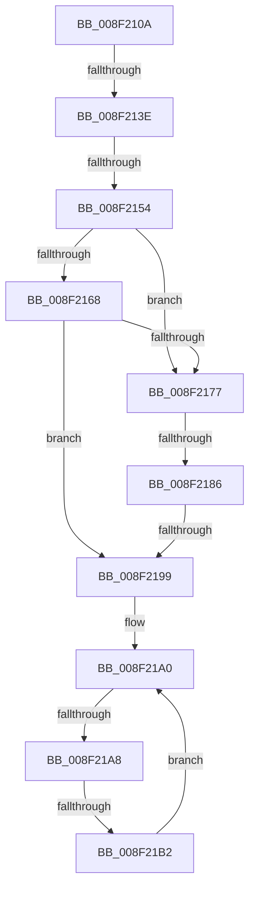

# sub_008F210A

- RVA: `0x008F210A`–`0x008F21B8` (길이 `174` bytes)
- VA: `0x00000001408F210A`
- 실행 섹션: `PAGE`
- PDB 이름 있음: `아니요`; PDB Function 태그: `아니요`
- unwind 정보 RVA: `0x00087398`
- 디코드: `43`개 명령, `174/174` bytes 표시
- 미해석 바이트: `0` (있으면 어셈블리에 `.byte`로 보존)

> 이 문서는 커널 이미지의 기계어와 PDB 기호를 분석해 생성했습니다. 4번과 5번은 함수 원형과 자료형을 바이너리 사용 방식에서 추정한 C 해석이며 원본 소스 복구 결과는 아닙니다.

## 1. Dependencies

- 직접 호출 지점: **3**; 고유 호출 대상: **2**
- 직접 호출자로 확인된 함수: **0**
- RIP 상대 이미지 참조: **2**

### Outgoing calls
- `0x008F2131` → [RtlInitUnicodeStringEx](../../text/46/RtlInitUnicodeStringEx_function_00463960.md) (function, `0x00463960`)
- `0x008F2154` → [PsGetCurrentServerSiloGlobals](../../text/2F/PsGetCurrentServerSiloGlobals_function_002FE1F0.md) (function, `0x002FE1F0`)
- `0x008F2177` → [PsGetCurrentServerSiloGlobals](../../text/2F/PsGetCurrentServerSiloGlobals_function_002FE1F0.md) (function, `0x002FE1F0`)

### Direct callers
- 이 함수 시작 RVA로 연결되는 직접 call은 확인되지 않았습니다. 간접 호출은 완전히 역산할 수 없습니다.

### Static image references
- `0x008F2168` → RVA `0x00001A30` (`.rdata`; read)
- `0x008F2186` → RVA `0x00001A40` (`.rdata`; read)

## 2. Other-region calls and transfers

- 다른 실행 섹션으로 향하는 call: **3**
  - `0x008F2131` → [RtlInitUnicodeStringEx](../../text/46/RtlInitUnicodeStringEx_function_00463960.md) (`PAGE` → `.text`)
  - `0x008F2154` → [PsGetCurrentServerSiloGlobals](../../text/2F/PsGetCurrentServerSiloGlobals_function_002FE1F0.md) (`PAGE` → `.text`)
  - `0x008F2177` → [PsGetCurrentServerSiloGlobals](../../text/2F/PsGetCurrentServerSiloGlobals_function_002FE1F0.md) (`PAGE` → `.text`)
- call이 아닌 외부 분기/꼬리 이동: **6**
  - `0x008F2138` → [sub_008F2220 + 0x14](Unknown_function_008F2220.md) (`tail-transfer`)
  - `0x008F214E` → [sub_008F2220 + 0x14](Unknown_function_008F2220.md) (`tail-transfer`)
  - `0x008F2180` → [sub_008F2220 + 0x14](Unknown_function_008F2220.md) (`tail-transfer`)
  - `0x008F2193` → [sub_008F2220 + 0x14](Unknown_function_008F2220.md) (`tail-transfer`)
  - `0x008F21A6` → [sub_008F2220](Unknown_function_008F2220.md) (`tail-transfer`)
  - `0x008F21AC` → [sub_008F228F](Unknown_function_008F228F.md) (`tail-transfer`)

## 3. Assembly (complete function range)

```asm
008F210A  48 89 BC 24 D8 01 00 00         mov qword ptr [rsp + 0x1d8], rdi
008F2112  49 8B D5                        mov rdx, r13
008F2115  48 89 45 C0                     mov qword ptr [rbp - 0x40], rax
008F2119  48 8D 4D 88                     lea rcx, [rbp - 0x78]
008F211D  8B D8                           mov ebx, eax
008F211F  0F 11 45 E8                     movups xmmword ptr [rbp - 0x18], xmm0
008F2123  8B F8                           mov edi, eax
008F2125  0F 11 4D C8                     movups xmmword ptr [rbp - 0x38], xmm1
008F2129  0F 11 45 88                     movups xmmword ptr [rbp - 0x78], xmm0
008F212D  0F 11 45 D8                     movups xmmword ptr [rbp - 0x28], xmm0
008F2131  E8 2A 18 B7 FF                  call 0x140463960
008F2136  85 C0                           test eax, eax
008F2138  0F 88 F6 00 00 00               js 0x1408f2234
008F213E  0F B7 45 8A                     movzx eax, word ptr [rbp - 0x76]
008F2142  B9 FE FF 00 00                  mov ecx, 0xfffe
008F2147  66 23 C1                        and ax, cx
008F214A  66 83 F8 62                     cmp ax, 0x62
008F214E  0F 82 E0 00 00 00               jb 0x1408f2234
008F2154  E8 97 C0 A0 FF                  call 0x1402fe1f0
008F2159  44 0F B7 45 88                  movzx r8d, word ptr [rbp - 0x78]
008F215E  48 8B 55 90                     mov rdx, qword ptr [rbp - 0x70]
008F2162  41 83 F8 08                     cmp r8d, 8
008F2166  72 0F                           jb 0x1408f2177
008F2168  48 8B 05 C1 F8 70 FF            mov rax, qword ptr [rip - 0x8f073f]
008F216F  48 8B 08                        mov rcx, qword ptr [rax]
008F2172  48 3B 0A                        cmp rcx, qword ptr [rdx]
008F2175  74 22                           je 0x1408f2199
008F2177  E8 74 C0 A0 FF                  call 0x1402fe1f0
008F217C  41 83 F8 08                     cmp r8d, 8
008F2180  0F 82 AE 00 00 00               jb 0x1408f2234
008F2186  48 8B 05 B3 F8 70 FF            mov rax, qword ptr [rip - 0x8f074d]
008F218D  48 8B 08                        mov rcx, qword ptr [rax]
008F2190  48 3B 0A                        cmp rcx, qword ptr [rdx]
008F2193  0F 85 9B 00 00 00               jne 0x1408f2234
008F2199  49 8D 4D 08                     lea rcx, [r13 + 8]
008F219D  0F 1F 00                        nop dword ptr [rax]
008F21A0  0F B7 01                        movzx eax, word ptr [rcx]
008F21A3  66 85 C0                        test ax, ax
008F21A6  74 78                           je 0x1408f2220
008F21A8  66 83 F8 5C                     cmp ax, 0x5c
008F21AC  0F 84 DD 00 00 00               je 0x1408f228f
008F21B2  48 83 C1 02                     add rcx, 2
008F21B6  EB E8                           jmp 0x1408f21a0
```

## 4. C-style interpretation (structured pseudocode)

```c
__int64 __fastcall sub_008F210A(void)
{
    __int64 result;
    unsigned __int64 v_stack_p1D8;

    v_stack_p1D8 = v_rdi;
    *(unsigned __int64 *)(v_rbp - 64) = result;
    *(unsigned __int64 *)(v_rbp - 24) = v_xmm0;
    *(unsigned __int64 *)(v_rbp - 56) = v_xmm1;
    *(unsigned __int64 *)(v_rbp - 120) = v_xmm0;
    *(unsigned __int64 *)(v_rbp - 40) = v_xmm0;
    result = RtlInitUnicodeStringEx(v_rbp - 120, v_r13, a3, a4);
    result = (unsigned __int16)((*(unsigned __int16 *)(v_rbp - 118)) & ((unsigned __int16)((unsigned int)(0xFFFEULL))));
    result = PsGetCurrentServerSiloGlobals((unsigned int)(0xFFFEULL), v_r13, a3, a4);
    if (((unsigned int)(*(unsigned __int16 *)(v_rbp - 120))) < 8) goto loc_008F2177;
    if ((*(unsigned __int64 *)(*(unsigned __int64 *)(v_rip - 9373503))) == (*(unsigned __int64 *)(*(unsigned __int64 *)(v_rbp - 112)))) goto loc_008F2199;
loc_008F2177:
    result = PsGetCurrentServerSiloGlobals(*(unsigned __int64 *)(*(unsigned __int64 *)(v_rip - 9373503)), *(unsigned __int64 *)(v_rbp - 112), *(unsigned __int16 *)(v_rbp - 120), a4);
loc_008F2199:
loc_008F21A0:
    a1 = (v_r13 + 8) + (2);
    goto loc_008F21A0;
}
```

## 5. (Beta) C Style

```c
void sub_008F210A(void)
{
    int64_t result;
    uint64_t v_stack_p1D8;

    v_stack_p1D8 = local_rdi;
    *(uint64_t *)(local_rbp - 0x40) = result;
    *(uint64_t *)(local_rbp - 0x18) = v_xmm0;
    *(uint64_t *)(local_rbp - 0x38) = v_xmm1;
    *(uint64_t *)(local_rbp - 0x78) = v_xmm0;
    *(uint64_t *)(local_rbp - 0x28) = v_xmm0;
    result = RtlInitUnicodeStringEx(local_rbp - 120, local_r13, a3, a4);
    result = (uint16_t)((*(uint16_t *)(local_rbp - 0x76)) & ((uint16_t)((uint32_t)(0xFFFEULL))));
    result = PsGetCurrentServerSiloGlobals((uint32_t)(0xFFFEULL), local_r13, a3, a4);
    if (((uint32_t)(*(uint16_t *)(local_rbp - 0x78))) < 8) goto loc_008F2177;
    if ((*(uint64_t *)(*(uint64_t *)(v_rip - 0x8F073F))) == (*(uint64_t *)(*(uint64_t *)(local_rbp - 0x70)))) goto loc_008F2199;
loc_008F2177:
    result = PsGetCurrentServerSiloGlobals(*(uint64_t *)(*(uint64_t *)(v_rip - 0x8F073F)), *(uint64_t *)(local_rbp - 0x70), *(uint16_t *)(local_rbp - 0x78), a4);
loc_008F2199:
loc_008F21A0:
    a1 = (local_r13 + 8) + (2);
    goto loc_008F21A0;
}
```

## 6. Execution-region graph

[열기: 2D/3D 그래프와 함수 탐색 컨트롤 패널](../../../control-panel.html?section=page&rva=0x008F210A&view=graph)

- 2D 그래프는 위에서 아래로 흐르고, 3D 그래프는 빈 공간을 드래그해 회전합니다. Shift+드래그는 이동, 휠은 확대·축소, 함수 노드 선택은 대상 보고서 이동입니다.

### Static fallback


