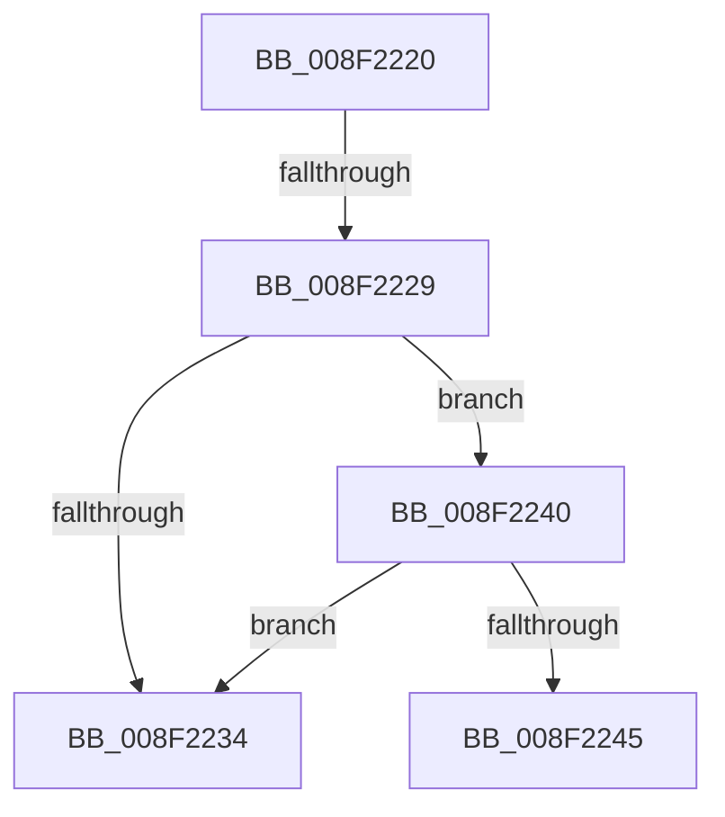

# sub_008F2220

- RVA: `0x008F2220`–`0x008F224B` (길이 `43` bytes)
- VA: `0x00000001408F2220`
- 실행 섹션: `PAGE`
- PDB 이름 있음: `아니요`; PDB Function 태그: `아니요`
- unwind 정보 RVA: `0x0008741C`
- 디코드: `13`개 명령, `43/43` bytes 표시
- 미해석 바이트: `0` (있으면 어셈블리에 `.byte`로 보존)

> 이 문서는 커널 이미지의 기계어와 PDB 기호를 분석해 생성했습니다. 4번과 5번은 함수 원형과 자료형을 바이너리 사용 방식에서 추정한 C 해석이며 원본 소스 복구 결과는 아닙니다.

## 1. Dependencies

- 직접 호출 지점: **0**; 고유 호출 대상: **0**
- 직접 호출자로 확인된 함수: **0**
- RIP 상대 이미지 참조: **0**

### Outgoing calls
- 직접 디코드된 call 명령이 없습니다.

### Direct callers
- 이 함수 시작 RVA로 연결되는 직접 call은 확인되지 않았습니다. 간접 호출은 완전히 역산할 수 없습니다.

### Static image references
- 디코드된 RIP-relative 메모리 참조가 없습니다.

## 2. Other-region calls and transfers

- 다른 실행 섹션으로 향하는 call: **0**
- call이 아닌 외부 분기/꼬리 이동: **2**
  - `0x008F2223` → [sub_008F245F](Unknown_function_008F245F.md) (`tail-transfer`)
  - `0x008F223E` → [sub_008F21D1](Unknown_function_008F21D1.md) (`tail-transfer`)

## 3. Assembly (complete function range)

```asm
008F2220  48 85 DB                        test rbx, rbx
008F2223  0F 84 36 02 00 00               je 0x1408f245f
008F2229  49 2B DD                        sub rbx, r13
008F222C  48 D1 FB                        sar rbx, 1
008F222F  48 3B DE                        cmp rbx, rsi
008F2232  76 0C                           jbe 0x1408f2240
008F2234  48 8B 74 24 70                  mov rsi, qword ptr [rsp + 0x70]
008F2239  BB 33 00 00 C0                  mov ebx, 0xc0000033
008F223E  EB 91                           jmp 0x1408f21d1
008F2240  83 FB 30                        cmp ebx, 0x30
008F2243  72 EF                           jb 0x1408f2234
008F2245  8B C3                           mov eax, ebx
008F2247  4D 8D 4D B4                     lea r9, [r13 - 0x4c]
```

## 4. C-style interpretation (structured pseudocode)

```c
__int64 __fastcall sub_008F2220(__int64 a1, __int64 a2, __int64 a3, __int64 a4, __int64 a5, __int64 a6, __int64 a7, __int64 a8, __int64 a9, __int64 a10, __int64 a11, __int64 a12, __int64 a13, __int64 a14)
{
    __int64 v_rbx;

    v_rbx = (v_rbx) - (v_r13);
    v_rbx = (v_rbx) >> (1);
    if (v_rbx <= v_rsi) goto loc_008F2240;
loc_008F2234:
loc_008F2240:
    if (((unsigned int)((unsigned int)(0xC0000033ULL))) < 48) goto loc_008F2234;
    return (unsigned int)((unsigned int)((unsigned int)(0xC0000033ULL)));
}
```

## 5. (Beta) C Style

```c
int64_t sub_008F2220(int64_t Arg1, int64_t Arg2, int64_t Arg3, int64_t Arg4, uint64_t Arg5, uint64_t Arg6, uint64_t Arg7, uint64_t Arg8, uint64_t Arg9, uint64_t Arg10, uint64_t Arg11, uint64_t Arg12, uint64_t Arg13, int64_t Arg14)
{
    int64_t local_rbx;

    local_rbx = (local_rbx) - (local_r13);
    local_rbx = (local_rbx) >> (1);
    if (local_rbx <= local_rsi) goto loc_008F2240;
loc_008F2234:
loc_008F2240:
    if (((uint32_t)((uint32_t)(0xC0000033ULL))) < 48) goto loc_008F2234;
    return (uint32_t)((uint32_t)((uint32_t)(0xC0000033ULL)));
}
```

## 6. Execution-region graph

[열기: 2D/3D 그래프와 함수 탐색 컨트롤 패널](../../../control-panel.html?section=page&rva=0x008F2220&view=graph)

- 2D 그래프는 위에서 아래로 흐르고, 3D 그래프는 빈 공간을 드래그해 회전합니다. Shift+드래그는 이동, 휠은 확대·축소, 함수 노드 선택은 대상 보고서 이동입니다.

### Static fallback


