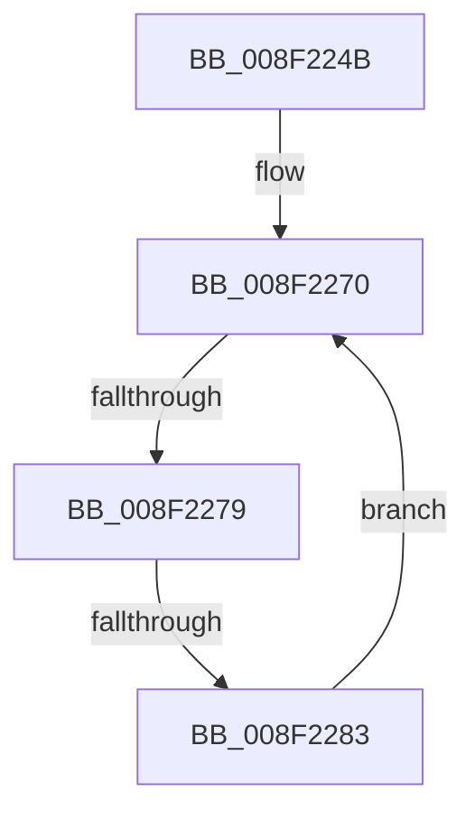

# sub_008F224B

- RVA: `0x008F224B`–`0x008F228F` (길이 `68` bytes)
- VA: `0x00000001408F224B`
- 실행 섹션: `PAGE`
- PDB 이름 있음: `아니요`; PDB Function 태그: `아니요`
- unwind 정보 RVA: `0x00087440`
- 디코드: `18`개 명령, `68/68` bytes 표시
- 미해석 바이트: `0` (있으면 어셈블리에 `.byte`로 보존)

> 이 문서는 커널 이미지의 기계어와 PDB 기호를 분석해 생성했습니다. 4번과 5번은 함수 원형과 자료형을 바이너리 사용 방식에서 추정한 C 해석이며 원본 소스 복구 결과는 아닙니다.

## 1. Dependencies

- 직접 호출 지점: **0**; 고유 호출 대상: **0**
- 직접 호출자로 확인된 함수: **0**
- RIP 상대 이미지 참조: **0**

### Outgoing calls
- 직접 디코드된 call 명령이 없습니다.

### Direct callers
- 이 함수 시작 RVA로 연결되는 직접 call은 확인되지 않았습니다. 간접 호출은 완전히 역산할 수 없습니다.

### Static image references
- 디코드된 RIP-relative 메모리 참조가 없습니다.

## 2. Other-region calls and transfers

- 다른 실행 섹션으로 향하는 call: **0**
- call이 아닌 외부 분기/꼬리 이동: **2**
  - `0x008F2277` → [sub_008F229E](Unknown_function_008F229E.md) (`tail-transfer`)
  - `0x008F2281` → [sub_008F229E](Unknown_function_008F229E.md) (`tail-transfer`)

## 3. Assembly (complete function range)

```asm
008F224B  4C 89 BC 24 C0 01 00 00         mov qword ptr [rsp + 0x1c0], r15
008F2253  48 8D 4D 60                     lea rcx, [rbp + 0x60]
008F2257  41 BF 27 00 00 00               mov r15d, 0x27
008F225D  45 8B C7                        mov r8d, r15d
008F2260  4D 8D 0C 41                     lea r9, [r9 + rax*2]
008F2264  48 8D 45 60                     lea rax, [rbp + 0x60]
008F2268  4C 2B C8                        sub r9, rax
008F226B  0F 1F 44 00 00                  nop dword ptr [rax + rax]
008F2270  49 8D 50 FF                     lea rdx, [r8 - 1]
008F2274  48 85 D2                        test rdx, rdx
008F2277  74 25                           je 0x1408f229e
008F2279  41 0F B7 04 09                  movzx eax, word ptr [r9 + rcx]
008F227E  66 85 C0                        test ax, ax
008F2281  74 1B                           je 0x1408f229e
008F2283  66 89 01                        mov word ptr [rcx], ax
008F2286  4C 8B C2                        mov r8, rdx
008F2289  48 83 C1 02                     add rcx, 2
008F228D  EB E1                           jmp 0x1408f2270
```

## 4. C-style interpretation (structured pseudocode)

```c
__int64 __fastcall sub_008F224B(__int64 a1, __int64 a2, __int64 a3, __int64 a4)
{
    unsigned __int64 v_stack_p1C0;

    v_stack_p1C0 = v_r15;
    a4 = (a4 + result * 2) - (v_rbp + 96);
loc_008F2270:
    *(unsigned __int16 *)(v_rbp + 96) = (unsigned __int16)(*(unsigned __int16 *)(a4 + v_rbp + 96 * 1));
    a1 = (v_rbp + 96) + (2);
    goto loc_008F2270;
}
```

## 5. (Beta) C Style

```c
int64_t sub_008F224B(int64_t Arg1, int64_t Arg2, int64_t Arg3, void *Arg4)
{
    uint8_t *arg4 = (uint8_t *)Arg4;

    uint64_t v_stack_p1C0;

    v_stack_p1C0 = local_r15;
    Arg4 = (Arg4 + result * 2) - (local_rbp + 96);
loc_008F2270:
    *(uint16_t *)(local_rbp + 0x60) = (uint16_t)(*(uint16_t *)(arg4 + local_rbp + 0x60 * 1));
    Arg1 = (local_rbp + 96) + (2);
    goto loc_008F2270;
}
```

### 관측된 메모리 오프셋

구조체 형식이 확인되지 않은 접근은 인자 기준의 오프셋으로만 기록했습니다.

| 기준 인자 | 오프셋 표현 | 폭 (bit) | 접근 |
|---|---:|---:|---|
| `Arg4` | `+ 0x0 + rax*2` | `64` | `R` |
| `Arg4` | `+ 0x0 + rcx*1` | `16` | `R` |

## 6. Execution-region graph

[열기: 2D/3D 그래프와 함수 탐색 컨트롤 패널](../../../control-panel.html?section=page&rva=0x008F224B&view=graph)

- 2D 그래프는 위에서 아래로 흐르고, 3D 그래프는 빈 공간을 드래그해 회전합니다. Shift+드래그는 이동, 휠은 확대·축소, 함수 노드 선택은 대상 보고서 이동입니다.

### Static fallback


